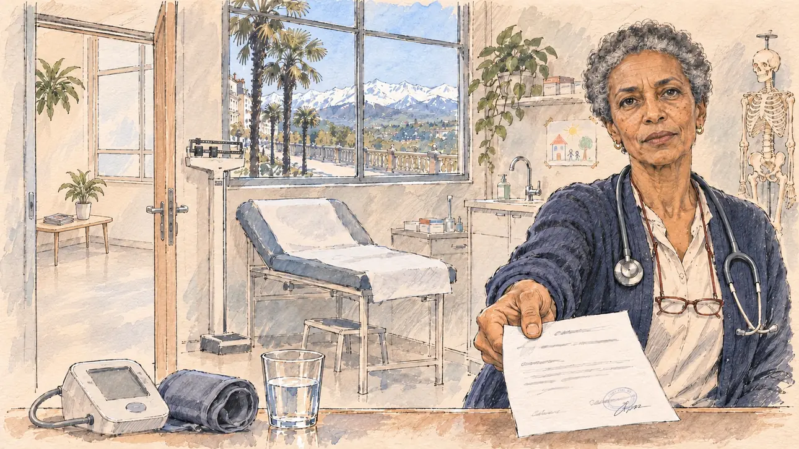

# `healthScare` · Un malaise en déplacement

**Validée par le PO le 06/11/2026**, au premier essai, avec `primeTime.webp` comme référence. Elle sert telle quelle en clair et en sombre.



| Champ | Valeur |
| --- | --- |
| Carte | `healthScare`, catégorie `private` (Vie privée), carte ajoutée par la PR #297 de l'app |
| Style | Reportage dessiné, trait de `primeTime` |
| Ton | Pudique et tendu |
| Date | 2026-11-06 |
| Outil | ChatGPT Images |
| Conversation | À remplir (le lien ne s'ouvre qu'avec le compte qui l'a créée) |
| Format rendu | 1672 × 941 (16:9) : export en 1290 × 726 px, WebP de qualité 75, 154 Ko, sans recadrage |
| Fichier d'origine | Image de ChatGPT, chez le PO. L'export du dépôt a été fait depuis la copie partagée dans la conversation avec Claude |
| Première édition | La prochaine Release qui suit le merge de la PR #297 de l'app |

## Texte de la carte

> **Un malaise en déplacement**
>
> Vous avez dû quitter un meeting plus tôt après un malaise : une vidéo de dix secondes circule. Les réseaux parlent déjà de votre santé et d'une éventuelle cachotterie.

## Le moment choisi

Le cabinet d'une médecin généraliste à Pau, le lendemain matin du meeting, vu depuis la chaise du patient où le candidat (hors champ) est assis : au premier plan, le bord du bureau avec un tensiomètre et un verre d'eau. La médecin tend au candidat le certificat qu'elle vient de signer, l'air calme, franc et un peu ferme. Par la porte entrouverte : la secrétaire et un patient de la salle d'attente qui regardent la vidéo sur un téléphone, où l'on ne voit que la scène du meeting, un pupitre vide, un verre renversé et le public qui se retourne. Par la fenêtre : le boulevard des Pyrénées, les palmiers, et la chaîne des Pyrénées enneigée dans la lumière du matin.

## Prompt complet

Dans une nouvelle conversation, avec [`primeTime.webp`](../../illustrations/media/primeTime.webp) comme seule image de référence.

```
Use the attached image as the style reference and copy its drawing: a realistic reportage drawing made on the spot for a newspaper, with quick, nervous pencil lines, often drawn twice, ink hatching in the shadows, transparent watercolour washes that spill a little over the lines, and the warm paper showing through. Not the same scene and not the same people: never reuse the face or the hair of the woman in the reference.
Like in the reference, the setting can be full when the story needs it, with the things that say where we are and what is happening, but each one is sketched with a few pencil lines and a light wash, never rendered or finished, and the drawing gets looser and paler towards the edges until it fades into the bare paper.
This must look like a drawing made by hand on paper by a press illustrator, halfway between a quick sketch and a realistic picture: never a photograph, a film poster or a digital painting, and never a cartoon, a comic strip, a caricature or a children's book illustration. Continuous lines, never dotted or dashed outlines; no uniform texture, speckles or hatching filter laid over the picture; no glossy highlights, no smooth gradients, in the sky and on the walls too. Colour can be rich in places, on a piece of clothing, a light or a flag, but it stays transparent and within the palette below. The fade into the paper at the edges stays narrow, without a wide white margin. No blur and no depth-of-field effect: everything, the foreground included, is drawn sharp, like a sketch made on the spot.
People are drawn from life with realistic anatomy and proportions, like in the reference: faces shaped with pencil lines, hatching and light washes, a little more finished than the background but never photographic (no photographic skin, no airbrushed or digital-painting look). Expressions stay natural and restrained, even in laughter or tears: no exaggerated grins, no wide-open mouths full of teeth, no rubbery or cartoonish faces.

Editorial illustration, landscape 16:9 (1536 × 864 px), the scene filling the frame, with only a light fade into the paper at the edges. The surgery of a general practitioner in Pau, in Béarn, in the South-West, on the morning after a campaign rally in early 2027: the player's candidate had to leave the rally early after feeling unwell, a ten-second video is going round, and social media already speak of the candidate's health and of something being hidden. The scene is seen from the patient's chair where the candidate is sitting, who stays off-camera: in the foreground, only the edge of the doctor's desk with a blood-pressure monitor, its cuff rolled up, and a glass of water. In the right third, the doctor, a woman in her late fifties of Ethiopian origin, slim and upright, with short grey natural hair, reading glasses on a cord and a dark-blue cardigan, a stethoscope round her neck, holds out towards the viewer the medical certificate she has just signed, a single sheet with a stamp and a few grey lines, with a calm, frank, slightly firm look, her face above mid-height. Around her, sketched in pencil and light washes: an examination couch with a paper sheet, a small sink, a scale, a few plants, a skeleton model in a corner and a children's drawing pinned to the wall; through the half-open door to the waiting room, the receptionist, a round woman in her forties with a red bob, and an elderly patient in a wool coat, bare-headed with white hair, leaning together over a phone that shows the ten-second video: the stage of a rally hall seen from the audience, an empty lectern, a glass of water knocked over on it, and the backs of the audience turning round, with nobody at the lectern and nothing that shows a man or a woman. Through the tall window, the Boulevard des Pyrénées in Pau, its palm trees and its railing, and beyond the green valley the long white chain of the snow-covered Pyrenees in the clear morning light. Only the doctor looks straight at the viewer. Nothing on the certificate, the stamp, the phone, the monitor, the drawing or the medicine boxes is readable, and no logo of a real company or social network appears.

Style: Reportage drawing made on the spot, like a press illustrator or courtroom sketch artist: pencil and ink with loose watercolour washes, lively unfinished lines, white paper showing through.

Palette: navy #13203F, vellum #F5EFE1, gold #A9802A, brick #B5523B, ochre #D9A441, sage #8FA58A, slate #5E7186, sand #DCC8A4, warm grey #8C8279; use 4 to 6 of them, subtle warm paper grain.

Tone: restrained and tense, the clear, cold morning light from the window, the white of the paper sheet and the certificate, the bluish glow of the phone in the waiting room, and the snowy mountains as the calm, bright patch.

Constraints: realistic proportions, natural expressions, never cartoonish or caricatured faces, drawn like the rest of the illustration and never photographic; people of varied ages, genders, origins and body types (heavy, stocky, round, tall, short, wiry, not only slim), each with a distinct face and haircut (no two people alike), drawn with respect and never as a joke; anatomically correct hands with exactly five fingers, few hands visible, the others in pockets, behind objects or out of frame; no readable text anywhere (the certificate, the stamp, the phone, the monitor, the drawing and the medicine boxes stay unreadable); no captions or speech bubbles; no logos or political party colours; no recognisable real person, no lookalike of a real politician, and no logo of a real company or social network; no explicit violence; no photographic rendering, no blur or bokeh, no dotted outlines, no texture or hatching filter over the picture, no oil-paint texture, no wide white margin or frame (a light fade into the paper at the edges is fine).

Format: if 16:9 is not available, make 1536 × 1024 and keep the top 80 px and the bottom 80 px free of anything important (faces, hands, the main action): they will be cropped.
```

## Décisions prises sur cette image

- **Le PO a retiré la secrétaire et le patient qui regardaient la vidéo** (06/11/2026) : mal rendus, ils apportaient peu à la scène. La porte de la salle d'attente reste ouverte sur une pièce vide, et la vidéo n'apparaît pas ; le certificat tendu suffit à dire l'histoire. Le prompt ci-dessus est celui de la génération, avant ce retrait.

## Essais écartés

Aucun.

## Retouches

Aucune.

## Relecture

Faite et validée par le PO le 06/11/2026.

- [x] Aucun texte lisible : le certificat n'a que des lignes griffonnées, un tampon rond et une signature illisibles ; rien n'est lisible sur le tensiomètre, le dessin ni les boîtes de médicaments.
- [x] Aucun sosie d'une personne réelle.
- [x] Le candidat du joueur est hors champ.
- [x] Mains, visages et foules sans défaut visible à 343 px de large.
- [x] Aucune couleur ni aucun logo de parti. Des personnes variées par l'âge, le corps, l'origine et la coiffure.
- [x] En 3:2 : sans objet, l'image est en 16:9.
- [x] Lisible sur la page de l'événement, en clair et en sombre.

Ce que la relecture a accepté : la salle d'attente est vide, sans la vidéo du meeting ; le premier plan montre le bureau depuis la chaise du patient, comme demandé.
