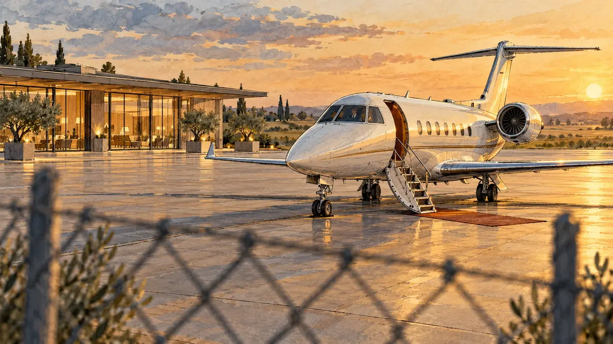

# `privateJet` · Le jet privé

**Validée par le PO le 30/10/2026**, au premier essai. Elle sert telle quelle en clair et en sombre.



| Champ | Valeur |
| --- | --- |
| Carte | `privateJet`, catégorie `polemic` (Polémique) |
| Style | Reportage dessiné |
| Ton | Ironique |
| Date | 2026-10-30 |
| Outil | ChatGPT, ChatGPT Images 2.5 ; mode et effort : non précisés |
| Conversation | À remplir (le lien ne s'ouvre qu'avec le compte qui l'a créée) |
| Format rendu | 1672 × 941 (16:9) : export en 1290 × 726 px, WebP de qualité 75, 120 Ko, sans recadrage |
| Fichier d'origine | PNG de ChatGPT, chez le PO. L'export du dépôt a été fait depuis la copie partagée dans la conversation avec Claude |
| Première édition | À remplir |

## Texte de la carte

> **Le jet privé**
>
> Un ami chef d'entreprise vous a prêté son jet pour rejoindre un meeting à deux heures de train. Les photos du tarmac circulent.

## Le moment choisi

Choisi par le PO : le jet attend seul sur le tarmac d'un petit aéroport privé de luxe, sans personne à l'horizon. On devine un pilote dans le cockpit, et le terminal au fond. Le grillage flou du premier plan fait de l'image la photo prise de l'extérieur, celle qui circule.

Un premier prompt montrait une collaboratrice au pied de la passerelle, un photographe et des passionnés d'avions derrière le grillage. Le PO l'a refusé avant toute génération : la scène doit montrer le jet, pas les gens.

## Prompt complet

Dans une nouvelle conversation, avec [`oldTweet.webp`](oldTweet.webp) comme seule image de référence :

```
Use the attached image as the style reference: the same pencil and ink drawing with loose watercolour washes and warm paper grain. Objects and buildings are drawn with visible ink lines, never photographic. Not the same scene.

Editorial illustration, landscape 16:9 (1536 × 864 px), filling the whole frame edge to edge. A small private jet waits alone on the tarmac of a small, luxurious private airport at the end of the afternoon in 2027. The jet stands in the right two thirds of the frame, in three-quarter view, its boarding stairs lowered onto a short carpet. Behind the cockpit windows, a pilot can just be made out, waiting. There is nobody else anywhere: no passengers, no staff, no onlookers. In the background, a low, elegant private terminal with tall glass windows, warm lights inside and a few olive trees in large planters, and beyond it flat countryside under a low sun. The scene is seen from just behind the airport's wire fence, a few blurred wires in the foreground, like a photo taken from outside. Everything is quiet, glossy and a little too perfect. Nothing on the jet, the terminal or the tarmac is readable: no registration number, no logos.

Style: Reportage drawing made on the spot, like a press illustrator or courtroom sketch artist: pencil and ink with loose watercolour washes, lively unfinished lines, white paper showing through.

Palette: navy #13203F, vellum #F5EFE1, gold #A9802A, brick #B5523B, ochre #D9A441, sage #8FA58A, slate #5E7186, sand #DCC8A4, warm grey #8C8279; use 4 to 6 of them, subtle warm paper grain.

Tone: gently ironic, low golden late-afternoon sun, long shadows on the empty tarmac.

Constraints: realistic proportions; no readable text anywhere (signs, registration numbers and screens stay blank); no captions or speech bubbles; no logos, flags or political party colours; no recognisable real person; no explicit violence; no oil-paint texture, no white or ragged border.

Format: if 16:9 is not available, make 1536 × 1024 and keep the top 80 px and the bottom 80 px free of anything important (the jet, the cockpit): they will be cropped.
```

## Essais écartés

Aucun.

## Retouches

Aucune.

## Relecture

Faite et validée par le PO le 30/10/2026.

- [x] Aucun texte lisible : ni immatriculation, ni logo, ni enseigne.
- [x] Aucun sosie d'une personne réelle. Le pilote est à peine visible.
- [x] Le candidat du joueur est hors champ.
- [x] Mains, visages et foules sans défaut visible à 343 px de large. Sans objet ici : personne d'autre que le pilote.
- [x] Aucune couleur de parti, aucun symbole officiel. Le jet ressemble à un vrai modèle d'avion d'affaires, ce que le PO a autorisé.
- [x] En 3:2 : rien d'important dans les 80 px du haut et du bas. Sans objet ici : l'image est en 16:9.
- [x] Lisible sur la page de l'événement, en clair et en sombre.
