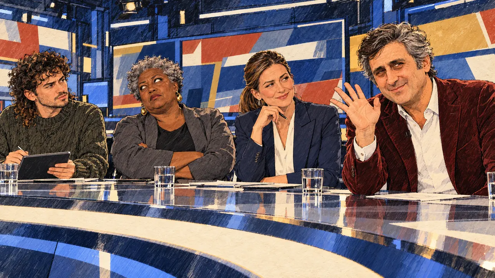

# `pundit` · Un éditorialiste vous éreinte

**Validée par le PO le 31/10/2026**, au premier essai de la méthode en deux étapes (portrait dessiné, puis scène). Elle sert telle quelle en clair et en sombre.



| Champ | Valeur |
| --- | --- |
| Carte | `pundit`, catégorie `attack` (Attaque) |
| Style | Reportage dessiné ; visages dessinés comme le reste, y compris celui de l'éditorialiste |
| Ton | Ironique et tendu |
| Date | 2026-10-31 |
| Outil | ChatGPT avec le modèle GPT Sol 6.1 en effort « light », et ChatGPT Images 2.5 |
| Conversation | À remplir (le lien ne s'ouvre qu'avec le compte qui l'a créée) |
| Format rendu | 1672 × 941 (16:9) : export en 1290 × 726 px depuis le PNG d'origine, WebP de qualité 75, 165 Ko, sans recadrage ; réexportée le 01/11/2026, après une première version en qualité 76 pour tenir 180 Ko |
| Fichier d'origine | PNG de ChatGPT, chez le PO, partagé aussi dans la conversation avec Claude |
| Première édition | À remplir |

## Texte de la carte

> **Un éditorialiste vous éreinte**
>
> En direct, un éditorialiste vedette qualifie votre programme de « catalogue de vœux pieux » et votre candidature de caprice.

## Le moment choisi

Le plateau d'un talk-show en direct, vu depuis la caméra principale. L'éditorialiste vedette, veste de velours bordeaux, se penche vers l'objectif avec un demi-sourire méprisant et une main levée qui donne congé au candidat. Autour de la table, l'animatrice sourit en coin, une économiste lève les yeux au ciel, un jeune chroniqueur prend des notes. Le candidat n'est pas sur le plateau : il est attaqué à distance.

## Prompt complet

En deux étapes, pour que la scène ne voie jamais la photo de famille.

### Étape 1 : le portrait dessiné

Dans une nouvelle conversation, avec deux images jointes : [`oldTweet.webp`](oldTweet.webp) pour le style, puis une photo de famille du PO. Le portrait obtenu n'est pas dans ce dépôt.

```
Use the first attached image as the style reference: the same pencil and ink drawing with loose watercolour washes and warm paper grain.
The second attached image is a family photograph. Draw a new portrait of this man, as a press illustrator or courtroom sketch artist would draw a quick likeness from life: head and shoulders, three-quarter view, on plain warm paper with no background.
Do not trace or copy the photograph. Redraw the face from scratch and keep only what makes him recognisable: the shape of the face, the hairline and the wavy hair, the eyebrows, the nose and the smile. Everything is drawn with ink outlines, hatching and flat watercolour washes, simplified like the faces in the reference image. No photographic skin, no photographic lighting, no detail taken over from the photo's texture.
Format: square, 1024 × 1024 px.
```

### Étape 2 : la scène

Dans une nouvelle conversation, avec deux images jointes : [`oldTweet.webp`](oldTweet.webp) pour le style, puis le portrait dessiné de l'étape 1 pour la ressemblance de l'éditorialiste.

```
Use the first attached image as the style reference: the same pencil and ink drawing with loose watercolour washes and warm paper grain. Not the same scene.
Use the second attached image, a drawn portrait, only as the likeness reference for the pundit: give him this man's features and wavy dark hair going grey, clean-shaven, and draw him exactly like the other people in the scene. Keep the likeness through the drawing, never through photographic detail.
Faces are drawn exactly like the clothes and the background: ink outlines, a few hatching strokes and flat watercolour washes for the skin, with the same level of detail as the rest of the drawing. No photographic skin, no realistic shading, no airbrushed or digital-painting look on the faces.

Editorial illustration, landscape 16:9 (1536 × 864 px), filling the whole frame edge to edge. The set of a live television talk show with a panel of commentators, in the evening in 2027, seen from the position of the main studio camera. In the right third, the star pundit, the man from the portrait, in a burgundy velvet jacket over a white shirt, leans towards the camera and looks straight at the viewer, one hand raised in a dismissive flick, with a thin, contemptuous smile: he is calling the player's candidate's programme a catalogue of pious wishes, his face above mid-height. Around the glossy desk: the host, a woman in her forties with a sleek ponytail and a tailored suit, hides a smirk; an economist, an older Black woman with short natural grey hair and large earrings, rolls her eyes and shakes her head; a young panellist with a curly mullet and a thick sweater takes notes on a tablet. Behind them, large screens show abstract graphics and an empty lower banner. The player's candidate does not appear. Nothing on the screens, the desk or the banners is readable.

Style: Reportage drawing made on the spot, like a press illustrator or courtroom sketch artist: pencil and ink with loose watercolour washes, lively unfinished lines, white paper showing through.

Palette: navy #13203F, vellum #F5EFE1, gold #A9802A, brick #B5523B, ochre #D9A441, sage #8FA58A, slate #5E7186, sand #DCC8A4, warm grey #8C8279; use 4 to 6 of them, subtle warm paper grain.

Tone: tense with a touch of irony, cold blue studio light, one hard key light on the pundit.

Constraints: realistic proportions, expressive but not caricatured faces, drawn like the rest of the illustration and never photographic; people of varied ages, genders, origins and body types (heavy, stocky, round, tall, short, wiry, not only slim), each with a distinct face and haircut (no two people alike), drawn with respect and never as a joke; anatomically correct hands with exactly five fingers, few hands visible, the others in pockets, behind objects or out of frame; no readable text anywhere (screens, banners, desk and labels stay unreadable); no captions or speech bubbles; no logos or political party colours; apart from the pundit, no recognisable real person and no lookalike of a real politician, journalist or TV commentator; no explicit violence; no oil-paint texture, no white or ragged border.

Format: if 16:9 is not available, make 1536 × 1024 and keep the top 80 px and the bottom 80 px free of anything important (faces, hands, the main action): they will be cropped.
```

## Décisions prises sur cette image

- **L'éditorialiste reprend les traits d'une photo de famille fournie par le PO**, avec l'accord de la famille (31/10/2026). Ni la photo ni le portrait dessiné ne sont dans ce dépôt.
- **La méthode en deux étapes remplace la photo jointe à la scène.** Jointe directement, la photo est recopiée telle quelle : le visage ressort photographique au milieu du dessin. Le portrait dessiné de l'étape 1 donne la ressemblance sans le rendu photo, et resservira pour toute autre carte avec la même personne.
- **La main levée** se lit plutôt comme un « au revoir » ironique que comme un revers méprisant. Le PO le garde : c'est un congé donné au candidat.

## Essais écartés

Aucune image écartée. Deux versions du prompt ont été abandonnées avant génération : la première décrivait un éditorialiste quelconque (cinquantaine, barbe courte), la seconde joignait la photo de famille directement à la scène.

## Retouches

Aucune.

## Relecture

Faite et validée par le PO le 31/10/2026.

- [x] Aucun texte lisible : ni sur les écrans, ni sur le bandeau, ni sur la table.
- [x] Aucun sosie d'une personne réelle, hors la ressemblance voulue de l'éditorialiste.
- [x] Le candidat du joueur n'apparaît pas.
- [x] Mains, visages et foules sans défaut visible à 343 px de large.
- [x] Aucune couleur de parti, aucun symbole officiel. Des personnes variées.
- [x] En 3:2 : rien d'important dans les 80 px du haut et du bas. Sans objet ici : l'image est en 16:9.
- [x] Lisible sur la page de l'événement, en clair et en sombre.
