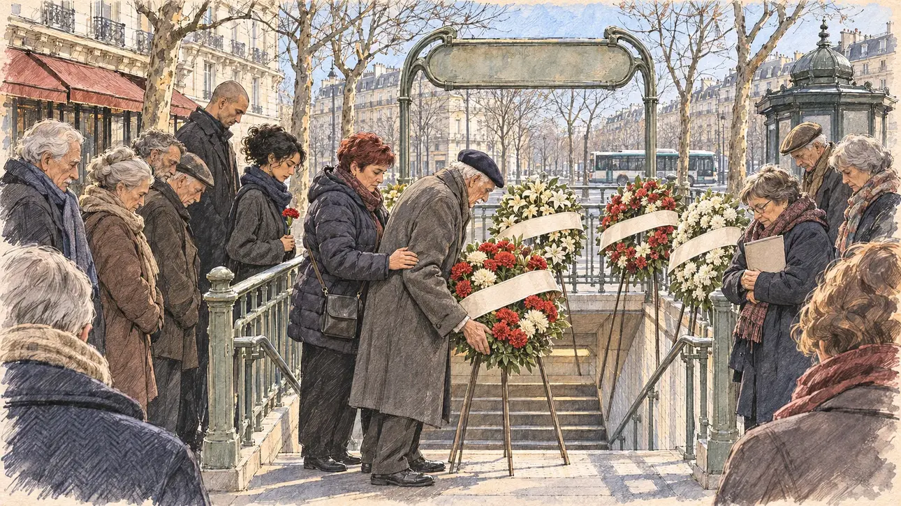

# `charonneAnniversary` · Charonne, soixante-cinq ans

**Validée par le PO le 23/11/2026**, au premier essai, dans le trait d'`oldTweet`. Elle sert telle quelle en clair et en sombre.



| Champ | Valeur |
| --- | --- |
| Carte | `charonneAnniversary`, catégorie `rendezvous` (Rendez-vous), carte ajoutée par la PR #480 de l'app |
| Style | Reportage dessiné, trait d'`oldTweet` |
| Ton | Solennel, recueilli |
| Date | 2026-11-23 |
| Outil | ChatGPT Images |
| Format rendu | 1672 × 941 (16:9) : export en 1290 × 726 px depuis l'image partagée dans la conversation avec Claude, WebP de qualité 75, 262 Ko, sans recadrage |
| Fichier d'origine | Image de ChatGPT, chez le PO. L'export du dépôt a été fait depuis la copie partagée dans la conversation avec Claude |
| Première édition | `kit-france-2611-0004` |

## Texte de la carte

> **Charonne, soixante-cinq ans**
>
> Le 8 février 1962, la police réprimait une manifestation contre l'OAS et la guerre d'Algérie : neuf manifestants mouraient au métro Charonne. Comme chaque année, un hommage a lieu à la station, et le comité demande que l'État reconnaisse sa responsabilité.

## Le moment choisi

L'hommage annuel de la fin de matinée devant l'entrée de la station, jamais la manifestation de 1962 : aucune image d'un drame réel, aucun portrait (`docs/STORE_LISTING.md` de l'app, Apple 1.1.7). Un matin froid et clair de février, une bouche de métro à l'enseigne vierge, des gerbes aux rubans blancs contre la balustrade. Une minute de silence : un homme de près de quatre-vingt-dix ans au béret dépose une gerbe, soutenu par une syndicaliste ; autour, des personnes âgées, des militantes et militants de tous âges, une jeune femme avec un œillet rouge, une femme avec un dossier. Aucun drapeau, aucune banderole, aucun logo. Le candidat est au dernier rang, hors champ : au premier plan, les dos de deux personnes.

## Prompt complet

Dans une nouvelle conversation, avec [`oldTweet.webp`](../../illustrations/polemic/oldTweet.webp) comme seule image de référence. Le passage sur le sol sec et la texture des manteaux a été renforcé après les deux écarts d'[`oussekineAnniversary`](oussekineAnniversary.md).

```
Use the attached image as the style reference and copy its drawing: a realistic reportage drawing made on the spot for a newspaper, with quick, nervous pencil lines, often drawn twice, ink hatching in the shadows, transparent watercolour washes that spill a little over the lines, and the warm paper showing through. Not the same scene.
Like in the reference, the setting can be full when the story needs it, with the things that say where we are and what is happening, but each one is sketched with a few pencil lines and a light wash, never rendered or finished, and the drawing gets looser and paler towards the edges until it fades into the bare paper.
This must look like a drawing made by hand on paper by a press illustrator, halfway between a quick sketch and a realistic picture: never a photograph, a film poster or a digital painting, and never a cartoon, a comic strip, a caricature or a children's book illustration. Continuous lines, never dotted or dashed outlines; no uniform texture, speckles or hatching filter laid over the picture, no woven or fabric texture on the coats or the walls; no glossy highlights, no smooth gradients, in the sky and on the walls too. Colour can be rich in places, on a piece of clothing, a flower or a ribbon, but it stays transparent and within the palette below. The fade into the paper at the edges stays narrow, without a wide white margin. No blur and no depth-of-field effect: everything, the foreground included, is drawn sharp, like a sketch made on the spot.
People are drawn from life with realistic anatomy and proportions, like in the reference: faces shaped with pencil lines, hatching and light washes, a little more finished than the background but never photographic (no photographic skin, no airbrushed or digital-painting look). Expressions stay natural and restrained, even in grief: no exaggerated expressions, no wide-open mouths, no rubbery or cartoonish faces.

Editorial illustration, landscape 16:9 (1536 × 864 px), the scene filling the frame, with only a light fade into the paper at the edges. A wide Parisian boulevard, late on a cold, bright February morning in 2027, in front of the entrance of a metro station, during the yearly tribute to nine demonstrators who died there in 1962 when the police charged a demonstration for peace. Only the remembrance of today: no scene from the past, no police, no violence, no portrait or photo of anyone. The player's candidate stands in the back row and stays off-camera: in the foreground, only the shoulders and backs of two people in winter coats, seen from behind at the bottom edge of the picture. In the centre, the metro entrance: a stairway going down between green-grey metal railings, a sign above it whose lettering is only a pale blur, never letters. Against the railing, five or six large wreaths of flowers on stands, their ribbons wide and blank. In front of them, a minute of silence: an old man in his late eighties, thin, with a beret, a white moustache and a long grey coat, steps forward to lay a wreath, steadied at the elbow by a stocky trade unionist in her fifties with short dyed red hair and a padded jacket, her face above mid-height, grave. Around them, a small crowd standing still, heads bowed: elderly men and women in heavy coats and scarves, a tall man in his forties with a shaved head, a young woman with curly black hair holding a single red carnation, a short round woman in her sixties with glasses holding a folder against her chest. Behind, sketched loosely in pencil and light washes: Haussmann-style buildings with a café terrace closed for winter, bare plane trees, a newspaper kiosk, a bus passing far away. The pavement is dry, plain grey stone sketched with a few lines, with no wet surface and no reflections. Nobody looks at the viewer. Nothing on the sign, the ribbons, the kiosk, the café, the folder or the bus is readable.

Style: Reportage drawing made on the spot, like a press illustrator or courtroom sketch artist: pencil and ink with loose watercolour washes, lively unfinished lines, white paper showing through.

Palette: navy #13203F, vellum #F5EFE1, gold #A9802A, brick #B5523B, ochre #D9A441, sage #8FA58A, slate #5E7186, sand #DCC8A4, warm grey #8C8279; use 4 to 6 of them, subtle warm paper grain.

Tone: solemn and gathered, a pale winter sun, cold air, the red of the carnations and of a few flowers in the wreaths the only bright spots.

Constraints: realistic proportions, natural expressions, never cartoonish or caricatured faces, drawn like the rest of the illustration and never photographic; people of varied ages, genders, origins and body types (heavy, stocky, round, tall, short, wiry, not only slim), each with a distinct face and haircut (no two people alike), drawn with respect and never as a joke; anatomically correct hands with exactly five fingers, few hands visible, the others in pockets, behind objects or out of frame; no readable text anywhere (the metro sign, the ribbons, the kiosk, the café, the folder and the bus stay unreadable); no captions, speech bubbles, banners or placards; no logos, flags, union or political party colours or symbols; no recognisable real person, no lookalike of a real politician and no portrait or photo of any victim; no police, no violence; no photographic rendering, no blur or bokeh, no wet ground or reflections, no dotted outlines, no texture or hatching filter over the picture, no oil-paint texture, no wide white margin or frame (a light fade into the paper at the edges is fine).

Format: if 16:9 is not available, make 1536 × 1024 and keep the top 80 px and the bottom 80 px free of anything important (faces, hands, the main action): they will be cropped.
```

## Décisions prises sur cette image

- L'entrée de métro est un édicule de style Guimard, image générique d'une station parisienne ; elle ne reproduit pas l'entrée réelle de la station.
- Les manteaux du premier plan gardent une légère texture à chevrons, jugée mineure.

## Essais écartés

Aucun.

## Retouches

Aucune.

## Relecture

Faite par Claude et validée par le PO le 23/11/2026.

- [x] Aucun texte lisible : l'enseigne du métro et les rubans sont vierges ; le bus, le kiosque et le dossier n'ont aucune inscription.
- [x] Aucun sosie d'une personne réelle, aucun portrait ni photo des victimes.
- [x] Le candidat du joueur est hors champ.
- [x] Mains, visages et foules sans défaut visible à 343 px de large.
- [x] Aucune couleur ni aucun logo de parti ou de syndicat, ni drapeau, ni banderole, aucun policier. Des personnes variées par l'âge, le corps, l'origine et la coiffure.
- [x] En 3:2 : sans objet, l'image est en 16:9.
- [x] Lisible sur la page de l'événement, en clair et en sombre.
