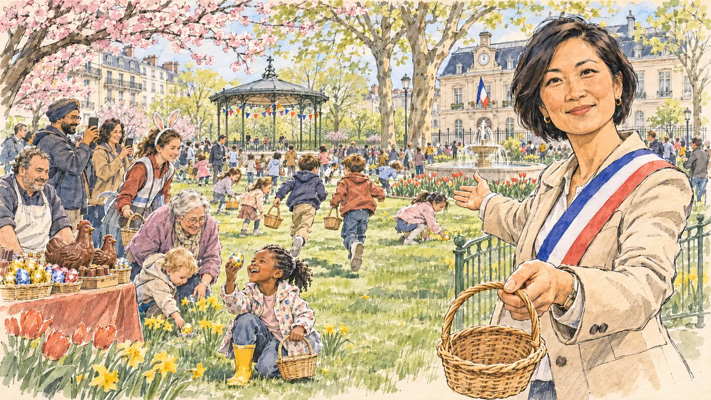

# `easterWeekend` · Le week-end de Pâques

**À générer.** Prompt prêt le 04/11/2026, pas encore d'image validée.



| Champ | Valeur |
| --- | --- |
| Carte | `easterWeekend`, catégorie `rendezvous` (Rendez-vous), carte ajoutée par la PR #297 de l'app |
| Style | Reportage dessiné, trait de `primeTime` |
| Ton | Chaleureux, printanier |
| Date | À remplir |
| Outil | ChatGPT Images |
| Conversation | À remplir (le lien ne s'ouvre qu'avec le compte qui l'a créée) |
| Format rendu | À remplir |
| Fichier d'origine | À remplir |
| Première édition | À remplir |

## Texte de la carte

> **Le week-end de Pâques**
>
> C'est le week-end de Pâques, avec un lundi férié : les routes se remplissent, les chocolatiers font l'un de leurs plus gros chiffres de l'année et, dans un village, on organise une chasse aux œufs pour deux cents enfants. Le maire vous invite, et vos équipes se demandent comment occuper ce long week-end.

## Le moment choisi

La chasse aux œufs du village, le lundi de Pâques en fin de matinée, sur le pré derrière l'église, vue depuis la place du candidat (hors champ) : au premier plan, un petit panier d'osier vide qu'on lui tend. La maire, écharpe tricolore sur sa veste de printemps, l'accueille et lui montre les enfants qui s'élancent. Autour : deux cents enfants de toutes origines avec leurs paniers, les parents qui filment, une grand-mère qui aide un tout-petit, un bénévole aux oreilles de lapin, le stand du chocolatier du village avec ses poules et ses cloches en chocolat, les arbres en fleurs, les jonquilles, l'église et ses cloches.

## Prompt complet

Dans une nouvelle conversation, avec [`primeTime.webp`](../../illustrations/media/primeTime.webp) comme seule image de référence.

```
Use the attached image as the style reference and copy its drawing: a realistic reportage drawing made on the spot for a newspaper, with quick, nervous pencil lines, often drawn twice, ink hatching in the shadows, transparent watercolour washes that spill a little over the lines, and the warm paper showing through. Not the same scene and not the same people: never reuse the face or the hair of the woman in the reference.
Like in the reference, the setting can be full when the story needs it, with the things that say where we are and what is happening, but each one is sketched with a few pencil lines and a light wash, never rendered or finished, and the drawing gets looser and paler towards the edges until it fades into the bare paper.
This must look like a drawing made by hand on paper by a press illustrator, halfway between a quick sketch and a realistic picture: never a photograph, a film poster or a digital painting, and never a cartoon, a comic strip, a caricature or a children's book illustration. Continuous lines, never dotted or dashed outlines; no uniform texture, speckles or hatching filter laid over the picture; no glossy highlights, no smooth gradients, in the sky and on the walls too. Colour can be rich in places, on a piece of clothing, a light or a flag, but it stays transparent and within the palette below. The fade into the paper at the edges stays narrow, without a wide white margin. No blur and no depth-of-field effect: everything, the foreground included, is drawn sharp, like a sketch made on the spot.
People are drawn from life with realistic anatomy and proportions, like in the reference: faces shaped with pencil lines, hatching and light washes, a little more finished than the background but never photographic (no photographic skin, no airbrushed or digital-painting look). Expressions stay natural and restrained, even in laughter or tears: no exaggerated grins, no wide-open mouths full of teeth, no rubbery or cartoonish faces.

Editorial illustration, landscape 16:9 (1536 × 864 px), the scene filling the frame, with only a light fade into the paper at the edges. The meadow behind the church of a French village, on Easter Monday 2027 at the end of the morning, during the egg hunt the village organises for two hundred children. The scene is seen from the place of the player's candidate, invited by the mayor, who stays off-camera: in the foreground, only a small empty wicker basket held out towards the viewer at the bottom edge of the picture. In the right third, the mayor, a cheerful woman in her forties of Vietnamese origin, with a short black bob, a tricolour sash over a light spring jacket, holds out the basket with one hand and points with the other at the children setting off, looking at the viewer with a welcoming smile, her face above mid-height. Around her, the egg hunt in full swing, sketched in pencil and light washes: children of all origins with baskets running across the grass and crouching in the daffodils, a little Black girl in yellow boots lifting a painted egg with pride, two boys racing towards a hedge; parents filming with their phones, among them a father with a turban; a grandmother in a cardigan helping a toddler; a teenage volunteer wearing a headband with rabbit ears; the trestle stand of the village chocolatier, a stocky man with a white apron, with chocolate hens, bells and eggs wrapped in coloured foil. Behind them, the stone church and its bell tower, blossoming cherry and apple trees, bunting of small coloured flags between two plane trees, and a few cars parked along the lane. Only the mayor looks at the viewer. Nothing on the stand, the foil, the bunting or the church is readable.

Style: Reportage drawing made on the spot, like a press illustrator or courtroom sketch artist: pencil and ink with loose watercolour washes, lively unfinished lines, white paper showing through.

Palette: navy #13203F, vellum #F5EFE1, gold #A9802A, brick #B5523B, ochre #D9A441, sage #8FA58A, slate #5E7186, sand #DCC8A4, warm grey #8C8279; use 4 to 6 of them, subtle warm paper grain.

Tone: warm and spring-like, bright late-morning sun, fresh greens, the yellow of the daffodils and the coloured foil of the eggs as the brightest notes.

Constraints: realistic proportions, natural expressions, never cartoonish or caricatured faces, drawn like the rest of the illustration and never photographic; people of varied ages, genders, origins and body types (heavy, stocky, round, tall, short, wiry, not only slim), each with a distinct face and haircut (no two people alike), drawn with respect and never as a joke; anatomically correct hands with exactly five fingers, few hands visible, the others in pockets, behind objects or out of frame; no readable text anywhere (the stand, the foil, the bunting and the church stay unreadable); no captions or speech bubbles; no logos or political party colours; no recognisable real person, no lookalike of a real politician or of a real mayor, and no Easter Bunny mascot costume; no explicit violence; no photographic rendering, no blur or bokeh, no dotted outlines, no texture or hatching filter over the picture, no oil-paint texture, no wide white margin or frame (a light fade into the paper at the edges is fine).

Format: if 16:9 is not available, make 1536 × 1024 and keep the top 80 px and the bottom 80 px free of anything important (faces, hands, the main action): they will be cropped.
```

## Décisions prises sur cette image

Aucune pour l'instant.

## Essais écartés

Aucun pour l'instant.

## Retouches

Aucune.

## Relecture

À faire sur l'image validée.
