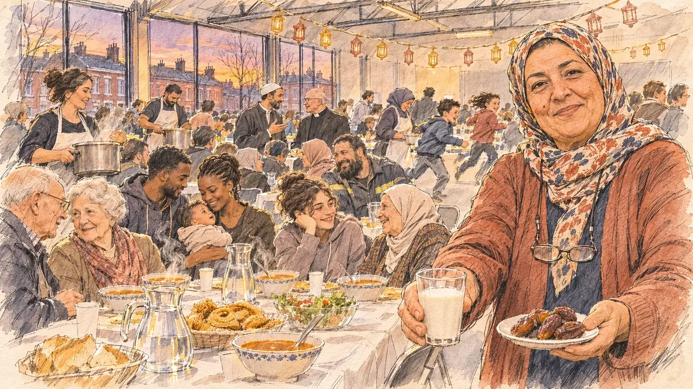

# `eidAlFitr` · La fin du ramadan

**À générer.** Prompt prêt le 04/11/2026, pas encore d'image validée.



| Champ | Valeur |
| --- | --- |
| Carte | `eidAlFitr`, catégorie `rendezvous` (Rendez-vous), carte ajoutée par la PR #297 de l'app |
| Style | Reportage dessiné, trait de `primeTime` |
| Ton | Chaleureux, convivial |
| Date | À remplir |
| Outil | ChatGPT Images |
| Conversation | À remplir (le lien ne s'ouvre qu'avec le compte qui l'a créée) |
| Format rendu | À remplir |
| Fichier d'origine | À remplir |
| Première édition | À remplir |

## Texte de la carte

> **La fin du ramadan**
>
> Pour la fin du ramadan, des associations organisent, dans une salle prêtée par la mairie de quartier, un grand repas de rupture du jeûne, ouvert à tous les habitants quelle que soit leur religion. On vous y invite, et vos équipes se demandent ce qu'il convient d'en faire.

## Le moment choisi

Le grand repas de rupture du jeûne dans une salle municipale de Roubaix, au coucher du soleil, en mars, vu depuis la place du candidat (hors champ) : au premier plan, une petite assiette de dattes et un verre de lait qu'on lui tend, la coutume pour rompre le jeûne. La présidente de l'association l'accueille. Autour : les longues tables, la soupe chorba, les pâtisseries, les voisins de toutes religions et de toutes origines, les bénévoles qui servent, un prêtre de la paroisse qui bavarde avec l'imam, des enfants. Derrière : la salle aux poutres métalliques, et par les hautes fenêtres les maisons de brique rouge du Nord sous le ciel du soir.

## Prompt complet

Dans une nouvelle conversation, avec [`primeTime.webp`](../../illustrations/media/primeTime.webp) comme seule image de référence.

```
Use the attached image as the style reference and copy its drawing: a realistic reportage drawing made on the spot for a newspaper, with quick, nervous pencil lines, often drawn twice, ink hatching in the shadows, transparent watercolour washes that spill a little over the lines, and the warm paper showing through. Not the same scene and not the same people: never reuse the face or the hair of the woman in the reference.
Like in the reference, the setting can be full when the story needs it, with the things that say where we are and what is happening, but each one is sketched with a few pencil lines and a light wash, never rendered or finished, and the drawing gets looser and paler towards the edges until it fades into the bare paper.
This must look like a drawing made by hand on paper by a press illustrator, halfway between a quick sketch and a realistic picture: never a photograph, a film poster or a digital painting, and never a cartoon, a comic strip, a caricature or a children's book illustration. Continuous lines, never dotted or dashed outlines; no uniform texture, speckles or hatching filter laid over the picture; no glossy highlights, no smooth gradients, in the sky and on the walls too. Colour can be rich in places, on a piece of clothing, a light or a flag, but it stays transparent and within the palette below. The fade into the paper at the edges stays narrow, without a wide white margin. No blur and no depth-of-field effect: everything, the foreground included, is drawn sharp, like a sketch made on the spot.
People are drawn from life with realistic anatomy and proportions, like in the reference: faces shaped with pencil lines, hatching and light washes, a little more finished than the background but never photographic (no photographic skin, no airbrushed or digital-painting look). Expressions stay natural and restrained, even in laughter or tears: no exaggerated grins, no wide-open mouths full of teeth, no rubbery or cartoonish faces.

Editorial illustration, landscape 16:9 (1536 × 864 px), the scene filling the frame, with only a light fade into the paper at the edges. A municipal hall lent by the district town hall in Roubaix, in the north of France, at sunset on an evening in early March 2027, during the big meal that breaks the fast at the end of Ramadan, organised by local associations and open to all residents whatever their religion. The scene is seen from the place of the player's candidate, who has been invited and stays off-camera: in the foreground, only a small plate of dates and a glass of milk held out towards the viewer, the custom for breaking the fast. In the right third, the president of the association, a warm woman in her fifties of Algerian origin, with a patterned headscarf, glasses on a cord and a long cardigan, offers the dates and looks at the viewer with a kind, welcoming smile, her face above mid-height. Around her, sketched in pencil and light washes: long tables covered with white paper tablecloths, steaming bowls of chorba soup, bread, salads, plates of honey pastries and jugs of water; neighbours of all faiths and origins sitting side by side, an elderly white couple from the street, a young Black couple with a baby, a teenage girl without a headscarf laughing with her grandmother in a headscarf, a big bearded man in a work jacket; volunteers in aprons carrying pots of soup; at the end of the hall, the imam of the district, a slim man in his forties with a short beard and a white cap, chatting with the parish priest, a bald man in his sixties with a clerical collar; children running between the tables. Behind them, the plain municipal hall with its metal beams, folding chairs and paper garlands of small lanterns, and through the tall windows the rows of red-brick terraced houses of the North under an orange and violet evening sky. Only the association president looks at the viewer. Nothing on the tables, the walls, the garlands or the windows is readable, and no Arabic or French lettering appears anywhere.

Style: Reportage drawing made on the spot, like a press illustrator or courtroom sketch artist: pencil and ink with loose watercolour washes, lively unfinished lines, white paper showing through.

Palette: navy #13203F, vellum #F5EFE1, gold #A9802A, brick #B5523B, ochre #D9A441, sage #8FA58A, slate #5E7186, sand #DCC8A4, warm grey #8C8279; use 4 to 6 of them, subtle warm paper grain.

Tone: warm and convivial, the golden light of the hall against the orange and violet sunset outside, the steam of the soup and the warm colours of the food as the brightest notes.

Constraints: realistic proportions, natural expressions, never cartoonish or caricatured faces, drawn like the rest of the illustration and never photographic; people of varied ages, genders, origins and body types (heavy, stocky, round, tall, short, wiry, not only slim), each with a distinct face and haircut (no two people alike), drawn with respect and never as a joke; anatomically correct hands with exactly five fingers, few hands visible, the others in pockets, behind objects or out of frame; no readable text anywhere (the tables, the walls, the garlands and the windows stay unreadable); no captions or speech bubbles; no logos or political party colours; no recognisable real person, no lookalike of a real politician or of a real religious leader; no explicit violence; no photographic rendering, no blur or bokeh, no dotted outlines, no texture or hatching filter over the picture, no oil-paint texture, no wide white margin or frame (a light fade into the paper at the edges is fine).

Format: if 16:9 is not available, make 1536 × 1024 and keep the top 80 px and the bottom 80 px free of anything important (faces, hands, the main action): they will be cropped.
```

## Décisions prises sur cette image

Aucune pour l'instant.

## Essais écartés

Aucun pour l'instant.

## Retouches

Aucune.

## Relecture

À faire sur l'image validée.
