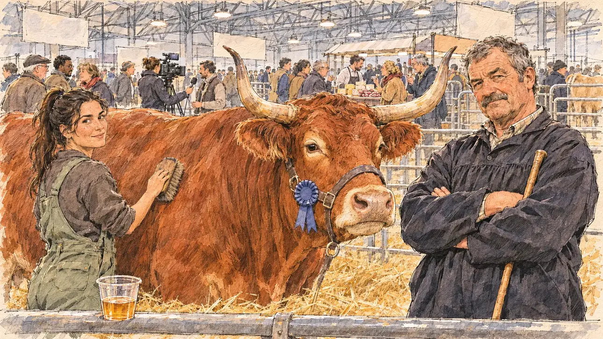

# `farmFair` · Le Salon de l'agriculture

**Validée par le PO le 04/11/2026**, au premier essai, avec `primeTime.webp` comme référence. Elle sert telle quelle en clair et en sombre.



| Champ | Valeur |
| --- | --- |
| Carte | `farmFair`, catégorie `rendezvous` (Rendez-vous), carte ajoutée par la PR #297 de l'app |
| Style | Reportage dessiné, trait de `primeTime` |
| Ton | Observateur, avec une pointe d'ironie |
| Date | 2026-11-04 |
| Outil | ChatGPT Images |
| Conversation | À remplir (le lien ne s'ouvre qu'avec le compte qui l'a créée) |
| Format rendu | 1672 × 941 (16:9) : export en 1290 × 726 px, WebP de qualité 75, 257 Ko, sans recadrage |
| Fichier d'origine | Image de ChatGPT, chez le PO. L'export du dépôt a été fait depuis la copie partagée dans la conversation avec Claude |
| Première édition | La prochaine Release qui suit le merge de la PR #297 de l'app |

## Texte de la carte

> **Le Salon de l'agriculture**
>
> Le Salon de l'agriculture bat son plein porte de Versailles. Tous les candidats s'y montrent : stands, vaches, dégustations, et des éleveurs qui ne ménagent pas les visiteurs.

## Le moment choisi

Le hall des bovins, en fin de matinée, vu depuis la place du candidat devant la barrière d'un stand, un gobelet de dégustation de cidre à la main (hors champ). L'éleveur, bras croisés devant sa vache primée, attend de voir ce que vaut ce candidat ; sa fille brosse la bête et sourit en coin. Derrière, la foule du Salon, une équipe de télé, des stands de dégustation sous la charpente métallique du hall.

## Prompt complet

Dans une nouvelle conversation, avec [`primeTime.webp`](../../illustrations/media/primeTime.webp) comme seule image de référence.

```
Use the attached image as the style reference and copy its drawing: a realistic reportage drawing made on the spot for a newspaper, with quick, nervous pencil lines, often drawn twice, ink hatching in the shadows, transparent watercolour washes that spill a little over the lines, and the warm paper showing through. Not the same scene and not the same people: never reuse the face or the hair of the woman in the reference.
Like in the reference, the setting can be full when the story needs it, with the things that say where we are and what is happening, but each one is sketched with a few pencil lines and a light wash, never rendered or finished, and the drawing gets looser and paler towards the edges until it fades into the bare paper.
This must look like a drawing made by hand on paper by a press illustrator, halfway between a quick sketch and a realistic picture: never a photograph, a film poster or a digital painting, and never a cartoon, a comic strip, a caricature or a children's book illustration. Continuous lines, never dotted or dashed outlines; no uniform texture, speckles or hatching filter laid over the picture; no glossy highlights, no smooth gradients, in the sky and on the walls too. Colour can be rich in places, on a piece of clothing, a light or a flag, but it stays transparent and within the palette below. The fade into the paper at the edges stays narrow, without a wide white margin. No blur and no depth-of-field effect: everything, the foreground included, is drawn sharp, like a sketch made on the spot.
People are drawn from life with realistic anatomy and proportions, like in the reference: faces shaped with pencil lines, hatching and light washes, a little more finished than the background but never photographic (no photographic skin, no airbrushed or digital-painting look). Expressions stay natural and restrained, even in laughter or tears: no exaggerated grins, no wide-open mouths full of teeth, no rubbery or cartoonish faces.

Editorial illustration, landscape 16:9 (1536 × 864 px), the scene filling the frame, with only a light fade into the paper at the edges. Hall 1 of the Paris farm show at Porte de Versailles, at the end of a busy morning in late February 2027: every presidential candidate comes here to be seen, and the farmers do not go easy on visitors. The scene is seen from the place of the player's candidate, who stays off-camera, standing at the low metal barrier of a cattle stand: in the foreground, only the top rail of the barrier and a small plastic tasting cup of cider held out on it. In the right third, the breeder, a stocky man in his fifties with a weathered face, a grey moustache and short grey hair, in the black smock of French cattle farmers, a herding stick under his arm, stands with his arms crossed beside his prize cow and looks at the viewer with a sceptical, challenging half-smile, his face above mid-height. Next to him, his huge prize cow, a red-brown cow with lyre-shaped horns and a blue rosette on her halter, stands on fresh straw, calm and enormous. On the left, his daughter, a young woman in her twenties with a long dark ponytail and green overalls, brushes the cow's flank and glances at the viewer with an amused smile. Behind them, the farm show in full swing, sketched loosely in pencil and light washes: the crowd of visitors in winter coats, a television crew filming another stand, a cheese and charcuterie tasting counter with a queue, other cows in their pens, the high metal roof frame of the hall with its lights and hanging banners left blank. Only the breeder and his daughter look at the viewer. Nothing on the banners, the stands, the rosette or the cup is readable.

Style: Reportage drawing made on the spot, like a press illustrator or courtroom sketch artist: pencil and ink with loose watercolour washes, lively unfinished lines, white paper showing through.

Palette: navy #13203F, vellum #F5EFE1, gold #A9802A, brick #B5523B, ochre #D9A441, sage #8FA58A, slate #5E7186, sand #DCC8A4, warm grey #8C8279; use 4 to 6 of them, subtle warm paper grain.

Tone: observant with a touch of irony, warm and busy, the flat white light of the hall and the warm colours of the straw and the cattle.

Constraints: realistic proportions, natural expressions, never cartoonish or caricatured faces, drawn like the rest of the illustration and never photographic; people of varied ages, genders, origins and body types (heavy, stocky, round, tall, short, wiry, not only slim), each with a distinct face and haircut (no two people alike), drawn with respect and never as a joke; anatomically correct hands with exactly five fingers, few hands visible, the others in pockets, behind objects or out of frame; no readable text anywhere (the banners, the stands, the rosette and the cup stay unreadable); no captions or speech bubbles; no logos or political party colours; no recognisable real person, no lookalike of a real politician or of a real farmer or a real prize cow; no explicit violence; no photographic rendering, no blur or bokeh, no dotted outlines, no texture or hatching filter over the picture, no oil-paint texture, no wide white margin or frame (a light fade into the paper at the edges is fine).

Format: if 16:9 is not available, make 1536 × 1024 and keep the top 80 px and the bottom 80 px free of anything important (faces, hands, the main action): they will be cropped.
```

## Décisions prises sur cette image

Aucune.

## Essais écartés

Aucun.

## Retouches

Aucune.

## Relecture

Faite et validée par le PO le 04/11/2026.

- [x] Aucun texte lisible : les bannières du hall sont blanches, la rosette, le comptoir de fromages et le gobelet n'ont rien d'écrit.
- [x] Aucun sosie d'une personne réelle.
- [x] Le candidat du joueur est hors champ.
- [x] Mains, visages et foules sans défaut visible à 343 px de large.
- [x] Aucune couleur ni aucun logo de parti. Des personnes variées par l'âge, le corps, l'origine et la coiffure.
- [x] En 3:2 : sans objet, l'image est en 16:9.
- [x] Lisible sur la page de l'événement, en clair et en sombre.

Ce que la relecture a accepté : une vache aux cornes en lyre très larges et à la carrure puissante, qui pourrait passer pour un taureau ; le gobelet de cidre posé sur la barrière plutôt que tendu.
