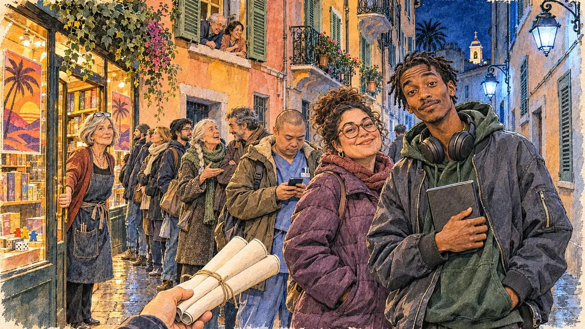

# `gameLaunch` · La sortie du jeu vidéo de la décennie

**Retenue par le PO le 21/11/2026**, au premier essai, sans retouche. Elle sert telle quelle en clair et en sombre.



| Champ | Valeur |
| --- | --- |
| Carte | `gameLaunch`, catégorie `rendezvous` (Rendez-vous), poids 1 à son pic, datée du 19/11 au 12/12/2026 et décroissante (`fade` : 1, 0,5, 0,25, 0,1 de la semaine du 15/11 à celle du 6/12) : seules les campagnes longues (#218) l'atteignent (Mitchnsun/moi-president, PO, 20/11/2026) |
| Style | Reportage dessiné |
| Ton | Chaleureux et légèrement ironique, minuit : le bleu froid de la rue, la lueur dorée de la vitrine sur les visages |
| Date | 2026-11-21 |
| Outil | ChatGPT Images |
| Format rendu | 1672 × 941 (16:9) : export en 1290 × 726 px, WebP de qualité 75, 276 Ko, sans recadrage, fait depuis la copie WebP reçue |
| Fichier d'origine | Image de ChatGPT, chez le PO. L'export du dépôt a été fait depuis la copie partagée dans la conversation avec Claude |
| Première édition | `kit-france-2611-0004` |

## Texte de la carte

> **La sortie du jeu vidéo de la décennie**
>
> À minuit, le jeu vidéo le plus attendu depuis dix ans sort enfin : des files devant les magasins, des millions de joueurs connectés, 80 € l'édition de base. Votre équipe numérique veut en profiter, une partie de votre camp préfère s'en tenir loin.

Réponses : « Laisser les joueurs jouer, sans commentaire », « Passer dans une file d'attente à minuit », « Défendre les studios français et leur crédit d'impôt », « Jouer en direct sur une chaîne de streaming » (le pari risqué).

## Le moment choisi

Minuit, une rue piétonne du Vieux-Nice : façades ocre et rose, volets verts, lampadaires. Une file d'adultes devant la vitrine éclairée d'un magasin de jeux, sa gérante tient la porte. Dans le tiers droit, un grand jeune homme d'origine sénégalaise sort avec sa boîte et regarde le candidat, hors champ, avec une curiosité amusée : un politique, ici, à cette heure ? Au premier plan, les tracts roulés du candidat. Le jeu est celui sorti le 19/11/2026 : la boîte, la vitrine et les affiches ne reprennent ni son titre, ni son logo, ni ses couleurs, ni ses personnages.

## Prompt complet

Dans une nouvelle conversation, avec [`primeTime.webp`](../../illustrations/media/primeTime.webp) comme seule image de référence :

```
Use the attached image as the style reference and copy its drawing: a realistic reportage drawing made on the spot for a newspaper, with quick, nervous pencil lines, often drawn twice, ink hatching in the shadows, transparent watercolour washes that spill a little over the lines, and the warm paper showing through. Not the same scene and not the same people: never reuse the face or the hair of the woman in the reference.
Like in the reference, the setting can be full when the story needs it, with the things that say where we are and what is happening, but each one is sketched with a few pencil lines and a light wash, never rendered or finished, and the drawing gets looser and paler towards the edges until it fades into the bare paper.
This must look like a drawing made by hand on paper by a press illustrator, halfway between a quick sketch and a realistic picture: never a photograph, a film poster or a digital painting, and never a cartoon, a comic strip, a caricature or a children's book illustration. Continuous lines, never dotted or dashed outlines; no uniform texture, speckles or hatching filter laid over the picture; no glossy highlights, no smooth gradients, in the sky and on the walls too. Colour can be rich in places, on a piece of clothing, a light or a flag, but it stays transparent and within the palette below. The fade into the paper at the edges stays narrow, without a wide white margin. No blur and no depth-of-field effect: everything, the foreground included, is drawn sharp, like a sketch made on the spot.
People are drawn from life with realistic anatomy and proportions, like in the reference: faces shaped with pencil lines, hatching and light washes, a little more finished than the background but never photographic (no photographic skin, no airbrushed or digital-painting look). Expressions stay natural and restrained, even in laughter or tears: no exaggerated grins, no wide-open mouths full of teeth, no rubbery or cartoonish faces.

Editorial illustration, landscape 16:9 (1536 × 864 px), the scene filling the frame, with only a light fade into the paper at the edges. At midnight in November 2027, in a narrow pedestrian street of the old town of Nice, in the south of France: tall ochre, salmon-pink and pale yellow façades with green shutters and wrought-iron balconies, old street lamps with a cold bluish light, a few people leaning out of a window above. In the middle ground, the brightly lit window of a small video game shop, its glow spilling warm on the paving stones; its middle-aged owner, a white woman in her late fifties with a short grey bob and reading glasses pushed up on her head, holds the door open. A queue of about ten adults stretches along the façade, all clearly over twenty, in puffer jackets, hoodies and scarves, some holding phones, some yawning, chatting or checking the time. The player's candidate stays off-camera: in the foreground, only the candidate's bundle of rolled-up campaign leaflets held at the bottom edge of the frame, blank. In the right third, the main character, a tall, lanky young man of about twenty-three of Senegalese descent, with short twists, a thin moustache, wireless headphones around his neck and an oversized dark green hoodie under an open bomber jacket, has just come out of the shop holding a plain dark game box against his chest; he looks at the viewer with amused, slightly surprised curiosity, eyebrows raised, his face above mid-height. Beside him in the queue: a round woman in her thirties of Portuguese descent with curly hair in a high bun and big glasses, in a purple puffer jacket, glancing at the viewer with a smile; behind her, a stocky man in his mid-forties of Vietnamese descent, a night-shift nurse with hospital scrubs showing under his parka and a shaved head, who keeps looking at his phone; further back, a wiry white woman in her sixties with a long white braid, a keen gamer, arguing cheerfully with her neighbour. Only the young man and the round woman look at the viewer; the others go on with what they are doing. The game box, the shop window and the posters show no logo, no title and no character from any real game: only abstract shapes of palm trees and a sunset, nothing in pink and turquoise neon; nothing on the box, the window, the phones or the leaflets is readable.

Style: Reportage drawing made on the spot, like a press illustrator or courtroom sketch artist: pencil and ink with loose watercolour washes, lively unfinished lines, white paper showing through.

Palette: navy #13203F, vellum #F5EFE1, gold #A9802A, brick #B5523B, ochre #D9A441, sage #8FA58A, slate #5E7186, sand #DCC8A4, warm grey #8C8279; use 4 to 6 of them, subtle warm paper grain.

Tone: warm and gently ironic, postures slightly exaggerated but never the faces: the cold navy of the midnight street and the warm golden glow of the shop window on the faces.

Constraints: realistic proportions, natural expressions, never cartoonish or caricatured faces, drawn like the rest of the illustration and never photographic; people of varied ages, genders, origins and body types (heavy, stocky, round, tall, short, wiry, not only slim), each with a distinct face and haircut (no two people alike), drawn with respect and never as a joke; each person's age, build and look plausible for their job and the scene (working people of working age), every person in the queue an adult, no stereotype tying an origin or a gender to a role, and no person of colour shown alone in a featured service or deferential role; anatomically correct hands with exactly five fingers, few hands visible, the others in pockets, behind objects or out of frame; no readable text anywhere (the game box, the shop window, the posters, the phones and the leaflets stay unreadable); no captions or speech bubbles; no logos, no console brand, no real video game's title, logo, characters or visual identity, no political party colours; no recognisable real person, no lookalike of a real politician or of a real streamer; no weapons and no violent imagery, even on the posters; no explicit violence; no photographic rendering, no blur or bokeh, no dotted outlines, no texture or hatching filter over the picture, no oil-paint texture, no wide white margin or frame (a light fade into the paper at the edges is fine).

Format: if 16:9 is not available, make 1536 × 1024 and keep the top 80 px and the bottom 80 px free of anything important (faces, hands, the main action): they will be cropped.
```

## Décisions prises sur cette image

Retenue par le PO (21/11/2026).

## Essais écartés

Aucun.

## Retouches

Aucune.

## Relecture

Faite le 21/11/2026 sur l'image reçue, zoomée sur le texte possible et les mains ; retenue par le PO le même jour.

- [x] Aucun texte lisible : boîte, vitrine, affiches, téléphone et tracts sans inscription.
- [x] Rien du vrai jeu : boîte unie, affiches de palmiers au couchant en ocre et violet, ni néon rose et turquoise, ni personnage, ni logo.
- [x] Le candidat du joueur est hors champ : sa main tient les tracts au premier plan, dans une manche sombre, sans bijou ni indice de genre.
- [x] Écarts au prompt : la main du candidat est visible (le prompt ne demandait que les tracts) ; la vitrine tient de la boutique de jeux de société (figurines de joueurs, dé) ; le jeune homme porte des dreadlocks courtes plutôt que des twists ; un couple âgé au balcon et le clocher d'une église du Vieux-Nice au fond.
- [x] Rendu : un grain craquelé couvre l'image, surtout sur les vestes et les façades, la dérive que le gabarit signale ; le PO l'a gardée telle quelle.
- [x] Aucun sosie d'une personne réelle repéré.
- [x] Mains sans défaut visible.
- [x] Aucune couleur, aucun logo ni aucun drapeau de parti. Des personnes variées par l'âge, le corps, l'origine et la coiffure ; toutes adultes.
- [x] En 16:9 : pas de recadrage.
- [ ] Lisible sur la page de l'événement, en clair et en sombre : à vérifier dans l'app, une fois la carte publiée.
