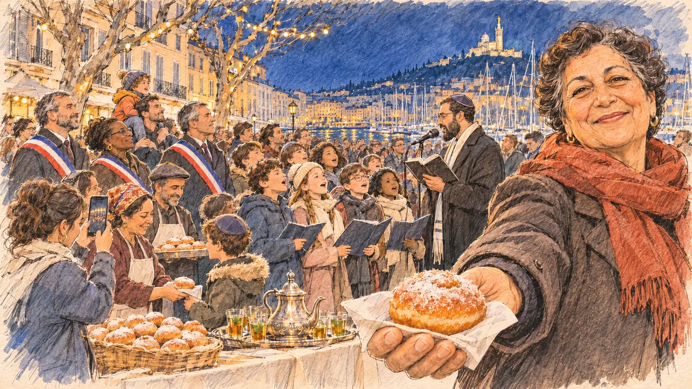

# `hanukkah` · L'allumage des bougies sur la place

**Validée par le PO le 04/11/2026**, au premier essai, avec `primeTime.webp` comme référence. Elle sert telle quelle en clair et en sombre.



| Champ | Valeur |
| --- | --- |
| Carte | `hanukkah`, catégorie `rendezvous` (Rendez-vous), carte ajoutée par la PR #297 de l'app |
| Style | Reportage dessiné, trait de `primeTime` |
| Ton | Chaleureux, recueilli |
| Date | 2026-11-04 |
| Outil | ChatGPT Images |
| Conversation | À remplir (le lien ne s'ouvre qu'avec le compte qui l'a créée) |
| Format rendu | 1672 × 941 (16:9) : export en 1290 × 726 px, WebP de qualité 75, 246 Ko, sans recadrage |
| Fichier d'origine | Image de ChatGPT, chez le PO. L'export du dépôt a été fait depuis la copie partagée dans la conversation avec Claude |
| Première édition | La prochaine Release qui suit le merge de la PR #297 de l'app |

## Texte de la carte

> **L'allumage des bougies sur la place**
>
> Pour Hanoukka, des associations de la ville organisent, avec l'accord de la mairie, l'allumage public des bougies sur une grande place, avec chants, beignets et élus de tous bords. On vous y invite.

## Le moment choisi

L'allumage public des bougies de Hanoukka sur une grande place de Marseille, près du Vieux-Port, à la tombée de la nuit, début décembre, vu depuis la place du candidat (hors champ) : au premier plan, un beignet dans une serviette en papier qu'on lui tend. La présidente de l'association qui organise l'accueille avec chaleur. Autour : le grand chandelier à neuf branches dont on allume les bougies de la soirée, un rabbin qui récite la bénédiction, une chorale d'enfants, des familles, des élus de tous bords en écharpe, des bénévoles qui servent beignets et thé. Derrière : les façades ocre et pastel, les platanes, les bateaux du Vieux-Port et la basilique sur sa colline.

## Prompt complet

Dans une nouvelle conversation, avec [`primeTime.webp`](../../illustrations/media/primeTime.webp) comme seule image de référence.

```
Use the attached image as the style reference and copy its drawing: a realistic reportage drawing made on the spot for a newspaper, with quick, nervous pencil lines, often drawn twice, ink hatching in the shadows, transparent watercolour washes that spill a little over the lines, and the warm paper showing through. Not the same scene and not the same people: never reuse the face or the hair of the woman in the reference.
Like in the reference, the setting can be full when the story needs it, with the things that say where we are and what is happening, but each one is sketched with a few pencil lines and a light wash, never rendered or finished, and the drawing gets looser and paler towards the edges until it fades into the bare paper.
This must look like a drawing made by hand on paper by a press illustrator, halfway between a quick sketch and a realistic picture: never a photograph, a film poster or a digital painting, and never a cartoon, a comic strip, a caricature or a children's book illustration. Continuous lines, never dotted or dashed outlines; no uniform texture, speckles or hatching filter laid over the picture; no glossy highlights, no smooth gradients, in the sky and on the walls too. Colour can be rich in places, on a piece of clothing, a light or a flag, but it stays transparent and within the palette below. The fade into the paper at the edges stays narrow, without a wide white margin. No blur and no depth-of-field effect: everything, the foreground included, is drawn sharp, like a sketch made on the spot.
People are drawn from life with realistic anatomy and proportions, like in the reference: faces shaped with pencil lines, hatching and light washes, a little more finished than the background but never photographic (no photographic skin, no airbrushed or digital-painting look). Expressions stay natural and restrained, even in laughter or tears: no exaggerated grins, no wide-open mouths full of teeth, no rubbery or cartoonish faces.

Editorial illustration, landscape 16:9 (1536 × 864 px), the scene filling the frame, with only a light fade into the paper at the edges. A large square near the Old Port of Marseille, at nightfall on an evening of early December 2026, during the public lighting of the Hanukkah candles organised by local associations with the agreement of the town hall: songs, doughnuts and elected officials from every side. The scene is seen from the place of the player's candidate, who has been invited and stays off-camera: in the foreground, only a sugared doughnut in a paper napkin held out towards the viewer. In the right third, the president of the organising association, a warm, round woman in her sixties of Sephardic North African origin, with short dark curls going grey, a wool coat and a red scarf, offers the doughnut and looks at the viewer with a broad, welcoming smile, her face above mid-height. Around her, sketched in pencil and light washes: in the middle of the square, a tall nine-branched candelabrum, a public hanukkiah, its candles for the evening lit with small warm flames; a rabbi in his forties with a short dark beard, a kippah and a dark coat reciting the blessing with a microphone; a choir of children of varied origins in winter coats singing; families with children on their shoulders, a teenager taking a photo with her phone; three elected officials of different sides with tricolour sashes over their coats, among them a Black woman in her fifties; volunteers serving doughnuts and mint tea from a trestle table. Behind them, the city of Marseille: tall ochre, cream and pastel façades with shutters, bare plane trees strung with small lights, the masts of boats in the Old Port, and on its hill in the distance the basilica of Notre-Dame-de-la-Garde under the deep blue evening sky. Only the association president looks at the viewer. Nothing on the banners, the table, the façades or the phone is readable, and no Hebrew or French lettering appears anywhere.

Style: Reportage drawing made on the spot, like a press illustrator or courtroom sketch artist: pencil and ink with loose watercolour washes, lively unfinished lines, white paper showing through.

Palette: navy #13203F, vellum #F5EFE1, gold #A9802A, brick #B5523B, ochre #D9A441, sage #8FA58A, slate #5E7186, sand #DCC8A4, warm grey #8C8279; use 4 to 6 of them, subtle warm paper grain.

Tone: warm and gathered, the deep blue of early night, the small golden flames of the candles and the strings of lights as the warmest notes.

Constraints: realistic proportions, natural expressions, never cartoonish or caricatured faces, drawn like the rest of the illustration and never photographic; people of varied ages, genders, origins and body types (heavy, stocky, round, tall, short, wiry, not only slim), each with a distinct face and haircut (no two people alike), drawn with respect and never as a joke; anatomically correct hands with exactly five fingers, few hands visible, the others in pockets, behind objects or out of frame; no readable text anywhere (the banners, the table, the façades and the phone stay unreadable); no captions or speech bubbles; no logos or political party colours; no recognisable real person, no lookalike of a real politician or of a real religious leader; no explicit violence; no photographic rendering, no blur or bokeh, no dotted outlines, no texture or hatching filter over the picture, no oil-paint texture, no wide white margin or frame (a light fade into the paper at the edges is fine).

Format: if 16:9 is not available, make 1536 × 1024 and keep the top 80 px and the bottom 80 px free of anything important (faces, hands, the main action): they will be cropped.
```

## Décisions prises sur cette image

- **Le grand chandelier retiré** (PO, 04/11/2026) : le PO l'a enlevé du prompt avant de générer, il prenait trop de place. Hanoukka se lit par le rabbin et son livre, les kippas, la chorale, les beignets et les élus. Le titre de la carte parle de l'allumage des bougies, que l'image ne montre plus : un écart voulu.

## Essais écartés

Aucun.

## Retouches

Aucune.

## Relecture

Faite et validée par le PO le 04/11/2026.

- [x] Aucun texte lisible : les livres de chants n'ont que des lignes, le téléphone ne montre que des lumières, aucune inscription en hébreu ni en français.
- [x] Aucun sosie d'une personne réelle.
- [x] Le candidat du joueur est hors champ.
- [x] Mains, visages et foules sans défaut visible à 343 px de large.
- [x] Aucune couleur ni aucun logo de parti. Des personnes variées par l'âge, le corps, l'origine et la coiffure.
- [x] En 3:2 : sans objet, l'image est en 16:9.
- [x] Lisible sur la page de l'événement, en clair et en sombre.

Ce que la relecture a accepté : pas de chandelier ni de bougies, retirés par le PO ; deux élus en écharpe au lieu de trois.
