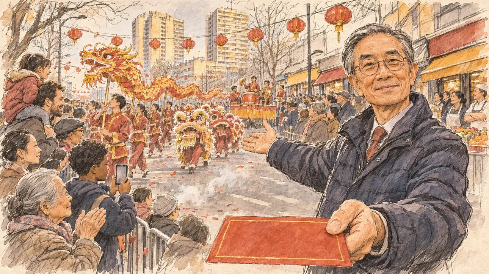

# `lunarNewYear` · Le Nouvel An lunaire

**À générer.** Prompt prêt le 04/11/2026, pas encore d'image validée.



| Champ | Valeur |
| --- | --- |
| Carte | `lunarNewYear`, catégorie `rendezvous` (Rendez-vous), carte ajoutée par la PR #297 de l'app |
| Style | Reportage dessiné, trait de `primeTime` |
| Ton | Chaleureux, festif |
| Date | À remplir |
| Outil | ChatGPT Images |
| Conversation | À remplir (le lien ne s'ouvre qu'avec le compte qui l'a créée) |
| Format rendu | À remplir |
| Fichier d'origine | À remplir |
| Première édition | À remplir |

## Texte de la carte

> **Le Nouvel An lunaire**
>
> Pour le Nouvel An lunaire, le 6 février, un quartier d'une grande ville organise un défilé de dragons et de lanternes, avec ses commerçants et ses associations. Le président de l'association des commerçants vous invite à la fête.

## Le moment choisi

Le défilé du Nouvel An lunaire dans le quartier asiatique du 13e arrondissement de Paris, un samedi après-midi de février, vu depuis le trottoir où se tient le candidat (hors champ) : au premier plan, une enveloppe rouge vierge qu'on lui tend. Le président de l'association des commerçants l'accueille et lui montre le défilé. Autour : le dragon porté par une dizaine de danseurs, deux lions, les tambours et les cymbales, les confettis rouges des pétards, les lanternes, les familles de toutes origines, les commerçants sur le pas de leur porte. Derrière : les tours des années 1970 du quartier, les devantures aux enseignes sans écriture, les lampions rouges tendus au-dessus de l'avenue.

## Prompt complet

Dans une nouvelle conversation, avec [`primeTime.webp`](../../illustrations/media/primeTime.webp) comme seule image de référence.

```
Use the attached image as the style reference and copy its drawing: a realistic reportage drawing made on the spot for a newspaper, with quick, nervous pencil lines, often drawn twice, ink hatching in the shadows, transparent watercolour washes that spill a little over the lines, and the warm paper showing through. Not the same scene and not the same people: never reuse the face or the hair of the woman in the reference.
Like in the reference, the setting can be full when the story needs it, with the things that say where we are and what is happening, but each one is sketched with a few pencil lines and a light wash, never rendered or finished, and the drawing gets looser and paler towards the edges until it fades into the bare paper.
This must look like a drawing made by hand on paper by a press illustrator, halfway between a quick sketch and a realistic picture: never a photograph, a film poster or a digital painting, and never a cartoon, a comic strip, a caricature or a children's book illustration. Continuous lines, never dotted or dashed outlines; no uniform texture, speckles or hatching filter laid over the picture; no glossy highlights, no smooth gradients, in the sky and on the walls too. Colour can be rich in places, on a piece of clothing, a light or a flag, but it stays transparent and within the palette below. The fade into the paper at the edges stays narrow, without a wide white margin. No blur and no depth-of-field effect: everything, the foreground included, is drawn sharp, like a sketch made on the spot.
People are drawn from life with realistic anatomy and proportions, like in the reference: faces shaped with pencil lines, hatching and light washes, a little more finished than the background but never photographic (no photographic skin, no airbrushed or digital-painting look). Expressions stay natural and restrained, even in laughter or tears: no exaggerated grins, no wide-open mouths full of teeth, no rubbery or cartoonish faces.

Editorial illustration, landscape 16:9 (1536 × 864 px), the scene filling the frame, with only a light fade into the paper at the edges. A wide avenue of the Asian quarter of the 13th arrondissement of Paris, on a cold Saturday afternoon in February 2027, during the Lunar New Year parade organised by the local shopkeepers and associations. The scene is seen from the pavement where the player's candidate stands, invited by the shopkeepers' association, and stays off-camera: in the foreground, only a red envelope with a plain gold border, no characters or letters on it, held out towards the viewer. In the right third, the president of the shopkeepers' association, a slim man in his sixties of Chinese and Vietnamese origin, with short grey hair combed back, round glasses and a dark padded jacket over a shirt and tie, offers the envelope and points with his other hand towards the parade, looking at the viewer with a proud, welcoming smile, his face above mid-height. Around him, sketched in pencil and light washes: a long golden and red dragon carried on poles by a dozen young dancers in matching tunics, weaving down the avenue; two lion dancers with fringed lion heads; drummers and cymbal players on a small float; a light drift of red confetti and white smoke from firecrackers; families of all origins on the pavements, a little girl on her father's shoulders, a Black teenage boy filming on his phone, an old woman of Cambodian origin in a quilted coat clapping; shopkeepers in aprons in the doorways of restaurants, bakeries and grocery shops. Behind them, the 1970s high-rise towers of the quarter, rows of red paper lanterns strung across the avenue, and shopfronts whose signs are only coloured panels with no writing. Only the association president looks at the viewer. Nothing on the envelope, the shop signs, the banners or the phone is readable, and no Chinese, Vietnamese or French lettering appears anywhere.

Style: Reportage drawing made on the spot, like a press illustrator or courtroom sketch artist: pencil and ink with loose watercolour washes, lively unfinished lines, white paper showing through.

Palette: navy #13203F, vellum #F5EFE1, gold #A9802A, brick #B5523B, ochre #D9A441, sage #8FA58A, slate #5E7186, sand #DCC8A4, warm grey #8C8279; use 4 to 6 of them, subtle warm paper grain.

Tone: warm and festive, the low winter sun on the towers, the red and gold of the dragon, the lanterns and the envelope as the brightest notes.

Constraints: realistic proportions, natural expressions, never cartoonish or caricatured faces, drawn like the rest of the illustration and never photographic; people of varied ages, genders, origins and body types (heavy, stocky, round, tall, short, wiry, not only slim), each with a distinct face and haircut (no two people alike), drawn with respect and never as a joke; anatomically correct hands with exactly five fingers, few hands visible, the others in pockets, behind objects or out of frame; no readable text anywhere (the envelope, the shop signs, the banners and the phone stay unreadable); no captions or speech bubbles; no logos or political party colours; no recognisable real person, no lookalike of a real politician or of a real community leader; no explicit violence; no photographic rendering, no blur or bokeh, no dotted outlines, no texture or hatching filter over the picture, no oil-paint texture, no wide white margin or frame (a light fade into the paper at the edges is fine).

Format: if 16:9 is not available, make 1536 × 1024 and keep the top 80 px and the bottom 80 px free of anything important (faces, hands, the main action): they will be cropped.
```

## Décisions prises sur cette image

Aucune pour l'instant.

## Essais écartés

Aucun pour l'instant.

## Retouches

Aucune.

## Relecture

À faire sur l'image validée.
