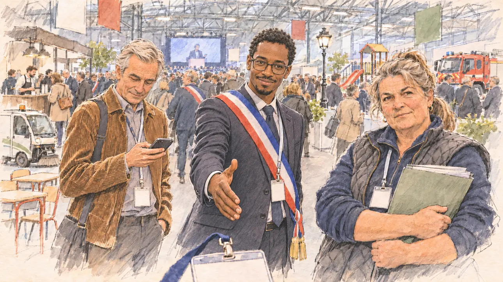

# `mayorsCongress` · Le Congrès des maires

**À générer.** Prompt prêt le 04/11/2026, pas encore d'image validée.



| Champ | Valeur |
| --- | --- |
| Carte | `mayorsCongress`, catégorie `rendezvous` (Rendez-vous), carte ajoutée par la PR #297 de l'app |
| Style | Reportage dessiné, trait de `primeTime` |
| Ton | Observateur, affairé |
| Date | À remplir |
| Outil | ChatGPT Images |
| Conversation | À remplir (le lien ne s'ouvre qu'avec le compte qui l'a créée) |
| Format rendu | À remplir |
| Fichier d'origine | À remplir |
| Première édition | À remplir |

## Texte de la carte

> **Le Congrès des maires**
>
> Le Congrès des maires s'ouvre porte de Versailles : des milliers d'élus de toute la France, nouveau mandat en main, se retrouvent sous un même toit. Tous les candidats viennent leur faire la cour.

## Le moment choisi

Une allée du salon du Congrès des maires, porte de Versailles, un matin de fin novembre, vue depuis la place du candidat (hors champ), son badge de visiteur vierge au premier plan. Une maire d'une petite commune l'arrête dans l'allée, son dossier de doléances serré contre elle, et attend de voir s'il connaît ses dossiers ; à côté d'elle, un maire de ville moyenne et un jeune maire. Autour : la foule des élus aux badges, quelques écharpes tricolores, les stands des fournisseurs des communes (un petit utilitaire électrique, du mobilier d'école, des lampadaires, une aire de jeux, un camion de pompiers), un écran géant qui retransmet la séance plénière, la charpente du hall.

## Prompt complet

Dans une nouvelle conversation, avec [`primeTime.webp`](../../illustrations/media/primeTime.webp) comme seule image de référence.

```
Use the attached image as the style reference and copy its drawing: a realistic reportage drawing made on the spot for a newspaper, with quick, nervous pencil lines, often drawn twice, ink hatching in the shadows, transparent watercolour washes that spill a little over the lines, and the warm paper showing through. Not the same scene and not the same people: never reuse the face or the hair of the woman in the reference.
Like in the reference, the setting can be full when the story needs it, with the things that say where we are and what is happening, but each one is sketched with a few pencil lines and a light wash, never rendered or finished, and the drawing gets looser and paler towards the edges until it fades into the bare paper.
This must look like a drawing made by hand on paper by a press illustrator, halfway between a quick sketch and a realistic picture: never a photograph, a film poster or a digital painting, and never a cartoon, a comic strip, a caricature or a children's book illustration. Continuous lines, never dotted or dashed outlines; no uniform texture, speckles or hatching filter laid over the picture; no glossy highlights, no smooth gradients, in the sky and on the walls too. Colour can be rich in places, on a piece of clothing, a light or a flag, but it stays transparent and within the palette below. The fade into the paper at the edges stays narrow, without a wide white margin. No blur and no depth-of-field effect: everything, the foreground included, is drawn sharp, like a sketch made on the spot.
People are drawn from life with realistic anatomy and proportions, like in the reference: faces shaped with pencil lines, hatching and light washes, a little more finished than the background but never photographic (no photographic skin, no airbrushed or digital-painting look). Expressions stay natural and restrained, even in laughter or tears: no exaggerated grins, no wide-open mouths full of teeth, no rubbery or cartoonish faces.

Editorial illustration, landscape 16:9 (1536 × 864 px), the scene filling the frame, with only a light fade into the paper at the edges. An aisle of the exhibition hall of the congress of French mayors at Porte de Versailles in Paris, on a busy morning in late November 2026: thousands of mayors, freshly re-elected or newly elected, from all over France, and every presidential candidate comes to court them. The scene is seen from the place of the player's candidate, who stays off-camera: in the foreground, only a visitor's badge on a lanyard, blank, hanging at the bottom edge of the picture. In the right third, the mayor of a small rural commune, a short, sturdy woman in her fifties with a grey-blonde ponytail, a navy fleece under a quilted waistcoat and a delegate's badge on a lanyard, has stopped the candidate in the aisle: she holds a thick folder of her commune's demands against her chest and looks at the viewer with a frank, testing look, half amused, waiting to see whether the candidate knows the files, her face above mid-height. Beside her, a tall mayor of a mid-sized town in his sixties, with swept-back silver hair, clean-shaven, in a dark suit, his tricolour sash over his jacket, holds out a hand to shake, smiling politely; a young mayor in his thirties of West African origin, slim, with glasses and a corduroy jacket, looks at his phone, half listening. Behind them, the congress in full swing, sketched loosely in pencil and light washes: a crowd of mayors in suits and coats with badges, a few tricolour sashes here and there, the stands of the suppliers of town halls, a small electric utility van, school desks, a street lamp on display, a children's playground set, a red fire engine, a coffee bar with a queue, a giant screen relaying the plenary session with a speaker at a lectern too small to see, and the high metal roof of the hall with hanging banners left blank. Only the woman mayor looks at the viewer. Nothing on the badges, the folder, the stands, the screen or the banners is readable.

Style: Reportage drawing made on the spot, like a press illustrator or courtroom sketch artist: pencil and ink with loose watercolour washes, lively unfinished lines, white paper showing through.

Palette: navy #13203F, vellum #F5EFE1, gold #A9802A, brick #B5523B, ochre #D9A441, sage #8FA58A, slate #5E7186, sand #DCC8A4, warm grey #8C8279; use 4 to 6 of them, subtle warm paper grain.

Tone: observant and busy, the flat white light of the exhibition hall, the tricolour of the sashes and the red of the fire engine as the brightest notes.

Constraints: realistic proportions, natural expressions, never cartoonish or caricatured faces, drawn like the rest of the illustration and never photographic; people of varied ages, genders, origins and body types (heavy, stocky, round, tall, short, wiry, not only slim), each with a distinct face and haircut (no two people alike), drawn with respect and never as a joke; anatomically correct hands with exactly five fingers, few hands visible, the others in pockets, behind objects or out of frame; no readable text anywhere (the badges, the folder, the stands, the screen and the banners stay unreadable); no captions or speech bubbles; no logos or political party colours; no recognisable real person, no lookalike of a real politician or of a real mayor; no explicit violence; no photographic rendering, no blur or bokeh, no dotted outlines, no texture or hatching filter over the picture, no oil-paint texture, no wide white margin or frame (a light fade into the paper at the edges is fine).

Format: if 16:9 is not available, make 1536 × 1024 and keep the top 80 px and the bottom 80 px free of anything important (faces, hands, the main action): they will be cropped.
```

## Décisions prises sur cette image

Aucune pour l'instant.

## Essais écartés

Aucun pour l'instant.

## Retouches

Aucune.

## Relecture

À faire sur l'image validée.
