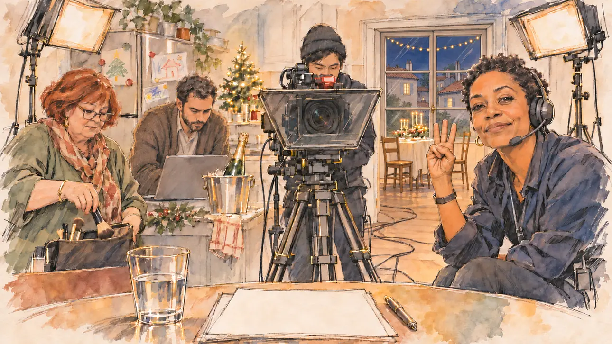

# `newYearWishes` · Les vœux du 31 décembre

**Validée par le PO le 04/11/2026**, au premier essai, avec `primeTime.webp` comme référence. Elle sert telle quelle en clair et en sombre.



| Champ | Valeur |
| --- | --- |
| Carte | `newYearWishes`, catégorie `rendezvous` (Rendez-vous), carte ajoutée par la PR #297 de l'app |
| Style | Reportage dessiné, trait de `primeTime` |
| Ton | Chaleureux, avec une pointe de trac |
| Date | 2026-11-04 |
| Outil | ChatGPT Images |
| Conversation | À remplir (le lien ne s'ouvre qu'avec le compte qui l'a créée) |
| Format rendu | 1672 × 941 (16:9) : export en 1290 × 726 px, WebP de qualité 75, 140 Ko, sans recadrage |
| Fichier d'origine | Image de ChatGPT, chez le PO. L'export du dépôt a été fait depuis la copie partagée dans la conversation avec Claude |
| Première édition | La prochaine Release qui suit le merge de la PR #297 de l'app |

## Texte de la carte

> **Les vœux du 31 décembre**
>
> Chaque 31 décembre, le chef de l'État s'adresse au pays. Une chaîne d'information vous offre le même créneau pour vos propres vœux, et vos militants attendent un message.

## Le moment choisi

La cuisine du candidat transformée en plateau, le soir du 31 décembre, juste avant d'enregistrer les vœux, vue depuis sa chaise (hors champ) : au premier plan, le bord de la table et une feuille de notes vierge. La réalisatrice, casque sur les oreilles, lève trois doigts pour le compte à rebours et regarde le candidat. Autour : le cadreur derrière la caméra et son prompteur, la maquilleuse qui range son pinceau, le conseiller en communication sur son portable. Derrière, la cuisine : le frigo et ses magnets, le sapin et ses guirlandes, une bouteille de champagne au frais, et par la fenêtre les toits de Paris dans la nuit.

## Prompt complet

Dans une nouvelle conversation, avec [`primeTime.webp`](../../illustrations/media/primeTime.webp) comme seule image de référence.

```
Use the attached image as the style reference and copy its drawing: a realistic reportage drawing made on the spot for a newspaper, with quick, nervous pencil lines, often drawn twice, ink hatching in the shadows, transparent watercolour washes that spill a little over the lines, and the warm paper showing through. Not the same scene and not the same people: never reuse the face or the hair of the woman in the reference.
Like in the reference, the setting can be full when the story needs it, with the things that say where we are and what is happening, but each one is sketched with a few pencil lines and a light wash, never rendered or finished, and the drawing gets looser and paler towards the edges until it fades into the bare paper.
This must look like a drawing made by hand on paper by a press illustrator, halfway between a quick sketch and a realistic picture: never a photograph, a film poster or a digital painting, and never a cartoon, a comic strip, a caricature or a children's book illustration. Continuous lines, never dotted or dashed outlines; no uniform texture, speckles or hatching filter laid over the picture; no glossy highlights, no smooth gradients, in the sky and on the walls too. Colour can be rich in places, on a piece of clothing, a light or a flag, but it stays transparent and within the palette below. The fade into the paper at the edges stays narrow, without a wide white margin. No blur and no depth-of-field effect: everything, the foreground included, is drawn sharp, like a sketch made on the spot.
People are drawn from life with realistic anatomy and proportions, like in the reference: faces shaped with pencil lines, hatching and light washes, a little more finished than the background but never photographic (no photographic skin, no airbrushed or digital-painting look). Expressions stay natural and restrained, even in laughter or tears: no exaggerated grins, no wide-open mouths full of teeth, no rubbery or cartoonish faces.

Editorial illustration, landscape 16:9 (1536 × 864 px), the scene filling the frame, with only a light fade into the paper at the edges. The kitchen of the player's candidate, turned into a small film set on the evening of 31 December 2026, a few seconds before recording the candidate's New Year wishes, offered the same slot as the head of state's address by a news channel. The scene is seen from the candidate's chair, the candidate staying off-camera: in the foreground, only the edge of the kitchen table with a sheet of notes, blank, and a glass of water. In the right third, the video director, a Black woman in her forties with short natural hair and a headset, crouching beside the camera, raises three fingers for the countdown and looks at the viewer with a calm, encouraging smile, her face above mid-height. Around her: a young cameraman of East Asian origin with a black beanie behind a camera on a tripod, a teleprompter glass in front of the lens showing only pale blurred lines; a plump make-up artist in her sixties with a henna-red bob packing her brush away; a communications adviser in his thirties with a short beard and a cardigan, holding his breath over a laptop. Behind them, the family kitchen, sketched loosely in pencil and light washes: a fridge covered with children's drawings and magnets, a small Christmas tree with warm fairy lights, a bottle of champagne in an ice bucket, a festive table half laid in the next room, two softbox lights on stands, cables on the floor, and through the window the rooftops of Paris at night with a few lit windows. Only the director looks at the viewer. Nothing on the notes, the teleprompter, the laptop, the fridge or the bottle is readable.

Style: Reportage drawing made on the spot, like a press illustrator or courtroom sketch artist: pencil and ink with loose watercolour washes, lively unfinished lines, white paper showing through.

Palette: navy #13203F, vellum #F5EFE1, gold #A9802A, brick #B5523B, ochre #D9A441, sage #8FA58A, slate #5E7186, sand #DCC8A4, warm grey #8C8279; use 4 to 6 of them, subtle warm paper grain.

Tone: warm with a touch of stage fright, the soft light of the softboxes and the warm glow of the fairy lights against the deep blue night outside.

Constraints: realistic proportions, natural expressions, never cartoonish or caricatured faces, drawn like the rest of the illustration and never photographic; people of varied ages, genders, origins and body types (heavy, stocky, round, tall, short, wiry, not only slim), each with a distinct face and haircut (no two people alike), drawn with respect and never as a joke; anatomically correct hands with exactly five fingers, few hands visible, the others in pockets, behind objects or out of frame; no readable text anywhere (the notes, the teleprompter, the laptop, the fridge and the bottle stay unreadable); no captions or speech bubbles; no logos or political party colours; no recognisable real person, no lookalike of a real politician, and no portrait of a real head of state; no explicit violence; no photographic rendering, no blur or bokeh, no dotted outlines, no texture or hatching filter over the picture, no oil-paint texture, no wide white margin or frame (a light fade into the paper at the edges is fine).

Format: if 16:9 is not available, make 1536 × 1024 and keep the top 80 px and the bottom 80 px free of anything important (faces, hands, the main action): they will be cropped.
```

## Décisions prises sur cette image

Aucune.

## Essais écartés

Aucun.

## Retouches

Aucune.

## Relecture

Faite et validée par le PO le 04/11/2026.

- [x] Aucun texte lisible : les notes et le prompteur sont vierges, la bouteille n'a pas d'étiquette, les dessins du frigo ne sont que des dessins.
- [x] Aucun sosie d'une personne réelle.
- [x] Le candidat du joueur est hors champ.
- [x] Mains, visages et foules sans défaut visible à 343 px de large.
- [x] Aucune couleur ni aucun logo de parti. Des personnes variées par l'âge, le corps, l'origine et la coiffure.
- [x] En 3:2 : sans objet, l'image est en 16:9.
- [x] Lisible sur la page de l'événement, en clair et en sombre.

Ce que la relecture a accepté : par la fenêtre, des toits de tuiles d'une petite ville plutôt que les toits de Paris ; un léger reflet sur la bouteille et le seau à champagne.
