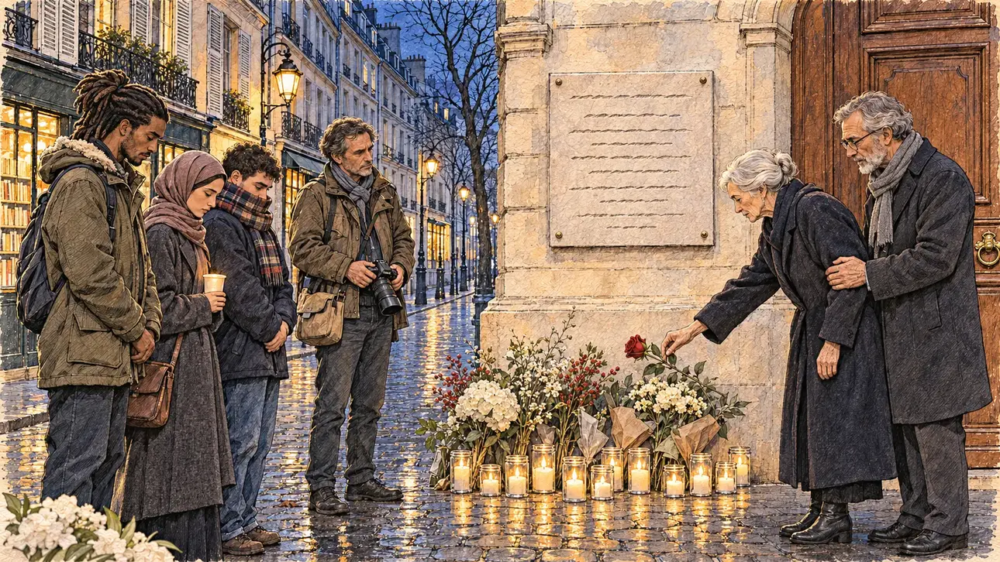

# `oussekineAnniversary` · Malik Oussekine, quarante ans

**Validée par le PO le 23/11/2026**, au premier essai, dans le trait d'`oldTweet`. Elle sert telle quelle en clair et en sombre.



| Champ | Valeur |
| --- | --- |
| Carte | `oussekineAnniversary`, catégorie `rendezvous` (Rendez-vous), carte ajoutée par la PR #480 de l'app |
| Style | Reportage dessiné, trait d'`oldTweet`, d'un rendu plus fini (voir les décisions) |
| Ton | Solennel, recueilli |
| Date | 2026-11-23 |
| Outil | ChatGPT Images |
| Format rendu | 1672 × 941 (16:9) : export en 1290 × 726 px depuis l'image partagée dans la conversation avec Claude, WebP de qualité 75, 276 Ko, sans recadrage |
| Fichier d'origine | Image de ChatGPT, chez le PO. L'export du dépôt a été fait depuis la copie partagée dans la conversation avec Claude |
| Première édition | `kit-france-2611-0004` |

## Texte de la carte

> **Malik Oussekine, quarante ans**
>
> Il y a quarante ans, dans la nuit du 5 au 6 décembre 1986, Malik Oussekine, étudiant, mourait sous les coups de policiers, rue Monsieur-le-Prince, en marge des manifestations contre la réforme universitaire. Un rassemblement est prévu devant la plaque.

## Le moment choisi

Le rassemblement d'aujourd'hui, jamais la nuit de 1986 : aucune image d'un drame réel, aucun portrait ni sosie de la victime (`docs/STORE_LISTING.md` de l'app, Apple 1.1.7). Une rue étroite du Quartier latin, un soir de décembre : devant la porte cochère d'un vieil immeuble, une plaque de pierre sans texte lisible, des fleurs et des bougies à son pied. Une femme âgée dépose une rose, soutenue par un homme de soixante ans ; des étudiants se recueillent, un photographe de presse attend. Le candidat est au fond de la foule, hors champ : au premier plan, le bord d'un bouquet blanc.

## Prompt complet

Dans une nouvelle conversation, avec [`oldTweet.webp`](../../illustrations/polemic/oldTweet.webp) comme seule image de référence.

```
Use the attached image as the style reference and copy its drawing: a realistic reportage drawing made on the spot for a newspaper, with quick, nervous pencil lines, often drawn twice, ink hatching in the shadows, transparent watercolour washes that spill a little over the lines, and the warm paper showing through. Not the same scene.
Like in the reference, the setting can be full when the story needs it, with the things that say where we are and what is happening, but each one is sketched with a few pencil lines and a light wash, never rendered or finished, and the drawing gets looser and paler towards the edges until it fades into the bare paper.
This must look like a drawing made by hand on paper by a press illustrator, halfway between a quick sketch and a realistic picture: never a photograph, a film poster or a digital painting, and never a cartoon, a comic strip, a caricature or a children's book illustration. Continuous lines, never dotted or dashed outlines; no uniform texture, speckles or hatching filter laid over the picture; no glossy highlights, no smooth gradients, in the sky and on the walls too. Colour can be rich in places, on a piece of clothing, a light or a flag, but it stays transparent and within the palette below. The fade into the paper at the edges stays narrow, without a wide white margin. No blur and no depth-of-field effect: everything, the foreground included, is drawn sharp, like a sketch made on the spot.
People are drawn from life with realistic anatomy and proportions, like in the reference: faces shaped with pencil lines, hatching and light washes, a little more finished than the background but never photographic (no photographic skin, no airbrushed or digital-painting look). Expressions stay natural and restrained, even in grief: no exaggerated expressions, no wide-open mouths, no rubbery or cartoonish faces.

Editorial illustration, landscape 16:9 (1536 × 864 px), the scene filling the frame, with only a light fade into the paper at the edges. A narrow old street of the Latin Quarter in Paris, on a cold December evening in 2026, during a quiet gathering of remembrance in front of a commemorative plaque, forty years after a student died there at the hands of police officers. Only the remembrance of today: no scene from the past, no police, no violence, no portrait of anyone. The player's candidate stands at the back of the crowd and stays off-camera: in the foreground, only the edge of a small bouquet of white flowers held low at the bottom edge of the picture. In the centre, on the pale stone wall beside the tall wooden carriage door of an old building, a rectangular stone plaque, its engraved lines drawn only as rows of small strokes, never letters. At the foot of the wall, a growing pile of bouquets and a dozen candles in glass jars. In the right third, an elderly woman in her eighties, small and slight, with white hair in a bun and a long dark coat, bends a little to lay a single red rose, her face above mid-height, calm and grave; a man in his sixties with a grey beard and glasses, who could have been a student in 1986, stands beside her, his hand on her arm. In the left third, a group of students in their twenties, varied: a tall young man with dreadlocks in a parka, a young woman with a headscarf and a long coat, a stocky young man with a scarf over his chin, one of them holding a candle in a paper cup, all standing still, heads slightly bowed. A little apart, a press photographer in his fifties with a camera lowered, waiting. Behind, sketched loosely in pencil and light washes: the narrow street with its old six-storey buildings, tall shuttered windows, wrought-iron balconies, a bookshop window lit warm, wet cobblestones only near the lamps, street lamps with a warm glow. Nobody looks at the viewer. Nothing on the plaque, the walls, the shops or the cups is readable.

Style: Reportage drawing made on the spot, like a press illustrator or courtroom sketch artist: pencil and ink with loose watercolour washes, lively unfinished lines, white paper showing through.

Palette: navy #13203F, vellum #F5EFE1, gold #A9802A, brick #B5523B, ochre #D9A441, sage #8FA58A, slate #5E7186, sand #DCC8A4, warm grey #8C8279; use 4 to 6 of them, subtle warm paper grain.

Tone: solemn and gathered, a dark blue December evening, the warm light of the candles and the street lamps on the faces.

Constraints: realistic proportions, natural expressions, never cartoonish or caricatured faces, drawn like the rest of the illustration and never photographic; people of varied ages, genders, origins and body types (heavy, stocky, round, tall, short, wiry, not only slim), each with a distinct face and haircut (no two people alike), drawn with respect and never as a joke; anatomically correct hands with exactly five fingers, few hands visible, the others in pockets, behind objects or out of frame; no readable text anywhere (the plaque, the walls, the shops and the cups stay unreadable); no captions, speech bubbles, banners or placards; no logos, flags or political party colours; no recognisable real person, no lookalike of a real politician and no portrait or photo of any victim; no police, no violence; no photographic rendering, no blur or bokeh, no dotted outlines, no texture or hatching filter over the picture, no oil-paint texture, no wide white margin or frame (a light fade into the paper at the edges is fine).

Format: if 16:9 is not available, make 1536 × 1024 and keep the top 80 px and the bottom 80 px free of anything important (faces, hands, the main action): they will be cropped.
```

## Décisions prises sur cette image

Le PO l'a gardée telle quelle (23/11/2026), malgré deux écarts relevés à la relecture : les pavés sont mouillés partout, avec de forts reflets, quand le prompt les voulait mouillés seulement près des réverbères (l'écart qui avait fait régénérer [`riots`](../crisis/riots.md)) ; le rendu est plus fini et plus pictural qu'`oldTweet`, avec une texture tissée sur les manteaux et les murs. Le message de correction proposé, non envoyé :

```
Keep the same scene, the same people, the same plaque and the same composition. Change only the rendering: the ground is dry, plain old cobblestones sketched with a few pencil lines, with no wet surface and no reflections, only a soft warm glow on the stones right under the candles and the lamps. Make the whole picture looser and lighter, closer to the reference: quick pencil lines and transparent watercolour washes, the paper showing through on the walls, the coats and the street, with no woven or fabric texture laid over the picture, and the buildings in the background paler and less finished.
```

## Essais écartés

Aucun.

## Retouches

Aucune.

## Relecture

Faite par Claude et validée par le PO le 23/11/2026.

- [x] Aucun texte lisible : la plaque ne porte que des traits, l'appareil photo un gribouillis à la place d'une marque.
- [x] Aucun sosie d'une personne réelle, aucun portrait ni photo de la victime.
- [x] Le candidat du joueur est hors champ.
- [x] Mains, visages et foules sans défaut visible à 343 px de large.
- [x] Aucune couleur ni aucun logo de parti, ni banderole ni pancarte, aucun policier. Des personnes variées par l'âge, le corps, l'origine et la coiffure.
- [x] En 3:2 : sans objet, l'image est en 16:9.
- [x] Lisible sur la page de l'événement, en clair et en sombre.
