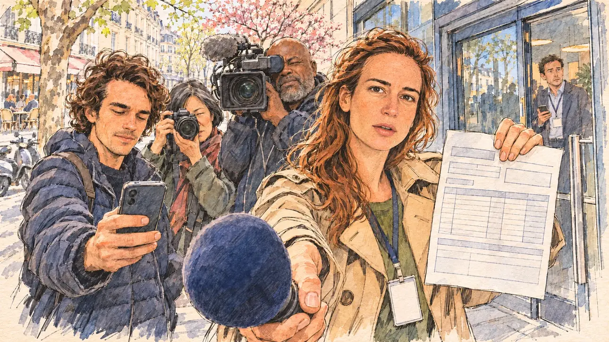

# `taxReturn` · Déclaration de revenus : la transparence

**À générer.** Prompt prêt le 04/11/2026, pas encore d'image validée.



| Champ | Valeur |
| --- | --- |
| Carte | `taxReturn`, catégorie `rendezvous` (Rendez-vous), carte ajoutée par la PR #297 de l'app |
| Style | Reportage dessiné, trait de `primeTime` |
| Ton | Observateur, un peu tendu |
| Date | À remplir |
| Outil | ChatGPT Images |
| Conversation | À remplir (le lien ne s'ouvre qu'avec le compte qui l'a créée) |
| Format rendu | À remplir |
| Fichier d'origine | À remplir |
| Première édition | À remplir |

## Texte de la carte

> **Déclaration de revenus : la transparence**
>
> La déclaration de revenus s'ouvre en ligne. À l'approche du premier tour, une journaliste demande aux candidats s'ils rendront la leur publique.

## Le moment choisi

Un point presse improvisé sur le trottoir devant le QG, un matin d'avril, vu depuis la place du candidat (hors champ), un micro tendu au premier plan. Une journaliste de radio pose la question, un formulaire de déclaration vierge à la main ; autour d'elle, un jeune reporter qui tend son téléphone, un cadreur et une photographe. Derrière, la porte vitrée du QG, une conseillère inquiète, un arbre en fleurs et la rue.

## Prompt complet

Dans une nouvelle conversation, avec trois images jointes, dans cet ordre : [`primeTime.webp`](../../illustrations/media/primeTime.webp) pour le style, puis le portrait dessiné de la journaliste, puis celui du jeune reporter, tous deux fournis par le PO. Les portraits ne sont pas dans ce dépôt.

```
Use the first attached image as the style reference and copy its drawing: a realistic reportage drawing made on the spot for a newspaper, with quick, nervous pencil lines, often drawn twice, ink hatching in the shadows, transparent watercolour washes that spill a little over the lines, and the warm paper showing through. Not the same scene and not the same people: never reuse the face or the hair of the woman in the reference.
Like in the reference, the setting can be full when the story needs it, with the things that say where we are and what is happening, but each one is sketched with a few pencil lines and a light wash, never rendered or finished, and the drawing gets looser and paler towards the edges until it fades into the bare paper.
Use the second and third attached images, two drawn portraits, only as likeness references. The second is the radio journalist: give her this woman's features, her long, loose, wavy auburn-brown hair and her freckles, at the same age as in the portrait. The third is the young reporter: give him this man's features, his shoulder-length curly brown hair and his light stubble, at the same age as in the portrait. Draw both faces with the same pencil lines and washes as the other people in the scene. Keep the likeness through the drawing, never through photographic detail.
This must look like a drawing made by hand on paper by a press illustrator, halfway between a quick sketch and a realistic picture: never a photograph, a film poster or a digital painting, and never a cartoon, a comic strip, a caricature or a children's book illustration. Continuous lines, never dotted or dashed outlines; no uniform texture, speckles or hatching filter laid over the picture; no glossy highlights, no smooth gradients, in the sky and on the walls too. Colour can be rich in places, on a piece of clothing, a light or a flag, but it stays transparent and within the palette below. The fade into the paper at the edges stays narrow, without a wide white margin. No blur and no depth-of-field effect: everything, the foreground included, is drawn sharp, like a sketch made on the spot.
People are drawn from life with realistic anatomy and proportions, like in the reference: faces shaped with pencil lines, hatching and light washes, a little more finished than the background but never photographic (no photographic skin, no airbrushed or digital-painting look). Expressions stay natural and restrained, even in laughter or tears: no exaggerated grins, no wide-open mouths full of teeth, no rubbery or cartoonish faces.

Editorial illustration, landscape 16:9 (1536 × 864 px), the scene filling the frame, with only a light fade into the paper at the edges. A pavement in Paris in front of the glass door of the player's candidate's campaign headquarters, on a bright morning in early April 2027, two weeks before the first round: online tax returns have just opened, and the press asks the candidates whether they will make theirs public. An improvised doorstep interview, seen from the place of the player's candidate, who stays off-camera: in the foreground, only the foam windscreen of a radio microphone held out towards the viewer. In the right third, the radio journalist who asks the question, the woman from the second portrait, in a beige trench coat with a press card on a lanyard, holds the microphone out with one hand and lifts in the other a printed tax return form, a page of blank boxes and columns, looking straight at the viewer with a polite, insistent smile, her face above mid-height. Around her, the rest of the press: the young reporter, the man from the third portrait, in a dark puffer jacket, holds out his smartphone to record; a heavy-set Black cameraman in his fifties with a short grey beard and a shaved head films over her shoulder; a small East Asian photographer in her fifties with a short black bob streaked with grey raises her camera. Behind them, sketched loosely in pencil and light washes: the glass door of the headquarters with a campaign staffer in a lanyard watching nervously, phone in hand, a plane tree in pale spring leaf and a cherry tree in blossom, parked scooters, a café terrace across the street and the pale stone façades. Only the journalist looks at the viewer. Nothing on the form, the press card, the door, the phone or the façades is readable.

Style: Reportage drawing made on the spot, like a press illustrator or courtroom sketch artist: pencil and ink with loose watercolour washes, lively unfinished lines, white paper showing through.

Palette: navy #13203F, vellum #F5EFE1, gold #A9802A, brick #B5523B, ochre #D9A441, sage #8FA58A, slate #5E7186, sand #DCC8A4, warm grey #8C8279; use 4 to 6 of them, subtle warm paper grain.

Tone: observant and a little tense, bright, fresh April morning light, spring colours in the trees.

Constraints: realistic proportions, natural expressions, never cartoonish or caricatured faces, drawn like the rest of the illustration and never photographic; people of varied ages, genders, origins and body types (heavy, stocky, round, tall, short, wiry, not only slim), each with a distinct face and haircut (no two people alike), drawn with respect and never as a joke; anatomically correct hands with exactly five fingers, few hands visible, the others in pockets, behind objects or out of frame; no readable text anywhere (the form, the press card, the door, the phone and the façades stay unreadable); no captions or speech bubbles; no logos or political party colours; apart from the radio journalist and the young reporter, no recognisable real person and no lookalike of a real politician or of a real journalist; no explicit violence; no photographic rendering, no blur or bokeh, no dotted outlines, no texture or hatching filter over the picture, no oil-paint texture, no wide white margin or frame (a light fade into the paper at the edges is fine).

Format: if 16:9 is not available, make 1536 × 1024 and keep the top 80 px and the bottom 80 px free of anything important (faces, hands, the main action): they will be cropped.
```

## Décisions prises sur cette image

- **La journaliste et le jeune reporter reprennent les traits de deux portraits dessinés fournis par le PO** (04/11/2026) : elle, de longs cheveux ondulés châtain roux et des taches de rousseur ; lui, des boucles brunes mi-longues et une barbe de trois jours. L'accord des deux personnes est à confirmer par le PO avant la validation de l'image. Les portraits ne sont pas dans ce dépôt, et la fiche ne nomme personne. Une seule étape : les portraits sont déjà dessinés.
- **Le cadreur est noir et la photographe asiatique** (PO, 04/11/2026), à la place des deux personnages du premier prompt.

## Essais écartés

Aucun pour l'instant.

## Retouches

Aucune.

## Relecture

À faire sur l'image validée.
