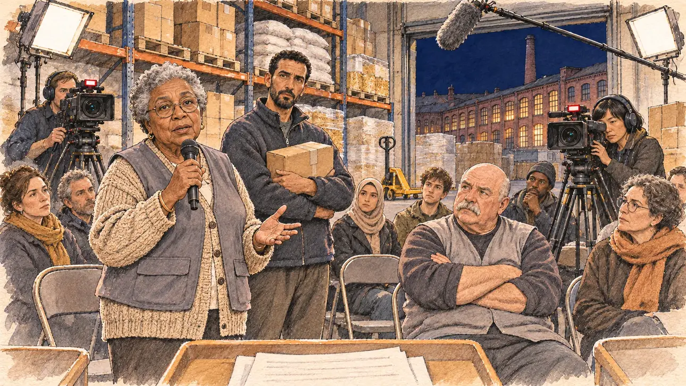

# `warehouseDebate` · Le débat de l'entrepôt

**Retenue par le PO le 19/11/2026** : l'image envoyée dans la session de l'app, sans retouche. Le nombre d'essais et les messages de correction sont à compléter. Elle sert telle quelle en clair et en sombre.



| Champ | Valeur |
| --- | --- |
| Carte | `warehouseDebate`, catégorie `rendezvous` (Rendez-vous), poids 0,15, du 15/11/2026 au 13/03/2027 (la campagne d'hiver de l'aide alimentaire), au tirage l'économie pèse +0,02 (Mitchnsun/moi-president, PO, 19/11/2026) |
| Style | Reportage dessiné |
| Ton | Tendu et observateur, la lumière blanche des projecteurs de télévision dans la pénombre de l'entrepôt |
| Date | 2026-11-19 |
| Outil | ChatGPT Images |
| Conversation | À remplir (le lien ne s'ouvre qu'avec le compte qui l'a créée) |
| Format rendu | 1672 × 941 (16:9) : export en 1290 × 726 px, WebP de qualité 75, 217 Ko, sans recadrage, fait depuis la copie WebP reçue |
| Fichier d'origine | Image de ChatGPT, chez le PO. L'export du dépôt a été fait depuis la copie partagée dans la conversation avec Claude |
| Première édition | `kit-france-2611-0004` |

## Texte de la carte

> **Le débat de l'entrepôt**
>
> À la veille de sa campagne d'hiver, le plus grand réseau d'aide alimentaire du pays invite les candidatures à débattre entre ses palettes. Les questions viendront des bénévoles et des personnes qu'il aide : une retraitée qui vit d'une petite pension, un père de famille qui travaille et vient chercher un colis. Les caméras de deux chaînes sont déjà là.

## Le moment choisi

Un entrepôt d'aide alimentaire en périphérie de Lille, un soir de novembre : des racks de palettes, un transpalette, et par la porte de quai ouverte le mur de brique rouge d'une ancienne filature. Entre les palettes, un plateau de télévision improvisé : des pupitres, deux caméras, une perche, des projecteurs, un public de bénévoles sur des chaises pliantes. Le candidat reste hors champ : seul le bord de son pupitre et ses notes, au bas du cadre. Une retraitée d'origine antillaise, micro en main, pose sa question en regardant le candidat ; derrière elle, un père de famille tient un colis. Le précédent est le débat du 16/11/2026 dans un entrepôt des Restos du Cœur : ni l'association, ni ses dirigeants, ni les présentateurs n'y sont reconnaissables.

## Prompt complet

Dans une nouvelle conversation, avec [`primeTime.webp`](../../illustrations/media/primeTime.webp) comme seule image de référence :

```
Use the attached image as the style reference and copy its drawing: a realistic reportage drawing made on the spot for a newspaper, with quick, nervous pencil lines, often drawn twice, ink hatching in the shadows, transparent watercolour washes that spill a little over the lines, and the warm paper showing through. Not the same scene and not the same people: never reuse the face or the hair of the woman in the reference.
Like in the reference, the setting can be full when the story needs it, with the things that say where we are and what is happening, but each one is sketched with a few pencil lines and a light wash, never rendered or finished, and the drawing gets looser and paler towards the edges until it fades into the bare paper.
This must look like a drawing made by hand on paper by a press illustrator, halfway between a quick sketch and a realistic picture: never a photograph, a film poster or a digital painting, and never a cartoon, a comic strip, a caricature or a children's book illustration. Continuous lines, never dotted or dashed outlines; no uniform texture, speckles or hatching filter laid over the picture; no glossy highlights, no smooth gradients, in the sky and on the walls too. Colour can be rich in places, on a piece of clothing, a light or a flag, but it stays transparent and within the palette below. The fade into the paper at the edges stays narrow, without a wide white margin. No blur and no depth-of-field effect: everything, the foreground included, is drawn sharp, like a sketch made on the spot.
People are drawn from life with realistic anatomy and proportions, like in the reference: faces shaped with pencil lines, hatching and light washes, a little more finished than the background but never photographic (no photographic skin, no airbrushed or digital-painting look). Expressions stay natural and restrained, even in laughter or tears: no exaggerated grins, no wide-open mouths full of teeth, no rubbery or cartoonish faces.

Editorial illustration, landscape 16:9 (1536 × 864 px), the scene filling the frame, with only a light fade into the paper at the edges. Inside a food aid warehouse on the outskirts of Lille, in the north of France, on a November evening in 2027: tall metal racks loaded with pallets of cardboard boxes, flour and pasta wrapped in plastic film, a pallet truck parked aside, and through an open loading door the red-brick wall of an old textile mill under a dark sky. Between the pallets, a makeshift television set: a few lecterns in a row, two TV cameras on tripods, a boom microphone, soft-box lights, a small audience of volunteers on folding chairs. The player's candidate stays off-camera: in the foreground, only the edge of the candidate's lectern and a few sheets of notes on it, at the bottom of the frame. In the left third, standing up from the audience with a hand-held microphone, a retired woman in her early seventies, small and round, of Caribbean descent, with short grey curly hair, round glasses and a knitted cardigan over a volunteer's sleeveless vest, asks her question and looks straight at the viewer, calm and serious, her face above mid-height. Behind her, a father in his forties, tall and lean, of North African descent, with a short black beard and a work fleece, holds a food parcel against his chest and listens; a heavy-set white volunteer in his sixties with a bald head and a grey moustache sits with his arms crossed; a young camerawoman of Vietnamese descent with a black bob and headphones frames the shot behind her camera. Only the retired woman and the father look at the viewer; the others watch her or their equipment. Nothing on the boxes, the lecterns, the vests, the cameras or the walls is readable.

Style: Reportage drawing made on the spot, like a press illustrator or courtroom sketch artist: pencil and ink with loose watercolour washes, lively unfinished lines, white paper showing through.

Palette: navy #13203F, vellum #F5EFE1, gold #A9802A, brick #B5523B, ochre #D9A441, sage #8FA58A, slate #5E7186, sand #DCC8A4, warm grey #8C8279; use 4 to 6 of them, subtle warm paper grain.

Tone: tense and observant, the white glare of the TV lights on the faces against the dim warehouse, the cardboard in warm sand and ochre, the night outside the loading door in navy.

Constraints: realistic proportions, natural expressions, never cartoonish or caricatured faces, drawn like the rest of the illustration and never photographic; people of varied ages, genders, origins and body types (heavy, stocky, round, tall, short, wiry, not only slim), each with a distinct face and haircut (no two people alike), drawn with respect and never as a joke; each person's age, build and look plausible for their job and the scene (working people of working age), no stereotype tying an origin or a gender to a role, and no person of colour shown alone in a featured service or deferential role; anatomically correct hands with exactly five fingers, few hands visible, the others in pockets, behind objects or out of frame; no readable text anywhere (the boxes, the lecterns, the vests, the cameras and the notes stay unreadable, no charity name, no channel logo); no captions or speech bubbles; no logos, no charity logo or heart emblem, no political party colours; no recognisable real person, no lookalike of a real politician, a real TV presenter or a real charity leader; no candidate visible at the other lecterns, only their empty edges; no explicit violence; no photographic rendering, no blur or bokeh, no dotted outlines, no texture or hatching filter over the picture, no oil-paint texture, no wide white margin or frame (a light fade into the paper at the edges is fine).

Format: if 16:9 is not available, make 1536 × 1024 and keep the top 80 px and the bottom 80 px free of anything important (faces, hands, the main action): they will be cropped.
```

## Décisions prises sur cette image

Retenue par le PO (19/11/2026).

## Essais écartés

À compléter.

## Retouches

Aucune.

## Relecture

Faite le 19/11/2026 sur l'image reçue, zoomée sur le texte possible et les mains ; retenue par le PO le même jour.

- [x] Aucun texte lisible : cartons, pupitres, gilets, caméras et notes sans inscription ; les feuilles du pupitre au premier plan n'ont que des traits.
- [x] Le candidat du joueur est hors champ : seul le bord de son pupitre et ses notes, au bas du cadre.
- [x] Écart au prompt : le public est plus nombreux que demandé (une femme voilée, un jeune homme, une femme à lunettes, un caméraman de plus) et les deux caméras ont un voyant rouge ; la retraitée et le père regardent le candidat comme demandé.
- [x] Rendu : un grain craquelé couvre l'image, la dérive que le gabarit signale (« no mottled, crackled or speckled texture ») ; le PO l'a gardée telle quelle.
- [x] Aucun sosie d'une personne réelle repéré.
- [x] Mains sans défaut visible.
- [x] Aucune couleur, aucun logo ni aucun drapeau de parti. Des personnes variées par l'âge, le corps, l'origine et la coiffure.
- [x] En 16:9 : pas de recadrage.
- [ ] Lisible sur la page de l'événement, en clair et en sombre : à vérifier dans l'app, une fois la carte publiée.
