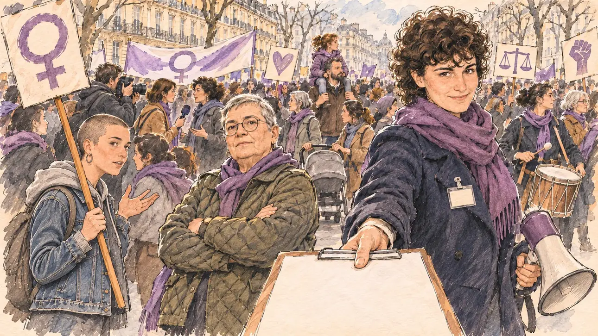

# `womensDay` · 8 mars : l'égalité en tête

**À générer.** Prompt prêt le 04/11/2026, pas encore d'image validée.



| Champ | Valeur |
| --- | --- |
| Carte | `womensDay`, catégorie `rendezvous` (Rendez-vous), carte ajoutée par la PR #297 de l'app |
| Style | Reportage dessiné, trait de `primeTime` |
| Ton | Observateur, déterminé |
| Date | À remplir |
| Outil | ChatGPT Images |
| Conversation | À remplir (le lien ne s'ouvre qu'avec le compte qui l'a créée) |
| Format rendu | À remplir |
| Fichier d'origine | À remplir |
| Première édition | À remplir |

## Texte de la carte

> **8 mars : l'égalité en tête**
>
> Lundi, c'est la Journée internationale des droits des femmes. Cortèges et tribunes se multiplient, et des associations demandent aux candidats ce qu'ils comptent faire pour l'égalité salariale.

## Le moment choisi

Le cortège du 8 mars sur un grand boulevard parisien, en fin d'après-midi, vu depuis le trottoir où se tient le candidat (hors champ), un questionnaire tendu au premier plan. La porte-parole d'une association, mégaphone à la main, lui tend le questionnaire sur l'égalité salariale et attend une réponse ; à côté d'elle, une syndicaliste et une étudiante. Derrière, le cortège : pancartes sans mots, foulards violets, banderoles, familles et poussettes, une journaliste au micro, les façades haussmanniennes.

## Prompt complet

Dans une nouvelle conversation, avec deux images jointes, dans cet ordre : [`primeTime.webp`](../../illustrations/media/primeTime.webp) pour le style, puis le portrait dessiné fourni par le PO pour la ressemblance de la porte-parole. Le portrait n'est pas dans ce dépôt.

```
Use the first attached image as the style reference and copy its drawing: a realistic reportage drawing made on the spot for a newspaper, with quick, nervous pencil lines, often drawn twice, ink hatching in the shadows, transparent watercolour washes that spill a little over the lines, and the warm paper showing through. Not the same scene and not the same people: never reuse the face or the hair of the woman in the reference.
Like in the reference, the setting can be full when the story needs it, with the things that say where we are and what is happening, but each one is sketched with a few pencil lines and a light wash, never rendered or finished, and the drawing gets looser and paler towards the edges until it fades into the bare paper.
Use the second attached image, a drawn portrait, only as the likeness reference for the spokeswoman: give her this woman's features, her short, thick, curly dark-brown hair and her dark eyebrows, at the same age as in the portrait, and draw her face with the same pencil lines and washes as the other people in the scene. Keep the likeness through the drawing, never through photographic detail.
This must look like a drawing made by hand on paper by a press illustrator, halfway between a quick sketch and a realistic picture: never a photograph, a film poster or a digital painting, and never a cartoon, a comic strip, a caricature or a children's book illustration. Continuous lines, never dotted or dashed outlines; no uniform texture, speckles or hatching filter laid over the picture; no glossy highlights, no smooth gradients, in the sky and on the walls too. Colour can be rich in places, on a piece of clothing, a light or a flag, but it stays transparent and within the palette below. The fade into the paper at the edges stays narrow, without a wide white margin. No blur and no depth-of-field effect: everything, the foreground included, is drawn sharp, like a sketch made on the spot.
People are drawn from life with realistic anatomy and proportions, like in the reference: faces shaped with pencil lines, hatching and light washes, a little more finished than the background but never photographic (no photographic skin, no airbrushed or digital-painting look). Expressions stay natural and restrained, even in laughter or tears: no exaggerated grins, no wide-open mouths full of teeth, no rubbery or cartoonish faces.

Editorial illustration, landscape 16:9 (1536 × 864 px), the scene filling the frame, with only a light fade into the paper at the edges. A big boulevard in Paris on the afternoon of 8 March 2027, International Women's Day: the march fills the street, and associations ask the presidential candidates what they will do for equal pay. The scene is seen from the pavement where the player's candidate stands, who stays off-camera: in the foreground, only the edge of a clipboard held out towards the viewer, with a questionnaire on it, blank. In the right third, the spokeswoman of a women's rights association, the woman from the portrait, with a purple scarf around her neck, a dark wool coat and a badge without words, holds out the clipboard with one hand and a megaphone lowered in the other, and looks straight at the viewer, firm and expectant, waiting for an answer, her face above mid-height. Beside her, a stocky union representative in her sixties with a short grey crop, round glasses and a quilted jacket, arms crossed, looks at the viewer too; a young student with a shaved head and a denim jacket holds a placard on a stick and talks with someone behind her. Behind them, the march in full flow along the boulevard, sketched loosely in pencil and light washes: a dense crowd of women and men of all ages, purple scarves and ribbons, handmade placards and long banners with no words, only colours and drawn symbols, a father with a child on his shoulders, a pushchair, a drummer, a press photographer and a journalist with a microphone, the tall pale Haussmann façades and their balconies, a few bare plane trees. Only the three women in front look at the viewer. Nothing on the placards, banners, badges, questionnaire or façades is readable.

Style: Reportage drawing made on the spot, like a press illustrator or courtroom sketch artist: pencil and ink with loose watercolour washes, lively unfinished lines, white paper showing through.

Palette: navy #13203F, vellum #F5EFE1, gold #A9802A, brick #B5523B, ochre #D9A441, sage #8FA58A, slate #5E7186, sand #DCC8A4, warm grey #8C8279; use 4 to 6 of them, subtle warm paper grain. A few touches of muted violet for the scarves and ribbons of the march, the colour of the day and of no political party.

Tone: observant and determined, bright late-winter afternoon light on the façades, the purple of the scarves and ribbons as the one colour of the day.

Constraints: realistic proportions, natural expressions, never cartoonish or caricatured faces, drawn like the rest of the illustration and never photographic; people of varied ages, genders, origins and body types (heavy, stocky, round, tall, short, wiry, not only slim), each with a distinct face and haircut (no two people alike), drawn with respect and never as a joke; anatomically correct hands with exactly five fingers, few hands visible, the others in pockets, behind objects or out of frame; no readable text anywhere (the placards, the banners, the badges, the questionnaire and the façades stay unreadable); no captions or speech bubbles; no logos or political party colours; apart from the spokeswoman, no recognisable real person and no lookalike of a real politician or of a real activist or union leader; no explicit violence; no photographic rendering, no blur or bokeh, no dotted outlines, no texture or hatching filter over the picture, no oil-paint texture, no wide white margin or frame (a light fade into the paper at the edges is fine).

Format: if 16:9 is not available, make 1536 × 1024 and keep the top 80 px and the bottom 80 px free of anything important (faces, hands, the main action): they will be cropped.
```

## Décisions prises sur cette image

- **La porte-parole reprend les traits d'un portrait dessiné fourni par le PO** (04/11/2026) : ses cheveux courts, épais et bouclés remplacent la coupe du premier prompt. L'accord de la personne est à confirmer par le PO avant la validation de l'image. Le portrait n'est pas dans ce dépôt, et la fiche ne nomme personne. Une seule étape : le portrait est déjà dessiné.
- **Quelques touches de violet sourd** pour les foulards et les rubans du cortège, hors de la palette : c'est la couleur de la journée, celle d'aucun parti (PO, 04/11/2026).

## Essais écartés

Aucun pour l'instant.

## Retouches

Aucune.

## Relecture

À faire sur l'image validée.
