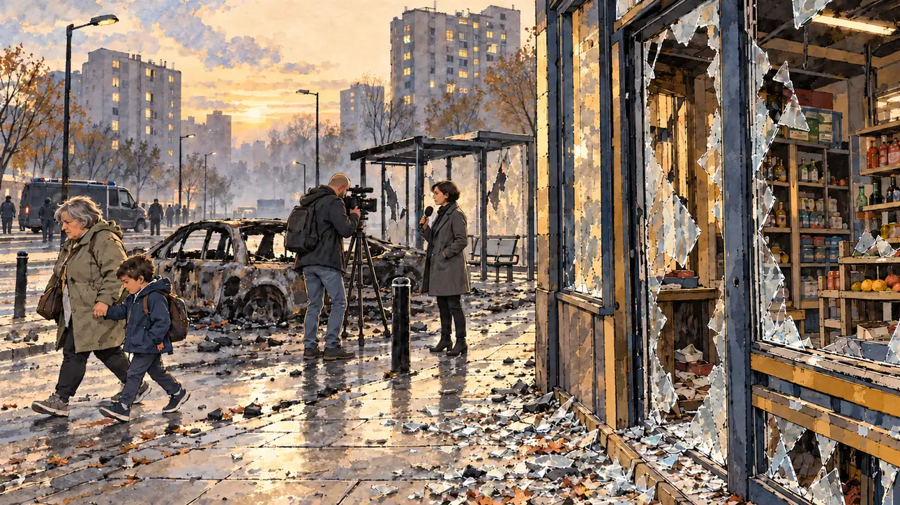

# `riots` · Nuits d'émeutes

**Validée par le PO le 31/10/2026**, après une retouche du PO. Elle sert telle quelle en clair et en sombre.



| Champ | Valeur |
| --- | --- |
| Carte | `riots`, catégorie `crisis` (Crise) |
| Style | Reportage dessiné |
| Ton | Tendu et sobre |
| Date | 2026-10-31 |
| Outil | ChatGPT, ChatGPT Images 2.5 ; mode et effort : non précisés |
| Conversation | À remplir (le lien ne s'ouvre qu'avec le compte qui l'a créée) |
| Format rendu | 1672 × 941 (16:9) : export en 1290 × 726 px depuis le PNG d'origine, WebP de qualité 60 pour rester sous 180 Ko (177 Ko), sans recadrage |
| Fichier d'origine | PNG de ChatGPT, chez le PO, partagé aussi dans la conversation avec Claude |
| Première édition | À remplir |

## Texte de la carte

> **Nuits d'émeutes**
>
> Plusieurs nuits d'émeutes dans des quartiers de banlieue : la sécurité écrase tous les autres sujets.

## Le moment choisi

Le lendemain matin, à l'aube, dans une cité : pas de feu, pas d'affrontement, pas de blessé, seulement les traces. La vitrine brisée d'une épicerie, la carcasse noircie d'une voiture, un abribus sans vitres, un fourgon de police au loin. Une grand-mère presse un enfant vers l'école, et une équipe de télé tourne devant la voiture.

## Prompt complet

Dans une nouvelle conversation, avec [`oldTweet.webp`](oldTweet.webp) comme seule image de référence :

```
Use the attached image as the style reference: the same pencil and ink drawing with loose watercolour washes and warm paper grain. Faces, hands and objects are drawn with visible ink lines, never photographic. Not the same scene.

Editorial illustration, landscape 16:9 (1536 × 864 px), filling the whole frame edge to edge. A housing estate on the outskirts of a French city, at dawn in 2027, after several nights of riots. The player's candidate has come the morning after and stays off-camera: in the foreground, only a few shards of glass on the pavement. In the right third, the owner of the corner grocery, a heavy-set man in his sixties, bald, with a thick white moustache and a cardigan, leans on his broom in front of his shattered shop window and looks up at the viewer with tired eyes, his face above mid-height. Nearby, a youth worker, a tall woman in her thirties with long box braids and a tracksuit jacket, arms crossed, also looks at the viewer, waiting to see what the candidate will say. Behind them, the blackened shell of a burnt car, a bus shelter without its glass, a police van parked at a distance; a short, round woman with a grey bob and a raincoat hurries a small boy with a backpack to school; a lanky reporter with a shaved head films the burnt car. Tower blocks with lit windows rise in the morning haze. No fire, no fighting, no injured person: only the aftermath. Nothing on the walls, the shop or the van is readable.

Style: Reportage drawing made on the spot, like a press illustrator or courtroom sketch artist: pencil and ink with loose watercolour washes, lively unfinished lines, white paper showing through.

Palette: navy #13203F, vellum #F5EFE1, gold #A9802A, brick #B5523B, ochre #D9A441, sage #8FA58A, slate #5E7186, sand #DCC8A4, warm grey #8C8279; use 4 to 6 of them, subtle warm paper grain.

Tone: tense and sober, cold grey dawn light, a thin haze of old smoke.

Constraints: realistic proportions, expressive but not caricatured faces, people of varied ages, genders, origins and body types (heavy, stocky, round, tall, short, wiry, not only slim), each with a distinct face and haircut (no two people alike), drawn with respect and never as a joke; anatomically correct hands with exactly five fingers, few hands visible, the others in pockets, behind objects or out of frame; no readable text anywhere (walls, signs, labels and screens stay unreadable); no captions or speech bubbles; no logos, flags or political party colours; no recognisable real person, no lookalike of a real politician; no explicit violence; no oil-paint texture, no white or ragged border.

Format: if 16:9 is not available, make 1536 × 1024 and keep the top 80 px and the bottom 80 px free of anything important (faces, hands, the main action): they will be cropped.
```

## Retouches

Le PO a retiré les deux personnages du premier plan, l'épicier et l'animatrice de quartier, qui regardaient le candidat. La scène montre le quartier au lendemain, sans personne qui interpelle le candidat.

## Relecture

Faite et validée par le PO le 31/10/2026, après la retouche.

- [x] Aucun texte lisible : ni sur les murs, ni dans l'épicerie, ni sur le fourgon.
- [x] Aucun sosie d'une personne réelle.
- [x] Le candidat du joueur est hors champ.
- [x] Mains, visages et foules sans défaut visible à 343 px de large.
- [x] Aucune couleur de parti, aucun symbole officiel. Pas de violence explicite ni de blessé.
- [x] En 3:2 : rien d'important dans les 80 px du haut et du bas. Sans objet ici : l'image est en 16:9.
- [x] Lisible sur la page de l'événement, en clair et en sombre.
