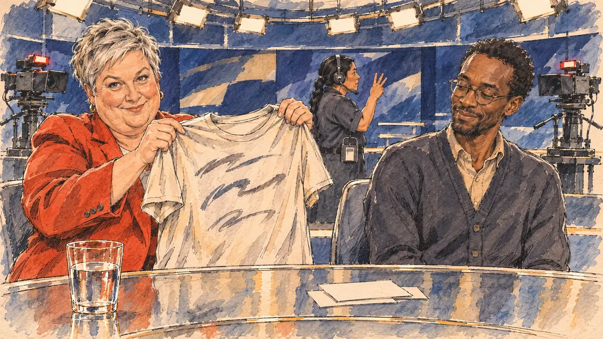

# `counterMerch` · Le contre-produit

**Validée par le PO le 19/11/2026**, au premier essai. Elle sert telle quelle en clair et en sombre.



| Champ | Valeur |
| --- | --- |
| Carte | `counterMerch`, catégorie `shop` (Boutique), poids 0,3, tant que la boutique est ouverte ; carte ajoutée par la PR #460 de l'app (Mitchnsun/moi-president#265) |
| Style | Reportage dessiné |
| Ton | Ironique, un piège en direct |
| Date | 2026-11-19 |
| Outil | ChatGPT Images, modèle GPT 6.2, effort Light |
| Conversation | À compléter |
| Format rendu | 1672 × 941 (16:9) : export en 1290 × 726 px, WebP de qualité 75, 200 Ko, sans recadrage, fait depuis la copie WebP de la conversation |
| Fichier d'origine | Image de ChatGPT, chez le PO. L'export du dépôt a été fait depuis la copie partagée dans la conversation avec Claude |
| Première édition | À compléter |

## Texte de la carte

> **Le contre-produit**
>
> L'équipe d'une candidature rivale vend un tee-shirt qui détourne votre slogan. Il s'arrache.

## Le moment choisi

Le plateau d'une émission de débat du soir, sur une chaîne d'information, sans ville reconnaissable, en direct : l'animatrice déplie devant son invité, le candidat, le tee-shirt de la candidature rivale qui détourne son slogan. Le candidat reste hors champ, à la place de l'invité : au premier plan, le bord de la table, son verre d'eau et ses fiches. L'animatrice regarde le spectateur avec un sourire malicieux, le tee-shirt tendu à bout de bras ; le chroniqueur retient un rire ; la cheffe de plateau compte les secondes. La candidature rivale reste anonyme : ni nom, ni visage, ni couleur sur le tee-shirt, dont le motif n'est que des traits de pinceau illisibles. C'est le plateau de télévision de la série, de nuit, différent du studio de [`primeTime`](../media/primeTime.md).

## Prompt complet

Dans une nouvelle conversation, avec [`primeTime.webp`](../../illustrations/media/primeTime.webp) comme seule image de référence :

```
Use the attached image as the style reference and copy its drawing: a realistic reportage drawing made on the spot for a newspaper, with quick, nervous pencil lines, often drawn twice, ink hatching in the shadows, transparent watercolour washes that spill a little over the lines, and the warm paper showing through. Not the same scene and not the same people: never reuse the face or the hair of the woman in the reference.
Like in the reference, the setting can be full when the story needs it, with the things that say where we are and what is happening, but each one is sketched with a few pencil lines and a light wash, never rendered or finished, and the drawing gets looser and paler towards the edges until it fades into the bare paper.
This must look like a drawing made by hand on paper by a press illustrator, halfway between a quick sketch and a realistic picture: never a photograph, a film poster or a digital painting, and never a cartoon, a comic strip, a caricature or a children's book illustration. Continuous lines, never dotted or dashed outlines; no uniform texture, speckles or hatching filter laid over the picture; no glossy highlights, no smooth gradients, in the sky and on the walls too. Colour can be rich in places, on a piece of clothing, a light or a flag, but it stays transparent and within the palette below. The fade into the paper at the edges stays narrow, without a wide white margin. No blur and no depth-of-field effect: everything, the foreground included, is drawn sharp, like a sketch made on the spot.
People are drawn from life with realistic anatomy and proportions, like in the reference: faces shaped with pencil lines, hatching and light washes, a little more finished than the background but never photographic (no photographic skin, no airbrushed or digital-painting look). Expressions stay natural and restrained, even in laughter or tears: no exaggerated grins, no wide-open mouths full of teeth, no rubbery or cartoonish faces.

Editorial illustration, landscape 16:9 (1536 × 864 px), the scene filling the frame, with only a light fade into the paper at the edges. The set of a late-evening debate show on a news channel, in 2027, live: a curved glass desk, a dark blue backdrop of screens showing abstract shapes, studio cameras on pedestals and a ring of lights above. The player's candidate is the guest and stays off-camera, in the guest's seat: in the foreground, only the edge of the desk with the candidate's glass of water and a few note cards. In the left third, the host, a heavy-set white woman in her fifties with a silver pixie cut and a bright brick-red jacket, holds up at arm's length a T-shirt sold by a rival candidacy that twists the campaign's slogan, and looks at the viewer with a mischievous smile, her face above mid-height. Beside her, a columnist in his thirties of Congolese descent, slim, with round glasses and a cardigan, holds back a laugh, his eyes on the T-shirt. In the background, the floor manager, a short woman in her forties of Peruvian descent with a long black plait and a headset, signals the seconds with her hand. Only the host looks at the viewer. The rival candidacy stays anonymous: the T-shirt shows only a few loose brush strokes that look like lettering but cannot be read, no face, no name, no party colour. Nothing on the screens, the cards, the cameras or the desk is readable.

Style: Reportage drawing made on the spot, like a press illustrator or courtroom sketch artist: pencil and ink with loose watercolour washes, lively unfinished lines, white paper showing through.

Palette: navy #13203F, vellum #F5EFE1, gold #A9802A, brick #B5523B, ochre #D9A441, sage #8FA58A, slate #5E7186, sand #DCC8A4, warm grey #8C8279; use 4 to 6 of them, subtle warm paper grain.

Tone: gently ironic, a trap set live, postures slightly exaggerated but never the faces, bright studio light and the deep blue of the set.

Constraints: realistic proportions, natural expressions, never cartoonish or caricatured faces, drawn like the rest of the illustration and never photographic; people of varied ages, genders, origins and body types (heavy, stocky, round, tall, short, wiry, not only slim), each with a distinct face and haircut (no two people alike), drawn with respect and never as a joke; each person's age, build and look plausible for their job and the scene (working people of working age), no stereotype tying an origin or a gender to a role, and no person of colour shown alone in a featured service or deferential role; anatomically correct hands with exactly five fingers, few hands visible, the others in pockets, behind objects or out of frame; no readable text anywhere (the T-shirt, the screens, the note cards, the cameras and the desk stay unreadable); no captions or speech bubbles; no logos, no channel logo, no political party colours, no rival candidate shown in any way; no recognisable real person, no lookalike of a real politician or television presenter; no explicit violence; no photographic rendering, no blur or bokeh, no dotted outlines, no texture or hatching filter over the picture, no oil-paint texture, no wide white margin or frame (a light fade into the paper at the edges is fine).

Format: if 16:9 is not available, make 1536 × 1024 and keep the top 80 px and the bottom 80 px free of anything important (faces, hands, the main action): they will be cropped.
```

## Essais écartés

Aucun.

## Retouches

Aucune.

## Relecture

Faite et validée par le PO le 19/11/2026.

- [x] Aucun texte lisible : le tee-shirt rival ne porte que des traits de pinceau ; les écrans du décor, les fiches, le badge et les caméras sont vierges.
- [x] La candidature rivale reste anonyme : ni nom, ni visage, ni couleur de parti ; aucun logo de chaîne.
- [x] Aucun sosie d'une personne réelle, animatrice comprise.
- [x] Le candidat du joueur est hors champ, à la place de l'invité : seuls son verre d'eau et ses fiches, au premier plan.
- [x] Mains et visages sans défaut visible à 343 px de large : les mains de l'animatrice sur le tee-shirt, celle de la cheffe de plateau qui compte les secondes.
- [x] Aucune couleur ni aucun logo de parti. Des personnes variées par l'âge, le corps, l'origine et la coiffure.
- [x] En 16:9 : pas de recadrage.
- [ ] Lisible sur la page de l'événement, en clair et en sombre : à vérifier dans l'app, une fois la carte publiée.
