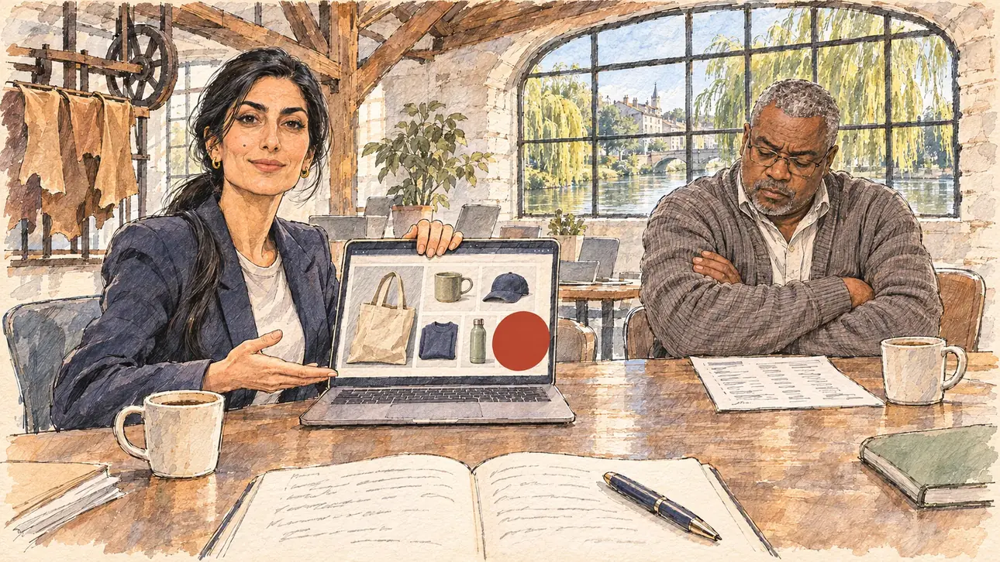

# `fakeDiscount` · La fausse promotion

**Validée par le PO le 19/11/2026**, au premier essai. Elle sert telle quelle en clair et en sombre.



| Champ | Valeur |
| --- | --- |
| Carte | `fakeDiscount`, catégorie `shop` (Boutique), poids 0,25, tant que la boutique est ouverte ; carte ajoutée par la PR #460 de l'app (Mitchnsun/moi-president#265) |
| Style | Reportage dessiné |
| Ton | Ironique, une tentation |
| Date | 2026-11-19 |
| Outil | ChatGPT Images, à compléter (modèle et effort) |
| Conversation | À compléter |
| Format rendu | 1672 × 941 (16:9) : export en 1290 × 726 px, WebP de qualité 75, 221 Ko, sans recadrage, fait depuis la copie WebP de la conversation (à refaire depuis le PNG d'origine) |
| Fichier d'origine | À compléter (hors du dépôt) |
| Première édition | À compléter |

## Texte de la carte

> **La fausse promotion**
>
> Votre équipe numérique propose d'afficher « −30 % » sur des prix gonflés la veille. Le stratagème a déjà fait vendre ailleurs.

## Le moment choisi

La réunion du matin de l'équipe numérique, dans un espace de travail partagé installé dans une ancienne chamoiserie de Niort, au bord de la Sèvre : la responsable de la croissance tourne son ordinateur vers le candidat et lui montre la page de la boutique, barrée d'une grosse pastille rouge. Le « −30 % » ne s'écrit pas : la pastille rouge, ronde, sans chiffre, dit la promotion, et la liste des prix de la veille, illisible, que tient le bénévole comptable, dit le tour de passe-passe. Le candidat reste hors champ : au premier plan, son carnet et son stylo sur la table. Elle regarde le spectateur, sûre d'elle ; lui fronce les sourcils, bras croisés. Niort n'avait encore servi à aucune carte.

## Prompt complet

Dans une nouvelle conversation, avec [`primeTime.webp`](../../illustrations/media/primeTime.webp) comme seule image de référence :

```
Use the attached image as the style reference and copy its drawing: a realistic reportage drawing made on the spot for a newspaper, with quick, nervous pencil lines, often drawn twice, ink hatching in the shadows, transparent watercolour washes that spill a little over the lines, and the warm paper showing through. Not the same scene and not the same people: never reuse the face or the hair of the woman in the reference.
Like in the reference, the setting can be full when the story needs it, with the things that say where we are and what is happening, but each one is sketched with a few pencil lines and a light wash, never rendered or finished, and the drawing gets looser and paler towards the edges until it fades into the bare paper.
This must look like a drawing made by hand on paper by a press illustrator, halfway between a quick sketch and a realistic picture: never a photograph, a film poster or a digital painting, and never a cartoon, a comic strip, a caricature or a children's book illustration. Continuous lines, never dotted or dashed outlines; no uniform texture, speckles or hatching filter laid over the picture; no glossy highlights, no smooth gradients, in the sky and on the walls too. Colour can be rich in places, on a piece of clothing, a light or a flag, but it stays transparent and within the palette below. The fade into the paper at the edges stays narrow, without a wide white margin. No blur and no depth-of-field effect: everything, the foreground included, is drawn sharp, like a sketch made on the spot.
People are drawn from life with realistic anatomy and proportions, like in the reference: faces shaped with pencil lines, hatching and light washes, a little more finished than the background but never photographic (no photographic skin, no airbrushed or digital-painting look). Expressions stay natural and restrained, even in laughter or tears: no exaggerated grins, no wide-open mouths full of teeth, no rubbery or cartoonish faces.

Editorial illustration, landscape 16:9 (1536 × 864 px), the scene filling the frame, with only a light fade into the paper at the edges. The morning meeting of the campaign's digital team in a shared workspace set up in a former chamois-leather tannery in Niort, in western France, in 2027: whitewashed stone walls, old wooden beams, a long table with laptops and coffee cups, and through the window the slow Sèvre river and its willows. The player's candidate sits at the table and stays off-camera: in the foreground, only the candidate's open notebook and a pen. In the left third, the team's growth lead, a woman in her thirties of Iranian descent, slim, with sleek long black hair in a low ponytail and a blazer over a T-shirt, turns her laptop towards the viewer to show a mock-up of the campaign's shop where a big round red sticker covers the prices, and looks at the viewer with a confident, slightly too smooth smile, her face above mid-height. Across the table, the volunteer accountant, a stocky man in his fifties of Guadeloupean descent, with short grey hair and a cardigan, frowns with his arms crossed over a printed list of yesterday's prices. Only the growth lead looks at the viewer. The red sticker is a plain red disc with no number, no percentage and no word on it; nothing on the laptop, the price list, the cups or the walls is readable.

Style: Reportage drawing made on the spot, like a press illustrator or courtroom sketch artist: pencil and ink with loose watercolour washes, lively unfinished lines, white paper showing through.

Palette: navy #13203F, vellum #F5EFE1, gold #A9802A, brick #B5523B, ochre #D9A441, sage #8FA58A, slate #5E7186, sand #DCC8A4, warm grey #8C8279; use 4 to 6 of them, subtle warm paper grain.

Tone: gently ironic, a temptation, postures slightly exaggerated but never the faces, soft morning light from the river window.

Constraints: realistic proportions, natural expressions, never cartoonish or caricatured faces, drawn like the rest of the illustration and never photographic; people of varied ages, genders, origins and body types (heavy, stocky, round, tall, short, wiry, not only slim), each with a distinct face and haircut (no two people alike), drawn with respect and never as a joke; each person's age, build and look plausible for their job and the scene (working people of working age), no stereotype tying an origin or a gender to a role, and no person of colour shown alone in a featured service or deferential role; anatomically correct hands with exactly five fingers, few hands visible, the others in pockets, behind objects or out of frame; no readable text anywhere (the red sticker is a plain disc with no number or word; the laptop, the price list, the cups and the walls stay unreadable); no captions or speech bubbles; no logos, no brand, no political party colours; no recognisable real person, no lookalike of a real politician; no explicit violence; no photographic rendering, no blur or bokeh, no dotted outlines, no texture or hatching filter over the picture, no oil-paint texture, no wide white margin or frame (a light fade into the paper at the edges is fine).

Format: if 16:9 is not available, make 1536 × 1024 and keep the top 80 px and the bottom 80 px free of anything important (faces, hands, the main action): they will be cropped.
```

## Essais écartés

Aucun.

## Retouches

Aucune. La pastille rouge occupe une case de la page plutôt que de couvrir les prix : écart accepté, elle dit encore la promotion à côté des produits.

## Relecture

Faite et validée par le PO le 19/11/2026.

- [x] Aucun texte lisible : la pastille rouge est un disque uni, sans chiffre ni mot ; la liste des prix et le carnet ne portent que des traits ; les produits de la page n'ont ni logo ni lettre.
- [x] Aucun sosie d'une personne réelle.
- [x] Le candidat du joueur est hors champ : seuls son carnet ouvert et son stylo, au premier plan.
- [x] Mains et visages sans défaut visible à 343 px de large : la main de la responsable de la croissance tendue vers l'écran et celle sur l'ordinateur, les bras croisés du comptable.
- [x] Aucune couleur ni aucun logo de parti. Des personnes variées par l'âge, le corps, l'origine et la coiffure. Les peaux de la chamoiserie au mur, la Sèvre et ses saules par la fenêtre.
- [x] En 16:9 : pas de recadrage.
- [ ] Lisible sur la page de l'événement, en clair et en sombre : à vérifier dans l'app, une fois la carte publiée.
