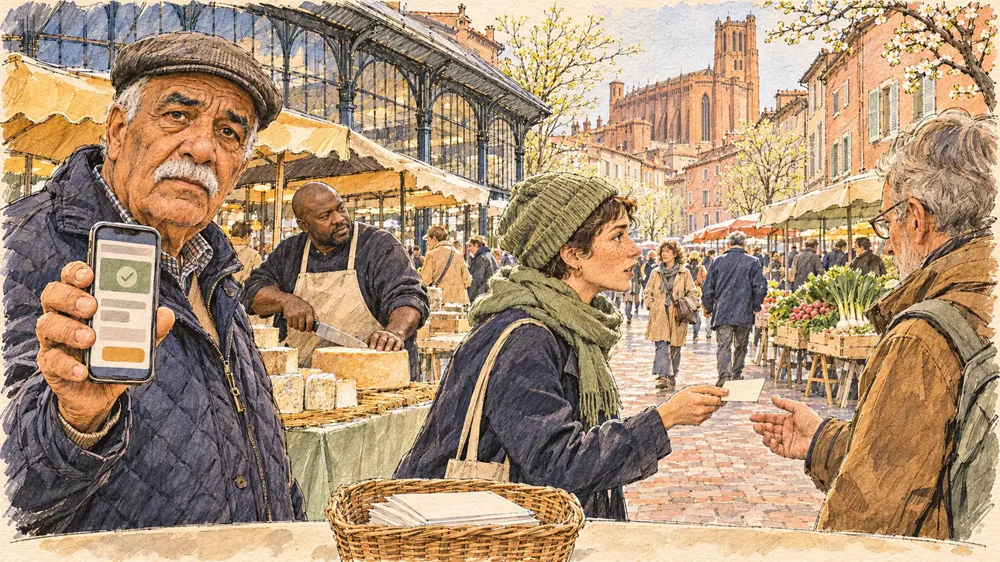

# `fakeShop` · La fausse boutique

**Validée par le PO le 19/11/2026**, au premier essai. Elle sert telle quelle en clair et en sombre.



| Champ | Valeur |
| --- | --- |
| Carte | `fakeShop`, catégorie `shop` (Boutique), poids 0,3, tant que la boutique est ouverte ; carte ajoutée par la PR #460 de l'app (Mitchnsun/moi-president#265) |
| Style | Reportage dessiné |
| Ton | Observateur, une confiance trompée |
| Date | 2026-11-19 |
| Outil | ChatGPT Images, modèle GPT 6.2 (effort à compléter) |
| Conversation | À compléter |
| Format rendu | 1672 × 941 (16:9) : export en 1290 × 726 px, WebP de qualité 75, 280 Ko, sans recadrage, fait depuis la copie WebP de la conversation (à refaire depuis le PNG d'origine) |
| Fichier d'origine | À compléter (hors du dépôt) |
| Première édition | À compléter |

## Texte de la carte

> **La fausse boutique**
>
> Un site imite votre boutique, avec vos couleurs et votre slogan, et encaisse l'argent de vos soutiens sans rien livrer.

## Le moment choisi

Le marché du samedi matin autour de la halle couverte d'Albi, en brique rose, la cathédrale Sainte-Cécile au bout de la rue, au stand de la campagne. Un soutien de la première heure montre au candidat, sur son téléphone, la commande payée sur le faux site, jamais livrée. Le candidat reste hors champ, derrière le stand : au premier plan, un panier de tracts. Le retraité regarde le spectateur, perplexe et blessé ; une bénévole distribue déjà de petites cartes d'alerte, vierges ; un fromager regarde la scène de son étal. Albi et le Tarn n'avaient encore servi à aucune carte ; c'est le marché de la série.

## Prompt complet

Dans une nouvelle conversation, avec [`primeTime.webp`](../../illustrations/media/primeTime.webp) comme seule image de référence :

```
Use the attached image as the style reference and copy its drawing: a realistic reportage drawing made on the spot for a newspaper, with quick, nervous pencil lines, often drawn twice, ink hatching in the shadows, transparent watercolour washes that spill a little over the lines, and the warm paper showing through. Not the same scene and not the same people: never reuse the face or the hair of the woman in the reference.
Like in the reference, the setting can be full when the story needs it, with the things that say where we are and what is happening, but each one is sketched with a few pencil lines and a light wash, never rendered or finished, and the drawing gets looser and paler towards the edges until it fades into the bare paper.
This must look like a drawing made by hand on paper by a press illustrator, halfway between a quick sketch and a realistic picture: never a photograph, a film poster or a digital painting, and never a cartoon, a comic strip, a caricature or a children's book illustration. Continuous lines, never dotted or dashed outlines; no uniform texture, speckles or hatching filter laid over the picture; no glossy highlights, no smooth gradients, in the sky and on the walls too. Colour can be rich in places, on a piece of clothing, a light or a flag, but it stays transparent and within the palette below. The fade into the paper at the edges stays narrow, without a wide white margin. No blur and no depth-of-field effect: everything, the foreground included, is drawn sharp, like a sketch made on the spot.
People are drawn from life with realistic anatomy and proportions, like in the reference: faces shaped with pencil lines, hatching and light washes, a little more finished than the background but never photographic (no photographic skin, no airbrushed or digital-painting look). Expressions stay natural and restrained, even in laughter or tears: no exaggerated grins, no wide-open mouths full of teeth, no rubbery or cartoonish faces.

Editorial illustration, landscape 16:9 (1536 × 864 px), the scene filling the frame, with only a light fade into the paper at the edges. The Saturday-morning market around the covered market hall of Albi, in the south-west of France, in 2027, in early spring: the pink-brick walls of the old town, the great brick cathedral at the end of the street, awnings, crates of vegetables, a cheese stall. At the campaign's folding stand, a supporter shows on his phone the order he paid for on a fake copy of the campaign's online shop, which never arrived. The player's candidate stands behind the stand and stays off-camera: in the foreground, only a wicker basket of leaflets on the edge of the stand. In the left third, the supporter, a retired bus driver in his seventies of Moroccan descent, tall and broad, with a white moustache, a flat cap and a quilted jacket, holds out his phone towards the viewer and looks at the viewer, puzzled and hurt, his face above mid-height. Beside the stand, a young volunteer, a freckled white woman in her twenties with a woollen beanie and a scarf, already hands small warning cards to passers-by, her eyes on them. Behind, at his stall, a cheese seller in his forties of Ivorian descent, stocky, with a shaved head and an apron, looks at the scene with his knife still in his hand over a wheel of cheese. Only the supporter looks at the viewer. Nothing on the phone, the cards, the leaflets, the awnings or the stalls' price tags is readable.

Style: Reportage drawing made on the spot, like a press illustrator or courtroom sketch artist: pencil and ink with loose watercolour washes, lively unfinished lines, white paper showing through.

Palette: navy #13203F, vellum #F5EFE1, gold #A9802A, brick #B5523B, ochre #D9A441, sage #8FA58A, slate #5E7186, sand #DCC8A4, warm grey #8C8279; use 4 to 6 of them, subtle warm paper grain.

Tone: observant, trust betrayed but no drama, bright spring morning light on the pink brick, soft shade under the awnings.

Constraints: realistic proportions, natural expressions, never cartoonish or caricatured faces, drawn like the rest of the illustration and never photographic; people of varied ages, genders, origins and body types (heavy, stocky, round, tall, short, wiry, not only slim), each with a distinct face and haircut (no two people alike), drawn with respect and never as a joke; each person's age, build and look plausible for their job and the scene (working people of working age), no stereotype tying an origin or a gender to a role, and no person of colour shown alone in a featured service or deferential role; anatomically correct hands with exactly five fingers, few hands visible, the others in pockets, behind objects or out of frame; no readable text anywhere (the phone, the cards, the leaflets, the awnings and the price tags stay unreadable); no captions or speech bubbles; no logos, no brand, no political party colours on the stand or the cards; no recognisable real person, no lookalike of a real politician; no explicit violence; no photographic rendering, no blur or bokeh, no dotted outlines, no texture or hatching filter over the picture, no oil-paint texture, no wide white margin or frame (a light fade into the paper at the edges is fine).

Format: if 16:9 is not available, make 1536 × 1024 and keep the top 80 px and the bottom 80 px free of anything important (faces, hands, the main action): they will be cropped.
```

## Essais écartés

Aucun.

## Retouches

Aucune.

## Relecture

Faite et validée par le PO le 19/11/2026.

- [x] Aucun texte lisible : le téléphone ne montre qu'une coche de commande payée et des barres ; les cartes d'alerte, les tracts, les auvents et les étiquettes de prix sont vierges.
- [x] Aucun sosie d'une personne réelle.
- [x] Le candidat du joueur est hors champ, derrière le stand : seul le panier de tracts, au premier plan.
- [x] Mains et visages sans défaut visible à 343 px de large : la main du retraité sur le téléphone, celles de la bénévole et du passant autour de la carte, celles du fromager sur le couteau et la meule.
- [x] Aucune couleur ni aucun logo de parti. Des personnes variées par l'âge, le corps, l'origine et la coiffure. La halle et la cathédrale Sainte-Cécile d'Albi.
- [x] En 16:9 : pas de recadrage.
- [ ] Lisible sur la page de l'événement, en clair et en sombre : à vérifier dans l'app, une fois la carte publiée.
