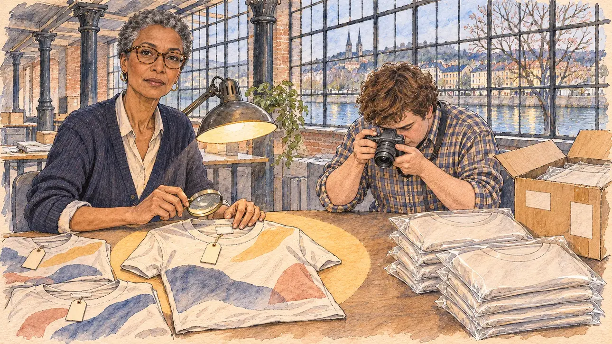

# `falseOrigin` · Fausse origine

**Validée par le PO le 19/11/2026**, au premier essai. Elle sert telle quelle en clair et en sombre.



| Champ | Valeur |
| --- | --- |
| Carte | `falseOrigin`, catégorie `shop` (Boutique), poids 0,35, tant que la boutique est ouverte, seulement quand ses produits sont imprimés en France ; trois fois plus fréquente quand la campagne défend la production en France (une mesure qui la défend au programme, ou une position de 0,4 ou plus sur l'axe de l'Europe) ; carte ajoutée par la PR #460 de l'app (Mitchnsun/moi-president#265) |
| Style | Reportage dessiné |
| Ton | Observateur, une enquête méticuleuse |
| Date | 2026-11-19 |
| Outil | ChatGPT Images, modèle GPT 6.2 (effort à compléter) |
| Conversation | À compléter |
| Format rendu | 1672 × 941 (16:9) : export en 1290 × 726 px, WebP de qualité 75, 223 Ko, sans recadrage, fait depuis la copie WebP de la conversation (à refaire depuis le PNG d'origine) |
| Fichier d'origine | À compléter (hors du dépôt) |
| Première édition | À compléter |

## Texte de la carte

> **Fausse origine**
>
> Une association de consommateurs relève que vos produits « imprimés en France » sont présentés comme français. Or la dernière transformation substantielle s'est faite à l'étranger.

## Le moment choisi

Le local d'une association de consommateurs, dans une ancienne filature d'Épinal au bord de la Moselle, un matin de mars, la veille de la publication : sur la grande table, les tee-shirts imprimés de la campagne, étiquetés comme pièces à conviction, et à côté un lot des mêmes tee-shirts vierges, encore dans leur emballage de gros, avec le carton d'expédition et ses bordereaux de douane, illisibles. Les deux étapes de la fabrication côte à côte disent l'affaire : la pièce est cousue ailleurs, seulement imprimée ici. L'enquêtrice de l'association, une loupe au-dessus d'une étiquette intérieure, regarde le spectateur, calme et précise ; un jeune collègue photographie les pièces. Le candidat n'apparaît pas. Épinal et les Vosges n'avaient encore servi à aucune carte.

## Prompt complet

Dans une nouvelle conversation, avec [`primeTime.webp`](../../illustrations/media/primeTime.webp) comme seule image de référence :

```
Use the attached image as the style reference and copy its drawing: a realistic reportage drawing made on the spot for a newspaper, with quick, nervous pencil lines, often drawn twice, ink hatching in the shadows, transparent watercolour washes that spill a little over the lines, and the warm paper showing through. Not the same scene and not the same people: never reuse the face or the hair of the woman in the reference.
Like in the reference, the setting can be full when the story needs it, with the things that say where we are and what is happening, but each one is sketched with a few pencil lines and a light wash, never rendered or finished, and the drawing gets looser and paler towards the edges until it fades into the bare paper.
This must look like a drawing made by hand on paper by a press illustrator, halfway between a quick sketch and a realistic picture: never a photograph, a film poster or a digital painting, and never a cartoon, a comic strip, a caricature or a children's book illustration. Continuous lines, never dotted or dashed outlines; no uniform texture, speckles or hatching filter laid over the picture; no glossy highlights, no smooth gradients, in the sky and on the walls too. Colour can be rich in places, on a piece of clothing, a light or a flag, but it stays transparent and within the palette below. The fade into the paper at the edges stays narrow, without a wide white margin. No blur and no depth-of-field effect: everything, the foreground included, is drawn sharp, like a sketch made on the spot.
People are drawn from life with realistic anatomy and proportions, like in the reference: faces shaped with pencil lines, hatching and light washes, a little more finished than the background but never photographic (no photographic skin, no airbrushed or digital-painting look). Expressions stay natural and restrained, even in laughter or tears: no exaggerated grins, no wide-open mouths full of teeth, no rubbery or cartoonish faces.

Editorial illustration, landscape 16:9 (1536 × 864 px), the scene filling the frame, with only a light fade into the paper at the edges. The office of a consumer association in a former spinning mill in Épinal, in the Vosges, in 2027, on a March morning, the day before its report comes out: tall factory windows over the Moselle river, exposed brick and old cast-iron columns, a long table under a work lamp. On the table, side by side, the two steps of the story: on one side, the campaign's printed T-shirts, laid flat with small evidence tags tied to them; on the other, a pile of the same T-shirts still blank, in their clear wholesale bags, next to an opened shipping carton with customs stickers. The player's candidate does not appear. In the left third, the association's investigator, a tall woman in her fifties of Malagasy descent, with short natural grey hair, tortoiseshell glasses and a navy cardigan, holds a magnifying glass over the inner neck label of a T-shirt and looks up at the viewer, calm and precise, her face above mid-height. Across the table, a young colleague, a short, round white man in his twenties with a mop of brown curls and a checked shirt, photographs the pieces with a small camera, his eyes on the viewfinder. Only the investigator looks at the viewer. Nothing on the T-shirts' prints, the labels, the tags, the bags, the carton, the stickers or the camera is readable: the prints are loose shapes of colour with no lettering.

Style: Reportage drawing made on the spot, like a press illustrator or courtroom sketch artist: pencil and ink with loose watercolour washes, lively unfinished lines, white paper showing through.

Palette: navy #13203F, vellum #F5EFE1, gold #A9802A, brick #B5523B, ochre #D9A441, sage #8FA58A, slate #5E7186, sand #DCC8A4, warm grey #8C8279; use 4 to 6 of them, subtle warm paper grain.

Tone: observant and neutral, pale morning light from the tall mill windows, the warm circle of the work lamp on the table.

Constraints: realistic proportions, natural expressions, never cartoonish or caricatured faces, drawn like the rest of the illustration and never photographic; people of varied ages, genders, origins and body types (heavy, stocky, round, tall, short, wiry, not only slim), each with a distinct face and haircut (no two people alike), drawn with respect and never as a joke; each person's age, build and look plausible for their job and the scene (working people of working age), no stereotype tying an origin or a gender to a role, and no person of colour shown alone in a featured service or deferential role; anatomically correct hands with exactly five fingers, few hands visible, the others in pockets, behind objects or out of frame; no readable text anywhere (the prints, the labels, the evidence tags, the bags, the carton and the customs stickers stay unreadable); no captions or speech bubbles; no logos, no association or brand name, no flag of any country, no political party colours; no recognisable real person, no lookalike of a real politician; no explicit violence; no photographic rendering, no blur or bokeh, no dotted outlines, no texture or hatching filter over the picture, no oil-paint texture, no wide white margin or frame (a light fade into the paper at the edges is fine).

Format: if 16:9 is not available, make 1536 × 1024 and keep the top 80 px and the bottom 80 px free of anything important (faces, hands, the main action): they will be cropped.
```

## Essais écartés

Aucun.

## Retouches

Aucune. Un léger grain de papier couvre l'image ; accepté, il ne se voit plus à la taille de la page.

## Relecture

Faite et validée par le PO le 19/11/2026.

- [x] Aucun texte lisible : les impressions sont des formes de couleur, les étiquettes de pièces à conviction et les bordereaux du carton sont vierges.
- [x] Aucun nom d'association ni de marque, aucun drapeau.
- [x] Aucun sosie d'une personne réelle.
- [x] Le candidat du joueur est absent.
- [x] Mains et visages sans défaut visible à 343 px de large : les mains de l'enquêtrice sur la loupe et le tee-shirt, celles du collègue sur l'appareil photo.
- [x] Aucune couleur ni aucun logo de parti. Des personnes variées par l'âge, le corps, l'origine et la coiffure. Les deux tas côte à côte, imprimés et vierges sous emballage, disent l'affaire ; par la fenêtre, la Moselle et Épinal.
- [x] En 16:9 : pas de recadrage.
- [ ] Lisible sur la page de l'événement, en clair et en sombre : à vérifier dans l'app, une fois la carte publiée.
