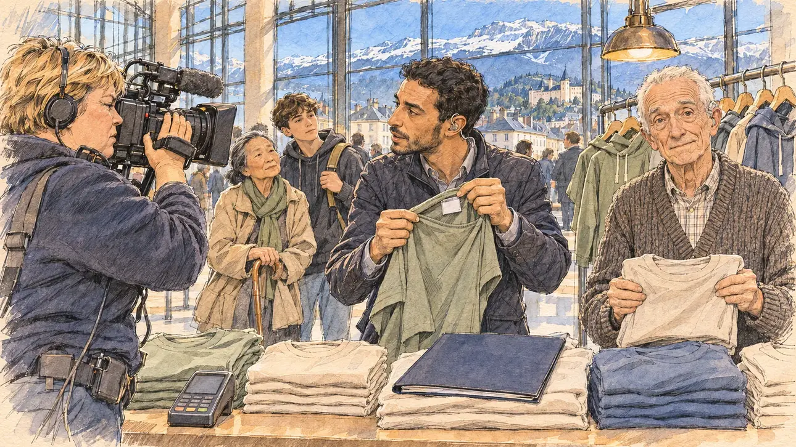

# `labelScandal` · Scandale d'étiquettes

**Validée par le PO le 19/11/2026**, au premier essai. Elle sert telle quelle en clair et en sombre.



| Champ | Valeur |
| --- | --- |
| Carte | `labelScandal`, catégorie `shop` (Boutique), poids 0,35, tant que la boutique est ouverte, seulement quand ses produits sont importés ; trois fois plus fréquente quand la campagne défend la production en France (une mesure qui la défend au programme, ou une position de 0,4 ou plus sur l'axe de l'Europe) ; carte ajoutée par la PR #460 de l'app (Mitchnsun/moi-president#265) |
| Style | Reportage dessiné |
| Ton | Tendu, une gêne en public |
| Date | 2026-11-19 |
| Outil | ChatGPT Images, à compléter (modèle et effort) |
| Conversation | À compléter |
| Format rendu | 1672 × 941 (16:9) : export en 1290 × 726 px, WebP de qualité 75, 230 Ko, sans recadrage, fait depuis la copie WebP de la conversation (à refaire depuis le PNG d'origine) |
| Fichier d'origine | À compléter (hors du dépôt) |
| Première édition | À compléter |

## Texte de la carte

> **Scandale d'étiquettes**
>
> Une équipe de télévision retourne vos tee-shirts devant la caméra : « fabriqué à l'étranger ». Le reportage passe en boucle.

## Le moment choisi

Le stand de la boutique, dans le hall d'une salle de meeting de Chambéry, une heure avant le discours, par un après-midi clair de mars : par la baie vitrée, les montagnes enneigées au-dessus des toits. Le candidat reste hors champ, de passage devant le stand : au premier plan, le bord de la table et le dossier de son discours posé sur une pile de tee-shirts pliés. Un journaliste de télévision a retourné un tee-shirt et tend sa petite étiquette cousue vers la caméra que tient sa cadreuse ; l'étiquette reste une forme blanche, sans un mot : c'est le geste qui dit l'origine, pas l'étiquette. Le bénévole qui tient le stand regarde le spectateur, embarrassé. Chambéry et la Savoie n'avaient encore servi à aucune carte.

## Prompt complet

Dans une nouvelle conversation, avec [`primeTime.webp`](../../illustrations/media/primeTime.webp) comme seule image de référence :

```
Use the attached image as the style reference and copy its drawing: a realistic reportage drawing made on the spot for a newspaper, with quick, nervous pencil lines, often drawn twice, ink hatching in the shadows, transparent watercolour washes that spill a little over the lines, and the warm paper showing through. Not the same scene and not the same people: never reuse the face or the hair of the woman in the reference.
Like in the reference, the setting can be full when the story needs it, with the things that say where we are and what is happening, but each one is sketched with a few pencil lines and a light wash, never rendered or finished, and the drawing gets looser and paler towards the edges until it fades into the bare paper.
This must look like a drawing made by hand on paper by a press illustrator, halfway between a quick sketch and a realistic picture: never a photograph, a film poster or a digital painting, and never a cartoon, a comic strip, a caricature or a children's book illustration. Continuous lines, never dotted or dashed outlines; no uniform texture, speckles or hatching filter laid over the picture; no glossy highlights, no smooth gradients, in the sky and on the walls too. Colour can be rich in places, on a piece of clothing, a light or a flag, but it stays transparent and within the palette below. The fade into the paper at the edges stays narrow, without a wide white margin. No blur and no depth-of-field effect: everything, the foreground included, is drawn sharp, like a sketch made on the spot.
People are drawn from life with realistic anatomy and proportions, like in the reference: faces shaped with pencil lines, hatching and light washes, a little more finished than the background but never photographic (no photographic skin, no airbrushed or digital-painting look). Expressions stay natural and restrained, even in laughter or tears: no exaggerated grins, no wide-open mouths full of teeth, no rubbery or cartoonish faces.

Editorial illustration, landscape 16:9 (1536 × 864 px), the scene filling the frame, with only a light fade into the paper at the edges. The campaign shop's stand in the foyer of a rally hall in Chambéry, in 2027, an hour before the speech, on a clear March afternoon: a long table covered with stacks of folded T-shirts, a rail of hoodies on hangers and a card reader, and through the tall glass front the snowy mountains of Savoy above the town's roofs. The player's candidate is passing the stand and stays off-camera: in the foreground, only the edge of the table with the candidate's speech folder lying on a stack of folded T-shirts. In the right third, the volunteer who runs the stand, a small, wiry white man in his late sixties with a white crew cut, a hearing aid and a knitted cardigan, stands behind the table with a folded T-shirt still in his hands and looks at the viewer, embarrassed, his face above mid-height. In the middle, a television reporter in his thirties of Algerian descent, slim, with a neat short beard and a quilted jacket, has turned a T-shirt inside out and holds its small sewn label up towards the lens, his eyes on the camera. On the left, his camera operator, a heavy-set white woman in her forties with cropped blond hair and a fleece, films with the camera on her shoulder. Behind them, two early supporters slow down to watch: an elderly woman of Vietnamese descent with a walking stick and a teenage boy with a rucksack. Only the volunteer looks at the viewer. The label is a small blank white rectangle with no letters and no flag on it; nothing on the T-shirts, the folder, the card reader or the camera is readable.

Style: Reportage drawing made on the spot, like a press illustrator or courtroom sketch artist: pencil and ink with loose watercolour washes, lively unfinished lines, white paper showing through.

Palette: navy #13203F, vellum #F5EFE1, gold #A9802A, brick #B5523B, ochre #D9A441, sage #8FA58A, slate #5E7186, sand #DCC8A4, warm grey #8C8279; use 4 to 6 of them, subtle warm paper grain.

Tone: tense, an awkward moment in public, clear cold mountain light through the glass, a warm lamp over the stand.

Constraints: realistic proportions, natural expressions, never cartoonish or caricatured faces, drawn like the rest of the illustration and never photographic; people of varied ages, genders, origins and body types (heavy, stocky, round, tall, short, wiry, not only slim), each with a distinct face and haircut (no two people alike), drawn with respect and never as a joke; each person's age, build and look plausible for their job and the scene (working people of working age), no stereotype tying an origin or a gender to a role, and no person of colour shown alone in a featured service or deferential role; anatomically correct hands with exactly five fingers, few hands visible, the others in pockets, behind objects or out of frame; no readable text anywhere (the label is a blank white rectangle; the T-shirts, the folder, the card reader and the camera stay unreadable); no captions or speech bubbles; no logos, no channel logo, no flag or country shown on the label, no political party colours; no recognisable real person, no lookalike of a real politician or journalist; no explicit violence; no photographic rendering, no blur or bokeh, no dotted outlines, no texture or hatching filter over the picture, no oil-paint texture, no wide white margin or frame (a light fade into the paper at the edges is fine).

Format: if 16:9 is not available, make 1536 × 1024 and keep the top 80 px and the bottom 80 px free of anything important (faces, hands, the main action): they will be cropped.
```

## Essais écartés

Aucun.

## Retouches

Aucune. L'aide auditive prévue pour le bénévole est passée à l'oreille du journaliste, comme une oreillette de reportage : écart accepté, il ne change pas la scène.

## Relecture

Faite et validée par le PO le 19/11/2026.

- [x] Aucun texte lisible : l'étiquette est un petit rectangle blanc vierge ; les tee-shirts, le dossier, le terminal de paiement et la caméra n'ont ni lettre ni chiffre.
- [x] Aucun sosie d'une personne réelle, journaliste compris ; aucun logo de chaîne.
- [x] Le candidat du joueur est hors champ : seul le dossier de son discours, posé sur les tee-shirts au premier plan.
- [x] Mains et visages sans défaut visible à 343 px de large : les mains du journaliste et du bénévole sur les tee-shirts, celles de la cadreuse sur la caméra, celles de la passante sur sa canne.
- [x] Aucune couleur ni aucun logo de parti, aucun drapeau sur l'étiquette. Des personnes variées par l'âge, le corps, l'origine et la coiffure. Derrière la baie, les montagnes et le château des ducs de Savoie.
- [x] En 16:9 : pas de recadrage.
- [ ] Lisible sur la page de l'événement, en clair et en sombre : à vérifier dans l'app, une fois la carte publiée.
