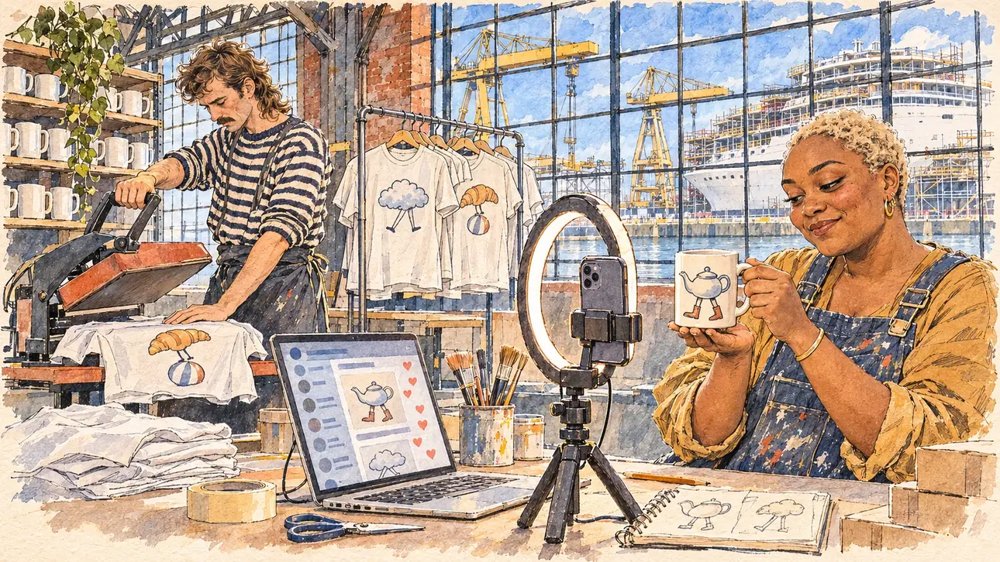

# `parodyShop` · La boutique parodique

**Validée par le PO le 19/11/2026**, au premier essai. Elle sert telle quelle en clair et en sombre.



| Champ | Valeur |
| --- | --- |
| Carte | `parodyShop`, catégorie `shop` (Boutique), poids 0,25, tant que la boutique est ouverte ; carte ajoutée par la PR #460 de l'app (Mitchnsun/moi-president#265) |
| Style | Reportage dessiné |
| Ton | Ironique, bon enfant |
| Date | 2026-11-19 |
| Outil | ChatGPT Images, modèle GPT 6.2 (effort à compléter) |
| Conversation | À compléter |
| Format rendu | 1672 × 941 (16:9) : export en 1290 × 726 px, WebP de qualité 75, 254 Ko, sans recadrage, fait depuis la copie WebP de la conversation (à refaire depuis le PNG d'origine) |
| Fichier d'origine | À compléter (hors du dépôt) |
| Première édition | À compléter |

## Texte de la carte

> **La boutique parodique**
>
> Un collectif lance une boutique qui parodie la vôtre : mugs à slogans absurdes, tee-shirts moqueurs. Les réseaux adorent.

## Le moment choisi

L'atelier partagé d'un collectif d'humoristes et de graphistes, dans une ancienne halle du port de Saint-Nazaire, un après-midi de mars : par la verrière, les grues des chantiers navals et la coque d'un paquebot en construction. Une membre du collectif photographie pour le site de la parodie un mug orné d'un dessin absurde ; un autre presse un motif moqueur sur un tee-shirt ; sur un portable, les cœurs des réseaux s'empilent. Les slogans absurdes passent par les dessins (un nuage à jambes, un croissant en équilibre), jamais par des mots lisibles, et aucun mug ne montre le candidat. Le candidat n'apparaît pas, et personne ne regarde le spectateur. Saint-Nazaire n'avait encore servi à aucune carte.

## Prompt complet

Dans une nouvelle conversation, avec [`primeTime.webp`](../../illustrations/media/primeTime.webp) comme seule image de référence :

```
Use the attached image as the style reference and copy its drawing: a realistic reportage drawing made on the spot for a newspaper, with quick, nervous pencil lines, often drawn twice, ink hatching in the shadows, transparent watercolour washes that spill a little over the lines, and the warm paper showing through. Not the same scene and not the same people: never reuse the face or the hair of the woman in the reference.
Like in the reference, the setting can be full when the story needs it, with the things that say where we are and what is happening, but each one is sketched with a few pencil lines and a light wash, never rendered or finished, and the drawing gets looser and paler towards the edges until it fades into the bare paper.
This must look like a drawing made by hand on paper by a press illustrator, halfway between a quick sketch and a realistic picture: never a photograph, a film poster or a digital painting, and never a cartoon, a comic strip, a caricature or a children's book illustration. Continuous lines, never dotted or dashed outlines; no uniform texture, speckles or hatching filter laid over the picture; no glossy highlights, no smooth gradients, in the sky and on the walls too. Colour can be rich in places, on a piece of clothing, a light or a flag, but it stays transparent and within the palette below. The fade into the paper at the edges stays narrow, without a wide white margin. No blur and no depth-of-field effect: everything, the foreground included, is drawn sharp, like a sketch made on the spot.
People are drawn from life with realistic anatomy and proportions, like in the reference: faces shaped with pencil lines, hatching and light washes, a little more finished than the background but never photographic (no photographic skin, no airbrushed or digital-painting look). Expressions stay natural and restrained, even in laughter or tears: no exaggerated grins, no wide-open mouths full of teeth, no rubbery or cartoonish faces.

Editorial illustration, landscape 16:9 (1536 × 864 px), the scene filling the frame, with only a light fade into the paper at the edges. The shared workshop of a collective of comedians and graphic designers in an old harbour hall in Saint-Nazaire, on the Atlantic coast, in 2027, on a March afternoon: a big glass wall onto the shipyard's gantry cranes and the white hull of a cruise ship under construction, a heat press, a rack of T-shirts, shelves of white mugs. The collective is shooting the products of its parody of the campaign's shop. The player's candidate does not appear, and no mug or T-shirt shows the candidate: their designs are absurd little drawings, a cloud with legs, a croissant balancing on a ball, a teapot wearing boots, never words. In the right third, a member of the collective in her late twenties of Comorian descent, round, with short bleached hair and paint-flecked dungarees, holds up a mug in front of a phone on a small tripod with a ring light, her face above mid-height, a sly, pleased smile, her eyes on the phone. On the left, a tall white man in his thirties with a mullet, a moustache and a striped jumper presses a design onto a T-shirt with the heat press, concentrating. On a laptop on the table, a social feed fills with little hearts. Nobody looks at the viewer. Nothing on the mugs, the T-shirts, the laptop, the phone or the boxes is readable.

Style: Reportage drawing made on the spot, like a press illustrator or courtroom sketch artist: pencil and ink with loose watercolour washes, lively unfinished lines, white paper showing through.

Palette: navy #13203F, vellum #F5EFE1, gold #A9802A, brick #B5523B, ochre #D9A441, sage #8FA58A, slate #5E7186, sand #DCC8A4, warm grey #8C8279; use 4 to 6 of them, subtle warm paper grain.

Tone: gently ironic and good-natured, postures slightly exaggerated but never the faces, the bright, salty light of the Atlantic through the glass.

Constraints: realistic proportions, natural expressions, never cartoonish or caricatured faces, drawn like the rest of the illustration and never photographic; people of varied ages, genders, origins and body types (heavy, stocky, round, tall, short, wiry, not only slim), each with a distinct face and haircut (no two people alike), drawn with respect and never as a joke; each person's age, build and look plausible for their job and the scene (working people of working age), no stereotype tying an origin or a gender to a role, and no person of colour shown alone in a featured service or deferential role; anatomically correct hands with exactly five fingers, few hands visible, the others in pockets, behind objects or out of frame; no readable text anywhere (the mugs, the T-shirts, the laptop, the phone and the boxes stay unreadable; the designs are drawings, never words); no captions or speech bubbles; no logos, no brand or social-network logo, no political party colours; no recognisable real person, no lookalike of a real politician or comedian; no portrait or caricature of anyone on the mugs or T-shirts; no explicit violence; no photographic rendering, no blur or bokeh, no dotted outlines, no texture or hatching filter over the picture, no oil-paint texture, no wide white margin or frame (a light fade into the paper at the edges is fine).

Format: if 16:9 is not available, make 1536 × 1024 and keep the top 80 px and the bottom 80 px free of anything important (faces, hands, the main action): they will be cropped.
```

## Essais écartés

Aucun.

## Retouches

Aucune.

## Relecture

Faite et validée par le PO le 19/11/2026.

- [x] Aucun texte lisible : les motifs sont des dessins (un nuage à jambes, un croissant en équilibre sur un ballon, une théière en bottes) ; le fil social n'a que des cœurs et des barres ; le carnet n'a que des croquis.
- [x] Aucun portrait ni aucune caricature sur les mugs et les tee-shirts ; aucun logo de réseau social ni de marque.
- [x] Aucun sosie d'une personne réelle, humoriste compris.
- [x] Le candidat du joueur est absent, et personne ne regarde le spectateur.
- [x] Mains et visages sans défaut visible à 343 px de large : les mains de la graphiste autour du mug, celles de son collègue sur la presse et le tee-shirt.
- [x] Aucune couleur ni aucun logo de parti : le ballon bleu-blanc-rouge sous le croissant est un clin d'œil, pas une couleur de parti. Des personnes variées par l'âge, le corps, l'origine et la coiffure. Par la verrière, les grues et le paquebot des chantiers de Saint-Nazaire.
- [x] En 16:9 : pas de recadrage.
- [ ] Lisible sur la page de l'événement, en clair et en sombre : à vérifier dans l'app, une fois la carte publiée.
