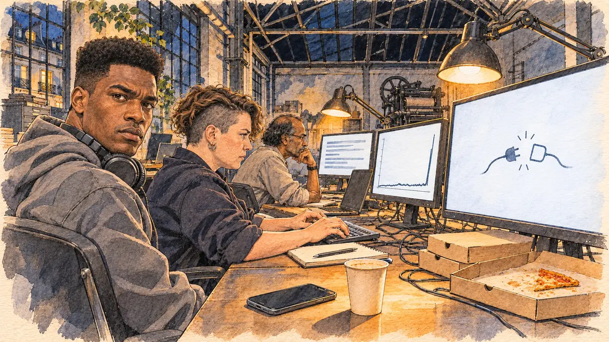

# `siteDown` · Le site tombe

**Validée par le PO le 19/11/2026**, au premier essai, avec une retouche. Elle sert telle quelle en clair et en sombre.



| Champ | Valeur |
| --- | --- |
| Carte | `siteDown`, catégorie `shop` (Boutique), poids 0,4, tant que la boutique est ouverte ; carte ajoutée par la PR #460 de l'app (Mitchnsun/moi-president#265) |
| Style | Reportage dessiné |
| Ton | Tendu, la nuit |
| Date | 2026-11-19 |
| Outil | ChatGPT Images, modèle GPT 6.2, effort Light |
| Conversation | À compléter |
| Format rendu | 1672 × 941 (16:9) : export en 1290 × 726 px, WebP de qualité 75, 192 Ko, sans recadrage, fait depuis la copie WebP de la conversation retouchée |
| Fichier d'origine | Image de ChatGPT, chez le PO. L'export du dépôt a été fait depuis la copie partagée dans la conversation avec Claude |
| Première édition | `kit-france-2611-0004` |

## Texte de la carte

> **Le site tombe**
>
> Un soir de buzz, votre boutique en ligne ne répond plus : trop de visites, ou une attaque. Les paniers restent vides.

## Le moment choisi

La salle de l'équipe numérique, au QG de campagne, dans un ancien atelier d'imprimerie du 11e arrondissement de Paris, à onze heures du soir, le soir du buzz : sous la verrière noire, les écrans montrent une page d'erreur et une courbe de visites qui monte à la verticale. Le candidat reste hors champ, venu voir : au premier plan, son téléphone retourné sur le bureau, à côté d'un gobelet. Le responsable du numérique, casque autour du cou, se retourne sur sa chaise et regarde le spectateur : trop de visites, ou une attaque, il ne sait pas encore. Une développeuse tape, un collègue suit les journaux de connexion. Le QG de nuit avait déjà servi, dans une petite salle de montage ([`officialClip`](../airtime/officialClip.md)) : ici, une grande salle ouverte sous sa verrière.

## Prompt complet

Dans une nouvelle conversation, avec [`primeTime.webp`](../../illustrations/media/primeTime.webp) comme seule image de référence :

```
Use the attached image as the style reference and copy its drawing: a realistic reportage drawing made on the spot for a newspaper, with quick, nervous pencil lines, often drawn twice, ink hatching in the shadows, transparent watercolour washes that spill a little over the lines, and the warm paper showing through. Not the same scene and not the same people: never reuse the face or the hair of the woman in the reference.
Like in the reference, the setting can be full when the story needs it, with the things that say where we are and what is happening, but each one is sketched with a few pencil lines and a light wash, never rendered or finished, and the drawing gets looser and paler towards the edges until it fades into the bare paper.
This must look like a drawing made by hand on paper by a press illustrator, halfway between a quick sketch and a realistic picture: never a photograph, a film poster or a digital painting, and never a cartoon, a comic strip, a caricature or a children's book illustration. Continuous lines, never dotted or dashed outlines; no uniform texture, speckles or hatching filter laid over the picture; no glossy highlights, no smooth gradients, in the sky and on the walls too. Colour can be rich in places, on a piece of clothing, a light or a flag, but it stays transparent and within the palette below. The fade into the paper at the edges stays narrow, without a wide white margin. No blur and no depth-of-field effect: everything, the foreground included, is drawn sharp, like a sketch made on the spot.
People are drawn from life with realistic anatomy and proportions, like in the reference: faces shaped with pencil lines, hatching and light washes, a little more finished than the background but never photographic (no photographic skin, no airbrushed or digital-painting look). Expressions stay natural and restrained, even in laughter or tears: no exaggerated grins, no wide-open mouths full of teeth, no rubbery or cartoonish faces.

Editorial illustration, landscape 16:9 (1536 × 864 px), the scene filling the frame, with only a light fade into the paper at the edges. The digital team's room at the campaign headquarters, in a former printing works in the 11th arrondissement of Paris, in 2027, at eleven at night, the evening of a buzz: a large open room under a glass roof gone black with the night, long shared desks, cables, pizza boxes, several monitors. On the biggest monitor, the campaign's online shop shows a blank error page with a small broken-plug pictogram; on another, a traffic graph shoots straight up; on a third, scrolling connection logs drawn as pale lines. The player's candidate has come to see and stays off-camera: in the foreground, only the candidate's phone, face down on the desk, next to a paper cup. In the left third, the head of the digital team, a man in his late twenties of Haitian descent, tall and broad-shouldered, with a high-top fade and a grey hoodie, headphones around his neck, swivels his chair round and looks at the viewer, tense, his face above mid-height. Beside him, a developer in her thirties, white, stocky, with an undercut and a small nose ring, types fast, her eyes on her screen. Further back, a wiry colleague in his fifties of Tamil descent, with thinning hair and rimless glasses, reads the logs with his chin in his hand. Only the head of the digital team looks at the viewer. Nothing on the monitors, the error page, the logs, the pizza boxes, the phone or the walls is readable.

Style: Reportage drawing made on the spot, like a press illustrator or courtroom sketch artist: pencil and ink with loose watercolour washes, lively unfinished lines, white paper showing through.

Palette: navy #13203F, vellum #F5EFE1, gold #A9802A, brick #B5523B, ochre #D9A441, sage #8FA58A, slate #5E7186, sand #DCC8A4, warm grey #8C8279; use 4 to 6 of them, subtle warm paper grain.

Tone: tense, late at night, the cold blue-white glow of the monitors against the warm pools of two desk lamps, hard shadows.

Constraints: realistic proportions, natural expressions, never cartoonish or caricatured faces, drawn like the rest of the illustration and never photographic; people of varied ages, genders, origins and body types (heavy, stocky, round, tall, short, wiry, not only slim), each with a distinct face and haircut (no two people alike), drawn with respect and never as a joke; each person's age, build and look plausible for their job and the scene (working people of working age), no stereotype tying an origin or a gender to a role, and no person of colour shown alone in a featured service or deferential role; anatomically correct hands with exactly five fingers, few hands visible, the others in pockets, behind objects or out of frame; no readable text anywhere (the monitors, the error page, the logs, the pizza boxes and the walls stay unreadable); no captions or speech bubbles; no logos, no brand or platform logo on the screens or the computers, no political party colours; no recognisable real person, no lookalike of a real politician; no explicit violence; no photographic rendering, no blur or bokeh, no dotted outlines, no texture or hatching filter over the picture, no oil-paint texture, no wide white margin or frame (a light fade into the paper at the edges is fine).

Format: if 16:9 is not available, make 1536 × 1024 and keep the top 80 px and the bottom 80 px free of anything important (faces, hands, the main action): they will be cropped.
```

## Essais écartés

Aucun.

## Retouches

Une marque de constructeur esquissée sur le bas du cadre de l'écran du milieu (environ 16 × 11 px, vers x 1084, y 544 sur l'image de 1672 × 941) est recouverte par le bord du cadre voisin, au Python (PIL), avant l'export (19/11/2026). Le grain de peinture visible sur toute l'image est accepté : il ne se voit plus à la taille de la page.

## Relecture

Faite et validée par le PO le 19/11/2026.

- [x] Aucun texte lisible : la page d'erreur ne montre que la prise débranchée, la courbe et les journaux sont des traits ; les boîtes à pizza, le carnet et le téléphone sont vierges.
- [x] Aucun logo de plateforme ni de constructeur, après la retouche du cadre de l'écran.
- [x] Aucun sosie d'une personne réelle.
- [x] Le candidat du joueur est hors champ : seuls son téléphone et un gobelet, au premier plan.
- [x] Mains et visages sans défaut visible à 343 px de large : les mains de la développeuse sur le clavier, celle du collègue sous le menton.
- [x] Aucune couleur ni aucun logo de parti. Des personnes variées par l'âge, le corps, l'origine et la coiffure. Derrière la verrière, une presse d'imprimerie et les façades du 11e.
- [x] En 16:9 : pas de recadrage.
- [ ] Lisible sur la page de l'événement, en clair et en sombre : à vérifier dans l'app, une fois la carte publiée.
