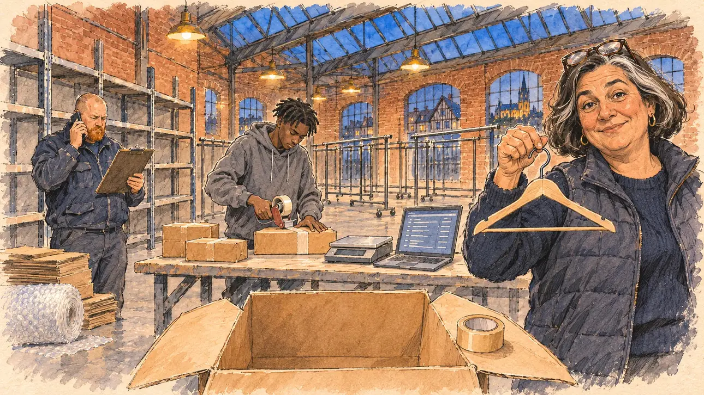

# `soldOut` · Rupture de stock

**Validée par le PO le 19/11/2026**, au premier essai. Elle sert telle quelle en clair et en sombre.



| Champ | Valeur |
| --- | --- |
| Carte | `soldOut`, catégorie `shop` (Boutique), poids 0,4, tant que la boutique est ouverte ; carte ajoutée par la PR #460 de l'app (Mitchnsun/moi-president#265) |
| Style | Reportage dessiné |
| Ton | Chaleureux et affairé, un soir de ruée |
| Date | 2026-11-19 |
| Outil | ChatGPT Images, modèle GPT 6.2 (effort à compléter) |
| Conversation | À compléter |
| Format rendu | 1672 × 941 (16:9) : export en 1290 × 726 px, WebP de qualité 75, 215 Ko, sans recadrage, fait depuis la copie WebP de la conversation (à refaire depuis le PNG d'origine) |
| Fichier d'origine | À compléter (hors du dépôt) |
| Première édition | À compléter |

## Texte de la carte

> **Rupture de stock**
>
> Votre produit phare s'arrache : le stock est vide en deux heures et les commandes continuent d'affluer. Votre trésorerie attend votre décision.

## Le moment choisi

Le petit entrepôt que la campagne loue dans une ancienne bonneterie de Troyes, en brique et à toit en dents de scie, un soir de février, deux heures après la mise en vente : les rayonnages du sweat-shirt bleu marine, le produit phare, sont vides, et sur l'écran d'un portable posé sur la table d'emballage la liste des commandes continue de s'allonger, illisible. Le candidat reste hors champ, arrivé pour décider : au premier plan, le dernier carton, ouvert et vide, avec son rouleau d'adhésif. La responsable de la boutique, un cintre vide à la main, regarde le spectateur, entre l'amusement et le vertige ; un jeune bénévole ferme les derniers colis, un logisticien demande au téléphone ce qu'un atelier peut refaire. Troyes, ville de la bonneterie, n'avait encore servi à aucune carte. La première carte de la catégorie `shop`.

## Prompt complet

Dans une nouvelle conversation, avec [`primeTime.webp`](../../illustrations/media/primeTime.webp) comme seule image de référence :

```
Use the attached image as the style reference and copy its drawing: a realistic reportage drawing made on the spot for a newspaper, with quick, nervous pencil lines, often drawn twice, ink hatching in the shadows, transparent watercolour washes that spill a little over the lines, and the warm paper showing through. Not the same scene and not the same people: never reuse the face or the hair of the woman in the reference.
Like in the reference, the setting can be full when the story needs it, with the things that say where we are and what is happening, but each one is sketched with a few pencil lines and a light wash, never rendered or finished, and the drawing gets looser and paler towards the edges until it fades into the bare paper.
This must look like a drawing made by hand on paper by a press illustrator, halfway between a quick sketch and a realistic picture: never a photograph, a film poster or a digital painting, and never a cartoon, a comic strip, a caricature or a children's book illustration. Continuous lines, never dotted or dashed outlines; no uniform texture, speckles or hatching filter laid over the picture; no glossy highlights, no smooth gradients, in the sky and on the walls too. Colour can be rich in places, on a piece of clothing, a light or a flag, but it stays transparent and within the palette below. The fade into the paper at the edges stays narrow, without a wide white margin. No blur and no depth-of-field effect: everything, the foreground included, is drawn sharp, like a sketch made on the spot.
People are drawn from life with realistic anatomy and proportions, like in the reference: faces shaped with pencil lines, hatching and light washes, a little more finished than the background but never photographic (no photographic skin, no airbrushed or digital-painting look). Expressions stay natural and restrained, even in laughter or tears: no exaggerated grins, no wide-open mouths full of teeth, no rubbery or cartoonish faces.

Editorial illustration, landscape 16:9 (1536 × 864 px), the scene filling the frame, with only a light fade into the paper at the edges. A small warehouse the campaign rents in a former hosiery mill in Troyes, in 2027, with red-brick walls and a sawtooth roof of skylights, on a February evening, two hours after the launch of the campaign's flagship product, a navy sweatshirt: the metal shelves where the sweatshirts were stacked are empty, a few flattened boxes and a roll of bubble wrap lie on the floor, a long packing table holds a scale, a tape gun and the last parcels, and an open laptop on the table shows a list of orders that keeps growing, drawn as pale lines. The player's candidate has just arrived to decide and stays off-camera: in the foreground, only the last cardboard box, open and empty, with a roll of packing tape on its flap. In the right third, the head of the campaign's shop, a round woman in her fifties of Portuguese descent, with a grey-streaked chin-length bob, reading glasses pushed up on her head and a padded sleeveless vest over a jumper, holds up an empty clothes hanger and looks at the viewer, half amused, half overwhelmed, her face above mid-height. At the packing table, a tall, lanky volunteer in his early twenties of Senegalese descent, with short locs and a grey hoodie, tapes up the last parcels, his eyes on his work. On the left, by the empty shelves, a stocky white logistics worker in his forties with a shaved head and a short red beard, in a work jacket, talks on the phone to a supplier, looking at a clipboard. Only the head of the shop looks at the viewer. Nothing on the laptop, the parcels, the clipboard, the boxes or the shelves is readable, and the sweatshirts that are left carry no print, logo or lettering.

Style: Reportage drawing made on the spot, like a press illustrator or courtroom sketch artist: pencil and ink with loose watercolour washes, lively unfinished lines, white paper showing through.

Palette: navy #13203F, vellum #F5EFE1, gold #A9802A, brick #B5523B, ochre #D9A441, sage #8FA58A, slate #5E7186, sand #DCC8A4, warm grey #8C8279; use 4 to 6 of them, subtle warm paper grain.

Tone: warm and busy, the tired yellow light of the warehouse lamps against the blue of the winter evening in the skylights.

Constraints: realistic proportions, natural expressions, never cartoonish or caricatured faces, drawn like the rest of the illustration and never photographic; people of varied ages, genders, origins and body types (heavy, stocky, round, tall, short, wiry, not only slim), each with a distinct face and haircut (no two people alike), drawn with respect and never as a joke; each person's age, build and look plausible for their job and the scene (working people of working age), no stereotype tying an origin or a gender to a role, and no person of colour shown alone in a featured service or deferential role; anatomically correct hands with exactly five fingers, few hands visible, the others in pockets, behind objects or out of frame; no readable text anywhere (the laptop, the parcels, the clipboard, the boxes and the shelf tags stay unreadable); no captions or speech bubbles; no logos, no brand and no political party colours; the sweatshirts are plain navy; no recognisable real person, no lookalike of a real politician; no explicit violence; no photographic rendering, no blur or bokeh, no dotted outlines, no texture or hatching filter over the picture, no oil-paint texture, no wide white margin or frame (a light fade into the paper at the edges is fine).

Format: if 16:9 is not available, make 1536 × 1024 and keep the top 80 px and the bottom 80 px free of anything important (faces, hands, the main action): they will be cropped.
```

## Essais écartés

Aucun.

## Retouches

Aucune.

## Relecture

Faite et validée par le PO le 19/11/2026.

- [x] Aucun texte lisible : l'écran du portable ne montre que des lignes pâles ; le bloc-notes, les colis et les cartons sont vierges.
- [x] Aucun sosie d'une personne réelle.
- [x] Le candidat du joueur est hors champ : seul le dernier carton, ouvert et vide, au premier plan.
- [x] Mains et visages sans défaut visible à 343 px de large : la main de la responsable sur le cintre, celles du bénévole sur le dévidoir, celles du logisticien sur le téléphone et le bloc-notes.
- [x] Aucune couleur ni aucun logo de parti, aucun produit imprimé. Des personnes variées par l'âge, le corps, l'origine et la coiffure. Par les fenêtres, la cathédrale et les maisons à pans de bois de Troyes.
- [x] En 16:9 : pas de recadrage.
- [ ] Lisible sur la page de l'événement, en clair et en sombre : à vérifier dans l'app, une fois la carte publiée.
