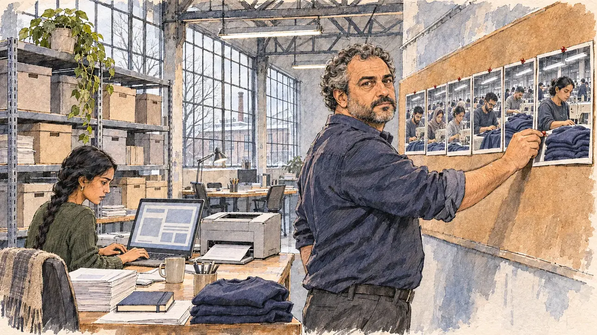

# `sweatshop` · L'atelier de misère

**Validée par le PO le 19/11/2026**, au premier essai. Elle sert telle quelle en clair et en sombre.



| Champ | Valeur |
| --- | --- |
| Carte | `sweatshop`, catégorie `shop` (Boutique), poids 0,25, tant que la boutique est ouverte, seulement quand ses produits sont importés ; trois fois plus fréquente quand la campagne défend la production en France (une mesure qui la défend au programme, ou une position de 0,4 ou plus sur l'axe de l'Europe) ; carte ajoutée par la PR #460 de l'app (Mitchnsun/moi-president#265) |
| Style | Reportage dessiné |
| Ton | Grave, sans pathos |
| Date | 2026-11-19 |
| Outil | ChatGPT Images, modèle GPT 6.2, effort Light |
| Conversation | À compléter |
| Format rendu | 1672 × 941 (16:9) : export en 1290 × 726 px, WebP de qualité 75, 219 Ko, sans recadrage, fait depuis la copie WebP de la conversation (à refaire depuis le PNG d'origine) |
| Fichier d'origine | À compléter (hors du dépôt) |
| Première édition | À compléter |

## Texte de la carte

> **L'atelier de misère**
>
> Une ONG publie des photos de l'atelier qui coud vos sweats : des salaires de misère, des journées de quatorze heures.

## Le moment choisi

Le bureau d'une ONG dans un ancien entrepôt d'Aubervilliers, la veille de la publication, en fin d'après-midi : le chargé d'enquête épingle au mur les derniers tirages des photos de l'atelier. Sur les photos, esquissées, de longues rangées de machines à coudre sous les néons, tard le soir, des ouvrières et des ouvriers adultes, concentrés sur leur ouvrage : le travail est dur, les gens restent dignes, aucun corps souffrant. Le chargé d'enquête se retourne vers le spectateur, grave ; une collègue met le rapport en page. Le candidat n'apparaît pas. L'atelier lui-même, à l'étranger, n'est vu qu'à travers les photos du mur : la scène reste en France, comme le veut le gabarit. Aubervilliers n'avait encore servi à aucune carte.

## Prompt complet

Dans une nouvelle conversation, avec [`primeTime.webp`](../../illustrations/media/primeTime.webp) comme seule image de référence :

```
Use the attached image as the style reference and copy its drawing: a realistic reportage drawing made on the spot for a newspaper, with quick, nervous pencil lines, often drawn twice, ink hatching in the shadows, transparent watercolour washes that spill a little over the lines, and the warm paper showing through. Not the same scene and not the same people: never reuse the face or the hair of the woman in the reference.
Like in the reference, the setting can be full when the story needs it, with the things that say where we are and what is happening, but each one is sketched with a few pencil lines and a light wash, never rendered or finished, and the drawing gets looser and paler towards the edges until it fades into the bare paper.
This must look like a drawing made by hand on paper by a press illustrator, halfway between a quick sketch and a realistic picture: never a photograph, a film poster or a digital painting, and never a cartoon, a comic strip, a caricature or a children's book illustration. Continuous lines, never dotted or dashed outlines; no uniform texture, speckles or hatching filter laid over the picture; no glossy highlights, no smooth gradients, in the sky and on the walls too. Colour can be rich in places, on a piece of clothing, a light or a flag, but it stays transparent and within the palette below. The fade into the paper at the edges stays narrow, without a wide white margin. No blur and no depth-of-field effect: everything, the foreground included, is drawn sharp, like a sketch made on the spot.
People are drawn from life with realistic anatomy and proportions, like in the reference: faces shaped with pencil lines, hatching and light washes, a little more finished than the background but never photographic (no photographic skin, no airbrushed or digital-painting look). Expressions stay natural and restrained, even in laughter or tears: no exaggerated grins, no wide-open mouths full of teeth, no rubbery or cartoonish faces.

Editorial illustration, landscape 16:9 (1536 × 864 px), the scene filling the frame, with only a light fade into the paper at the edges. The office of a human-rights organisation in a converted warehouse in Aubervilliers, near Paris, in 2027, at the end of a winter afternoon, the day before it publishes its report: a long wall of pinboard, metal shelves of archive boxes, a big table with a laptop and a printer. On the wall, a row of printed photographs of a garment workshop abroad, sketched in pencil and pale washes: long rows of sewing machines under bare neon tubes late at night, women and men in their twenties to forties sitting upright and focused on their work, piles of navy sweatshirts on the tables. The work is hard and the hours long, and the workers keep their dignity: no suffering bodies, no injury, no child, nobody crying, nobody shown as a victim. The player's candidate does not appear. In the right third, the organisation's lead investigator, a short, round man in his forties of Lebanese descent, with curly greying hair, a short beard and rolled-up shirtsleeves, pins the last photograph to the wall and turns to look at the viewer, grave and quiet, his face above mid-height. At the table on the left, a colleague in her late twenties of Bangladeshi descent, slim, with a long braid and a dark green jumper, lays out the report on the laptop, her eyes on the screen. Only the investigator looks at the viewer. Nothing on the photographs, the report, the laptop, the boxes or the wall is readable, and the sweatshirts in the photographs carry no print or lettering.

Style: Reportage drawing made on the spot, like a press illustrator or courtroom sketch artist: pencil and ink with loose watercolour washes, lively unfinished lines, white paper showing through.

Palette: navy #13203F, vellum #F5EFE1, gold #A9802A, brick #B5523B, ochre #D9A441, sage #8FA58A, slate #5E7186, sand #DCC8A4, warm grey #8C8279; use 4 to 6 of them, subtle warm paper grain.

Tone: grave and quiet, without pathos, the grey light of a winter afternoon through high windows, the cold white of the neon in the photographs.

Constraints: realistic proportions, natural expressions, never cartoonish or caricatured faces, drawn like the rest of the illustration and never photographic; people of varied ages, genders, origins and body types (heavy, stocky, round, tall, short, wiry, not only slim), each with a distinct face and haircut (no two people alike), drawn with respect and never as a joke; each person's age, build and look plausible for their job and the scene (working people of working age), no stereotype tying an origin or a gender to a role, and no person of colour shown alone in a featured service or deferential role; anatomically correct hands with exactly five fingers, few hands visible, the others in pockets, behind objects or out of frame; no readable text anywhere (the photographs, the report, the laptop, the archive boxes and the wall stay unreadable); no captions or speech bubbles; no logos, no organisation or brand name, no flag of any country, no political party colours; no recognisable real person, no lookalike of a real politician or activist; no violence, no suffering or injured bodies, no children at work: the workers in the photographs are adults shown with dignity; no photographic rendering, no blur or bokeh, no dotted outlines, no texture or hatching filter over the picture, no oil-paint texture, no wide white margin or frame (a light fade into the paper at the edges is fine).

Format: if 16:9 is not available, make 1536 × 1024 and keep the top 80 px and the bottom 80 px free of anything important (faces, hands, the main action): they will be cropped.
```

## Essais écartés

Aucun.

## Retouches

Aucune.

## Relecture

Faite et validée par le PO le 19/11/2026.

- [x] Aucun texte lisible : les photos, l'écran du portable, les feuilles de l'imprimante, le carnet et les boîtes d'archives sont vierges.
- [x] Aucun sosie d'une personne réelle, militant compris.
- [x] Le candidat du joueur est absent.
- [x] Mains et visages sans défaut visible à 343 px de large : la main du chargé d'enquête sur la punaise, celles de sa collègue sur le clavier.
- [x] Aucune couleur ni aucun logo de parti, aucun drapeau. Sur les photos, des ouvrières et des ouvriers adultes, concentrés et dignes, sans corps souffrant. Des personnes variées par l'âge, le corps, l'origine et la coiffure.
- [x] En 16:9 : pas de recadrage.
- [ ] Lisible sur la page de l'événement, en clair et en sombre : à vérifier dans l'app, une fois la carte publiée.
