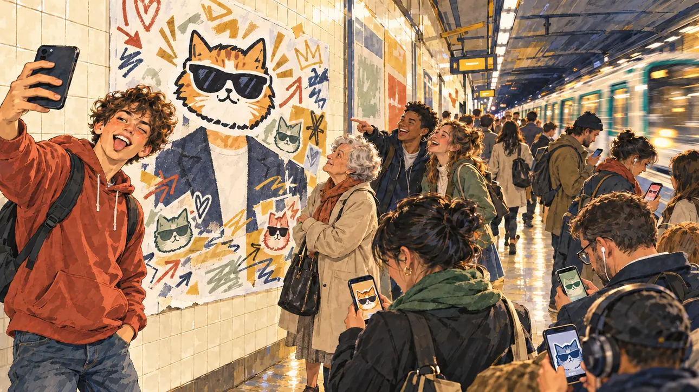

# `sloganMeme` · Votre slogan devient un mème

**Validée par le PO le 31/10/2026**, après une retouche par commentaire. Elle sert telle quelle en clair et en sombre.



| Champ | Valeur |
| --- | --- |
| Carte | `sloganMeme`, catégorie `buzz` (Buzz) |
| Style | Reportage dessiné |
| Ton | Ironique |
| Date | 2026-10-31 |
| Outil | ChatGPT, ChatGPT Images 2.5 ; mode et effort : non précisés |
| Conversation | À remplir (le lien ne s'ouvre qu'avec le compte qui l'a créée) |
| Format rendu | 1672 × 941 (16:9) : export en 1290 × 726 px depuis le PNG d'origine, WebP de qualité 75, 162 Ko, sans recadrage |
| Fichier d'origine | PNG de ChatGPT, chez le PO, partagé aussi dans la conversation avec Claude |
| Première édition | À remplir |

## Texte de la carte

> **Votre slogan devient un mème**
>
> Internet s'empare de votre slogan et le détourne dans tous les sens. Le mème est partout, et pas toujours à votre avantage.

## Le moment choisi

Le slogan est du texte : il ne peut pas apparaître. Le mème se voit dans la rue, sur un quai de métro parisien à l'heure de pointe : l'affiche de campagne du candidat, dont un autocollant de chat à lunettes noires cache la tête, et dont le slogan disparaît sous les gribouillis. Un ado fait un selfie devant, des étudiants rient, et les voyageurs voient le même chat sur leur téléphone.

## Prompt complet

Dans une nouvelle conversation, avec [`oldTweet.webp`](oldTweet.webp) comme seule image de référence :

```
Use the attached image as the style reference: the same pencil and ink drawing with loose watercolour washes and warm paper grain. Faces, hands and objects are drawn with visible ink lines, never photographic. Not the same scene.

Editorial illustration, landscape 16:9 (1536 × 864 px), filling the whole frame edge to edge. A Paris metro platform in the morning rush hour in 2027, the day the candidate's slogan has become a meme. On the tiled wall, a large campaign poster of the player's candidate: the candidate's face is entirely covered by a sticker of a cartoon cat wearing sunglasses, and the slogan band at the bottom is covered with doodles, arrows and stickers, so that no word can be read. In the left third, a teenager in a hoodie takes a selfie in front of the poster, pulling a face, his face above mid-height. Around him, commuters of all ages glance at their smartphones, whose screens show the same cartoon cat in different colours; a woman in her seventies looks at the poster and shakes her head; two students laugh, one pointing at the poster. A train pulls in on the right in a blur. Nothing on the poster, the screens or the station signs is readable.

Style: Reportage drawing made on the spot, like a press illustrator or courtroom sketch artist: pencil and ink with loose watercolour washes, lively unfinished lines, white paper showing through.

Palette: navy #13203F, vellum #F5EFE1, gold #A9802A, brick #B5523B, ochre #D9A441, sage #8FA58A, slate #5E7186, sand #DCC8A4, warm grey #8C8279; use 4 to 6 of them, subtle warm paper grain.

Tone: gently ironic, postures slightly exaggerated but never the faces, cool underground light on warm cream tiles.

Constraints: realistic proportions, expressive but not caricatured faces, people of varied ages, genders and origins; anatomically correct hands with exactly five fingers, few hands visible, the others in pockets, behind objects or out of frame; no readable text anywhere (posters, signs, labels and screens stay unreadable); no captions or speech bubbles; no logos, flags or political party colours; no recognisable real person, no lookalike of a real politician; no explicit violence; no oil-paint texture, no white or ragged border.

Format: if 16:9 is not available, make 1536 × 1024 and keep the top 80 px and the bottom 80 px free of anything important (faces, hands, the main action): they will be cropped.
```

## Retouches

Commentaire posé sur l'affiche de l'essai 1 :

```
On this poster, cover the whole head, hair included, with the cat sticker, and replace the suit and tie with a plain dark collarless jacket, so that nothing shows whether the candidate is a man or a woman. Keep everything else in the image unchanged.
```

L'essai 1 montrait un costume, une cravate et des cheveux gris au-dessus de l'autocollant : l'affiche donnait un genre au candidat, ce que la règle interdit (#161). La retouche n'a changé que l'affiche.

## Relecture

Faite et validée par le PO le 31/10/2026, après la retouche.

- [x] Aucun texte lisible : ni slogan, ni panneaux de la station, ni écrans.
- [x] Aucun sosie d'une personne réelle.
- [x] Le candidat du joueur n'a ni visage ni genre : sur l'affiche, la tête est cachée et la veste est neutre.
- [x] Mains, visages et foules sans défaut visible à 343 px de large.
- [x] Aucune couleur de parti, aucun symbole officiel. Des personnes variées.
- [x] En 3:2 : rien d'important dans les 80 px du haut et du bas. Sans objet ici : l'image est en 16:9.
- [x] Lisible sur la page de l'événement, en clair et en sombre.
