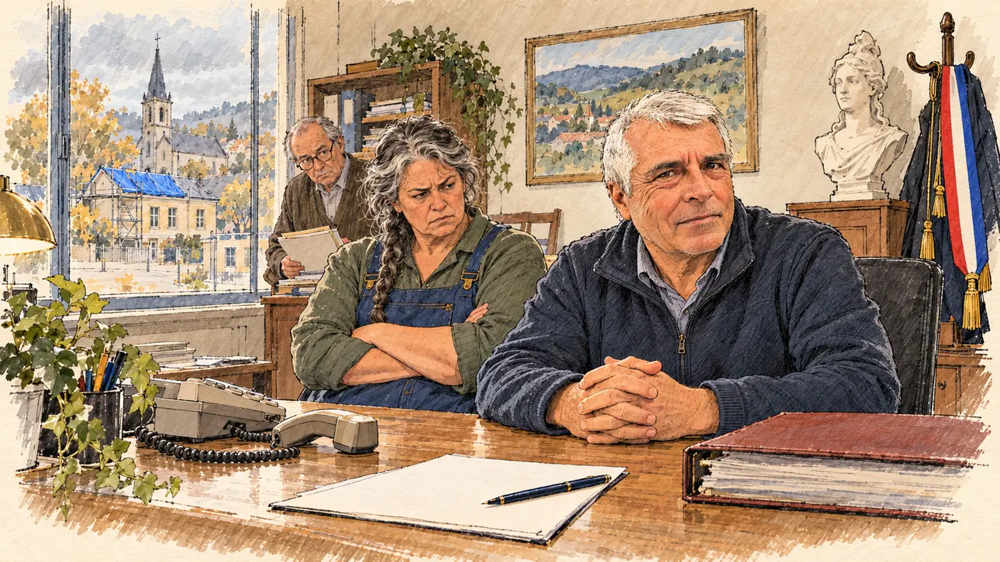

# `sponsorThreatened` · Un de vos parrains menacé

**Validée par le PO le 01/11/2026**, au premier essai. Elle sert telle quelle en clair et en sombre.



| Champ | Valeur |
| --- | --- |
| Carte | `sponsorThreatened`, catégorie `sponsorships` (Parrainages), carte ajoutée par la PR #225 (lot R2 des parrainages, #213) |
| Style | Reportage dessiné ; visages dessinés comme le reste, le dessin s'efface légèrement dans le papier aux bords |
| Ton | Grave et calme, avec une pointe d'obstination |
| Date | 2026-11-01 |
| Outil | ChatGPT, ChatGPT Images 2.5 ; mode et effort : non précisés |
| Conversation | À remplir (le lien ne s'ouvre qu'avec le compte qui l'a créée) |
| Format rendu | 1672 × 941 (16:9) : export en 1290 × 726 px depuis le PNG d'origine, WebP de qualité 75, 192 Ko, sans recadrage |
| Fichier d'origine | PNG de ChatGPT, chez le PO, partagé aussi dans la conversation avec Claude |
| Première édition | À remplir |

## Texte de la carte

Texte de la branche de la PR #225, avant sa fusion.

> **Un de vos parrains menacé**
>
> Le maire d'un village qui vous a promis sa signature dit avoir été menacé de perdre une subvention s'il vous parraine.

## Le moment choisi

Le bureau du maire d'un village, un matin gris. Le candidat est venu le voir et reste hors champ : de son côté du bureau, un formulaire de parrainage vierge et un stylo. Le maire, mains jointes, le regarde, inquiet mais décidé ; son adjointe fusille du regard le téléphone décroché ; le secrétaire écoute en faisant semblant de classer. Par la fenêtre, l'école au toit bâché que la subvention devait réparer. Personne n'est désigné comme l'auteur de la menace.

## Prompt complet

Dans une nouvelle conversation, avec deux images jointes : [`oldTweet.webp`](oldTweet.webp) pour le style, puis le portrait dessiné déjà fait pour [`comet`](comet.md), d'après une photo de famille du PO, pour la ressemblance du maire.

```
Use the first attached image as the style reference: the same pencil and ink drawing with loose watercolour washes and warm paper grain. Not the same scene.
Use the second attached image, a drawn portrait, only as the likeness reference for the mayor: give him this man's features, short grey-white hair and light stubble, and draw his face with the same ink lines and washes as the other people in the scene. Keep the likeness through the drawing, never through photographic detail.
This must look like a drawing made by hand on paper, never like a photograph or a film poster: the people are drawn with ink lines and flat washes, not modelled; the background is only suggested with a few pencil lines and light, transparent washes, so that the warm paper shows through; the drawing may fade lightly into the bare paper at the edges and in the corners, as on a sketchbook page, the fade staying narrow, without a wide white margin. Lighter and less saturated than a painting: no dense colour, no glossy highlights, no hatching filter laid over a finished image. No blur and no depth-of-field effect: everything, the foreground included, is drawn sharp with ink lines, like a sketch made on the spot.
Faces are drawn exactly like the clothes and the background: ink outlines, a few hatching strokes and flat watercolour washes for the skin, with the same level of detail as the rest of the drawing. No photographic skin, no realistic wrinkles or pores, no airbrushed or digital-painting look on the faces.

Editorial illustration, landscape 16:9 (1536 × 864 px), the scene filling the frame, with only a light fade into the paper at the edges. The small office of the mayor of a French village, in the town hall on a grey morning in 2027. The mayor had promised his signature to the player's candidate; he says he has been threatened with losing a subsidy if he goes ahead, by someone he will not name. The candidate has come to see him and stays off-camera: in the foreground, on the viewer's side of the desk, only a blank sponsorship form and a pen. In the right third, the mayor, the man from the portrait, in his sixties, in a fleece jacket, his hands folded on the desk, looks at the viewer, worried but defiant, his face above mid-height. On his desk, an old landline phone with the handset off the hook, and a thick, closed subsidy file. Behind him, the French tricolour mayor's sash hangs on a coat stand next to a plaster bust of Marianne, and a framed landscape of the valley hangs on the wall. Through the window, the village square, the church and the little school, its roof half covered by a blue tarpaulin: the subsidy was for that roof. Next to the mayor, his deputy, a big, broad-shouldered farmer in her fifties with a long grey plait and blue overalls, arms crossed, scowls at the phone; at the back, the town hall secretary, a thin elderly man in a cardigan with reading glasses on his nose, pretends to file papers while listening. Nothing on the form, the file, the phone or the walls is readable.

Style: Reportage drawing made on the spot, like a press illustrator or courtroom sketch artist: pencil and ink with loose watercolour washes, lively unfinished lines, white paper showing through.

Palette: navy #13203F, vellum #F5EFE1, gold #A9802A, brick #B5523B, ochre #D9A441, sage #8FA58A, slate #5E7186, sand #DCC8A4, warm grey #8C8279; use 4 to 6 of them, subtle warm paper grain.

Tone: grave and quiet, with a touch of stubbornness, the grey light of a rural morning.

Constraints: realistic proportions, expressive but not caricatured faces, drawn like the rest of the illustration and never photographic; people of varied ages, genders, origins and body types (heavy, stocky, round, tall, short, wiry, not only slim), each with a distinct face and haircut (no two people alike), drawn with respect and never as a joke; anatomically correct hands with exactly five fingers, few hands visible, the others in pockets, behind objects or out of frame; no portrait of a real president or politician on the walls; no readable text anywhere (forms, files, phones, signs and walls stay unreadable); no captions or speech bubbles; no logos or political party colours; apart from the mayor, no recognisable real person and no lookalike of a real politician or mayor; no explicit violence, no menacing figure; no photographic rendering, no blur or bokeh, no hatching filter over a finished digital painting, no oil-paint texture, no wide white margin or frame (a light fade into the paper at the edges is fine).

Format: if 16:9 is not available, make 1536 × 1024 and keep the top 80 px and the bottom 80 px free of anything important (faces, hands, the main action): they will be cropped.
```

## Décisions prises sur cette image

- **Le maire reprend les traits d'une photo de famille fournie par le PO**, la même personne que l'astronome de [`comet`](comet.md), avec son accord, confirmé par le PO. Ni la photo ni le portrait dessiné ne sont dans ce dépôt.
- **La maire du premier prompt devient un maire,** et l'adjoint devient une adjointe, pour ne pas avoir deux hommes de la soixantaine côte à côte.
- **Personne n'est désigné comme l'auteur de la menace,** comme le veut la carte : un téléphone décroché suffit. Pas de portrait de président au mur, mais un paysage de la vallée.

## Essais écartés

Aucune image écartée. Le premier prompt, avec une maire sans ressemblance voulue, a été remplacé avant génération :

```
Use the attached image as the style reference: the same pencil and ink drawing with loose watercolour washes and warm paper grain. Not the same scene.
This must look like a drawing made by hand on paper, never like a photograph or a film poster: the people are drawn with ink lines and flat washes, not modelled; the background is only suggested with a few pencil lines and light, transparent washes, so that the warm paper shows through; the drawing may fade lightly into the bare paper at the edges and in the corners, as on a sketchbook page, the fade staying narrow, without a wide white margin. Lighter and less saturated than a painting: no dense colour, no glossy highlights, no hatching filter laid over a finished image. No blur and no depth-of-field effect: everything, the foreground included, is drawn sharp with ink lines, like a sketch made on the spot.
Faces are drawn exactly like the clothes and the background: ink outlines, a few hatching strokes and flat watercolour washes for the skin, with the same level of detail as the rest of the drawing. No photographic skin, no realistic wrinkles or pores, no airbrushed or digital-painting look on the faces.

Editorial illustration, landscape 16:9 (1536 × 864 px), the scene filling the frame, with only a light fade into the paper at the edges. The small office of the mayor of a French village, in the town hall on a grey morning in 2027. The mayor had promised her signature to the player's candidate; she says she has been threatened with losing a subsidy if she goes ahead, by someone she will not name. The candidate has come to see her and stays off-camera: in the foreground, on the viewer's side of the desk, only a blank sponsorship form and a pen. In the right third, the mayor, a stocky woman in her fifties with short grey hair, a fleece jacket and the weathered hands of a farmer folded on the desk, looks at the viewer, worried but defiant, her face above mid-height. On her desk, an old landline phone with the handset off the hook, and a thick, closed subsidy file. Behind her, the French tricolour mayor's sash hangs on a coat stand next to a plaster bust of Marianne, and a framed landscape of the valley hangs on the wall. Through the window, the village square, the church and the little school, its roof half covered by a blue tarpaulin: the subsidy was for that roof. Next to the mayor, her deputy, a big bearded farmer in his sixties in blue overalls, arms crossed, scowls at the phone; at the back, the town hall secretary, a thin elderly man in a cardigan with reading glasses on his nose, pretends to file papers while listening. Nothing on the form, the file, the phone or the walls is readable.

Style: Reportage drawing made on the spot, like a press illustrator or courtroom sketch artist: pencil and ink with loose watercolour washes, lively unfinished lines, white paper showing through.

Palette: navy #13203F, vellum #F5EFE1, gold #A9802A, brick #B5523B, ochre #D9A441, sage #8FA58A, slate #5E7186, sand #DCC8A4, warm grey #8C8279; use 4 to 6 of them, subtle warm paper grain.

Tone: grave and quiet, with a touch of stubbornness, the grey light of a rural morning.

Constraints: realistic proportions, expressive but not caricatured faces, drawn like the rest of the illustration and never photographic; people of varied ages, genders, origins and body types (heavy, stocky, round, tall, short, wiry, not only slim), each with a distinct face and haircut (no two people alike), drawn with respect and never as a joke; anatomically correct hands with exactly five fingers, few hands visible, the others in pockets, behind objects or out of frame; no portrait of a real president or politician on the walls; no readable text anywhere (forms, files, phones, signs and walls stay unreadable); no captions or speech bubbles; no logos or political party colours; no recognisable real person, no lookalike of a real politician or mayor; no explicit violence, no menacing figure; no photographic rendering, no blur or bokeh, no hatching filter over a finished digital painting, no oil-paint texture, no wide white margin or frame (a light fade into the paper at the edges is fine).

Format: if 16:9 is not available, make 1536 × 1024 and keep the top 80 px and the bottom 80 px free of anything important (faces, hands, the main action): they will be cropped.
```

## Retouches

Aucune.

## Relecture

Faite et validée par le PO le 01/11/2026.

- [x] Aucun texte lisible : ni sur le formulaire, ni sur le dossier, ni sur la façade de l'école.
- [x] Aucun sosie d'une personne réelle, hors la ressemblance voulue du maire. Pas de portrait de président.
- [x] Le candidat du joueur est hors champ.
- [x] Mains, visages et foules sans défaut visible à 343 px de large.
- [x] Aucune couleur de parti. L'écharpe tricolore et la Marianne signalent la mairie. Des personnes variées par l'âge, le corps et la coiffure.
- [x] En 3:2 : rien d'important dans les 80 px du haut et du bas. Sans objet ici : l'image est en 16:9.
- [x] Lisible sur la page de l'événement, en clair et en sombre.
