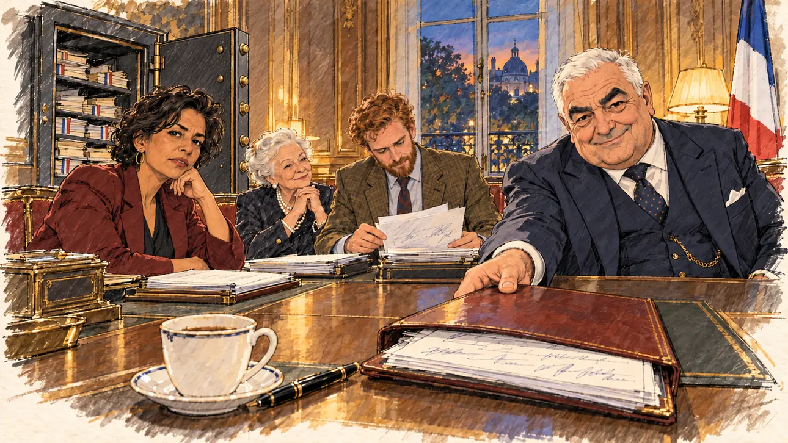

# `sponsorshipBank` · La banque des parrainages

**Validée par le PO le 01/11/2026**, au premier essai. Elle sert telle quelle en clair et en sombre.



| Champ | Valeur |
| --- | --- |
| Carte | `sponsorshipBank`, catégorie `sponsorships` (Parrainages), carte ajoutée par la PR #225 (lot R2 des parrainages, #213) |
| Style | Reportage dessiné, rendu assez fini : table brillante, dorures saturées (accepté par le PO) ; le dessin s'efface légèrement dans le papier aux bords |
| Ton | Ironique, feutré |
| Date | 2026-11-01 |
| Outil | ChatGPT, ChatGPT Images 2.5 ; mode et effort : non précisés |
| Conversation | À remplir (le lien ne s'ouvre qu'avec le compte qui l'a créée) |
| Format rendu | 1672 × 941 (16:9) : export en 1290 × 726 px depuis le PNG d'origine, WebP de qualité 75, 166 Ko, sans recadrage |
| Fichier d'origine | PNG de ChatGPT, chez le PO, partagé aussi dans la conversation avec Claude |
| Première édition | À remplir |

## Texte de la carte

Texte de la branche de la PR #225, avant sa fusion.

> **La banque des parrainages**
>
> Des parlementaires proposent de « prêter » leurs signatures aux candidats qui dépassent 10 % dans les sondages, au nom du pluralisme. Vous en faites partie.

## Le moment choisi

Un petit salon lambrissé du Sénat, le soir. Quelques parlementaires ont invité le candidat pour lui « prêter » leurs signatures. Le porte-parole fait glisser vers lui un épais dossier de formulaires signés, avec le sourire d'un banquier à l'ancienne ; dans un coin, un vieux coffre-fort ouvert, plein de formulaires, file la métaphore de la banque. Le candidat est hors champ : de son côté de la table, une tasse de café et un stylo-plume.

## Prompt complet

Dans une nouvelle conversation, avec [`oldTweet.webp`](oldTweet.webp) comme seule image de référence :

```
Use the attached image as the style reference: the same pencil and ink drawing with loose watercolour washes and warm paper grain. Not the same scene.
This must look like a drawing made by hand on paper, never like a photograph or a film poster: the people are drawn with ink lines and flat washes, not modelled; the background is only suggested with a few pencil lines and light, transparent washes, so that the warm paper shows through; the drawing may fade lightly into the bare paper at the edges and in the corners, as on a sketchbook page, the fade staying narrow, without a wide white margin. Lighter and less saturated than a painting: no dense colour, no glossy highlights, no hatching filter laid over a finished image. No blur and no depth-of-field effect: everything, the foreground included, is drawn sharp with ink lines, like a sketch made on the spot.
Faces are drawn exactly like the clothes and the background: ink outlines, a few hatching strokes and flat watercolour washes for the skin, with the same level of detail as the rest of the drawing. No photographic skin, no realistic wrinkles or pores, no airbrushed or digital-painting look on the faces.

Editorial illustration, landscape 16:9 (1536 × 864 px), the scene filling the frame, with only a light fade into the paper at the edges. A small panelled salon in the French Senate in Paris, in the evening in 2027, with a French tricolour flag in the corner and, through the tall window, the trees of the Luxembourg garden. A few members of parliament have invited the player's candidate, now above 10 % in the polls, to offer to lend their signatures in the name of pluralism, like a bank lending money. The candidate sits at the table and stays off-camera: in the foreground, on the viewer's side of the table, only a cup of coffee and a closed fountain pen. In the corner, as a joke on the bank, an old open safe full of folders of signed forms. In the right third, the spokesman, a heavy-set senator in his seventies with a white crew cut, bushy dark eyebrows and a three-piece suit with a watch chain, slides a thick leather folder of signed forms across the table towards the viewer with one hand, with the benevolent smile of an old-fashioned banker, looking at the viewer, his face above mid-height. Around the table: a member of parliament in her forties of North African origin with short wavy dark hair and a burgundy jacket, who looks at the viewer, weighing the candidate up; a tiny senator in her eighties with a white chignon and pearls, nodding approvingly; a lanky young member of parliament in his thirties with a red beard and a tweed jacket, leafing through the forms. Nothing on the forms, the folders, the safe or the walls is readable.

Style: Reportage drawing made on the spot, like a press illustrator or courtroom sketch artist: pencil and ink with loose watercolour washes, lively unfinished lines, white paper showing through.

Palette: navy #13203F, vellum #F5EFE1, gold #A9802A, brick #B5523B, ochre #D9A441, sage #8FA58A, slate #5E7186, sand #DCC8A4, warm grey #8C8279; use 4 to 6 of them, subtle warm paper grain.

Tone: gently ironic, cosy and slightly conspiratorial, warm lamplight on old wood panelling.

Constraints: realistic proportions, expressive but not caricatured faces, drawn like the rest of the illustration and never photographic; people of varied ages, genders, origins and body types (heavy, stocky, round, tall, short, wiry, not only slim), each with a distinct face and haircut (no two people alike), drawn with respect and never as a joke; anatomically correct hands with exactly five fingers, few hands visible, the others in pockets, behind objects or out of frame; no readable text anywhere (forms, folders, safes, nameplates and walls stay unreadable); no captions or speech bubbles; no logos or political party colours; no recognisable real person, no lookalike of a real senator or member of parliament; no explicit violence; no photographic rendering, no blur or bokeh, no hatching filter over a finished digital painting, no oil-paint texture, no wide white margin or frame (a light fade into the paper at the edges is fine).

Format: if 16:9 is not available, make 1536 × 1024 and keep the top 80 px and the bottom 80 px free of anything important (faces, hands, the main action): they will be cropped.
```

## Décisions prises sur cette image

- **Le porte-parole garde son profil** de sénateur âgé et corpulent aux cheveux blancs et aux sourcils sombres. Claude signalait un risque d'évocation d'un président du Sénat ou d'une personnalité connue, et proposait un sénateur maigre et chauve ; le PO a gardé l'image telle quelle. Leçon pour les prochains prompts : ne pas décrire un personnage qui colle au profil type d'un titulaire de fonction connu.
- **Le rendu, plus fini que le reportage dessiné** (table brillante, dorures saturées, visage de la vieille sénatrice très détaillé), est accepté par le PO.
- **Le coffre-fort ouvert** porte le jeu de mots de la carte : une banque qui prête des signatures.

## Essais écartés

Aucun.

## Retouches

Aucune.

## Relecture

Faite et validée par le PO le 01/11/2026.

- [x] Aucun texte lisible : les formulaires n'ont que des signatures et des lignes illisibles.
- [x] Aucun sosie avéré d'une personne réelle ; le profil du porte-parole est un risque relevé et accepté par le PO.
- [x] Le candidat du joueur est hors champ.
- [x] Mains, visages et foules sans défaut visible à 343 px de large.
- [x] Aucune couleur de parti. Le drapeau tricolore signale le Sénat. Des personnes variées par l'âge, le corps, l'origine et la coiffure.
- [x] En 3:2 : rien d'important dans les 80 px du haut et du bas. Sans objet ici : l'image est en 16:9.
- [x] Lisible sur la page de l'événement, en clair et en sombre.
