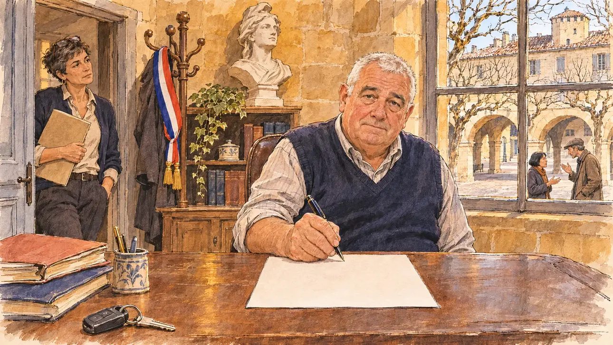

# `hesitantMayor` · Le maire qui hésite

**Retenue par le PO le 16/11/2026**, au premier essai. Elle sert telle quelle en clair et en sombre.



| Champ | Valeur |
| --- | --- |
| Carte | `hesitantMayor`, catégorie `sponsorships` (Parrainages), poids 0,12, semaines 1 à 7 pendant la collecte des parrainages ; une leçon de la campagne (réseau +2 sur la visite au maire), une seule des six par partie (Mitchnsun/moi-president, PO, 14/11/2026) |
| Style | Reportage dessiné |
| Ton | Chaleureux et un peu ironique, après-midi d'hiver |
| Date | 2026-11-16 |
| Outil | ChatGPT Images, à compléter (modèle et effort) |
| Conversation | À compléter |
| Format rendu | 1672 × 941 (16:9) : export en 1290 × 726 px, WebP de qualité 75, 198 Ko, sans recadrage, fait depuis la copie WebP de la conversation (à refaire depuis le PNG d'origine) |
| Fichier d'origine | À compléter (hors du dépôt) |
| Première édition | À compléter |

## Texte de la carte

> **Le maire qui hésite**
>
> Le maire d'un village vous a promis sa signature, puis n'ose plus : les parrainages sont publics, et son conseil municipal est partagé.

## Le moment choisi

Le bureau du maire d'un village-bastide du Gers, un après-midi de février : murs de pierre blonde, buste de Marianne, l'écharpe tricolore au portemanteau, un vieux bureau ; par la fenêtre, la place à arcades. Le candidat est assis face au bureau, hors champ : seules ses clés de voiture, sur le coin du bureau. Le maire tient son stylo au-dessus du formulaire, vierge, et le regarde, embarrassé : comprenez-moi. À la porte, la secrétaire de mairie l'observe ; sous les arcades, deux conseillers municipaux se disputent. Le précédent est la publication des parrainages depuis 2016, qui freine les maires (16 444 signatures en 1981, 13 427 en 2022) : personne n'y ressemble à un maire réel.

## Prompt complet

Dans une nouvelle conversation, avec [`primeTime.webp`](../../illustrations/media/primeTime.webp) comme seule image de référence :

```
Use the attached image as the style reference and copy its drawing: a realistic reportage drawing made on the spot for a newspaper, with quick, nervous pencil lines, often drawn twice, ink hatching in the shadows, transparent watercolour washes that spill a little over the lines, and the warm paper showing through. Not the same scene and not the same people: never reuse the face or the hair of the woman in the reference.
Like in the reference, the setting can be full when the story needs it, with the things that say where we are and what is happening, but each one is sketched with a few pencil lines and a light wash, never rendered or finished, and the drawing gets looser and paler towards the edges until it fades into the bare paper.
This must look like a drawing made by hand on paper by a press illustrator, halfway between a quick sketch and a realistic picture: never a photograph, a film poster or a digital painting, and never a cartoon, a comic strip, a caricature or a children's book illustration. Continuous lines, never dotted or dashed outlines; no uniform texture, speckles or hatching filter laid over the picture; no glossy highlights, no smooth gradients, in the sky and on the walls too. Colour can be rich in places, on a piece of clothing, a light or a flag, but it stays transparent and within the palette below. The fade into the paper at the edges stays narrow, without a wide white margin. No blur and no depth-of-field effect: everything, the foreground included, is drawn sharp, like a sketch made on the spot.
People are drawn from life with realistic anatomy and proportions, like in the reference: faces shaped with pencil lines, hatching and light washes, a little more finished than the background but never photographic (no photographic skin, no airbrushed or digital-painting look). Expressions stay natural and restrained, even in laughter or tears: no exaggerated grins, no wide-open mouths full of teeth, no rubbery or cartoonish faces.

Editorial illustration, landscape 16:9 (1536 × 864 px), the scene filling the frame, with only a light fade into the paper at the edges. The small office of the mayor, on the first floor of the town hall of a fortified bastide village in the Gers, in south-western France, on an afternoon in February 2027: walls of honey-coloured stone, a bust of Marianne on a shelf, the tricolour sash hanging on a coat rack, an old wooden desk; through the window, the arcaded square of the bastide. The player's candidate sits facing the desk and stays off-camera: in the foreground, only the candidate's car keys on the corner of the desk. In the right third, behind the desk, the mayor, a round, ruddy farmer in his sixties with white crew-cut hair, in a sleeveless jumper over a shirt, holds a pen above a blank sponsorship form and looks at the viewer, embarrassed, as if asking to be understood, his face above mid-height. At the door, the town hall secretary, a lean woman in her fifties with glasses pushed up on her head and a file under her arm, watches the mayor. Through the window, under the arcades, two town councillors argue: a woman in her forties of Vietnamese descent with a short bob and a tall, thin man in a cap. Only the mayor looks at the viewer. Nothing on the form, the file, the desk, the shelf or the square is readable.

Style: Reportage drawing made on the spot, like a press illustrator or courtroom sketch artist: pencil and ink with loose watercolour washes, lively unfinished lines, white paper showing through.

Palette: navy #13203F, vellum #F5EFE1, gold #A9802A, brick #B5523B, ochre #D9A441, sage #8FA58A, slate #5E7186, sand #DCC8A4, warm grey #8C8279; use 4 to 6 of them, subtle warm paper grain.

Tone: warm and slightly ironic, the golden light of a winter afternoon on the honey-coloured stone, the blank form as the quiet centre of the picture.

Constraints: realistic proportions, natural expressions, never cartoonish or caricatured faces, drawn like the rest of the illustration and never photographic; people of varied ages, genders, origins and body types (heavy, stocky, round, tall, short, wiry, not only slim), each with a distinct face and haircut (no two people alike), drawn with respect and never as a joke; each person's age, build and look plausible for their job and the scene (working people of working age), no stereotype tying an origin or a gender to a role, and no person of colour shown alone in a featured service or deferential role; anatomically correct hands with exactly five fingers, few hands visible, the others in pockets, behind objects or out of frame; no readable text anywhere (the form, the file, the desk, the shelf and the square stay unreadable, no Cerfa number, no names, no shop signs); no captions or speech bubbles; no logos, no political party colours, no flags other than the tricolour sash; no recognisable real person, no lookalike of a real politician or of a real mayor, no portrait of a real president on the wall; no explicit violence; no photographic rendering, no blur or bokeh, every outline a continuous pencil or ink line with no dotted or dashed outlines, no mottled, crackled or speckled texture over the faces, the clothes, the stone or the sky, no hatching filter over the picture, no oil-paint texture, no glow or halo, no wide white margin or frame (a light fade into the paper at the edges is fine).

Format: if 16:9 is not available, make 1536 × 1024 and keep the top 80 px and the bottom 80 px free of anything important (faces, hands, the main action): they will be cropped.
```

## Décisions prises sur cette image

Retenue telle quelle par le PO (16/11/2026). Le maire est au centre plutôt que dans le tiers droit, le formulaire blanc devant lui ; une étagère de livres et un lierre meublent le fond, comme un bureau de mairie.

## Essais écartés

Aucun.

## Retouches

Aucune.

## Relecture

Faite le 16/11/2026, à confirmer par le PO.

- [x] Aucun texte lisible : le formulaire est blanc ; rien sur le dossier, les livres ni la place.
- [x] Aucun sosie d'une personne réelle ; aucun portrait de président, seul le buste de Marianne.
- [x] Le candidat du joueur est hors champ : seules ses clés, sur le bureau.
- [x] Mains et visages sans défaut visible à 343 px de large : la main du maire sur le stylo, celle de la secrétaire sur son dossier, les gestes des deux conseillers.
- [x] Aucune couleur, aucun logo ni aucun drapeau de parti ; seule l'écharpe tricolore. Des personnes variées par l'âge, le corps, l'origine et la coiffure.
- [x] En 16:9 : pas de recadrage.
- [ ] Lisible sur la page de l'événement, en clair et en sombre : à vérifier dans l'app, une fois la carte publiée.
