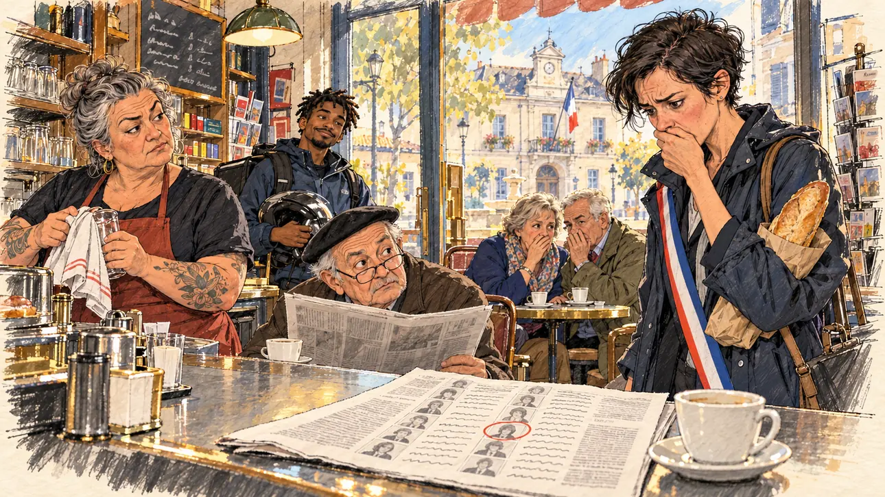

# `localPressSponsors` · La presse locale épingle vos parrains

**Validée par le PO le 01/11/2026**, au premier essai. Elle sert telle quelle en clair et en sombre.



| Champ | Valeur |
| --- | --- |
| Carte | `localPressSponsors`, catégorie `sponsorships` (Parrainages), carte ajoutée par la PR #225 (lot R2 des parrainages, #213) |
| Style | Reportage dessiné ; visages dessinés comme le reste, le dessin s'efface légèrement dans le papier aux bords |
| Ton | Ironique, un peu gêné |
| Date | 2026-11-01 |
| Outil | ChatGPT avec le modèle GPT Sol 6.1 en effort « light », et ChatGPT Images 2.5 |
| Conversation | À remplir (le lien ne s'ouvre qu'avec le compte qui l'a créée) |
| Format rendu | 1672 × 941 (16:9) : export en 1290 × 726 px depuis le PNG d'origine, WebP de qualité 75, 203 Ko, sans recadrage |
| Fichier d'origine | PNG de ChatGPT, chez le PO, partagé aussi dans la conversation avec Claude |
| Première édition | À remplir |

## Texte de la carte

Texte de la branche de la PR #225, avant sa fusion.

> **La presse locale épingle vos parrains**
>
> Le quotidien régional publie la liste des maires qui vous parrainent, et leur demande de se justifier.

## Le moment choisi

Le café-tabac d'un bourg, tôt le matin, le jour où le quotidien régional publie la liste. Sur le zinc, le journal ouvert sur une colonne de petits portraits, dont un entouré de rouge. Une des maires de la liste entre, sa baguette sous le bras, et s'arrête net, la main sur la bouche ; tout le café s'est tourné vers elle. Le candidat n'apparaît pas.

## Prompt complet

Dans une nouvelle conversation, avec [`oldTweet.webp`](../../illustrations/polemic/oldTweet.webp) comme seule image de référence :

```
Use the attached image as the style reference: the same pencil and ink drawing with loose watercolour washes and warm paper grain. Not the same scene.
This must look like a drawing made by hand on paper, never like a photograph or a film poster: the people are drawn with ink lines and flat washes, not modelled; the background is only suggested with a few pencil lines and light, transparent washes, so that the warm paper shows through; the drawing may fade lightly into the bare paper at the edges and in the corners, as on a sketchbook page, the fade staying narrow, without a wide white margin. Lighter and less saturated than a painting: no dense colour, no glossy highlights, no hatching filter laid over a finished image. No blur and no depth-of-field effect: everything, the foreground included, is drawn sharp with ink lines, like a sketch made on the spot.
Faces are drawn exactly like the clothes and the background: ink outlines, a few hatching strokes and flat watercolour washes for the skin, with the same level of detail as the rest of the drawing. No photographic skin, no realistic wrinkles or pores, no airbrushed or digital-painting look on the faces.

Editorial illustration, landscape 16:9 (1536 × 864 px), the scene filling the frame, with only a light fade into the paper at the edges. The village café-tobacconist of a small French town, early in the morning in 2027, the day the regional daily paper published the list of the mayors who sponsor the player's candidate and asked them to explain themselves. The candidate does not appear. In the foreground, spread out on the zinc counter next to a cup of coffee, the regional paper, open on a page with a column of tiny drawn portraits and a long list of names, one of them circled in red pen; nothing on it is readable. In the right third, one of those mayors, a tall, wiry woman in her forties with short black hair and a rain jacket, a baguette under her arm, has just come in and stops dead, her cheeks flushed, staring at the paper with dismay, her face above mid-height. Everyone in the café has turned towards her: the owner, a stocky woman in her fifties with tattooed forearms and a grey bun, raises an eyebrow while drying a glass; an old regular in a beret, a round man in his eighties, peers at her over his glasses, the paper in his hands; a young delivery man with a motorbike helmet under his arm and short twists grins; a retired couple at a small table whisper to each other behind their hands. Through the window, the little square of the town hall with its French tricolour flag. Nothing on the paper, the posters, the menu board or the shop signs is readable.

Style: Reportage drawing made on the spot, like a press illustrator or courtroom sketch artist: pencil and ink with loose watercolour washes, lively unfinished lines, white paper showing through.

Palette: navy #13203F, vellum #F5EFE1, gold #A9802A, brick #B5523B, ochre #D9A441, sage #8FA58A, slate #5E7186, sand #DCC8A4, warm grey #8C8279; use 4 to 6 of them, subtle warm paper grain.

Tone: gently ironic, a little awkward, the pale light of an early morning and the warm light of the café.

Constraints: realistic proportions, expressive but not caricatured faces, drawn like the rest of the illustration and never photographic; people of varied ages, genders, origins and body types (heavy, stocky, round, tall, short, wiry, not only slim), each with a distinct face and haircut (no two people alike), drawn with respect and never as a joke; nobody looks at the viewer; anatomically correct hands with exactly five fingers, few hands visible, the others in pockets, behind objects or out of frame; no readable text anywhere (newspapers, posters, menu boards, tobacco signs and shop fronts stay unreadable); no captions or speech bubbles; no logos, brand names or political party colours; no recognisable real person, no lookalike of a real politician or mayor; no explicit violence; no photographic rendering, no blur or bokeh, no hatching filter over a finished digital painting, no oil-paint texture, no wide white margin or frame (a light fade into the paper at the edges is fine).

Format: if 16:9 is not available, make 1536 × 1024 and keep the top 80 px and the bottom 80 px free of anything important (faces, hands, the main action): they will be cropped.
```

## Décisions prises sur cette image

- **La maire porte son écharpe tricolore,** ajoutée par le générateur : personne ne la porte pour aller chercher son pain, mais elle la désigne comme maire au premier coup d'œil et ajoute au comique. Le PO la garde.
- **Personne ne regarde le spectateur :** tous les regards vont vers la maire.

## Essais écartés

Aucun.

## Retouches

Aucune.

## Relecture

Faite et validée par le PO le 01/11/2026.

- [x] Aucun texte lisible : le journal n'a que des lignes ondulées, l'ardoise que des gribouillis ; un mot inventé sur le présentoir de cartes postales reste invisible à la taille de l'application.
- [x] Aucun sosie d'une personne réelle.
- [x] Le candidat du joueur n'apparaît pas.
- [x] Mains, visages et foules sans défaut visible à 343 px de large.
- [x] Aucune couleur de parti. L'écharpe et le drapeau tricolores signalent la maire et la mairie. Des personnes variées par l'âge, le corps, l'origine et la coiffure.
- [x] En 3:2 : rien d'important dans les 80 px du haut et du bas. Sans objet ici : l'image est en 16:9.
- [x] Lisible sur la page de l'événement, en clair et en sombre.
