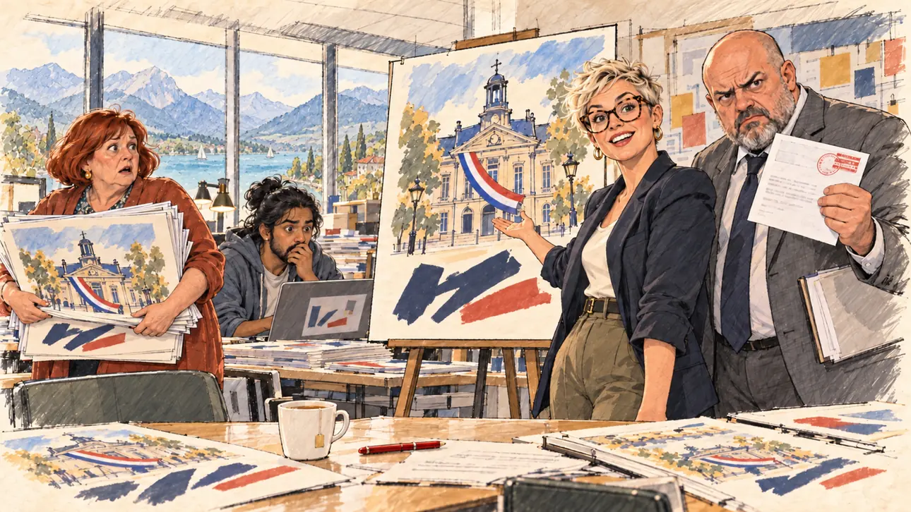

# `mayorsCandidate` · « Le candidat des maires »

**Validée par le PO le 01/11/2026**, au premier essai. Elle sert telle quelle en clair et en sombre.



| Champ | Valeur |
| --- | --- |
| Carte | `mayorsCandidate`, catégorie `sponsorships` (Parrainages), carte ajoutée par la PR #225 (lot R2 des parrainages, #213) |
| Style | Reportage dessiné ; visages dessinés comme le reste, le dessin s'efface légèrement dans le papier aux bords |
| Ton | Comique : un enthousiasme qui retombe d'un coup |
| Date | 2026-11-01 |
| Outil | ChatGPT avec le modèle GPT Sol 6.1 en effort « light », et ChatGPT Images 2.5 |
| Conversation | À remplir (le lien ne s'ouvre qu'avec le compte qui l'a créée) |
| Format rendu | 1672 × 941 (16:9) : export en 1290 × 726 px depuis le PNG d'origine, WebP de qualité 75, 151 Ko, sans recadrage |
| Fichier d'origine | PNG de ChatGPT, chez le PO, partagé aussi dans la conversation avec Claude |
| Première édition | À remplir |

## Texte de la carte

Texte de la branche de la PR #225, avant sa fusion.

> **« Le candidat des maires »**
>
> Votre équipe propose de vous présenter en « candidat des maires ». Une association d'élus prévient qu'elle ira en justice si vous utilisez ce titre.

## Le moment choisi

La salle de communication du QG, au moment où arrivent les premières affiches « candidat des maires » et la mise en demeure de l'association. La responsable de la communication présente fièrement l'affiche ; l'avocat de la campagne brandit la lettre recommandée en grimaçant ; derrière eux, le graphiste et une bénévole chargée d'affiches se figent. Le candidat est hors champ : sa tasse de thé et un stylo rouge au bord de la table.

## Prompt complet

Dans une nouvelle conversation, avec [`oldTweet.webp`](../../illustrations/polemic/oldTweet.webp) comme seule image de référence :

```
Use the attached image as the style reference: the same pencil and ink drawing with loose watercolour washes and warm paper grain. Not the same scene.
This must look like a drawing made by hand on paper, never like a photograph or a film poster: the people are drawn with ink lines and flat washes, not modelled; the background is only suggested with a few pencil lines and light, transparent washes, so that the warm paper shows through; the drawing may fade lightly into the bare paper at the edges and in the corners, as on a sketchbook page, the fade staying narrow, without a wide white margin. Lighter and less saturated than a painting: no dense colour, no glossy highlights, no hatching filter laid over a finished image. No blur and no depth-of-field effect: everything, the foreground included, is drawn sharp with ink lines, like a sketch made on the spot.
Faces are drawn exactly like the clothes and the background: ink outlines, a few hatching strokes and flat watercolour washes for the skin, with the same level of detail as the rest of the drawing. No photographic skin, no realistic wrinkles or pores, no airbrushed or digital-painting look on the faces.

Editorial illustration, landscape 16:9 (1536 × 864 px), the scene filling the frame, with only a light fade into the paper at the edges. The communication room of the player's candidate's campaign headquarters, in the afternoon in 2027. The team wants to present the candidate as the mayors' candidate and has just printed the first posters, at the very moment a mayors' association warns that it will go to court if the title is used. The candidate stays off-camera: in the foreground, on the edge of the big table, only the candidate's cup of tea and a red pen. On an easel, the large poster proof: a stylised town hall with a French tricolour sash draped across it and a line of big bold lettering made only of unreadable shapes; no portrait of the candidate on it. In the right third, the head of communications, a short, energetic woman in her thirties with a bleached pixie cut and big tortoiseshell glasses, presents the poster with one open hand and looks at the viewer with pride, her face above mid-height. Next to her, the campaign's lawyer, a tall, heavy-set man in his fifties with a shaved head and a grey suit, holds up an open registered letter with a red stamp and grimaces at the viewer. Behind them, a young graphic designer of South Asian origin with long hair tied low and a hoodie freezes at his laptop, and a round volunteer in her sixties with a dyed copper bob stops dead, her arms full of freshly printed posters. Nothing on the poster, the letter, the printed posters or the screen is readable.

Style: Reportage drawing made on the spot, like a press illustrator or courtroom sketch artist: pencil and ink with loose watercolour washes, lively unfinished lines, white paper showing through.

Palette: navy #13203F, vellum #F5EFE1, gold #A9802A, brick #B5523B, ochre #D9A441, sage #8FA58A, slate #5E7186, sand #DCC8A4, warm grey #8C8279; use 4 to 6 of them, subtle warm paper grain.

Tone: comic, an enthusiasm that deflates in one second, bright afternoon light through the windows.

Constraints: realistic proportions, expressive but not caricatured faces, drawn like the rest of the illustration and never photographic; people of varied ages, genders, origins and body types (heavy, stocky, round, tall, short, wiry, not only slim), each with a distinct face and haircut (no two people alike), drawn with respect and never as a joke; no picture of the candidate anywhere; anatomically correct hands with exactly five fingers, few hands visible, the others in pockets, behind objects or out of frame; no readable text anywhere (posters, letters, stamps, screens and walls stay unreadable); no captions or speech bubbles; no logos of a real association, no political party colours; no recognisable real person, no lookalike of a real politician; no explicit violence; no photographic rendering, no blur or bokeh, no hatching filter over a finished digital painting, no oil-paint texture, no wide white margin or frame (a light fade into the paper at the edges is fine).

Format: if 16:9 is not available, make 1536 × 1024 and keep the top 80 px and the bottom 80 px free of anything important (faces, hands, the main action): they will be cropped.
```

## Décisions prises sur cette image

- **Le slogan de l'affiche n'est pas écrit :** de grands coups de pinceau bleu et rouge en tiennent lieu, sous une mairie barrée d'une écharpe tricolore. Pas de portrait du candidat sur l'affiche (voir [`sloganMeme`](../buzz/sloganMeme.md)).
- **L'association de la carte est fictive :** aucun logo, aucun nom.
- **Par la fenêtre, un lac de montagne** plutôt que Paris : le prompt ne fixait pas de ville, le PO garde l'image.

## Essais écartés

Aucun.

## Retouches

Aucune.

## Relecture

Faite et validée par le PO le 01/11/2026.

- [x] Aucun texte lisible : ni sur l'affiche, ni sur la lettre, dont le tampon rouge ne porte aucun mot.
- [x] Aucun sosie d'une personne réelle. Aucun portrait du candidat.
- [x] Le candidat du joueur est hors champ.
- [x] Mains, visages et foules sans défaut visible à 343 px de large.
- [x] Aucune couleur de parti, aucun logo d'association. Des personnes variées par l'âge, le corps, l'origine et la coiffure.
- [x] En 3:2 : rien d'important dans les 80 px du haut et du bas. Sans objet ici : l'image est en 16:9.
- [x] Lisible sur la page de l'événement, en clair et en sombre.
