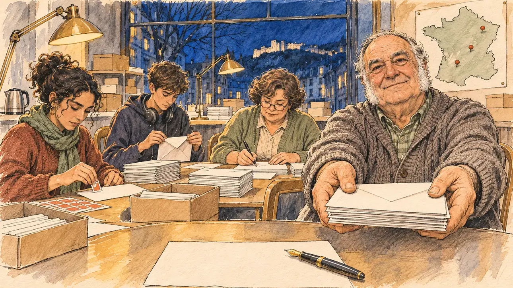

# `noNetwork` · Sans réseau

**Retenue par le PO le 16/11/2026**, au premier essai. Elle sert telle quelle en clair et en sombre.



| Champ | Valeur |
| --- | --- |
| Carte | `noNetwork`, catégorie `sponsorships` (Parrainages), poids 0,15, semaines 1 à 7 pendant la collecte des parrainages ; une leçon gagnée sur une faiblesse (réseau +3, jet inversé), une seule de la série par partie (Mitchnsun/moi-president, PO, 16/11/2026) |
| Style | Reportage dessiné |
| Ton | Chaleureux et un peu mélancolique, soirée de lampes |
| Date | 2026-11-16 |
| Outil | ChatGPT Images, modèle GPT 6.2, effort Light |
| Conversation | À compléter |
| Format rendu | 1672 × 941 (16:9) : export en 1290 × 726 px, WebP de qualité 75, 211 Ko, sans recadrage, fait depuis la copie WebP de la conversation |
| Fichier d'origine | Image de ChatGPT, chez le PO. L'export du dépôt a été fait depuis la copie partagée dans la conversation avec Claude |
| Première édition | `kit-france-2611-0004` |

## Texte de la carte

> **Sans réseau**
>
> Il vous manque des parrainages, et vos appels aux élus ne donnent rien : vous n'avez ni parti puissant ni carnet d'adresses.

## Le moment choisi

Le petit QG de campagne installé dans une ancienne boutique de Besançon, un soir de février : la vitrine sur la ville et la citadelle éclairée, des lampes de bureau, des cartons, une carte de France aux rares punaises rouges. Le candidat est à la table, hors champ : seuls son stylo-plume et une lettre vierge. L'ancien maire bénévole qui s'occupe des parrainages lui tend une pile de lettres : on les envoie toutes ce soir ; une étudiante colle des timbres, un adolescent plie des lettres, une bénévole recopie des adresses. Les précédents sont les 31 derniers parrainages arrachés in extremis (mars 2017) et un candidat qui a appelé les maires sans étiquette sans atteindre les 500 (2022) : personne n'y ressemble à un élu réel.

## Prompt complet

Dans une nouvelle conversation, avec [`primeTime.webp`](../../illustrations/media/primeTime.webp) comme seule image de référence :

```
Use the attached image as the style reference and copy its drawing: a realistic reportage drawing made on the spot for a newspaper, with quick, nervous pencil lines, often drawn twice, ink hatching in the shadows, transparent watercolour washes that spill a little over the lines, and the warm paper showing through. Not the same scene and not the same people: never reuse the face or the hair of the woman in the reference.
Like in the reference, the setting can be full when the story needs it, with the things that say where we are and what is happening, but each one is sketched with a few pencil lines and a light wash, never rendered or finished, and the drawing gets looser and paler towards the edges until it fades into the bare paper.
This must look like a drawing made by hand on paper by a press illustrator, halfway between a quick sketch and a realistic picture: never a photograph, a film poster or a digital painting, and never a cartoon, a comic strip, a caricature or a children's book illustration. Continuous lines, never dotted or dashed outlines; no uniform texture, speckles or hatching filter laid over the picture; no glossy highlights, no smooth gradients, in the sky and on the walls too. Colour can be rich in places, on a piece of clothing, a light or a flag, but it stays transparent and within the palette below. The fade into the paper at the edges stays narrow, without a wide white margin. No blur and no depth-of-field effect: everything, the foreground included, is drawn sharp, like a sketch made on the spot.
People are drawn from life with realistic anatomy and proportions, like in the reference: faces shaped with pencil lines, hatching and light washes, a little more finished than the background but never photographic (no photographic skin, no airbrushed or digital-painting look). Expressions stay natural and restrained, even in laughter or tears: no exaggerated grins, no wide-open mouths full of teeth, no rubbery or cartoonish faces.

Editorial illustration, landscape 16:9 (1536 × 864 px), the scene filling the frame, with only a light fade into the paper at the edges. A small campaign headquarters set up in a former shop in Besançon, in eastern France, on an evening in February 2027: a shop window on the dark street, a few meeting tables, cardboard boxes, and on the wall a map of France with only a few red pins and no labels; volunteers put letters into envelopes, piles of envelopes on the tables. The player's candidate sits at a table and stays off-camera: in the foreground, only the candidate's fountain pen lying beside a blank letter. In the right third, the volunteer in charge of the sponsorships, a former rural mayor, a heavy-set white man in his seventies with thick white sideburns and a wool cardigan, holds out a pile of letters towards the viewer with an encouraging smile, as if saying they will all go out tonight, his face above mid-height. Around the table: a student of Moroccan descent with curly hair pinned up sticks stamps; a thin teenage boy with headphones around his neck folds letters; a short, round woman in her fifties with reading glasses copies addresses onto envelopes. At the back, boxes of leaflets and a kettle. Only the former mayor looks at the viewer. Nothing on the letters, the envelopes, the map, the boxes or the shop window is readable.

Style: Reportage drawing made on the spot, like a press illustrator or courtroom sketch artist: pencil and ink with loose watercolour washes, lively unfinished lines, white paper showing through.

Palette: navy #13203F, vellum #F5EFE1, gold #A9802A, brick #B5523B, ochre #D9A441, sage #8FA58A, slate #5E7186, sand #DCC8A4, warm grey #8C8279; use 4 to 6 of them, subtle warm paper grain.

Tone: warm and a little melancholic, the yellow light of the desk lamps against the blue night in the shop window, the energy of a small team that believes in it.

Constraints: realistic proportions, natural expressions, never cartoonish or caricatured faces, drawn like the rest of the illustration and never photographic; people of varied ages, genders, origins and body types (heavy, stocky, round, tall, short, wiry, not only slim), each with a distinct face and haircut (no two people alike), drawn with respect and never as a joke; each person's age, build and look plausible for their job and the scene (working people of working age), no stereotype tying an origin or a gender to a role, and no person of colour shown alone in a featured service or deferential role; anatomically correct hands with exactly five fingers, few hands visible, the others in pockets, behind objects or out of frame; no readable text anywhere (the letters, the envelopes, the map, the boxes and the shop window stay unreadable, no addresses, no place names on the map, no stamps with figures); no captions or speech bubbles; no logos, no political party colours, no flags; no recognisable real person, no lookalike of a real politician or of a real mayor; no explicit violence; no photographic rendering, no blur or bokeh, every outline a continuous pencil or ink line with no dotted or dashed outlines, no mottled, crackled or speckled texture over the faces, the clothes or the walls, no hatching filter over the picture, no oil-paint texture, no glow or halo around the lamps, no wide white margin or frame (a light fade into the paper at the edges is fine).

Format: if 16:9 is not available, make 1536 × 1024 and keep the top 80 px and the bottom 80 px free of anything important (faces, hands, the main action): they will be cropped.
```

## Décisions prises sur cette image

Retenue telle quelle par le PO (16/11/2026). La citadelle de Besançon, éclairée, se voit par la vitrine, un monument que le gabarit permet ; la carte de France, sans légende, n'a que trois punaises.

## Essais écartés

Aucun.

## Retouches

Aucune.

## Relecture

Faite le 16/11/2026, à confirmer par le PO.

- [x] Aucun texte lisible : lettres et enveloppes blanches, carte sans noms, timbres sans chiffres.
- [x] Aucun sosie d'une personne réelle.
- [x] Le candidat du joueur est hors champ : seuls son stylo-plume et la lettre vierge.
- [x] Mains et visages sans défaut visible à 343 px de large : les deux mains de l'ancien maire sous la pile de lettres, celles qui collent un timbre, plient une enveloppe, écrivent une adresse.
- [x] Aucune couleur, aucun logo ni aucun drapeau de parti. Des personnes variées par l'âge, le corps, l'origine et la coiffure.
- [x] En 16:9 : pas de recadrage.
- [ ] Lisible sur la page de l'événement, en clair et en sombre : à vérifier dans l'app, une fois la carte publiée.
