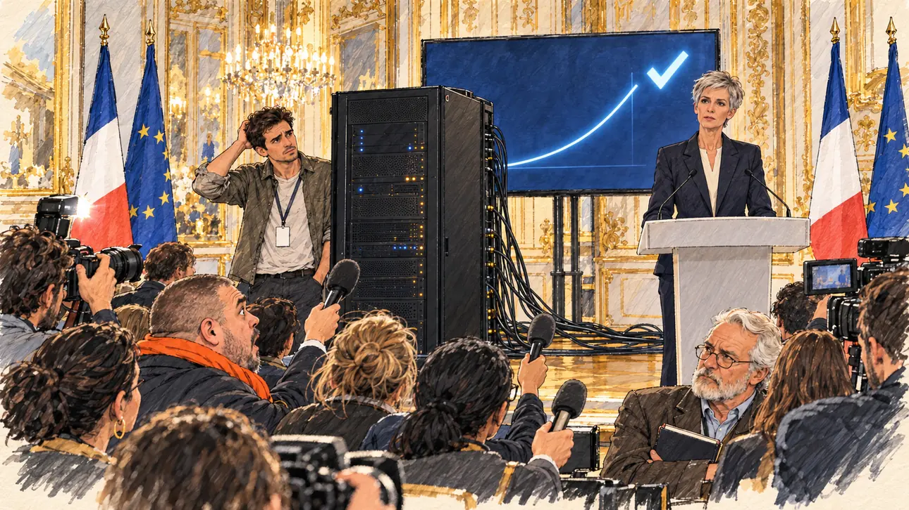

# `stateAlgorithm` · L'algorithme a parlé

**Validée par le PO le 01/11/2026**, au premier essai. Elle sert telle quelle en clair et en sombre.



| Champ | Valeur |
| --- | --- |
| Carte | `stateAlgorithm`, catégorie `farFetched` (Incroyable) |
| Style | Reportage dessiné ; visages dessinés comme le reste, le dessin s'efface légèrement dans le papier aux bords |
| Ton | Solennel et absurde |
| Date | 2026-11-01 |
| Outil | ChatGPT, ChatGPT Images 2.5 ; mode et effort : non précisés |
| Conversation | À remplir (le lien ne s'ouvre qu'avec le compte qui l'a créée) |
| Format rendu | 1672 × 941 (16:9) : export en 1290 × 726 px depuis le PNG d'origine, WebP de qualité 75, 177 Ko, sans recadrage |
| Fichier d'origine | PNG de ChatGPT, chez le PO, partagé aussi dans la conversation avec Claude |
| Première édition | À remplir |

## Texte de la carte

> **L'algorithme a parlé**
>
> Un algorithme d'État, censé prédire l'élection, annonce votre victoire. Personne ne sait comment il fonctionne, mais tout le monde y croit un peu.

## Le moment choisi

Une conférence de presse dans le salon doré d'un ministère. Au milieu des miroirs, du lustre et des drapeaux, l'algorithme : une baie de serveurs noire qui clignote, ses câbles en vrac sur le parquet. Sur l'écran, une courbe qui s'envole et une grande coche. La directrice du programme annonce le résultat, solennelle ; derrière la machine, un jeune ingénieur se gratte la tête, incapable d'expliquer comment elle marche. La presse est bouche bée, sauf un vieux journaliste sceptique. Le candidat n'apparaît pas, ni en personne ni en image.

## Prompt complet

Dans une nouvelle conversation, avec deux images jointes : [`oldTweet.webp`](oldTweet.webp) pour le style, puis un portrait dessiné du PO, fourni par lui, pour la ressemblance de l'ingénieur. Le portrait n'est pas dans ce dépôt.

```
Use the first attached image as the style reference: the same pencil and ink drawing with loose watercolour washes and warm paper grain. Not the same scene.
Use the second attached image, a drawn portrait, only as the likeness reference for the young engineer: give him this man's features, short tousled dark-brown hair and light stubble, and draw his face with the same ink lines and washes as the other people in the scene. Keep the likeness through the drawing, never through photographic detail.
This must look like a drawing made by hand on paper, never like a photograph or a film poster: the people are drawn with ink lines and flat washes, not modelled; the background is only suggested with a few pencil lines and light, transparent washes, so that the warm paper shows through; the drawing may fade lightly into the bare paper at the edges and in the corners, as on a sketchbook page, without a wide white margin. Lighter and less saturated than a painting: no dense colour, no glossy highlights, no hatching filter laid over a finished image.
Faces are drawn exactly like the clothes and the background: ink outlines, a few hatching strokes and flat watercolour washes for the skin, with the same level of detail as the rest of the drawing. No photographic skin, no realistic wrinkles or pores, no airbrushed or digital-painting look on the faces.

Editorial illustration, landscape 16:9 (1536 × 864 px), the scene filling the frame, with only a light fade into the paper at the edges. A gilded reception room in a French ministry in Paris, in 2027, during a press conference: the State's election-forecasting algorithm has just predicted the player's candidate's victory. The candidate does not appear. In the middle of the room, between the gilded mirrors, the chandelier and the French and European flags, stands the algorithm: a tall, matte black cabinet humming with tiny blinking lights, thick cables snaking across the parquet floor, strangely out of place. Behind it, a large screen shows only a soaring curve and a big glowing tick. In the right third, the director of the programme, a very tall, thin woman in her fifties with a severe silver pixie cut and a dark trouser suit, stands at a plain lectern and announces the result to the cameras with solemn calm, looking at the viewer, her face above mid-height. Behind the machine, a young engineer, the man from the portrait, in his thirties, in a crumpled shirt with rolled-up sleeves and a lanyard, scratches his head, visibly unable to explain how it works. In the foreground, the press seen from behind and from the side: raised microphones, a photographer's flash, a heavy-set journalist with a buzz cut and a bright orange scarf, mouth open, and an old journalist with a white beard and half-moon glasses, arms crossed, sceptical, his notebook closed. Nothing on the screen, the lectern, the cabinet, the microphones or the notebooks is readable.

Style: Reportage drawing made on the spot, like a press illustrator or courtroom sketch artist: pencil and ink with loose watercolour washes, lively unfinished lines, white paper showing through.

Palette: navy #13203F, vellum #F5EFE1, gold #A9802A, brick #B5523B, ochre #D9A441, sage #8FA58A, slate #5E7186, sand #DCC8A4, warm grey #8C8279; use 4 to 6 of them, subtle warm paper grain.

Tone: solemn and absurd at once, the cold light of the machine against the warm gold of the room.

Constraints: realistic proportions, expressive but not caricatured faces, drawn like the rest of the illustration and never photographic; people of varied ages, genders, origins and body types (heavy, stocky, round, tall, short, wiry, not only slim), each with a distinct face and haircut (no two people alike), drawn with respect and never as a joke; no picture or silhouette of the candidate anywhere; anatomically correct hands with exactly five fingers, few hands visible, the others in pockets, behind objects or out of frame; no readable text anywhere (screens, lecterns, cabinets, microphones and notebooks stay unreadable); no captions or speech bubbles; no logos or political party colours; apart from the engineer, no recognisable real person and no lookalike of a real politician or journalist; no robot, no humanoid machine, no famous film computer; no explicit violence; no photographic rendering, no hatching filter over a finished digital painting, no oil-paint texture, no wide white margin or frame (a light fade into the paper at the edges is fine).

Format: if 16:9 is not available, make 1536 × 1024 and keep the top 80 px and the bottom 80 px free of anything important (faces, hands, the main action): they will be cropped.
```

## Décisions prises sur cette image

- **L'ingénieur reprend les traits du PO,** d'après un portrait dessiné qu'il a fourni lui-même (01/11/2026). Le portrait n'est pas dans ce dépôt.
- **L'ingénieur n'est plus « corpulent » et n'a plus de queue de cheval,** comme dans le premier prompt : on ne change ni la silhouette ni la coiffure d'une personne réelle. Le journaliste à l'écharpe orange devient corpulent, pour garder des corps variés.
- **Aucune image du candidat,** pas même une silhouette sur l'écran : seulement une courbe et une coche.
- **La directrice regarde la salle** plutôt que le spectateur, comme le demandait le prompt : elle reste solennelle, l'écart est gardé.

## Essais écartés

Aucune image écartée. Le premier prompt, sans ressemblance voulue, a été remplacé avant génération :

```
Use the attached image as the style reference: the same pencil and ink drawing with loose watercolour washes and warm paper grain. Not the same scene.
This must look like a drawing made by hand on paper, never like a photograph or a film poster: the people are drawn with ink lines and flat washes, not modelled; the background is only suggested with a few pencil lines and light, transparent washes, so that the warm paper shows through; the drawing may fade lightly into the bare paper at the edges and in the corners, as on a sketchbook page, without a wide white margin. Lighter and less saturated than a painting: no dense colour, no glossy highlights, no hatching filter laid over a finished image.
Faces are drawn exactly like the clothes and the background: ink outlines, a few hatching strokes and flat watercolour washes for the skin, with the same level of detail as the rest of the drawing. No photographic skin, no realistic wrinkles or pores, no airbrushed or digital-painting look on the faces.

Editorial illustration, landscape 16:9 (1536 × 864 px), the scene filling the frame, with only a light fade into the paper at the edges. A gilded reception room in a French ministry in Paris, in 2027, during a press conference: the State's election-forecasting algorithm has just predicted the player's candidate's victory. The candidate does not appear. In the middle of the room, between the gilded mirrors, the chandelier and the French and European flags, stands the algorithm: a tall, matte black cabinet humming with tiny blinking lights, thick cables snaking across the parquet floor, strangely out of place. Behind it, a large screen shows only a soaring curve and a big glowing tick. In the right third, the director of the programme, a very tall, thin woman in her fifties with a severe silver pixie cut and a dark trouser suit, stands at a plain lectern and announces the result to the cameras with solemn calm, looking at the viewer, her face above mid-height. Behind the machine, a young engineer, a heavy-set man in his twenties with long hair in a ponytail and a crumpled shirt, scratches his head, visibly unable to explain how it works. In the foreground, the press seen from behind and from the side: raised microphones, a photographer's flash, a journalist with a buzz cut and a bright orange scarf, mouth open, and an old journalist with a white beard and half-moon glasses, arms crossed, sceptical, his notebook closed. Nothing on the screen, the lectern, the cabinet, the microphones or the notebooks is readable.

Style: Reportage drawing made on the spot, like a press illustrator or courtroom sketch artist: pencil and ink with loose watercolour washes, lively unfinished lines, white paper showing through.

Palette: navy #13203F, vellum #F5EFE1, gold #A9802A, brick #B5523B, ochre #D9A441, sage #8FA58A, slate #5E7186, sand #DCC8A4, warm grey #8C8279; use 4 to 6 of them, subtle warm paper grain.

Tone: solemn and absurd at once, the cold light of the machine against the warm gold of the room.

Constraints: realistic proportions, expressive but not caricatured faces, drawn like the rest of the illustration and never photographic; people of varied ages, genders, origins and body types (heavy, stocky, round, tall, short, wiry, not only slim), each with a distinct face and haircut (no two people alike), drawn with respect and never as a joke; no picture or silhouette of the candidate anywhere; anatomically correct hands with exactly five fingers, few hands visible, the others in pockets, behind objects or out of frame; no readable text anywhere (screens, lecterns, cabinets, microphones and notebooks stay unreadable); no captions or speech bubbles; no logos or political party colours; no recognisable real person, no lookalike of a real politician or journalist; no robot, no humanoid machine, no famous film computer; no explicit violence; no photographic rendering, no hatching filter over a finished digital painting, no oil-paint texture, no wide white margin or frame (a light fade into the paper at the edges is fine).

Format: if 16:9 is not available, make 1536 × 1024 and keep the top 80 px and the bottom 80 px free of anything important (faces, hands, the main action): they will be cropped.
```

## Retouches

Aucune.

## Relecture

Faite et validée par le PO le 01/11/2026.

- [x] Aucun texte lisible : ni sur l'écran, ni sur le pupitre, ni sur la machine, ni sur les badges.
- [x] Aucun sosie d'une personne réelle, hors la ressemblance voulue de l'ingénieur. La machine ne reprend ni le monolithe de *2001* ni un ordinateur de film.
- [x] Le candidat du joueur n'apparaît pas.
- [x] Mains, visages et foules sans défaut visible à 343 px de large.
- [x] Aucune couleur de parti. Les drapeaux français et européens signalent le ministère. Des personnes variées par l'âge, le corps, l'origine et la coiffure.
- [x] En 3:2 : rien d'important dans les 80 px du haut et du bas. Sans objet ici : l'image est en 16:9.
- [x] Lisible sur la page de l'événement, en clair et en sombre.
