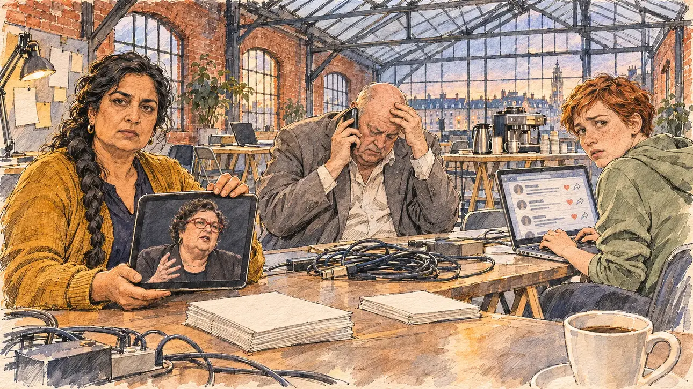

# `arsenicKiss` · Le baiser à l'arsenic

**Validée par le PO le 27/11/2026**, au premier essai. Elle sert telle quelle en clair et en sombre.



| Champ | Valeur |
| --- | --- |
| Carte | `arsenicKiss`, catégorie `support` (Offre de soutien), tirée seulement après une prise de position pro-russe ; carte ajoutée pour Mitchnsun/moi-president#562 |
| Style | Reportage dessiné, trait de `primeTime` |
| Ton | Tendu, petit matin gris |
| Date | 2026-11-27 |
| Outil | ChatGPT Images |
| Conversation | La conversation habituelle du PO, la même pour toutes les images (PO, 27/11/2026) |
| Format rendu | 1672 × 941 (16:9) : export en 1290 × 726 px, WebP de qualité 75, 270 Ko, sans recadrage |
| Fichier d'origine | Image de ChatGPT, chez le PO. L'export du dépôt a été fait depuis la copie partagée dans la conversation avec Claude |
| Première édition | La prochaine Release qui suit le merge de la PR de Mitchnsun/moi-president#562 |

## Texte de la carte

> **Le baiser à l'arsenic**
>
> Une ancienne présentatrice d'une chaîne d'État russe, sanctionnée par l'Union pour sa propagande, salue votre position sur la guerre en Ukraine : « Enfin une voix de la paix en France ! » Ses relais en ligne vous applaudissent, et la presse parle d'un baiser à l'arsenic.

Ses réponses : remercier pour ce soutien, assumer (vous parlez de paix, peu importe qui applaudit), ne rien dire, dénoncer une tentative d'ingérence russe, retourner l'accusation (un procès d'intention).

## Le moment choisi

Le petit matin dans le QG de campagne, un ancien atelier de brique rouge de Lille sous une verrière, le beffroi au loin : l'équipe découvre la vidéo de la propagandiste. Le candidat du joueur est hors champ, la scène vue de sa place : au premier plan, sa tasse de café. La directrice de la communication lui tend la tablette où passe la vidéo et le regarde ; l'attaché de presse, au téléphone avec un journaliste, se tient le front ; une militante, devant les réactions qui défilent sur son ordinateur, lève les yeux, inquiète. La présentatrice de la vidéo est fictive : elle ne reprend pas les traits de la personne réelle du cas (`docs/NEWS_SOURCES.md` de l'app), et rien sur l'écran ne nomme un pays. L'image ne montre pas la propagandiste en personne, mais ce que son soutien fait à la campagne.

## Prompt complet

Dans une nouvelle conversation, avec [`primeTime.webp`](../../illustrations/media/primeTime.webp) comme seule image de référence. Le prompt a été écrit avant que le texte de la carte nomme la Russie (PO, 27/11/2026) : il dit « a foreign state television channel », et l'image ne montre de toute façon aucun drapeau ni logo.

```
Use the attached image as the style reference and copy its drawing: a realistic reportage drawing made on the spot for a newspaper, with quick, nervous pencil lines, often drawn twice, ink hatching in the shadows, transparent watercolour washes that spill a little over the lines, and the warm paper showing through. Take from the reference its line, its washes and its paper, not the finish of the presenter's face, which is the most finished and almost photographic part of it: every face here stays a drawing. Not the same scene and not the same people: never reuse the face or the hair of the woman in the reference.
Like in the reference, the setting can be full when the story needs it, with the things that say where we are and what is happening, but each one is sketched with a few pencil lines and a light wash, never rendered or finished, and the drawing gets looser and paler towards the edges until it fades into the bare paper.
This must look like a drawing made by hand on paper by a press illustrator, halfway between a quick sketch and a realistic picture: never a photograph, a film poster or a digital painting, and never a cartoon, a comic strip, a caricature or a children's book illustration. Continuous lines, never dotted or dashed outlines; the paper grain is the paper itself, never a mottled texture, speckles or hatching filter laid over the picture; no glossy highlights, no smooth gradients, in the sky and on the walls too. Colour can be rich in places, on a piece of clothing, a light or a flag, but it stays transparent and within the palette below. The fade into the paper at the edges stays narrow, without a wide white margin. No blur and no depth-of-field effect: everything, the foreground included, is drawn sharp, like a sketch made on the spot.
People are drawn from life with realistic anatomy and proportions: each face is drawn with the same visible pencil and ink lines, hatching and transparent washes as the clothes and the room, looser and sketchier than the presenter's face in the reference, with realistic features but never photographic (no photographic skin, no smooth shading, no airbrushed or digital-painting look). Expressions stay natural and restrained, even in laughter or tears: no exaggerated grins, no wide-open mouths full of teeth, no rubbery or cartoonish faces.

Editorial illustration, landscape 16:9 (1536 × 864 px), the scene filling the frame, with only a light fade into the paper at the edges. Early morning in 2027 in a campaign headquarters set up in a former red-brick workshop in Lille, France: a glass roof with grey daylight, brick walls, long trestle tables with laptops, cables and folded campaign leaflets, a coffee machine. A former presenter of a foreign state television channel has just posted a video praising the player's candidate, and the team discovers it. The player's candidate stays off-camera, the scene seen from where they stand: in the bottom-right foreground, only their white coffee cup on the table. In the left third, the main character, the communications director, a woman in her mid-forties of Indian origin, round and solid, a thick dark braid over one shoulder, a mustard cardigan over a dark blouse, holds a tablet turned towards the viewer and looks straight at the viewer, grave and urgent, her face above mid-height. On the tablet, small and sketchy, a video: a fictional presenter in her late fifties, heavy-set, short dark curly hair, red-framed glasses, speaking to the camera in a dark studio with a plain backdrop, no flag, no logo, no text. In the middle ground, a press officer in his sixties, white, bald and heavy, a rumpled grey suit without a tie, on his phone with a journalist, rubbing his forehead, looking down. On the right, behind the coffee cup, a young volunteer in her early twenties, white, freckles, short red hair, a green hoodie, sits at a laptop where a column of unreadable social media reactions with small heart and share icons scrolls, and she glances up at the viewer, worried. Nobody smiles. Nothing on the tablet, the laptop, the leaflets or the walls is readable.

Style: Reportage drawing made on the spot, like a press illustrator or courtroom sketch artist: pencil and ink with loose watercolour washes, lively unfinished lines, white paper showing through.

Palette: navy #13203F, vellum #F5EFE1, gold #A9802A, brick #B5523B, ochre #D9A441, sage #8FA58A, slate #5E7186, sand #DCC8A4, warm grey #8C8279; use 4 to 6 of them, subtle warm paper grain.

Tone: tense, grey early-morning light from the glass roof, the cold glow of the screens on the faces.

Constraints: realistic proportions, natural expressions, never cartoonish or caricatured faces, drawn like the rest of the illustration and never photographic; people of varied ages, genders, origins and body types (heavy, stocky, round, tall, short, wiry, not only slim), each with a distinct face and haircut (no two people alike), drawn with respect and never as a joke; each person's age, build and look plausible for their job and the scene (working people of working age), no stereotype tying an origin or a gender to a role, and no person of colour shown alone in a featured service or deferential role; anatomically correct hands with exactly five fingers, few hands visible, the others in pockets, behind objects or out of frame; no readable text anywhere (the tablet, the laptop, the leaflets and the walls stay unreadable); no captions or speech bubbles; no logos or political party colours; no flag, emblem or channel logo that names a country; no recognisable real person, no lookalike of a real politician or of a real television presenter, the presenter on the tablet included; no explicit violence; no photographic rendering, no blur or bokeh, no dotted outlines, no texture or hatching filter over the picture, no oil-paint texture, no wide white margin or frame (a light fade into the paper at the edges is fine).

Format: if 16:9 is not available, make 1536 × 1024 and keep the top 80 px and the bottom 80 px free of anything important (faces, hands, the main action): they will be cropped.
```

## Décisions prises sur cette image

- Une première copie partagée dans la conversation avec Claude n'est pas arrivée en fichier ; le PO l'a renvoyée, et l'export vient de la seconde.

## Essais écartés

Aucun.

## Retouches

Aucune.

## Relecture

Faite par Claude le 27/11/2026 et validée par le PO le même jour.

- [x] Aucun texte lisible : la tablette, l'ordinateur (des barres et des icônes), les tracts, les murs.
- [x] Aucun sosie d'une personne réelle relevé ; la présentatrice de la tablette est fictive.
- [x] Le candidat du joueur est hors champ ; seule sa tasse est au premier plan.
- [x] Mains sans défaut visible (la tablette, le téléphone, le clavier).
- [x] Aucune couleur ni aucun logo de parti, aucun drapeau. Des personnes variées par l'âge, le corps, l'origine et la coiffure.
- [x] En 16:9 : pas de recadrage.
- [ ] Lisible sur la page de l'événement, en clair et en sombre : à voir dans l'app.

Deux plantes vertes sont restées dans le décor, que le gabarit écarte ; gardées.
