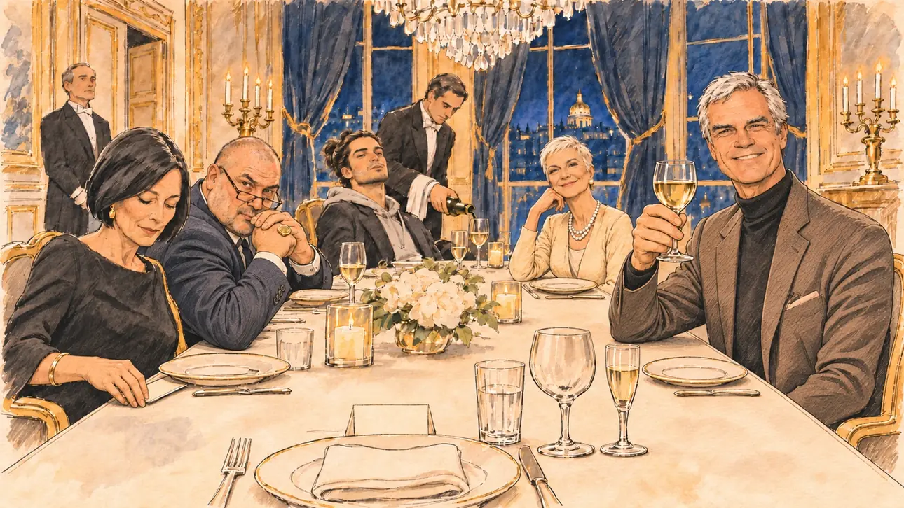

# `donorsDinner` · Un dîner de donateurs

**Validée par le PO le 31/10/2026**, au premier essai. Elle sert telle quelle en clair et en sombre.



| Champ | Valeur |
| --- | --- |
| Carte | `donorsDinner`, catégorie `support` (Offre de soutien) |
| Style | Reportage dessiné, rendu très réaliste : visages presque photographiques, comme [`primeTime`](../media/primeTime.md) |
| Ton | Ironique |
| Date | 2026-10-31 |
| Outil | ChatGPT avec le modèle GPT Sol 6.1 en effort « light », et ChatGPT Images 2.5 |
| Conversation | À remplir (le lien ne s'ouvre qu'avec le compte qui l'a créée) |
| Format rendu | 1672 × 941 (16:9) : export en 1290 × 726 px depuis le PNG d'origine, WebP de qualité 75, 156 Ko, sans recadrage |
| Fichier d'origine | PNG de ChatGPT, chez le PO, partagé aussi dans la conversation avec Claude |
| Première édition | `kit-france-2611-0001` |

## Texte de la carte

> **Un dîner de donateurs**
>
> Un riche homme d'affaires organise un dîner de levée de fonds en votre honneur. Les chèques s'annoncent généreux, les invités très discrets.

## Le moment choisi

Un dîner privé aux chandelles dans le salon d'un hôtel particulier parisien. Le candidat est en bout de table : son assiette, sa serviette, un marque-place vierge. L'hôte lève son verre vers lui ; autour de la table, des invités élégants et discrets, dont une femme qui glisse un chèque sous sa soucoupe.

## Prompt complet

Dans une nouvelle conversation, avec deux images jointes : [`oldTweet.webp`](../../illustrations/polemic/oldTweet.webp) pour le style, puis une photo de famille du PO pour la ressemblance de l'hôte.

```
Use the first attached image as the style reference: the same pencil and ink drawing with loose watercolour washes and warm paper grain. Not the same scene.
Use the second attached image, a family photograph, only as the likeness reference for the host: give him the face, the short white hair and the build of the white-haired man on the right of the photograph, at the same age, drawn in the same style as everyone else. Ignore the other people in the photograph.
Faces are drawn exactly like the clothes and the background: ink outlines, a few hatching strokes and flat watercolour washes for the skin, with the same level of detail as the rest of the drawing. No photographic skin, no realistic shading, no airbrushed or digital-painting look on the faces.

Editorial illustration, landscape 16:9 (1536 × 864 px), filling the whole frame edge to edge. A private fundraising dinner in the candlelit salon of a Paris mansion, late in the evening in 2027, given in honour of the player's candidate. The candidate sits at the head of the long table and stays off-camera: in the foreground, only the candidate's plate, a folded napkin, a crystal glass and a blank place card. In the right third, the host, a rich businessman, the white-haired man from the photograph, in a cashmere jacket over a black turtleneck, raises his glass towards the viewer with a satisfied smile, his face above mid-height. Along the table, the guests are elegant and very discreet: a woman in her sixties with a short platinum crop and pearls smiles politely at the viewer; a young heir with a man bun and a hoodie under his blazer leans back; a heavy-set man with a shaved head and a signet ring looks at the viewer over his glasses; a woman in her fifties with a sleek black bob and a black dress, looking down, slips a folded cheque under her saucer. A butler pours wine. Near the door, a silver tray holds the guests' smartphones, collected at the entrance, and the heavy curtains are drawn. Nothing on the cheque, the place card or the walls is readable.

Style: Reportage drawing made on the spot, like a press illustrator or courtroom sketch artist: pencil and ink with loose watercolour washes, lively unfinished lines, white paper showing through.

Palette: navy #13203F, vellum #F5EFE1, gold #A9802A, brick #B5523B, ochre #D9A441, sage #8FA58A, slate #5E7186, sand #DCC8A4, warm grey #8C8279; use 4 to 6 of them, subtle warm paper grain.

Tone: gently ironic, warm candlelight and gold reflections, everything a little too smooth.

Constraints: realistic proportions, expressive but not caricatured faces, drawn like the rest of the illustration and never photographic; people of varied ages, genders, origins and body types (heavy, stocky, round, tall, short, wiry, not only slim), each with a distinct face and haircut (no two people alike), drawn with respect and never as a joke; anatomically correct hands with exactly five fingers, few hands visible, the others in pockets, behind objects or out of frame; no readable text anywhere (cheques, cards, labels and screens stay unreadable); no captions or speech bubbles; no logos or political party colours; apart from the host, no recognisable real person and no lookalike of a real politician or businessman; no explicit violence; no oil-paint texture, no white or ragged border.

Format: if 16:9 is not available, make 1536 × 1024 and keep the top 80 px and the bottom 80 px free of anything important (faces, hands, the main action): they will be cropped.
```

## Décisions prises sur cette image

- **L'hôte reprend les traits d'une photo de famille fournie par le PO**, avec l'accord de la famille (31/10/2026). La photo n'est pas dans ce dépôt.
- **Le rendu, très réaliste,** est accepté par le PO. La photo de famille jointe tire sans doute le générateur vers le réalisme.

## Essais écartés

Aucun.

## Retouches

Aucune.

## Relecture

Faite et validée par le PO le 31/10/2026.

- [x] Aucun texte lisible : ni sur le chèque, ni sur le marque-place.
- [x] Aucun sosie d'une personne réelle, hors la ressemblance voulue de l'hôte.
- [x] Le candidat du joueur est hors champ.
- [x] Mains, visages et foules sans défaut visible à 343 px de large.
- [x] Aucune couleur de parti, aucun symbole officiel.
- [x] En 3:2 : rien d'important dans les 80 px du haut et du bas. Sans objet ici : l'image est en 16:9.
- [x] Lisible sur la page de l'événement, en clair et en sombre.

## Régénération demandée (04/11/2026)

**Pourquoi.** La revue de la première série note le style à 3/3 et les détails à 3/3 : c'est un autre style, une photo de dîner de gala à peine peinte, avec des visages photographiques, du cristal et des dorures aux reflets brillants, des bougies en halos et du bokeh au fond, quelques hachures seulement sur la nappe. La table est couverte de verres, de bougeoirs, d'assiettes à liseré, de couverts, de fleurs et d'un marque-place ; autour, une dizaine d'invités, deux serveurs, lustres, chandeliers, buste, tentures, pâtisseries et un dôme par la fenêtre. Avec `danceVideo`, c'est l'image la plus loin du style. Le PO a décidé de régénérer l'image.

**Ce qui reste.** Le moment : le dîner aux chandelles, le candidat hors champ en bout de table, l'hôte à droite qui lève son verre avec un sourire satisfait, quatre invités discrets (la femme aux perles, l'héritier au chignon, l'homme corpulent à la chevalière, la femme au carré noir qui glisse un chèque sous sa soucoupe), le maître d'hôtel qui sert. L'hôte garde la ressemblance voulue de la première série (une photo de famille du PO).

**Ce qui change.** La table se réduit au couvert du candidat, au marque-place vierge et à trois verres, sans reflets ni bougeoirs en grappe. Le décor tombe à un chandelier et des tentures esquissés : plus de lustres, de buste, de pâtisseries, de dôme ni de plateau de téléphones, un seul maître d'hôtel au fond. Le portrait de l'hôte n'est pas dans le kit : le prompt passe par la méthode en deux étapes du gabarit de la ressemblance voulue (portrait dessiné d'abord, puis scène), pour que la photo ne soit jamais jointe à la scène, ce qui tirait le rendu vers le réalisme.

### Prompt de régénération

Deux étapes, dans deux nouvelles conversations.

**Étape 1 : le portrait.** Dans une nouvelle conversation, avec deux images jointes, dans cet ordre : [`primeTime.webp`](../../illustrations/media/primeTime.webp) pour le style, puis la photo de famille du PO déjà utilisée pour cette carte. Le portrait obtenu n'est pas dans ce dépôt ; à faire vérifier par le PO (dessiné, et ressemblant) avant la scène.

```
Use the first attached image as the style reference: the same pencil and ink drawing with loose watercolour washes and warm paper grain.
The second attached image is a photograph. Draw a new portrait of the white-haired man on the right of the photograph, as a press illustrator or courtroom sketch artist would draw a quick likeness from life: head and shoulders, three-quarter view, with a warm, satisfied smile, in a plain dark turtleneck, on plain warm paper with no background. Ignore the other people in the photograph.
Do not trace or copy the photograph. Redraw the face from scratch and keep only what makes him recognisable: the shape of the face, the short white hair and its hairline, the eyebrows, the eyes, the nose, the mouth and the smile. Everything is drawn with ink outlines, hatching and flat watercolour washes, realistic and drawn from life like the faces in the reference image, never a caricature. No photographic skin, no photographic lighting, no detail taken over from the photo's texture.
Format: square, 1024 × 1024 px.
```

**Étape 2 : la scène.** Dans une nouvelle conversation, avec deux images jointes, dans cet ordre : [`primeTime.webp`](../../illustrations/media/primeTime.webp) pour le style, puis le portrait dessiné de l'étape 1 pour la ressemblance de l'hôte.

```
Use the first attached image as the style reference and copy its drawing: a realistic reportage drawing made on the spot for a newspaper, with quick, nervous pencil lines, often drawn twice, ink hatching in the shadows, transparent watercolour washes that spill a little over the lines, and the warm paper showing through. Not the same scene and not the same people: never reuse the face or the hair of the woman in the reference.
Like in the reference, the setting can be full when the story needs it, with the things that say where we are and what is happening, but each one is sketched with a few pencil lines and a light wash, never rendered or finished, and the drawing gets looser and paler towards the edges until it fades into the bare paper.
Use the second attached image, a drawn portrait, only as the likeness reference for the host: give him this man's features and short white hair, and draw his face with the same ink lines and washes as the other people in the scene. Keep the likeness through the drawing, never through photographic detail.
This must look like a drawing made by hand on paper by a press illustrator, halfway between a quick sketch and a realistic picture: never a photograph, a film poster or a digital painting, and never a cartoon, a comic strip, a caricature or a children's book illustration. Continuous lines, never dotted or dashed outlines; no uniform texture, speckles or hatching filter laid over the picture; no glossy highlights, no smooth gradients, in the sky and on the walls too. Colour can be rich in places, on a piece of clothing, a light or a flag, but it stays transparent and within the palette below. The fade into the paper at the edges stays narrow, without a wide white margin. No blur and no depth-of-field effect: everything, the foreground included, is drawn sharp, like a sketch made on the spot.
People are drawn from life with realistic anatomy and proportions, like in the reference: faces shaped with pencil lines, hatching and light washes, a little more finished than the background but never photographic (no photographic skin, no airbrushed or digital-painting look). Expressions stay natural and restrained, even in laughter or tears: no exaggerated grins, no wide-open mouths full of teeth, no rubbery or cartoonish faces.

Editorial illustration, landscape 16:9 (1536 × 864 px), the scene filling the frame, with only a light fade into the paper at the edges. A private fundraising dinner in the candlelit salon of a Paris mansion, late in the evening in 2027, given in honour of the player's candidate. The candidate sits at the head of the long table and stays off-camera: in the foreground, only the candidate's plain plate with a folded napkin, a blank place card and three crystal glasses, drawn with a few clear ink lines and a pale wash, no sparkle and no glitter. In the right third, the host, a rich businessman, the man from the portrait, in his sixties, in a cashmere jacket over a black turtleneck, raises his glass towards the viewer with a satisfied smile, his face above mid-height. Along the table, four guests, elegant and very discreet: a woman in her sixties with a short platinum crop and pearls smiles politely at the viewer; a young heir with a man bun and a hoodie under his blazer leans back; a heavy-set man with a shaved head and a signet ring looks at the viewer over his glasses; a woman in her fifties with a sleek black bob and a black dress, looking down, slips a folded cheque under her saucer. A butler in the background pours wine, only sketched. The room is only suggested: a candelabra with two candles and heavy dark curtains drawn with a few lines, the rest bare warm paper. Nothing on the cheque or the place card is readable.

Style: Reportage drawing made on the spot, like a press illustrator or courtroom sketch artist: pencil and ink with loose watercolour washes, lively unfinished lines, white paper showing through.

Palette: navy #13203F, vellum #F5EFE1, gold #A9802A, brick #B5523B, ochre #D9A441, sage #8FA58A, slate #5E7186, sand #DCC8A4, warm grey #8C8279; use 4 to 6 of them, subtle warm paper grain.

Tone: gently ironic, warm candlelight and a little gold, everything a little too smooth.

Constraints: realistic proportions, natural expressions, never cartoonish or caricatured faces, drawn like the rest of the illustration and never photographic; people of varied ages, genders, origins and body types (heavy, stocky, round, tall, short, wiry, not only slim), each with a distinct face and haircut (no two people alike), drawn with respect and never as a joke; anatomically correct hands with exactly five fingers, few hands visible, the others in pockets, behind objects or out of frame; no readable text anywhere (the cheque and the place card stay unreadable); no captions or speech bubbles; no logos or political party colours; apart from the host, no recognisable real person and no lookalike of a real politician or businessman; no explicit violence; no photographic rendering, no blur or bokeh, no dotted outlines, no texture or hatching filter over the picture, no oil-paint texture, no wide white margin or frame (a light fade into the paper at the edges is fine).

Format: if 16:9 is not available, make 1536 × 1024 and keep the top 80 px and the bottom 80 px free of anything important (faces, hands, the main action): they will be cropped.
```
