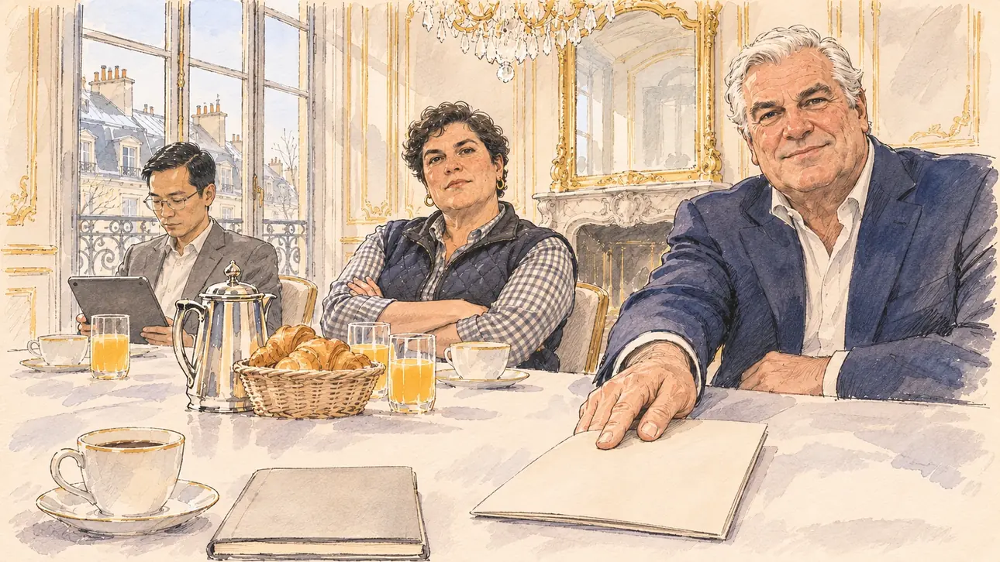

# `employersPact` · Le patronat vous tend la main

**Validée par le PO le 08/11/2026**, au premier essai. Elle sert telle quelle en clair et en sombre.



| Champ | Valeur |
| --- | --- |
| Carte | `employersPact`, catégorie `support` (Offre de soutien) |
| Style | Reportage dessiné |
| Ton | Chaleureux en surface, une pointe d'ironie |
| Date | 2026-11-08 |
| Outil | ChatGPT Images, à compléter (modèle et effort) |
| Conversation | À compléter |
| Format rendu | 1672 × 941 (16:9) : export en 1290 × 726 px, WebP de qualité 75, 148 Ko, sans recadrage, fait depuis la copie WebP de la conversation (à refaire depuis le PNG d'origine) |
| Fichier d'origine | À compléter (hors du dépôt) |
| Première édition | À compléter |

## Texte de la carte

> **Le patronat vous tend la main**
>
> Une grande organisation patronale est prête à vous soutenir, à une condition : renoncer à toute hausse du Smic, qui « mettrait la pagaille dans les entreprises ».

## Le moment choisi

Un petit-déjeuner d'affaires dans le salon privé d'un cercle, au premier étage d'un immeuble haussmannien du 8ᵉ arrondissement de Paris, un matin d'hiver : moulures dorées, lustre, cheminée de marbre, toits de zinc derrière les portes-fenêtres. Le candidat est à table, hors champ : sa tasse et son carnet fermé au premier plan. Le président de l'organisation lui glisse un dossier avec un sourire assuré ; la cheffe d'une entreprise de logistique, bras croisés, le jauge ; le directeur des affaires sociales lit sa tablette.

## Prompt complet

Dans une nouvelle conversation, avec [`primeTime.webp`](../../illustrations/media/primeTime.webp) comme seule image de référence :

```
Use the attached image as the style reference and copy its drawing: a realistic reportage drawing made on the spot for a newspaper, with quick, nervous pencil lines, often drawn twice, ink hatching in the shadows, transparent watercolour washes that spill a little over the lines, and the warm paper showing through. Not the same scene and not the same people: never reuse the face or the hair of the woman in the reference.
Like in the reference, the setting can be full when the story needs it, with the things that say where we are and what is happening, but each one is sketched with a few pencil lines and a light wash, never rendered or finished, and the drawing gets looser and paler towards the edges until it fades into the bare paper.
This must look like a drawing made by hand on paper by a press illustrator, halfway between a quick sketch and a realistic picture: never a photograph, a film poster or a digital painting, and never a cartoon, a comic strip, a caricature or a children's book illustration. Continuous lines, never dotted or dashed outlines; no uniform texture, speckles or hatching filter laid over the picture; no glossy highlights, no smooth gradients, in the sky and on the walls too. Colour can be rich in places, on a piece of clothing, a light or a flag, but it stays transparent and within the palette below. The fade into the paper at the edges stays narrow, without a wide white margin. No blur and no depth-of-field effect: everything, the foreground included, is drawn sharp, like a sketch made on the spot.
People are drawn from life with realistic anatomy and proportions, like in the reference: faces shaped with pencil lines, hatching and light washes, a little more finished than the background but never photographic (no photographic skin, no airbrushed or digital-painting look). Expressions stay natural and restrained, even in laughter or tears: no exaggerated grins, no wide-open mouths full of teeth, no rubbery or cartoonish faces.

Editorial illustration, landscape 16:9 (1536 × 864 px), the scene filling the frame, with only a light fade into the paper at the edges. A private business breakfast in Paris, on a winter morning in 2027, in a private salon of a business club on the first floor of a Haussmann building in the 8th arrondissement: cream walls with gilded mouldings, a marble fireplace with a tall mirror, a crystal chandelier, tall French windows with wrought-iron balconies looking out on the grey zinc rooftops and chimney pots of Paris under a pale sky. A large employers' organisation offers to back the player's candidate, on one condition: give up any rise of the minimum wage. The player's candidate sits at the table and stays off-camera: in the foreground, only the candidate's cup of coffee and a closed notebook on the white tablecloth. In the right third, across the table, the president of the organisation, a man in his mid-sixties of European descent, tall and heavy-set with broad shoulders, a full head of thick white hair combed back, clean-shaven with a heavy jaw, no glasses, in a navy suit and an open-collared white shirt without a tie, slides a slim folder across the tablecloth towards the viewer with a polite, firm, self-assured smile, looking at the viewer, his face above mid-height. Beside him, the head of a logistics firm, a woman in her forties of Portuguese descent, stocky and broad, with short dark hair and a quilted sleeveless jacket over a checked shirt, sits back with her arms crossed and weighs up the viewer, looking at the viewer. At the end of the table, the organisation's director of social affairs, a slim man in his late thirties of Vietnamese descent, with neat short hair and thin-framed glasses, in a grey blazer, reads his tablet without looking up. On the table, a silver coffee pot, a basket of croissants, glasses of orange juice. No waiter, nobody serving. No portrait on the walls. Nothing on the folder, the notebook, the tablet or the walls is readable, and no logo of any organisation appears.

Style: Reportage drawing made on the spot, like a press illustrator or courtroom sketch artist: pencil and ink with loose watercolour washes, lively unfinished lines, white paper showing through.

Palette: navy #13203F, vellum #F5EFE1, gold #A9802A, brick #B5523B, ochre #D9A441, sage #8FA58A, slate #5E7186, sand #DCC8A4, warm grey #8C8279; use 4 to 6 of them, subtle warm paper grain.

Tone: warm on the surface with a touch of irony, soft morning light through the tall windows on the gilded mouldings, polite smiles that set a condition.

Constraints: realistic proportions, natural expressions, never cartoonish or caricatured faces, drawn like the rest of the illustration and never photographic; people of varied ages, genders, origins and body types (heavy, stocky, round, tall, short, wiry, not only slim), each with a distinct face and haircut (no two people alike), drawn with respect and never as a joke; each person's age, build and look plausible for their role and the scene, no stereotype tying an origin or a gender to a role, and no person of colour shown alone in a featured service or deferential role; anatomically correct hands with exactly five fingers, few hands visible, the others in pockets, behind objects or out of frame; no readable text anywhere (the folder, the notebook, the tablet and the walls stay unreadable); no captions or speech bubbles; no logos, no organisation's emblem, no political party colours; no recognisable real person, no lookalike of a real politician, of a real employers' leader or of any real business figure; no explicit violence; no photographic rendering, no blur or bokeh, no dotted outlines, no texture or hatching filter over the picture, no oil-paint texture, no wide white margin or frame (a light fade into the paper at the edges is fine).

Format: if 16:9 is not available, make 1536 × 1024 and keep the top 80 px and the bottom 80 px free of anything important (faces, hands, the main action): they will be cropped.
```

## Décisions prises sur cette image

- **Le président a le profil réaliste du poste** (PO, 07/11/2026) : les dirigeants des grandes organisations patronales sont presque toujours des hommes blancs d'un certain âge, et la règle « Le rôle va avec le métier et le contexte, sans cliché » du [gabarit](../gabarit.md) veut que le rôle aille avec le contexte. Il n'a les traits d'aucune personne réelle : le PO avait demandé qu'il ressemble au dirigeant en exercice d'une organisation patronale, ce que le gabarit interdit (un sosie d'une personne réelle). Ce choix va un peu contre la règle « pas de profil type d'un titulaire de fonction connu » : le PO l'a pris en connaissance de cause, et le président garde une allure à lui (épaisse chevelure blanche coiffée en arrière, rasé de près, sans lunettes, chemise ouverte sans cravate).
- **Les deux autres rôles se répartissent hommes et femmes** : la cheffe d'une entreprise de logistique, d'origine portugaise, et le directeur des affaires sociales, d'origine vietnamienne. Aucun serveur, aucun rôle de service.
- **Paris plutôt que Lille** (PO, 08/11/2026) : un cercle d'affaires du 8ᵉ arrondissement, sans vue sur la tour Eiffel, qui désignerait le siège d'une organisation réelle tout proche.

## Essais écartés

Aucun. Deux versions du prompt, écrites avant et jamais générées, mettaient à la présidence une femme d'origine marocaine, puis le même président dans une ancienne filature de Lille.

## Retouches

Aucune.

## Relecture

Faite et validée par le PO le 08/11/2026.

- [x] Aucun texte lisible : le dossier, le carnet et l'écran de la tablette sont vierges, aucun portrait au mur.
- [x] Aucun sosie d'une personne réelle.
- [x] Le candidat du joueur est hors champ : seuls sa tasse et son carnet fermé.
- [x] Mains, visages et foules sans défaut visible à 343 px de large.
- [x] Aucune couleur ni aucun logo de parti ou d'organisation. Des personnes variées par l'âge, le corps, l'origine et la coiffure.
- [x] En 16:9 : pas de recadrage.
- [ ] Lisible sur la page de l'événement, en clair et en sombre : à vérifier dans l'app, une fois la carte publiée.
