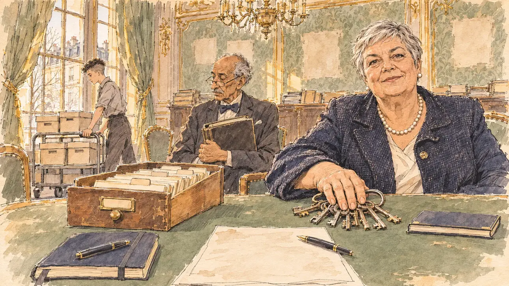

# `partyMachine` · Un grand parti vous ouvre ses portes

**Validée par le PO le 10/11/2026**, au premier essai. Elle sert telle quelle en clair et en sombre.



| Champ | Valeur |
| --- | --- |
| Carte | `partyMachine`, catégorie `support` (Soutien), poids 0,2, toute semaine ; un pari gagné sur une faiblesse (refuser l'appareil, sur un réseau faible) |
| Style | Reportage dessiné |
| Ton | Cordial et transactionnel, fin d'après-midi |
| Date | 2026-11-10 |
| Outil | ChatGPT Images, à compléter (modèle et effort) |
| Conversation | À compléter |
| Format rendu | 1672 × 941 (16:9) : export en 1290 × 726 px, WebP de qualité 75, 205 Ko, sans recadrage, fait depuis la copie WebP de la conversation (à refaire depuis le PNG d'origine) |
| Fichier d'origine | À compléter (hors du dépôt) |
| Première édition | À compléter |

## Texte de la carte

> **Un grand parti vous ouvre ses portes**
>
> Un grand parti, en perte de vitesse, vous offre son appareil : ses élus, ses fichiers, son argent. En échange, il veut des places et un mot dans votre programme.

## Le moment choisi

La vieille salle du bureau politique d'un grand parti en déclin, dans un hôtel particulier parisien sans bâtiment reconnaissable, en fin d'après-midi. Sur le papier peint, des rectangles plus clairs à la place des portraits des anciens chefs, décrochés : aucun portrait n'est montré. Sur la table, l'appareil offert : un gros trousseau de clés, un tiroir de fiches de militants, un chéquier. Le candidat reste hors champ, à la table : son carnet fermé et son stylo, et la liste des exigences du parti glissée vers lui, un stylo dessus. La secrétaire générale, la main sur le trousseau, regarde le spectateur avec un sourire cordial et insistant : tout ça est à vous, à une condition. Le trésorier serre son registre, une stagiaire pousse un chariot d'archives.

## Prompt complet

Dans une nouvelle conversation, avec [`primeTime.webp`](../../illustrations/media/primeTime.webp) comme seule image de référence :

```
Use the attached image as the style reference and copy its drawing: a realistic reportage drawing made on the spot for a newspaper, with quick, nervous pencil lines, often drawn twice, ink hatching in the shadows, transparent watercolour washes that spill a little over the lines, and the warm paper showing through. Not the same scene and not the same people: never reuse the face or the hair of the woman in the reference.
Like in the reference, the setting can be full when the story needs it, with the things that say where we are and what is happening, but each one is sketched with a few pencil lines and a light wash, never rendered or finished, and the drawing gets looser and paler towards the edges until it fades into the bare paper.
This must look like a drawing made by hand on paper by a press illustrator, halfway between a quick sketch and a realistic picture: never a photograph, a film poster or a digital painting, and never a cartoon, a comic strip, a caricature or a children's book illustration. Continuous lines, never dotted or dashed outlines; no uniform texture, speckles or hatching filter laid over the picture; no glossy highlights, no smooth gradients, in the sky and on the walls too. Colour can be rich in places, on a piece of clothing, a light or a flag, but it stays transparent and within the palette below. The fade into the paper at the edges stays narrow, without a wide white margin. No blur and no depth-of-field effect: everything, the foreground included, is drawn sharp, like a sketch made on the spot.
People are drawn from life with realistic anatomy and proportions, like in the reference: faces shaped with pencil lines, hatching and light washes, a little more finished than the background but never photographic (no photographic skin, no airbrushed or digital-painting look). Expressions stay natural and restrained, even in laughter or tears: no exaggerated grins, no wide-open mouths full of teeth, no rubbery or cartoonish faces.

Editorial illustration, landscape 16:9 (1536 × 864 px), the scene filling the frame, with only a light fade into the paper at the edges. The old meeting room of the political bureau of a big party in decline, in a Parisian townhouse with no recognisable building, late on an afternoon in February 2027, when the party offers the player's candidate its machine, its elected officials, its files and its money, in exchange for seats and a word in the programme: a long table with a worn green baize, tall windows with heavy faded curtains, a dusty chandelier, and on the old wallpaper several paler rectangles where the portraits of former leaders used to hang, now empty, with no portrait anywhere. On the table, the machine on offer: a big ring of old keys, an open drawer of activists' index cards, a closed chequebook. The player's candidate stays off-camera, at the table: in the foreground, only the candidate's own closed notebook and pen, and the party's list of demands slid towards the candidate, a pen lying on it, unreadable. In the right third, the party's secretary general, a stocky woman in her sixties with a silver crop, a pearl necklace and a dark tweed jacket, rests one hand on the ring of keys and looks at the viewer with a cordial, insistent smile, all this is yours, on one condition, her face above mid-height. Behind her, the party's treasurer, a thin man in his seventies of Tunisian descent with a bow tie and half-moon glasses, holds a thick ledger against his chest; at the back, a tall young intern with a shaved undercut pushes a trolley of archive boxes. Only the secretary general looks at the viewer. Nothing on the list, the index cards, the chequebook, the ledger, the boxes or the walls is readable.

Style: Reportage drawing made on the spot, like a press illustrator or courtroom sketch artist: pencil and ink with loose watercolour washes, lively unfinished lines, white paper showing through.

Palette: navy #13203F, vellum #F5EFE1, gold #A9802A, brick #B5523B, ochre #D9A441, sage #8FA58A, slate #5E7186, sand #DCC8A4, warm grey #8C8279; use 4 to 6 of them, subtle warm paper grain.

Tone: cordial and transactional, a slightly dusty faded grandeur, the late warm light from the tall windows on the old gold of the room, the empty pale rectangles on the wall as a quiet sign of decline.

Constraints: realistic proportions, natural expressions, never cartoonish or caricatured faces, drawn like the rest of the illustration and never photographic; people of varied ages, genders, origins and body types (heavy, stocky, round, tall, short, wiry, not only slim), each with a distinct face and haircut (no two people alike), drawn with respect and never as a joke; each person's age, build and look plausible for their job and the scene (working people of working age), no stereotype tying an origin or a gender to a role, and no person of colour shown alone in a featured service or deferential role; no portrait, photograph or bust of anyone on the walls; anatomically correct hands with exactly five fingers, few hands visible, the others in pockets, behind objects or out of frame; no readable text anywhere (the list, the index cards, the chequebook, the ledger, the boxes and the walls stay unreadable, no figures); no captions or speech bubbles; no logos, no party name, no party emblem, no political party colours, no flags; no recognisable real person, no lookalike of a real politician; no explicit violence; no photographic rendering, no blur or bokeh, every outline a continuous pencil or ink line with no dotted or dashed outlines, no mottled, crackled or speckled texture over the faces, the clothes or the walls, no hatching filter over the picture, no oil-paint texture, no glow or halo around the chandelier or the windows, no wide white margin or frame (a light fade into the paper at the edges is fine).

Format: if 16:9 is not available, make 1536 × 1024 and keep the top 80 px and the bottom 80 px free of anything important (faces, hands, the main action): they will be cropped.
```

## Décisions prises sur cette image

Validée telle quelle par le PO (10/11/2026). Une femme forte aux cheveux gris courts, à la tête d'un grand parti en déclin, peut évoquer une ancienne dirigeante de parti : le visage n'est pas un portrait, et le PO n'y voit personne.

## Essais écartés

Aucun.

## Retouches

Aucune.

## Relecture

Faite et validée par le PO le 10/11/2026.

- [x] Aucun texte lisible : ni sur la liste, ni sur les fiches, le chéquier, le registre ou les cartons.
- [x] Aucun sosie d'une personne réelle (voir les décisions) ; aucun portrait aux murs.
- [x] Le candidat du joueur est hors champ : seuls son carnet et son stylo, au premier plan.
- [x] Mains et visages sans défaut visible à 343 px de large : la main sur le trousseau, celles du trésorier sur son registre, celles de la stagiaire sur le chariot.
- [x] Aucune couleur, aucun nom, aucun emblème ni aucun drapeau de parti. Des personnes variées par l'âge, le corps, l'origine et la coiffure.
- [x] En 16:9 : pas de recadrage.
- [ ] Lisible sur la page de l'événement, en clair et en sombre : à vérifier dans l'app, une fois la carte publiée.
