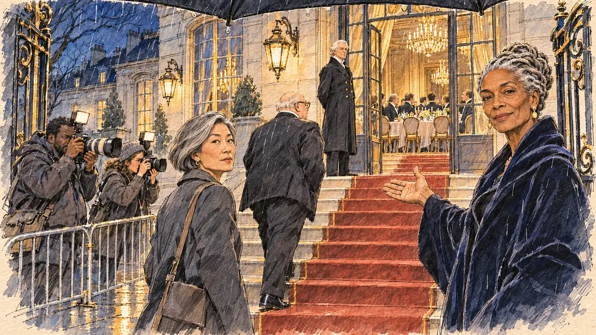

# `powerDinner` · Le dîner du cercle

**Retenue par le PO le 15/11/2026**, au premier essai. Elle sert telle quelle en clair et en sombre.



| Champ | Valeur |
| --- | --- |
| Carte | `powerDinner`, catégorie `support` (Offre de soutien), poids 0,1, toute semaine ; un geste au bord de l'axe du système, côté institutionnel (Mitchnsun/moi-president, PO, 14/11/2026) |
| Style | Reportage dessiné |
| Ton | Ironique en douceur, soirée pluvieuse aux lanternes |
| Date | 2026-11-15 |
| Outil | ChatGPT Images, modèle GPT 6.2, effort Light |
| Conversation | À compléter |
| Format rendu | 1672 × 941 (16:9) : export en 1290 × 726 px, WebP de qualité 75, 257 Ko, sans recadrage, fait depuis la copie WebP de la conversation |
| Fichier d'origine | Image de ChatGPT, chez le PO. L'export du dépôt a été fait depuis la copie partagée dans la conversation avec Claude |
| Première édition | À compléter |

## Texte de la carte

> **Le dîner du cercle**
>
> Un cercle qui réunit chaque mois ministres, grands patrons et directeurs de journaux vous invite à son dîner. Les photographes attendent à la sortie.

## Le moment choisi

L'entrée d'un hôtel particulier du VIIᵉ arrondissement de Paris, un soir de février sous la pluie : grilles dorées, lanternes, un tapis rouge qui monte le perron, et par la porte ouverte les lustres et la table dressée. Le candidat est au pied du tapis, hors champ : seul le bord de son parapluie noir, en haut de l'image. En haut des marches, la présidente du cercle l'invite à monter d'un geste ; une directrice de journal se retourne vers lui ; un convive entre ; le portier attend à la porte ; derrière la barrière, deux photographes mitraillent. Le précédent est le soir du Fouquet's (6 mai 2007) : personne n'y ressemble à un ministre, un patron ou un directeur de journal réel. Le PO a écarté la proposition de montrer le candidat au bras du chef de l'État sortant.

## Prompt complet

Dans une nouvelle conversation, avec [`primeTime.webp`](../../illustrations/media/primeTime.webp) comme seule image de référence :

```
Use the attached image as the style reference and copy its drawing: a realistic reportage drawing made on the spot for a newspaper, with quick, nervous pencil lines, often drawn twice, ink hatching in the shadows, transparent watercolour washes that spill a little over the lines, and the warm paper showing through. Not the same scene and not the same people: never reuse the face or the hair of the woman in the reference.
Like in the reference, the setting can be full when the story needs it, with the things that say where we are and what is happening, but each one is sketched with a few pencil lines and a light wash, never rendered or finished, and the drawing gets looser and paler towards the edges until it fades into the bare paper.
This must look like a drawing made by hand on paper by a press illustrator, halfway between a quick sketch and a realistic picture: never a photograph, a film poster or a digital painting, and never a cartoon, a comic strip, a caricature or a children's book illustration. Continuous lines, never dotted or dashed outlines; no uniform texture, speckles or hatching filter laid over the picture; no glossy highlights, no smooth gradients, in the sky and on the walls too. Colour can be rich in places, on a piece of clothing, a light or a flag, but it stays transparent and within the palette below. The fade into the paper at the edges stays narrow, without a wide white margin. No blur and no depth-of-field effect: everything, the foreground included, is drawn sharp, like a sketch made on the spot.
People are drawn from life with realistic anatomy and proportions, like in the reference: faces shaped with pencil lines, hatching and light washes, a little more finished than the background but never photographic (no photographic skin, no airbrushed or digital-painting look). Expressions stay natural and restrained, even in laughter or tears: no exaggerated grins, no wide-open mouths full of teeth, no rubbery or cartoonish faces.

Editorial illustration, landscape 16:9 (1536 × 864 px), the scene filling the frame, with only a light fade into the paper at the edges. The entrance of an eighteenth-century private mansion in the seventh arrondissement of Paris, on an evening in February 2027 under a fine drizzle, where a circle of ministers, business leaders and newspaper editors holds its monthly dinner: the carriage gate open on a paved courtyard lit by lanterns, a red carpet running down the steps of pale stone, and behind the tall windows, chandeliers and a long laid table. The player's candidate stands at the foot of the red carpet and stays off-camera: in the foreground, only the edge of the candidate's black umbrella at the top of the frame. In the right third, at the top of the steps, the president of the circle, a tall, slim woman in her mid-sixties of Haitian descent with silver locs pinned up, in a dark velvet coat, invites the viewer to come up with a gesture of the hand and an assured smile, her face above mid-height. On the steps: a guest going in, a heavy-set white man in his seventies, bald, with tortoiseshell glasses, in a dinner jacket; a newspaper editor in her fifties of Korean descent with a sleek grey bob, turning back towards the viewer with curiosity. Behind a barrier on the pavement, the photographers: a stocky man of Malian descent with a long lens and a young woman in a beanie, flashes raised. At the door, a tall elderly white doorman with white hair in a frock coat. Only the president of the circle and the newspaper editor look at the viewer. Nothing on the facade, the barrier, the cameras or the windows is readable.

Style: Reportage drawing made on the spot, like a press illustrator or courtroom sketch artist: pencil and ink with loose watercolour washes, lively unfinished lines, white paper showing through.

Palette: navy #13203F, vellum #F5EFE1, gold #A9802A, brick #B5523B, ochre #D9A441, sage #8FA58A, slate #5E7186, sand #DCC8A4, warm grey #8C8279; use 4 to 6 of them, subtle warm paper grain.

Tone: gently ironic, postures slightly exaggerated but never the faces, the golden light of the lanterns and the chandeliers reflected on the wet paving stones, the cold blue of the night, the red carpet as the strong note of the picture.

Constraints: realistic proportions, natural expressions, never cartoonish or caricatured faces, drawn like the rest of the illustration and never photographic; people of varied ages, genders, origins and body types (heavy, stocky, round, tall, short, wiry, not only slim), each with a distinct face and haircut (no two people alike), drawn with respect and never as a joke; each person's age, build and look plausible for their job and the scene (working people of working age), no stereotype tying an origin or a gender to a role, and no person of colour shown alone in a featured service or deferential role; anatomically correct hands with exactly five fingers, few hands visible, the others in pockets, behind objects or out of frame; no readable text anywhere (the facade, the barrier, the cameras and the windows stay unreadable, no plaque, no club name, no street sign); no captions or speech bubbles; no logos, no television channel logo, no political party colours, no flags; no recognisable real person, no lookalike of a real politician, minister, business leader or newspaper editor, no portrait of a real president; no explicit violence; no photographic rendering, no blur or bokeh, every outline a continuous pencil or ink line with no dotted or dashed outlines, no mottled, crackled or speckled texture over the faces, the clothes, the stone or the sky, no hatching filter over the picture, no oil-paint texture, no glow, halo or lens flare around the lanterns or the flashes, no wide white margin or frame (a light fade into the paper at the edges is fine).

Format: if 16:9 is not available, make 1536 × 1024 and keep the top 80 px and the bottom 80 px free of anything important (faces, hands, the main action): they will be cropped.
```

## Décisions prises sur cette image

Retenue telle quelle par le PO (15/11/2026). La bruine est devenue une vraie pluie, qui fait briller le tapis et le trottoir ; le parapluie du candidat ferme le haut de l'image.

## Essais écartés

Aucun.

## Retouches

Aucune.

## Relecture

Faite le 15/11/2026, à confirmer par le PO.

- [x] Aucun texte lisible : rien sur la façade, la barrière, les appareils ni les fenêtres.
- [x] Aucun sosie d'une personne réelle ; aucun portrait de président.
- [x] Le candidat du joueur est hors champ : seul le bord de son parapluie, en haut de l'image.
- [x] Mains et visages sans défaut visible à 343 px de large : la main ouverte de la présidente (cinq doigts), celles des photographes sur leurs appareils.
- [x] Aucune couleur, aucun logo ni aucun drapeau de parti. Des personnes variées par l'âge, le corps, l'origine et la coiffure ; le portier, seul rôle de service, n'est pas une personne racisée.
- [x] En 16:9 : pas de recadrage.
- [ ] Lisible sur la page de l'événement, en clair et en sombre : à vérifier dans l'app, une fois la carte publiée.
