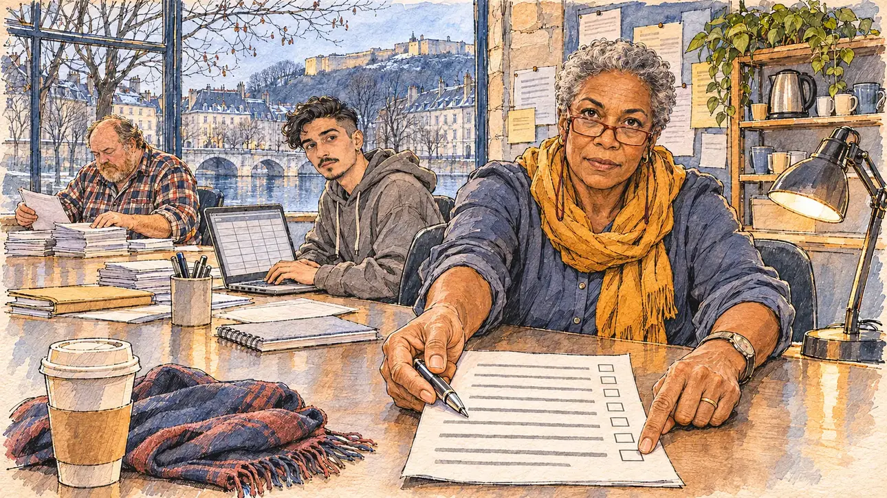

# `remindAssociation` · Le questionnaire d'une association

**Validée par le PO le 27/11/2026**, au premier essai, malgré la texture notée plus bas. Elle sert telle quelle en clair et en sombre.



| Champ | Valeur |
| --- | --- |
| Carte | `remindAssociation`, catégorie `support` (Offre de soutien), carte ajoutée par la PR #561 de l'app (Mitchnsun/moi-president#499) |
| Style | Reportage dessiné ; une texture tissée couvre les vêtements et la table, gardée par le PO |
| Ton | Observateur, avec un peu de pression |
| Date | 2026-11-27 |
| Outil | ChatGPT Images, modèle GPT 6.2 Astra, effort Light |
| Conversation | À remplir (le lien ne s'ouvre qu'avec le compte qui l'a créée) |
| Format rendu | 1672 × 941 (16:9) : export en 1290 × 726 px depuis l'image partagée dans la conversation avec Claude, WebP de qualité 75, 267 Ko, sans recadrage |
| Fichier d'origine | Image de ChatGPT, chez le PO. L'export du dépôt est fait depuis la copie partagée dans la conversation avec Claude |
| Première édition | La prochaine Release qui suit le merge de la PR #561 de l'app |

## Texte de la carte

> **Le questionnaire d'une association**
>
> Une association publie demain les réponses des candidatures à son questionnaire. Il reste une case à remplir : ce que dit votre programme sur un sujet précis.

Les réponses sont trois mesures d'un même thème, tirées pour chaque partie : celle du programme et deux qu'il ne tient pas. L'image ne montre donc ni le thème ni l'association, qui n'a ni nom, ni logo, ni couleur.

## Le moment choisi

Le local d'une association à Besançon, un ancien commerce en rez-de-chaussée dont la vitrine donne sur les façades de pierre gris-bleu de la vieille ville, un après-midi d'hiver : une longue table couverte de piles de feuilles, un ordinateur, une lampe déjà allumée, un panneau de liège. Le candidat est hors champ, assis à la table : au premier plan, seulement un gobelet de café à emporter et une écharpe pliée. La coordinatrice lui tend le questionnaire et un stylo, le doigt sur la dernière case vide ; un jeune bénévole monte le tableau comparatif sur l'ordinateur, un autre trie les feuilles sans lever la tête. Le questionnaire n'est qu'une grille de cases vides. Besançon n'a pas encore servi pour une carte de soutien, et le local change des QG déjà nombreux dans la série.

## Prompt complet

Dans une nouvelle conversation, avec [`primeTime.webp`](../../illustrations/media/primeTime.webp) comme seule image de référence :

```
Use the attached image as the style reference and copy its drawing: a realistic reportage drawing made on the spot for a newspaper, with quick, nervous pencil lines, often drawn twice, ink hatching in the shadows, transparent watercolour washes that spill a little over the lines, and the warm paper showing through. Take from the reference its line, its washes and its paper, not the finish of the presenter's face, which is the most finished and almost photographic part of it: every face here stays a drawing. Not the same scene and not the same people: never reuse the face or the hair of the woman in the reference.
Like in the reference, the setting can be full when the story needs it, with the things that say where we are and what is happening, but each one is sketched with a few pencil lines and a light wash, never rendered or finished, and the drawing gets looser and paler towards the edges until it fades into the bare paper.
This must look like a drawing made by hand on paper by a press illustrator, halfway between a quick sketch and a realistic picture: never a photograph, a film poster or a digital painting, and never a cartoon, a comic strip, a caricature or a children's book illustration. Continuous lines, never dotted or dashed outlines; the paper grain is the paper itself, never a mottled texture, speckles or hatching filter laid over the picture; no glossy highlights, no smooth gradients, in the sky and on the walls too. Colour can be rich in places, on a piece of clothing, a light or a flag, but it stays transparent and within the palette below. The fade into the paper at the edges stays narrow, without a wide white margin. No blur and no depth-of-field effect: everything, the foreground included, is drawn sharp, like a sketch made on the spot.
People are drawn from life with realistic anatomy and proportions: each face is drawn with the same visible pencil and ink lines, hatching and transparent washes as the clothes and the room, looser and sketchier than the presenter's face in the reference, with realistic features but never photographic (no photographic skin, no smooth shading, no airbrushed or digital-painting look). Expressions stay natural and restrained, even in laughter or tears: no exaggerated grins, no wide-open mouths full of teeth, no rubbery or cartoonish faces.

Editorial illustration, landscape 16:9 (1536 × 864 px), the scene filling the frame, with only a light fade into the paper at the edges. A winter afternoon in 2027, in the small premises of a local association in Besançon, a former shop on the ground floor with a tall window onto the grey-blue limestone facades of the old town: a long table covered with printed sheets sorted in piles, a laptop, a desk lamp already on, a kettle and mugs on a shelf, a cork board full of pinned notices. The association publishes tomorrow the answers of every candidate to its questionnaire, and one box is still empty. The player's candidate stays off-camera, the scene seen from their place at the table: in the foreground, only the near edge of the table with a takeaway coffee cup and a folded scarf. In the right third, the main character, the association's coordinator, a woman in her early sixties of Guadeloupean origin, tall and broad-shouldered, with short natural grey hair and red-framed reading glasses on a cord, an ochre scarf over a slate-blue shirt, leans across the table and holds out a printed questionnaire and a pen towards the viewer, one finger on the last empty box, and looks at the viewer, patient but expecting an answer, her face above mid-height. Behind her, a young volunteer in his twenties of Turkish origin, slim, with a dark undercut and a thin moustache, in a grey hoodie, sits at the laptop building a comparison table and glances up at the viewer. At the other end of the table, a heavy-set man in his late fifties with a ginger-grey beard and thinning hair, in a checked flannel shirt, sorts printed sheets into piles and does not look up. Nothing on the questionnaire, the sheets, the laptop, the notices or the window is readable: the questionnaire is only rows of blank boxes and grey lines. No logo, no name and no colours of the association.

Style: Reportage drawing made on the spot, like a press illustrator or courtroom sketch artist: pencil and ink with loose watercolour washes, lively unfinished lines, white paper showing through.

Palette: navy #13203F, vellum #F5EFE1, gold #A9802A, brick #B5523B, ochre #D9A441, sage #8FA58A, slate #5E7186, sand #DCC8A4, warm grey #8C8279; use 4 to 6 of them, subtle warm paper grain.

Tone: observant, with a little pressure, the cold blue light of the winter afternoon in the window and the warm light of the desk lamp on the table.

Constraints: realistic proportions, natural expressions, never cartoonish or caricatured faces, drawn like the rest of the illustration and never photographic; people of varied ages, genders, origins and body types (heavy, stocky, round, tall, short, wiry, not only slim), each with a distinct face and haircut (no two people alike), drawn with respect and never as a joke; each person's age, build and look plausible for their job and the scene (working people of working age), no stereotype tying an origin or a gender to a role, and no person of colour shown alone in a featured service or deferential role; anatomically correct hands with exactly five fingers, few hands visible, the others in pockets, behind objects or out of frame; no readable text anywhere (the questionnaire, the sheets, the laptop and the notices stay unreadable); no captions or speech bubbles; no logos or political party colours; no recognisable real person, no lookalike of a real politician; no explicit violence; no photographic rendering, no blur or bokeh, no dotted outlines, no texture or hatching filter over the picture, no oil-paint texture, no wide white margin or frame (a light fade into the paper at the edges is fine).

Format: if 16:9 is not available, make 1536 × 1024 and keep the top 80 px and the bottom 80 px free of anything important (faces, hands, the main action): they will be cropped.
```

## Décisions prises sur cette image

- Le PO a gardé le premier essai (27/11/2026) sans message de correction, avec la texture tissée posée sur les vêtements, la table et l'écharpe, moins forte que sur [`remindMeeting`](../field/remindMeeting.md).
- La vitrine donne sur le Doubs, le pont de Battant et la Citadelle, que le prompt ne demandait pas : gardés, ils disent Besançon.
- Une plante verte pend de l'étagère, un objet qui ne fait que remplir : gardée, elle est petite.

## Essais écartés

Aucun.

## Retouches

Aucune.

## Relecture

Faite et validée par le PO le 27/11/2026.

- [x] Aucun texte lisible : le questionnaire n'a que des traits gris et des cases vides, l'écran une grille vide, les notes du panneau de liège des lignes.
- [x] Aucun sosie d'une personne réelle. L'association n'est pas reconnaissable.
- [x] Le candidat du joueur est hors champ : seulement son gobelet et son écharpe.
- [x] Mains, visages et foules sans défaut visible à 343 px de large : la main au stylo et celle qui pointe la case ont cinq doigts.
- [x] Aucune couleur ni aucun logo de parti ou d'association. Des personnes variées par l'âge, le corps, l'origine et la coiffure.
- [x] En 3:2 : sans objet, l'image est en 16:9.
- [x] Lisible sur la page de l'événement, en clair et en sombre.
