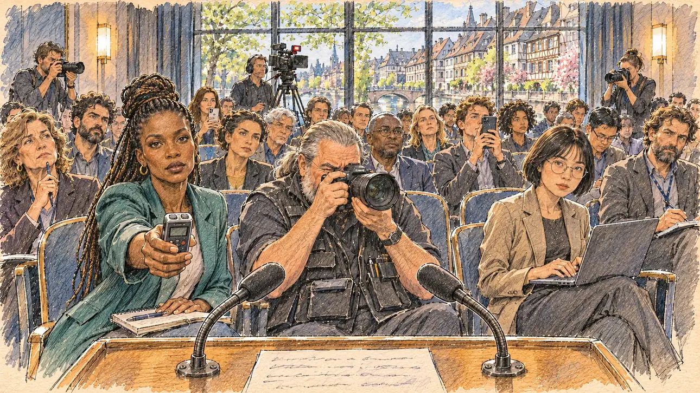

# `rnCallsYou` · Le Rassemblement Hexagonal appelle à voter pour vous

**Proposée au PO le 25/11/2026**, au premier essai, avec `primeTime.webp` comme référence et le prompt mis à jour le même jour sur les visages. Elle sert telle quelle en clair et en sombre.



| Champ | Valeur |
| --- | --- |
| Carte | `rnCallsYou`, catégorie `support` (Offre de soutien), carte ajoutée par la PR #533 de l'app (Mitchnsun/moi-president#204) |
| Style | Reportage dessiné, trait de `primeTime`, visages dessinés |
| Ton | Tendu |
| Date | 2026-11-25 |
| Outil | ChatGPT Images |
| Conversation | À remplir (le lien ne s'ouvre qu'avec le compte qui l'a créée) |
| Format rendu | 1672 × 941 (16:9) : export en 1290 × 726 px, WebP de qualité 75, 291 Ko, sans recadrage |
| Fichier d'origine | Image de ChatGPT, chez le PO. L'export du dépôt a été fait depuis la copie partagée dans la conversation avec Claude |
| Première édition | La prochaine Release qui suit le merge de la PR #533 de l'app |

## Texte de la carte

> **Le Rassemblement Hexagonal appelle à voter pour vous**
>
> Sans candidature à défendre, le Rassemblement Hexagonal appelle son électorat à voter pour vous. Rien ne l'oblige à suivre, mais la presse attend votre réponse.

Réponses : « Accepter le soutien », « Refuser le soutien » (le RN retire sa consigne), « Ne pas répondre », sans jet de dés. La carte n'est jamais tirée au hasard : elle vient la semaine qui suit la consigne du RN, quand il appelle à voter pour le joueur après une inéligibilité tombée après le dépôt des parrainages, ce qu'il ne fait que pour un allié (extrême droite, droite souveraine) à 3 % ou plus du sondage publié.

## Le moment choisi

Une conférence de presse dans un hôtel de Strasbourg, la Petite France derrière la baie vitrée. Le candidat est au pupitre, ses deux micros fixés dessus ; au premier rang, une journaliste de radio tend son enregistreur, un photographe le vise, une jeune journaliste lève les yeux de son ordinateur, et toute la salle attend la réponse.

## Prompt complet

Dans une nouvelle conversation, avec [`primeTime.webp`](../../illustrations/media/primeTime.webp) comme seule image de référence :

```
Use the attached image as the style reference and copy its drawing: a realistic reportage drawing made on the spot for a newspaper, with quick, nervous pencil lines, often drawn twice, ink hatching in the shadows, transparent watercolour washes that spill a little over the lines, and the warm paper showing through. Take from the reference its line, its washes and its paper, not the finish of the presenter's face, which is the most finished and almost photographic part of it: every face here stays a drawing. Not the same scene and not the same people: never reuse the face or the hair of the woman in the reference.
Like in the reference, the setting can be full when the story needs it, with the things that say where we are and what is happening, but each one is sketched with a few pencil lines and a light wash, never rendered or finished, and the drawing gets looser and paler towards the edges until it fades into the bare paper.
This must look like a drawing made by hand on paper by a press illustrator, halfway between a quick sketch and a realistic picture: never a photograph, a film poster or a digital painting, and never a cartoon, a comic strip, a caricature or a children's book illustration. Continuous lines, never dotted or dashed outlines; the paper grain is the paper itself, never a mottled texture, speckles or hatching filter laid over the picture; no glossy highlights, no smooth gradients, in the sky and on the walls too. Colour can be rich in places, on a piece of clothing, a light or a flag, but it stays transparent and within the palette below. The fade into the paper at the edges stays narrow, without a wide white margin. No blur and no depth-of-field effect: everything, the foreground included, is drawn sharp, like a sketch made on the spot.
People are drawn from life with realistic anatomy and proportions: each face is drawn with the same visible pencil and ink lines, hatching and transparent washes as the clothes and the room, looser and sketchier than the presenter's face in the reference, with realistic features but never photographic (no photographic skin, no smooth shading, no airbrushed or digital-painting look). Expressions stay natural and restrained, even in laughter or tears: no exaggerated grins, no wide-open mouths full of teeth, no rubbery or cartoonish faces.

Editorial illustration, landscape 16:9 (1536 × 864 px), the scene filling the frame, with only a light fade into the paper at the edges. A spring morning in 2027, in the conference room of a hotel in Strasbourg, with a tall window looking onto the half-timbered houses and the canal of the Petite France: rows of chairs full of journalists, a few photographers standing on the side, a camera on a tripod at the back. A big party with no candidate of its own has just called its voters to vote for the player's candidate, and the press waits for the answer. The player's candidate stays off-camera, the scene seen from their place behind the lectern: in the foreground, only the top edge of the wooden lectern with two microphones fixed on short goosenecks screwed into it and a sheet of notes lying on it, nothing readable on the notes. In the left third, in the front row, the main character, a radio journalist in her thirties of Congolese origin, tall and slender, with long braids gathered in a high bun, in a teal blazer, holds her own small recorder at arm's length in her hand, and looks at the viewer with a sharp, insistent face, waiting for the answer, her face above mid-height. Beside her, a heavy-set press photographer in his fifties with a grey ponytail and a beard, in a black vest with many pockets, raises his camera to his eye. Two seats away, a young journalist of Chinese origin, short, with a straight black bob and round glasses, types on a laptop on her knees and glances up at the viewer. Behind them, the other journalists, sketched loosely, wait, some with their phones held up. Only the radio journalist and the young journalist look at the viewer. The microphones of the lectern are fixed to it; the recorder is in the journalist's hand; nothing floats. No banners, no flags of a party, no party colours. Nothing on the notes, the laptop, the phones, the camera, the press badges or the walls is readable.

Style: Reportage drawing made on the spot, like a press illustrator or courtroom sketch artist: pencil and ink with loose watercolour washes, lively unfinished lines, white paper showing through.

Palette: navy #13203F, vellum #F5EFE1, gold #A9802A, brick #B5523B, ochre #D9A441, sage #8FA58A, slate #5E7186, sand #DCC8A4, warm grey #8C8279; use 4 to 6 of them, subtle warm paper grain.

Tone: tense, the soft daylight of the window on the half-timbered facades against the hard white light of the room, a whole room holding its breath before the answer.

Constraints: realistic proportions, natural expressions, never cartoonish or caricatured faces, drawn like the rest of the illustration and never photographic; people of varied ages, genders, origins and body types (heavy, stocky, round, tall, short, wiry, not only slim), each with a distinct face and haircut (no two people alike), drawn with respect and never as a joke; each person's age, build and look plausible for their job and the scene (working people of working age), no stereotype tying an origin or a gender to a role, and no person of colour shown alone in a featured service or deferential role; anatomically correct hands with exactly five fingers, few hands visible, the others in pockets, behind objects or out of frame; every object is held by a visible person or rests on a surface, nothing floats in the air and no hand or microphone comes in from the edges of the picture; no readable text anywhere (the notes, the laptop, the phones, the camera, the press badges and the walls stay unreadable, no channel or media logo); no captions or speech bubbles; no logos or political party colours; no recognisable real person, no lookalike of a real politician or of a real journalist, and no politician in the scene; no explicit violence; no photographic rendering, no blur or bokeh, no dotted outlines, no texture or hatching filter over the picture, no oil-paint texture, no wide white margin or frame (a light fade into the paper at the edges is fine).

Format: if 16:9 is not available, make 1536 × 1024 and keep the top 80 px and the bottom 80 px free of anything important (faces, hands, the main action): they will be cropped.

```

## Décisions prises sur cette image

- Le soutien du RN n'apparaît pas à l'image : ni drapeau, ni banderole, ni couleur ; la salle qui attend dit l'enjeu.
- Les micros fixés au pupitre, l'enregistreur dans la main de la journaliste.
- Le prompt ne faisait regarder le spectateur qu'à deux personnes ; la salle entière le regarde, et le PO en a fait une règle du gabarit : dans une scène de meeting ou de presse, la plupart des gens regardent le candidat (PO, 25/11/2026).

## Essais écartés

Aucun.

## Retouches

Aucune.

## Relecture

Faite par Claude le 25/11/2026, à valider par le PO.

- [x] Aucun texte lisible : les notes du pupitre ne portent que des lignes d'écriture illisibles, l'enregistreur et l'ordinateur sont vides.
- [ ] Le boîtier de l'appareil du photographe porte une pseudo-marque proche d'une marque réelle : à juger par le PO.
- [x] Aucun sosie d'une personne réelle, aucun responsable politique dans l'image.
- [x] Le candidat du joueur est hors champ ; le pupitre, ses micros et ses notes sont au premier plan.
- [x] Mains et visages sans défaut visible à 343 px de large : la journaliste tient son enregistreur, cinq doigts ; le photographe tient son appareil.
- [x] Aucune couleur ni aucun logo de parti. Des personnes variées par l'âge, le corps et l'origine (congolaise, chinoise, d'autres dans la salle).
- [x] En 3:2 : sans objet, l'image est en 16:9.
- [x] Lisible sur la page de l'événement, en clair et en sombre : vérifié dans l'app web de la PR #533 (Chromium, 420 px), le kit servi en local, le 25/11/2026.
