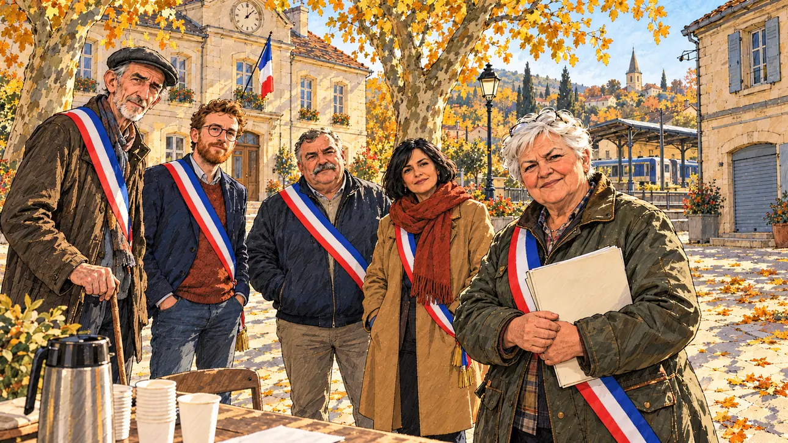

# `ruralMayors` · Les maires ruraux

**Validée par le PO le 31/10/2026**, au premier essai. Elle sert telle quelle en clair et en sombre.



| Champ | Valeur |
| --- | --- |
| Carte | `ruralMayors`, catégorie `support` (Offre de soutien) |
| Style | Reportage dessiné |
| Ton | Chaleureux |
| Date | 2026-10-31 |
| Outil | ChatGPT avec le modèle GPT Sol 6.1 en effort « light », et ChatGPT Images 2.5 |
| Conversation | À remplir (le lien ne s'ouvre qu'avec le compte qui l'a créée) |
| Format rendu | 1672 × 941 (16:9) : export en 1290 × 726 px depuis le PNG d'origine, WebP de qualité 75, 232 Ko, sans recadrage ; réexportée le 01/11/2026, après une première version en qualité 50 pour tenir 180 Ko |
| Fichier d'origine | PNG de ChatGPT, chez le PO, partagé aussi dans la conversation avec Claude |
| Première édition | À remplir |

## Texte de la carte

> **Les maires ruraux**
>
> Un collectif de maires ruraux propose de vous soutenir, à condition de défendre les écoles, les gares et les bureaux de poste.

## Le moment choisi

La place d'un village, un matin d'automne. Cinq maires en écharpe tricolore attendent la réponse du candidat, sans se presser ; leur porte-parole serre le dossier de leurs revendications. Les trois enjeux de la carte sont dans le décor : la mairie-école, la poste aux volets baissés et la petite gare au loin.

## Prompt complet

Dans une nouvelle conversation, avec [`oldTweet.webp`](../../illustrations/polemic/oldTweet.webp) comme seule image de référence. C'est le premier prompt qui demande des visages dessinés comme le reste de l'image (PO, 31/10/2026).

```
Use the attached image as the style reference: the same pencil and ink drawing with loose watercolour washes and warm paper grain. Not the same scene.
Faces are drawn exactly like the clothes and the background: ink outlines, a few hatching strokes and flat watercolour washes for the skin, with the same level of detail as the rest of the drawing. No photographic skin, no realistic shading, no airbrushed or digital-painting look on the faces.

Editorial illustration, landscape 16:9 (1536 × 864 px), filling the whole frame edge to edge. The small square of a French village on a sunny autumn morning in 2027, in front of the old town hall and school building, a pale stone house with a clock and a tricolour flag, no lettering on its front. Across the square, the post office has its shutters down, and in the distance stands a small country railway station. The player's candidate has come to meet a collective of rural mayors and stays off-camera: in the foreground, only the edge of a folding table with a thermos of coffee and paper cups. Facing the viewer, five mayors wearing their tricolour sashes over everyday clothes. In the right third, their spokeswoman, a stocky farmer in her sixties with short white hair and a waxed jacket, holds a thick folder of demands against her chest and looks at the viewer with a frank, demanding smile, her face above mid-height. Around her: a very tall, thin old man with a flat cap and a walking stick, a young mayor with a red beard and round glasses, a round mayor with a grey moustache and a bomber jacket, and a small woman in her forties with a black bob and a long scarf. They all look at the viewer, waiting for an answer, at ease and in no hurry. Nothing on the buildings, the folder or the signs is readable.

Style: Reportage drawing made on the spot, like a press illustrator or courtroom sketch artist: pencil and ink with loose watercolour washes, lively unfinished lines, white paper showing through.

Palette: navy #13203F, vellum #F5EFE1, gold #A9802A, brick #B5523B, ochre #D9A441, sage #8FA58A, slate #5E7186, sand #DCC8A4, warm grey #8C8279; use 4 to 6 of them, subtle warm paper grain, with the blue, white and red of the sashes and the flag as the only saturated colours.

Tone: warm, soft autumn sun, long shadows on the square, golden plane trees.

Constraints: realistic proportions, expressive but not caricatured faces, drawn like the rest of the illustration and never photographic; people of varied ages, genders, origins and body types (heavy, stocky, round, tall, short, wiry, not only slim), each with a distinct face and haircut (no two people alike), drawn with respect and never as a joke; anatomically correct hands with exactly five fingers, few hands visible, the others in pockets, behind objects or out of frame; no readable text anywhere (buildings, signs, folders and labels stay unreadable); no captions or speech bubbles; no logos or political party colours; no recognisable real person, no lookalike of a real politician; no explicit violence; no oil-paint texture, no white or ragged border.

Format: if 16:9 is not available, make 1536 × 1024 and keep the top 80 px and the bottom 80 px free of anything important (faces, hands, the main action): they will be cropped.
```

## Essais écartés

Aucun.

## Retouches

Aucune.

## Relecture

Faite et validée par le PO le 31/10/2026.

- [x] Aucun texte lisible : ni sur la mairie, ni sur le dossier, ni sur les panneaux.
- [x] Aucun sosie d'une personne réelle.
- [x] Le candidat du joueur est hors champ.
- [x] Mains, visages et foules sans défaut visible à 343 px de large.
- [x] Aucune couleur de parti. Les écharpes tricolores et le drapeau de la mairie sont permis. Les maires sont variés par l'âge, le corps et le visage, moins par l'origine, ce que le PO accepte.
- [x] En 3:2 : rien d'important dans les 80 px du haut et du bas. Sans objet ici : l'image est en 16:9.
- [x] Lisible sur la page de l'événement, en clair et en sombre.
