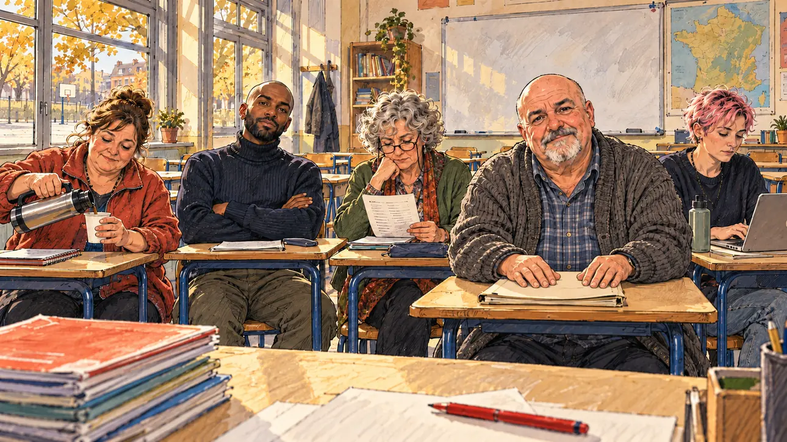

# `teachersUnion` · Un syndicat enseignant

**Validée par le PO le 31/10/2026**, au premier essai. Elle sert telle quelle en clair et en sombre.



| Champ | Valeur |
| --- | --- |
| Carte | `teachersUnion`, catégorie `support` (Offre de soutien) |
| Style | Reportage dessiné ; visages dessinés comme le reste |
| Ton | Chaleureux, avec une pointe d'ironie |
| Date | 2026-10-31 |
| Outil | ChatGPT avec le modèle GPT Sol 6.1 en effort « light », et ChatGPT Images 2.5 |
| Conversation | À remplir (le lien ne s'ouvre qu'avec le compte qui l'a créée) |
| Format rendu | 1672 × 941 (16:9) : export en 1290 × 726 px depuis le PNG d'origine, WebP de qualité 75, 166 Ko, sans recadrage |
| Fichier d'origine | PNG de ChatGPT, chez le PO, partagé aussi dans la conversation avec Claude |
| Première édition | À remplir |

## Texte de la carte

> **Un syndicat enseignant**
>
> Un grand syndicat enseignant envisage de vous soutenir. En échange, il attend des promesses : salaires revalorisés, postes créés.

## Le moment choisi

Une salle de classe de collège après le dernier cours. Le candidat est assis au bureau du professeur, face au syndicat comme à un oral ; les responsables syndicaux sont serrés sur les petites tables des élèves. Le secrétaire général sourit en négociateur, une collègue lit la liste des revendications, une autre sert le café.

## Prompt complet

Dans une nouvelle conversation, avec [`oldTweet.webp`](../../illustrations/polemic/oldTweet.webp) comme seule image de référence :

```
Use the attached image as the style reference: the same pencil and ink drawing with loose watercolour washes and warm paper grain. Not the same scene.
Faces are drawn exactly like the clothes and the background: ink outlines, a few hatching strokes and flat watercolour washes for the skin, with the same level of detail as the rest of the drawing. No photographic skin, no realistic shading, no airbrushed or digital-painting look on the faces.

Editorial illustration, landscape 16:9 (1536 × 864 px), filling the whole frame edge to edge. A secondary-school classroom in France after the last lesson, in 2027, where the leaders of a large teachers' union meet the player's candidate. The candidate sits at the teacher's desk, facing them as if taking an oral exam, and stays off-camera: in the foreground, only the edge of the desk with a red pen and a pile of exercise books. Facing the viewer, the union leaders sit at the pupils' small desks, a little too small for them. In the right third, the general secretary, a heavy-set bald man in his fifties with a grey goatee and a worn cardigan, his hands folded on a folder, looks at the viewer with a patient negotiator's smile, his face above mid-height. Around him: a young teacher with short dyed pink hair and a nose ring types notes on a laptop; an older woman with curly grey hair and reading glasses on a chain reads down a long list; a tall Black teacher in his thirties with a shaved head and a turtleneck, arms crossed, also looks at the viewer; a stocky woman in her forties with a ponytail and a fleece pours coffee from a thermos. Behind them, a whiteboard wiped clean, a map on the wall and the windows on the empty schoolyard. Nothing on the board, the books, the screen or the walls is readable.

Style: Reportage drawing made on the spot, like a press illustrator or courtroom sketch artist: pencil and ink with loose watercolour washes, lively unfinished lines, white paper showing through.

Palette: navy #13203F, vellum #F5EFE1, gold #A9802A, brick #B5523B, ochre #D9A441, sage #8FA58A, slate #5E7186, sand #DCC8A4, warm grey #8C8279; use 4 to 6 of them, subtle warm paper grain.

Tone: warm with a touch of irony, late-afternoon light through the classroom windows, a little chalk dust in the air.

Constraints: realistic proportions, expressive but not caricatured faces, drawn like the rest of the illustration and never photographic; people of varied ages, genders, origins and body types (heavy, stocky, round, tall, short, wiry, not only slim), each with a distinct face and haircut (no two people alike), drawn with respect and never as a joke; anatomically correct hands with exactly five fingers, few hands visible, the others in pockets, behind objects or out of frame; no readable text anywhere (board, books, signs and screens stay unreadable); no captions or speech bubbles; no logos or political party colours; no recognisable real person, no lookalike of a real politician or union leader; no explicit violence; no oil-paint texture, no white or ragged border.

Format: if 16:9 is not available, make 1536 × 1024 and keep the top 80 px and the bottom 80 px free of anything important (faces, hands, the main action): they will be cropped.
```

## Essais écartés

Aucun.

## Retouches

Aucune.

## Relecture

Faite et validée par le PO le 31/10/2026.

- [x] Aucun texte lisible : ni au tableau, ni sur la liste, ni sur la carte, ni sur l'écran.
- [x] Aucun sosie d'une personne réelle.
- [x] Le candidat du joueur est hors champ.
- [x] Mains, visages et foules sans défaut visible à 343 px de large.
- [x] Aucune couleur de parti, aucun symbole officiel. Des personnes variées par l'âge, le corps, l'origine et la coiffure.
- [x] En 3:2 : rien d'important dans les 80 px du haut et du bas. Sans objet ici : l'image est en 16:9.
- [x] Lisible sur la page de l'événement, en clair et en sombre.
