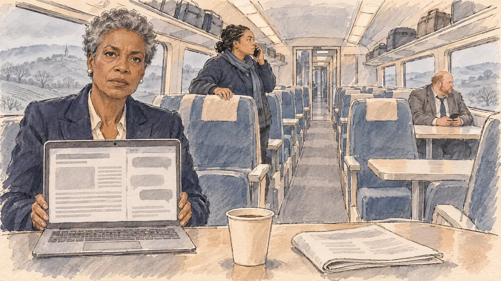

# `aideMessages` · Un collaborateur a tenu des propos répréhensibles

**Validée par le PO le 10/11/2026**, au premier essai. Elle sert telle quelle en clair et en sombre.



| Champ | Valeur |
| --- | --- |
| Carte | `aideMessages`, catégorie `team` (Crise d'équipe), poids 0,2 (0,35 dans les deux premiers du sondage), toute semaine, jamais dans la même partie que [`aideRacism`](aideRacism.md), son pendant raciste |
| Style | Reportage dessiné |
| Ton | Grave et tendu, matin gris |
| Date | 2026-11-10 |
| Outil | ChatGPT Images, à compléter (modèle et effort) |
| Conversation | À compléter |
| Format rendu | 1672 × 941 (16:9) : export en 1290 × 726 px, WebP de qualité 75, 159 Ko, sans recadrage, fait depuis la copie WebP de la conversation (à refaire depuis le PNG d'origine) |
| Fichier d'origine | À compléter (hors du dépôt) |
| Première édition | À compléter |

## Texte de la carte

> **Un collaborateur a tenu des propos répréhensibles**
>
> Un site d'investigation publie des messages antisémites qu'un collaborateur de votre entourage aurait écrits il y a une dizaine d'années. Il nie en être l'auteur et parle de faux ; la presse attend votre réponse.

## Le moment choisi

Une voiture de TGV, un matin gris de février, l'équipe en route vers un déplacement, quelques minutes après la publication : le QG avait déjà servi trois fois. Le candidat reste hors champ, assis à sa table : son gobelet de café et le programme de la journée, au premier plan. En face de lui, la directrice de campagne tourne vers le spectateur son ordinateur ouvert sur l'article, des blocs gris et des bulles de messages illisibles, et le regarde, grave : il faut décider. Au fond, le collaborateur est assis seul, des sièges vides autour de lui, et fixe la vitre, son téléphone à la main ; c'est cette solitude qui raconte l'affaire. Dans l'allée, l'attachée de presse est déjà au téléphone ; par les vitres passent les collines de Bourgogne dans la brume.

## Prompt complet

Dans une nouvelle conversation, avec [`primeTime.webp`](../../illustrations/media/primeTime.webp) comme seule image de référence :

```
Use the attached image as the style reference and copy its drawing: a realistic reportage drawing made on the spot for a newspaper, with quick, nervous pencil lines, often drawn twice, ink hatching in the shadows, transparent watercolour washes that spill a little over the lines, and the warm paper showing through. Not the same scene and not the same people: never reuse the face or the hair of the woman in the reference.
Like in the reference, the setting can be full when the story needs it, with the things that say where we are and what is happening, but each one is sketched with a few pencil lines and a light wash, never rendered or finished, and the drawing gets looser and paler towards the edges until it fades into the bare paper.
This must look like a drawing made by hand on paper by a press illustrator, halfway between a quick sketch and a realistic picture: never a photograph, a film poster or a digital painting, and never a cartoon, a comic strip, a caricature or a children's book illustration. Continuous lines, never dotted or dashed outlines; no uniform texture, speckles or hatching filter laid over the picture; no glossy highlights, no smooth gradients, in the sky and on the walls too. Colour can be rich in places, on a piece of clothing, a light or a flag, but it stays transparent and within the palette below. The fade into the paper at the edges stays narrow, without a wide white margin. No blur and no depth-of-field effect: everything, the foreground included, is drawn sharp, like a sketch made on the spot.
People are drawn from life with realistic anatomy and proportions, like in the reference: faces shaped with pencil lines, hatching and light washes, a little more finished than the background but never photographic (no photographic skin, no airbrushed or digital-painting look). Expressions stay natural and restrained, even in laughter or tears: no exaggerated grins, no wide-open mouths full of teeth, no rubbery or cartoonish faces.

Editorial illustration, landscape 16:9 (1536 × 864 px), the scene filling the frame, with only a light fade into the paper at the edges. The carriage of a French high-speed train on a grey February morning in 2027, the player's campaign team travelling to a campaign visit, a few minutes after an investigative website has published antisemitic messages that one of the candidate's close aides allegedly wrote ten years ago, which he denies: rows of seats, tables between them, luggage racks, and through the wide windows the hills of Burgundy passing in the mist. The player's candidate stays off-camera, sitting at a table: in the foreground, only the candidate's paper cup of coffee and the folded programme of the day on the table. In the left third, the campaign director, a tall Black woman in her fifties with short grey natural hair, small pearl earrings and a dark trouser suit, sitting across the table, turns her open laptop towards the viewer, its screen showing only grey blocks of an article and a few grey message bubbles, all unreadable; she looks at the viewer, grave and steady, we have to decide, her face above mid-height. At the far end of the carriage, alone at a table with empty seats all around him, the aide in question, a heavy-set, balding white man in his forties with a short ginger beard and a crumpled grey suit, holds his phone and stares out of the window, shut in. In the aisle, the press officer, a short, round woman in her thirties of Cape Verdean descent with braids tied back and a quilted jacket, already speaks on her phone, one hand on a seat back. Only the campaign director looks at the viewer. Nothing on the laptop, the phones, the programme, the train or the windows is readable.

Style: Reportage drawing made on the spot, like a press illustrator or courtroom sketch artist: pencil and ink with loose watercolour washes, lively unfinished lines, white paper showing through.

Palette: navy #13203F, vellum #F5EFE1, gold #A9802A, brick #B5523B, ochre #D9A441, sage #8FA58A, slate #5E7186, sand #DCC8A4, warm grey #8C8279; use 4 to 6 of them, subtle warm paper grain.

Tone: grave and tense, cold grey morning light through the windows, the isolation of the man at the end of the carriage, the empty seats around him.

Constraints: realistic proportions, natural expressions, never cartoonish or caricatured faces, drawn like the rest of the illustration and never photographic; people of varied ages, genders, origins and body types (heavy, stocky, round, tall, short, wiry, not only slim), each with a distinct face and haircut (no two people alike), drawn with respect and never as a joke; each person's age, build and look plausible for their job and the scene (working people of working age), no stereotype tying an origin or a gender to a role, and no person of colour shown alone in a featured service or deferential role; anatomically correct hands with exactly five fingers, few hands visible, the others in pockets, behind objects or out of frame; no readable text anywhere (the laptop, the phones, the programme, the train and the windows stay unreadable, no words, no names); no captions or speech bubbles; no symbols of any kind, no religious or hateful symbols, no caricature; no logos, no railway company name or logo, no political party colours; no recognisable real person, no lookalike of a real politician; no explicit violence; no photographic rendering, no blur or bokeh, every outline a continuous pencil or ink line with no dotted or dashed outlines, no mottled, crackled or speckled texture over the faces, the clothes or the seats, no hatching filter over the picture, no oil-paint texture, no glow or halo around the screens, no wide white margin or frame (a light fade into the paper at the edges is fine).

Format: if 16:9 is not available, make 1536 × 1024 and keep the top 80 px and the bottom 80 px free of anything important (faces, hands, the main action): they will be cropped.
```

## Décisions prises sur cette image

Validée telle quelle par le PO (10/11/2026).

- **Le collaborateur ne ressemble pas à la personne de l'affaire réelle** : massif, dégarni, la quarantaine, une barbe rousse, rien du jeune homme brun et mince de l'automne 2026. Aucun symbole, aucun message lisible, aucune caricature.
- La voiture est presque vide autour de l'équipe : gardé, les sièges vides disent l'isolement du collaborateur.

## Essais écartés

Aucun.

## Retouches

Aucune.

## Relecture

Faite et validée par le PO le 10/11/2026.

- [x] Aucun texte lisible : l'ordinateur ne montre que des blocs et des bulles grises, le programme que des traits ; aucun nom de compagnie ferroviaire.
- [x] Aucun sosie d'une personne réelle (voir les décisions) ; aucun symbole.
- [x] Le candidat du joueur est hors champ : seuls son gobelet et son programme, au premier plan.
- [x] Mains et visages sans défaut visible à 343 px de large : celles de la directrice sur l'ordinateur, la main de l'attachée de presse sur le dossier du siège, le téléphone du collaborateur.
- [x] Aucune couleur ni aucun logo de parti. Des personnes variées par l'âge, le corps, l'origine et la coiffure.
- [x] En 16:9 : pas de recadrage.
- [ ] Lisible sur la page de l'événement, en clair et en sombre : à vérifier dans l'app, une fois la carte publiée.
