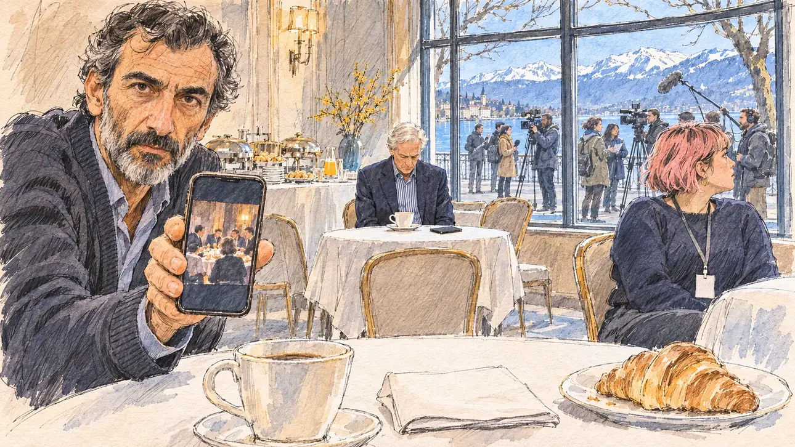

# `aideRacism` · Un collaborateur a tenu des propos racistes

**Validée par le PO le 10/11/2026**, au premier essai. Elle sert telle quelle en clair et en sombre.



| Champ | Valeur |
| --- | --- |
| Carte | `aideRacism`, catégorie `team` (Crise d'équipe), poids 0,2 (0,35 dans les deux premiers du sondage), toute semaine, jamais dans la même partie que [`aideMessages`](aideMessages.md), dont elle est le pendant raciste |
| Style | Reportage dessiné |
| Ton | Tendu et feutré, matin lumineux |
| Date | 2026-11-10 |
| Outil | ChatGPT Images, à compléter (modèle et effort) |
| Conversation | À compléter |
| Format rendu | 1672 × 941 (16:9) : export en 1290 × 726 px, WebP de qualité 75, 221 Ko, sans recadrage, fait depuis la copie WebP de la conversation (à refaire depuis le PNG d'origine) |
| Fichier d'origine | À compléter (hors du dépôt) |
| Première édition | À compléter |

## Texte de la carte

> **Un collaborateur a tenu des propos racistes**
>
> Une vidéo tournée lors d'un dîner privé montre un collaborateur de votre entourage tenir des propos racistes. Il parle d'une plaisanterie sortie de son contexte et s'excuse du bout des lèvres ; la presse attend votre réponse.

## Le moment choisi

La salle du petit-déjeuner d'un hôtel d'Annecy, un matin froid et lumineux de mars, pendant un déplacement de campagne : par la baie vitrée, le lac et les montagnes enneigées ; sur le trottoir, les journalistes attendent avec caméras et perche. Le candidat reste hors champ, à la table de l'équipe : sa tasse de café, un croissant et ses notes, au premier plan. Le directeur de la communication lui tend son téléphone, une image figée de la vidéo du dîner, sans visage reconnaissable, et regarde le spectateur : ils attendent dehors. Seul à une petite table près du buffet, le collaborateur baisse la tête sur un café auquel il n'a pas touché, son téléphone retourné ; une jeune bénévole regarde les caméras par la vitre. Le racisme reste vague, comme sur la carte : personne n'est désigné comme la cible des propos. [`aideMessages`](aideMessages.md), son pendant, se passe dans un TGV ; Annecy n'avait encore servi à aucune carte.

## Prompt complet

Dans une nouvelle conversation, avec [`primeTime.webp`](../../illustrations/media/primeTime.webp) comme seule image de référence :

```
Use the attached image as the style reference and copy its drawing: a realistic reportage drawing made on the spot for a newspaper, with quick, nervous pencil lines, often drawn twice, ink hatching in the shadows, transparent watercolour washes that spill a little over the lines, and the warm paper showing through. Not the same scene and not the same people: never reuse the face or the hair of the woman in the reference.
Like in the reference, the setting can be full when the story needs it, with the things that say where we are and what is happening, but each one is sketched with a few pencil lines and a light wash, never rendered or finished, and the drawing gets looser and paler towards the edges until it fades into the bare paper.
This must look like a drawing made by hand on paper by a press illustrator, halfway between a quick sketch and a realistic picture: never a photograph, a film poster or a digital painting, and never a cartoon, a comic strip, a caricature or a children's book illustration. Continuous lines, never dotted or dashed outlines; no uniform texture, speckles or hatching filter laid over the picture; no glossy highlights, no smooth gradients, in the sky and on the walls too. Colour can be rich in places, on a piece of clothing, a light or a flag, but it stays transparent and within the palette below. The fade into the paper at the edges stays narrow, without a wide white margin. No blur and no depth-of-field effect: everything, the foreground included, is drawn sharp, like a sketch made on the spot.
People are drawn from life with realistic anatomy and proportions, like in the reference: faces shaped with pencil lines, hatching and light washes, a little more finished than the background but never photographic (no photographic skin, no airbrushed or digital-painting look). Expressions stay natural and restrained, even in laughter or tears: no exaggerated grins, no wide-open mouths full of teeth, no rubbery or cartoonish faces.

Editorial illustration, landscape 16:9 (1536 × 864 px), the scene filling the frame, with only a light fade into the paper at the edges. The breakfast room of a hotel in Annecy, in the Alps, on a cold, bright morning in March 2027, during a campaign trip, the morning after a video filmed at a private dinner showed one of the candidate's close aides making racist remarks: small tables with white cloths, a buffet, and through a large bay window the lake and the snowy mountains in the morning light; on the pavement outside the window, a group of journalists waits with cameras, microphones and a boom pole. The player's candidate stays off-camera, sitting at the team's table: in the foreground, only the candidate's cup of coffee, a croissant on a plate and the folded notes of the day. In the left third, the campaign's head of communications, a tall, wiry man in his fifties of Armenian descent with a salt-and-pepper beard and a cardigan over his shirt, leans towards the viewer and holds out his phone, its screen showing only a frozen frame of a few small sketched figures around a dinner table, no recognisable face; he looks at the viewer, tense and low-voiced, they are waiting outside, his face above mid-height. Alone at a small table by the buffet, the aide in question, a slim white man in his sixties with neat white hair, a navy blazer and a striped shirt, sits with his head bowed over an untouched coffee, his phone face down. At the team's table, a young volunteer in her twenties, short and round, with a pink-dyed bob and a blank lanyard, looks out of the window at the cameras. Only the head of communications looks at the viewer. Nothing on the phones, the notes, the cameras, the windows or the walls is readable.

Style: Reportage drawing made on the spot, like a press illustrator or courtroom sketch artist: pencil and ink with loose watercolour washes, lively unfinished lines, white paper showing through.

Palette: navy #13203F, vellum #F5EFE1, gold #A9802A, brick #B5523B, ochre #D9A441, sage #8FA58A, slate #5E7186, sand #DCC8A4, warm grey #8C8279; use 4 to 6 of them, subtle warm paper grain.

Tone: tense and quiet, the cold bright light of the lake and the mountains against the grave faces of the team, the aide alone as the heart of the picture.

Constraints: realistic proportions, natural expressions, never cartoonish or caricatured faces, drawn like the rest of the illustration and never photographic; people of varied ages, genders, origins and body types (heavy, stocky, round, tall, short, wiry, not only slim), each with a distinct face and haircut (no two people alike), drawn with respect and never as a joke; each person's age, build and look plausible for their job and the scene (working people of working age), no stereotype tying an origin or a gender to a role, and no person of colour shown alone in a featured service or deferential role; nobody in the picture is shown as the target of the remarks; anatomically correct hands with exactly five fingers, few hands visible, the others in pockets, behind objects or out of frame; no readable text anywhere (the phones, the notes, the cameras, the windows and the walls stay unreadable, no words, no names); no captions or speech bubbles; no symbols of any kind, no hateful symbols, no caricature; no logos, no hotel name, no television channel logo, no political party colours; no recognisable real person, no lookalike of a real politician; no explicit violence; no photographic rendering, no blur or bokeh, every outline a continuous pencil or ink line with no dotted or dashed outlines, no mottled, crackled or speckled texture over the faces, the clothes or the walls, no hatching filter over the picture, no oil-paint texture, no glow or halo around the window or the screens, no wide white margin or frame (a light fade into the paper at the edges is fine).

Format: if 16:9 is not available, make 1536 × 1024 and keep the top 80 px and the bottom 80 px free of anything important (faces, hands, the main action): they will be cropped.
```

## Décisions prises sur cette image

Validée telle quelle par le PO (10/11/2026), avec deux points relevés à la relecture :

- le visage du directeur de la communication, plus fini que le reste de l'image, a un profil type (cheveux bouclés grisonnants, barbe poivre et sel) qui peut faire penser à un acteur franco-arménien connu ; ce n'est pas un portrait, et le PO n'y voit personne. Un message de correction (cheveux gris courts, lunettes fines, barbe courte, la main redessinée) a été préparé, pas envoyé ;
- sa main qui tient le téléphone est un peu grosse, les doigts épais : gardée.

## Essais écartés

Aucun.

## Retouches

Aucune.

## Relecture

Faite et validée par le PO le 10/11/2026.

- [x] Aucun texte lisible : le téléphone ne montre qu'une image figée du dîner, sans visage reconnaissable ; rien sur les caméras, les notes ni les murs ; aucun nom d'hôtel.
- [x] Aucun sosie d'une personne réelle (voir les décisions pour le directeur de la communication) ; aucun symbole, personne n'est désigné comme la cible des propos.
- [x] Le candidat du joueur est hors champ : seuls son café, son croissant et ses notes, au premier plan.
- [x] Mains et visages sans défaut gênant à 343 px de large : la main au téléphone (voir les décisions).
- [x] Aucune couleur ni aucun logo de parti. Des personnes variées par l'âge, le corps, l'origine et la coiffure.
- [x] En 16:9 : pas de recadrage.
- [ ] Lisible sur la page de l'événement, en clair et en sombre : à vérifier dans l'app, une fois la carte publiée.
