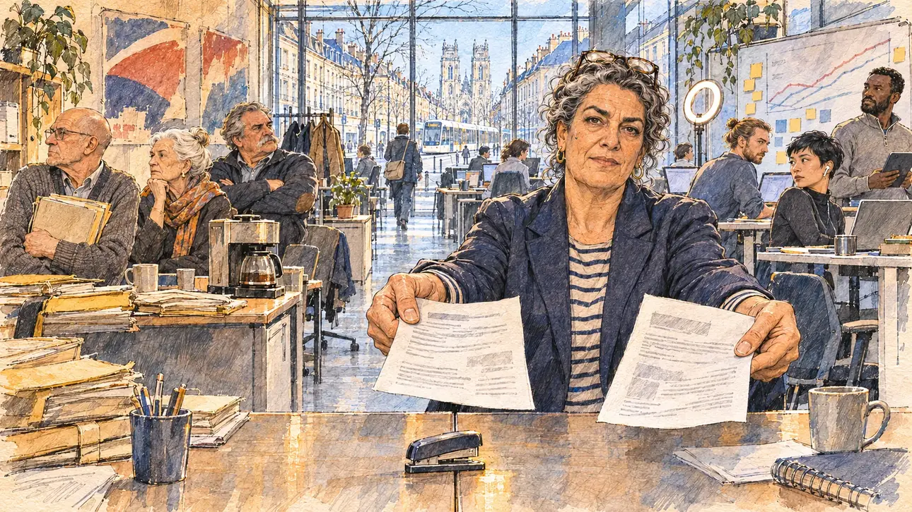

# `clanWar` · Guerre des clans au QG

**Validée par le PO le 05/11/2026**, au premier essai, avec `primeTime.webp` comme référence. Elle sert telle quelle en clair et en sombre.



| Champ | Valeur |
| --- | --- |
| Carte | `clanWar`, catégorie `team` (Crise d'équipe), carte ajoutée par la PR #297 de l'app |
| Style | Reportage dessiné, trait de `primeTime` |
| Ton | Tendu et ironique |
| Date | 2026-11-05 |
| Outil | ChatGPT Images |
| Conversation | À remplir (le lien ne s'ouvre qu'avec le compte qui l'a créée) |
| Format rendu | 1672 × 941 (16:9) : export en 1290 × 726 px, WebP de qualité 75, 247 Ko, sans recadrage |
| Fichier d'origine | Image de ChatGPT, chez le PO. L'export du dépôt a été fait depuis la copie partagée dans la conversation avec Claude |
| Première édition | La prochaine Release qui suit le merge de la PR #297 de l'app |

## Texte de la carte

> **Guerre des clans au QG**
>
> Au QG, les anciens du premier cercle et les recrues arrivées avec les sondages ne se parlent plus. Des documents internes circulent dans les deux camps, et chacun réclame votre arbitrage.

## Le moment choisi

Le grand bureau ouvert du QG de campagne à Orléans, un matin de semaine, vu depuis l'allée centrale où le candidat (hors champ) vient d'entrer : au premier plan, une rangée de bureaux qui coupe la pièce en deux, et une agrafeuse posée sur la ligne de partage. La secrétaire générale de la campagne, au milieu, tend au candidat deux notes internes, une dans chaque main, l'air las : à vous de trancher. À gauche, les anciens du premier cercle, dossiers papier et vieilles affiches de campagnes passées ; à droite, les recrues, ordinateurs portables et courbes de sondages au tableau blanc ; les deux camps se tournent le dos. Par la fenêtre : la rue Jeanne-d'Arc, le tramway, et au bout les tours de la cathédrale Sainte-Croix.

## Prompt complet

Dans une nouvelle conversation, avec [`primeTime.webp`](../../illustrations/media/primeTime.webp) comme seule image de référence.

```
Use the attached image as the style reference and copy its drawing: a realistic reportage drawing made on the spot for a newspaper, with quick, nervous pencil lines, often drawn twice, ink hatching in the shadows, transparent watercolour washes that spill a little over the lines, and the warm paper showing through. Not the same scene and not the same people: never reuse the face or the hair of the woman in the reference.
Like in the reference, the setting can be full when the story needs it, with the things that say where we are and what is happening, but each one is sketched with a few pencil lines and a light wash, never rendered or finished, and the drawing gets looser and paler towards the edges until it fades into the bare paper.
This must look like a drawing made by hand on paper by a press illustrator, halfway between a quick sketch and a realistic picture: never a photograph, a film poster or a digital painting, and never a cartoon, a comic strip, a caricature or a children's book illustration. Continuous lines, never dotted or dashed outlines; no uniform texture, speckles or hatching filter laid over the picture; no glossy highlights, no smooth gradients, in the sky and on the walls too. Colour can be rich in places, on a piece of clothing, a light or a flag, but it stays transparent and within the palette below. The fade into the paper at the edges stays narrow, without a wide white margin. No blur and no depth-of-field effect: everything, the foreground included, is drawn sharp, like a sketch made on the spot.
People are drawn from life with realistic anatomy and proportions, like in the reference: faces shaped with pencil lines, hatching and light washes, a little more finished than the background but never photographic (no photographic skin, no airbrushed or digital-painting look). Expressions stay natural and restrained, even in laughter or tears: no exaggerated grins, no wide-open mouths full of teeth, no rubbery or cartoonish faces.

Editorial illustration, landscape 16:9 (1536 × 864 px), the scene filling the frame, with only a light fade into the paper at the edges. The large open-plan office of the campaign headquarters of the player's candidate in Orléans, on the Loire, on a weekday morning in early 2027: the old guard of the inner circle and the recruits who arrived with the good polls no longer speak to each other, internal documents circulate in both camps, and each side demands the candidate's arbitration. The scene is seen from the central aisle where the candidate has just come in, who stays off-camera: in the foreground, only a row of desks pushed together that cuts the room in two, and a stapler lying right on the dividing line. In the right third, the campaign's secretary general, a woman in her fifties of Tunisian origin, tall and solid, with greying curly hair tied back, glasses pushed up on her head and a navy blazer over a striped shirt, holds out two printed internal memos towards the viewer, one in each hand, with a weary, half-ironic look that says the decision is the candidate's, her face above mid-height. Sketched in pencil and light washes, on the left side of the room, the old guard: a bald man in his sixties in a cardigan clutching a thick paper file, a woman in her seventies with a white bun and a scarf, a stocky man with a grey moustache, arms crossed, around a desk piled with folders and an old coffee machine, under faded posters of past campaigns showing only colours and shapes, with no faces and no words; on the right side, the recruits: a young man with a bun and a laptop, a young woman of Vietnamese origin with a pixie cut and earbuds, a tall consultant of Ivorian origin in a quarter-zip jumper holding a tablet, around standing desks, a whiteboard with rising poll curves and sticky notes, and a ring light; the two camps turn their backs on each other, a few glancing over their shoulders. Through the big window at the end of the room, the rue Jeanne-d'Arc in Orléans, a pale stone street with a tram passing, and at its end the tall twin towers of the Gothic cathedral of Sainte-Croix in the bright winter light. Only the secretary general looks straight at the viewer. Nothing on the memos, the files, the posters, the whiteboard, the screens, the sticky notes or the tram is readable, and no party colour or logo of a real company appears.

Style: Reportage drawing made on the spot, like a press illustrator or courtroom sketch artist: pencil and ink with loose watercolour washes, lively unfinished lines, white paper showing through.

Palette: navy #13203F, vellum #F5EFE1, gold #A9802A, brick #B5523B, ochre #D9A441, sage #8FA58A, slate #5E7186, sand #DCC8A4, warm grey #8C8279; use 4 to 6 of them, subtle warm paper grain.

Tone: tense and ironic, the bright, cold light of a winter morning through the big window, the warm yellowed paper of the old guard's side against the cool blue glow of the recruits' screens.

Constraints: realistic proportions, natural expressions, never cartoonish or caricatured faces, drawn like the rest of the illustration and never photographic; people of varied ages, genders, origins and body types (heavy, stocky, round, tall, short, wiry, not only slim), each with a distinct face and haircut (no two people alike), drawn with respect and never as a joke; anatomically correct hands with exactly five fingers, few hands visible, the others in pockets, behind objects or out of frame; no readable text anywhere (the memos, the files, the posters, the whiteboard, the screens, the sticky notes and the tram stay unreadable); no captions or speech bubbles; no logos or political party colours; no recognisable real person, no lookalike of a real politician, and no logo of a real company; no explicit violence; no photographic rendering, no blur or bokeh, no dotted outlines, no texture or hatching filter over the picture, no oil-paint texture, no wide white margin or frame (a light fade into the paper at the edges is fine).

Format: if 16:9 is not available, make 1536 × 1024 and keep the top 80 px and the bottom 80 px free of anything important (faces, hands, the main action): they will be cropped.
```

## Décisions prises sur cette image

Aucune.

## Essais écartés

Aucun.

## Retouches

Aucune.

## Relecture

Faite et validée par le PO le 05/11/2026.

- [x] Aucun texte lisible : les notes n'ont que des lignes grises, le tableau blanc des courbes et des notes autocollantes vides ; rien n'est lisible sur les dossiers, les écrans ni le tramway.
- [x] Aucun sosie d'une personne réelle.
- [x] Le candidat du joueur est hors champ.
- [x] Mains, visages et foules sans défaut visible à 343 px de large.
- [x] Aucune couleur ni aucun logo de parti. Des personnes variées par l'âge, le corps, l'origine et la coiffure.
- [x] En 3:2 : sans objet, l'image est en 16:9.
- [x] Lisible sur la page de l'événement, en clair et en sombre.

Ce que la relecture a accepté : les vieilles affiches du côté des anciens sont des aplats bleus, blancs et rouges, tricolores et sans forme de logo, signalés au PO ; quelques recrues regardent le candidat par-dessus leur écran.
