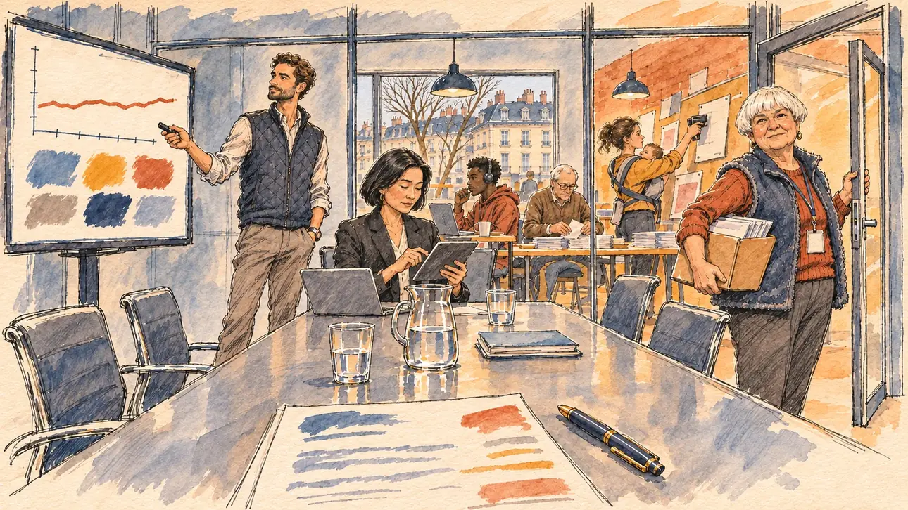

# `costlyConsultants` · Les consultants hors de prix

**Validée par le PO le 10/11/2026**, au premier essai. Elle sert telle quelle en clair et en sombre.



| Champ | Valeur |
| --- | --- |
| Carte | `costlyConsultants`, catégorie `team` (Crise d'équipe), poids 0,2, toute semaine ; un pari gagné sur une faiblesse (les bénévoles aux commandes, sur un réseau faible) |
| Style | Reportage dessiné |
| Ton | Contraste ironique, après-midi d'hiver |
| Date | 2026-11-10 |
| Outil | ChatGPT Images, à compléter (modèle et effort) |
| Conversation | À compléter |
| Format rendu | 1672 × 941 (16:9) : export en 1290 × 726 px, WebP de qualité 75, 195 Ko, sans recadrage, fait depuis la copie WebP de la conversation (à refaire depuis le PNG d'origine) |
| Fichier d'origine | À compléter (hors du dépôt) |
| Première édition | À compléter |

## Texte de la carte

> **Les consultants hors de prix**
>
> Votre agence de communication coûte une fortune et vos sondages internes stagnent. Vos bénévoles, de leur côté, réclament plus de place dans la campagne.

## Le moment choisi

La salle de réunion vitrée du QG de campagne, en terrain neutre, un après-midi de février, pendant la présentation de l'agence. Le candidat reste hors champ, à la table : la facture de l'agence, chiffres illisibles, et son stylo, au premier plan. Côté agence, une courbe plate et une planche de couleurs à l'écran, un consultant en doudoune sans manches qui pointe sa télécommande, sa collègue sur sa tablette. Derrière la vitre, la salle des bénévoles bouillonne : appels au casque, tracts pliés, affiches agrafées. Dans l'encadrement de la porte, la coordinatrice des bénévoles, une retraitée, un carton de tracts sur la hanche, regarde le spectateur, décidée : laissez-nous faire.

## Prompt complet

Dans une nouvelle conversation, avec [`primeTime.webp`](../../illustrations/media/primeTime.webp) comme seule image de référence :

```
Use the attached image as the style reference and copy its drawing: a realistic reportage drawing made on the spot for a newspaper, with quick, nervous pencil lines, often drawn twice, ink hatching in the shadows, transparent watercolour washes that spill a little over the lines, and the warm paper showing through. Not the same scene and not the same people: never reuse the face or the hair of the woman in the reference.
Like in the reference, the setting can be full when the story needs it, with the things that say where we are and what is happening, but each one is sketched with a few pencil lines and a light wash, never rendered or finished, and the drawing gets looser and paler towards the edges until it fades into the bare paper.
This must look like a drawing made by hand on paper by a press illustrator, halfway between a quick sketch and a realistic picture: never a photograph, a film poster or a digital painting, and never a cartoon, a comic strip, a caricature or a children's book illustration. Continuous lines, never dotted or dashed outlines; no uniform texture, speckles or hatching filter laid over the picture; no glossy highlights, no smooth gradients, in the sky and on the walls too. Colour can be rich in places, on a piece of clothing, a light or a flag, but it stays transparent and within the palette below. The fade into the paper at the edges stays narrow, without a wide white margin. No blur and no depth-of-field effect: everything, the foreground included, is drawn sharp, like a sketch made on the spot.
People are drawn from life with realistic anatomy and proportions, like in the reference: faces shaped with pencil lines, hatching and light washes, a little more finished than the background but never photographic (no photographic skin, no airbrushed or digital-painting look). Expressions stay natural and restrained, even in laughter or tears: no exaggerated grins, no wide-open mouths full of teeth, no rubbery or cartoonish faces.

Editorial illustration, landscape 16:9 (1536 × 864 px), the scene filling the frame, with only a light fade into the paper at the edges. The glass-walled meeting room of the player's campaign headquarters in an ordinary French city, on a February afternoon in 2027, during the presentation of the expensive communication agency, while the campaign's internal polls stagnate: a long table, a large screen showing only a flat line on a chart and a moodboard of abstract colour swatches, no words and no numbers. The player's candidate stays off-camera, at the table: in the foreground, only the agency's invoice, its figures unreadable, and the candidate's pen beside it. On the agency's side: a tall, slim consultant in his thirties with a trimmed beard, a sleeveless quilted vest over a shirt and white sneakers, points a clicker at the screen with a confident smile; his colleague, a woman in her forties of Korean descent with a sleek bob and a black blazer, taps on a tablet. Behind the glass wall, the volunteers' room is buzzing: a young student of Malian descent makes calls with a headset, an old man folds leaflets, a mother with a baby in a carrier staples posters to a board. In the right third, standing in the open glass door, the volunteers' coordinator, a short, round retired woman in her sixties with a white bowl cut, a fleece gilet and a blank lanyard, holds a box of leaflets against her hip and looks at the viewer, determined and warm, let us do it, her face above mid-height. Only the coordinator looks at the viewer. Nothing on the screen, the invoice, the tablet, the leaflets, the posters or the walls is readable.

Style: Reportage drawing made on the spot, like a press illustrator or courtroom sketch artist: pencil and ink with loose watercolour washes, lively unfinished lines, white paper showing through.

Palette: navy #13203F, vellum #F5EFE1, gold #A9802A, brick #B5523B, ochre #D9A441, sage #8FA58A, slate #5E7186, sand #DCC8A4, warm grey #8C8279; use 4 to 6 of them, subtle warm paper grain.

Tone: ironic contrast, the cool, slick grey of the agency's room against the warm, busy ochre and brick of the volunteers' room behind the glass, the coordinator in the doorway between the two.

Constraints: realistic proportions, natural expressions, never cartoonish or caricatured faces, drawn like the rest of the illustration and never photographic; people of varied ages, genders, origins and body types (heavy, stocky, round, tall, short, wiry, not only slim), each with a distinct face and haircut (no two people alike), drawn with respect and never as a joke; each person's age, build and look plausible for their job and the scene (working people of working age), no stereotype tying an origin or a gender to a role, and no person of colour shown alone in a featured service or deferential role; no reflection of anyone in the glass walls; anatomically correct hands with exactly five fingers, few hands visible, the others in pockets, behind objects or out of frame; no readable text anywhere (the screen, the invoice, the tablet, the leaflets, the posters and the walls stay unreadable, no figures, no slogans); no captions or speech bubbles; no logos, no agency name, no political party colours; no recognisable real person, no lookalike of a real politician or consultant; no explicit violence; no photographic rendering, no blur or bokeh, every outline a continuous pencil or ink line with no dotted or dashed outlines, no mottled, crackled or speckled texture over the faces, the clothes or the walls, no hatching filter over the picture, no oil-paint texture, no glow or halo around the screen, no wide white margin or frame (a light fade into the paper at the edges is fine).

Format: if 16:9 is not available, make 1536 × 1024 and keep the top 80 px and the bottom 80 px free of anything important (faces, hands, the main action): they will be cropped.
```

## Décisions prises sur cette image

Validée telle quelle par le PO (10/11/2026). La table est brillante et reflète la carafe et les verres, un peu plus lisse que le gabarit : gardé.

## Essais écartés

Aucun.

## Retouches

Aucune.

## Relecture

Faite et validée par le PO le 10/11/2026.

- [x] Aucun texte lisible : la facture n'a que des traits de couleur, l'écran une courbe et des pastilles, sans un chiffre ; aucun nom d'agence.
- [x] Aucun sosie d'une personne réelle.
- [x] Le candidat du joueur est hors champ : seuls la facture et son stylo, au premier plan.
- [x] Mains et visages sans défaut visible à 343 px de large : la télécommande, la tablette, la main sur la porte et celle sous le carton.
- [x] Aucune couleur ni aucun logo de parti. Des personnes variées par l'âge, le corps, l'origine et la coiffure.
- [x] En 16:9 : pas de recadrage.
- [ ] Lisible sur la page de l'événement, en clair et en sombre : à vérifier dans l'app, une fois la carte publiée.
