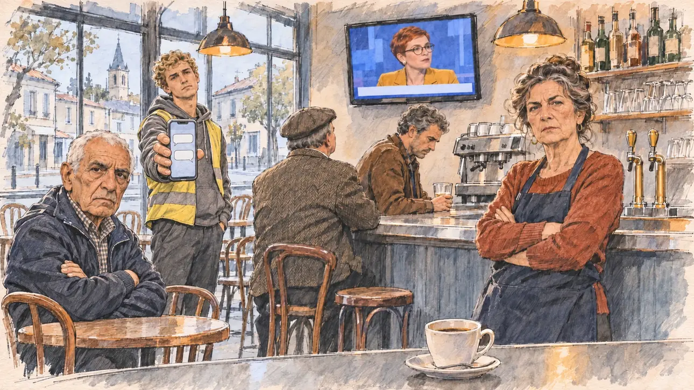

# `leakedChat` · Messages compromettants

**Validée par le PO le 31/10/2026**, au premier essai. Elle sert telle quelle en clair et en sombre.



| Champ | Valeur |
| --- | --- |
| Carte | `leakedChat`, catégorie `team` (Crise d'équipe) |
| Style | Reportage dessiné, rendu plus réaliste : visages presque photographiques, comme [`primeTime`](../media/primeTime.md) |
| Ton | Tendu |
| Date | 2026-10-31 |
| Outil | ChatGPT avec le modèle GPT Sol 6.1 en effort « light », et ChatGPT Images 2.5 |
| Conversation | À remplir (le lien ne s'ouvre qu'avec le compte qui l'a créée) |
| Format rendu | 1672 × 941 (16:9) : export en 1290 × 726 px, WebP de qualité 75, 133 Ko, sans recadrage |
| Fichier d'origine | PNG de ChatGPT, chez le PO. L'export du dépôt a été fait depuis la copie partagée dans la conversation avec Claude |
| Première édition | `kit-france-2611-0001` |

## Texte de la carte

> **Messages compromettants**
>
> Des captures de la messagerie de votre équipe fuitent : vos conseillers s'y moquent sans retenue de vos propres électeurs.

## Le moment choisi

La conséquence chez les électeurs : un café-bar de petite ville, le matin, au moment où le candidat entre pour une visite de campagne. La patronne, bras croisés, le regarde avec un reproche glacial ; un vieux monsieur lui tend son téléphone, la conversation à l'écran ; un jeune ouvrier le toise. Le café sur le zinc reste intact.

## Prompt complet

Dans une nouvelle conversation, avec [`oldTweet.webp`](../../illustrations/polemic/oldTweet.webp) comme seule image de référence :

```
Use the attached image as the style reference: the same pencil and ink drawing with loose watercolour washes and warm paper grain. Faces, hands and objects are drawn with visible ink lines, never photographic. Not the same scene.

Editorial illustration, landscape 16:9 (1536 × 864 px), filling the whole frame edge to edge. A small-town café-bar in France, on a weekday morning in 2027, the day after screenshots of the candidate's team chat leaked: the candidate's advisers mocked their own voters. The player's candidate has just walked in for a campaign visit and stays off-camera: in the foreground, only the edge of the zinc counter with a cup of coffee nobody has touched. In the right third, behind the counter, the owner, a woman in her sixties, arms crossed, looks at the viewer with cold reproach, her face above mid-height. At a table, an old man holds up his smartphone towards the viewer, its screen showing chat bubbles; a young worker in a high-visibility vest looks at the viewer and shakes his head; two regulars at the bar look at each other with raised eyebrows. On the wall, a television shows the morning news. Only the owner, the old man and the young worker look at the viewer. Nothing on the screens, the menus or the walls is readable.

Style: Reportage drawing made on the spot, like a press illustrator or courtroom sketch artist: pencil and ink with loose watercolour washes, lively unfinished lines, white paper showing through.

Palette: navy #13203F, vellum #F5EFE1, gold #A9802A, brick #B5523B, ochre #D9A441, sage #8FA58A, slate #5E7186, sand #DCC8A4, warm grey #8C8279; use 4 to 6 of them, subtle warm paper grain.

Tone: tense, pale morning light through the café windows, warm light over the bar.

Constraints: realistic proportions, expressive but not caricatured faces, people of varied ages, genders and origins; anatomically correct hands with exactly five fingers, few hands visible, the others in pockets, behind objects or out of frame; no readable text anywhere (signs, menus, labels and screens stay blank or unreadable); no captions or speech bubbles; no logos, flags or political party colours; no recognisable real person, no lookalike of a real politician; no explicit violence; no oil-paint texture, no white or ragged border.

Format: if 16:9 is not available, make 1536 × 1024 and keep the top 80 px and the bottom 80 px free of anything important (faces, hands, the main action): they will be cropped.
```

## Essais écartés

Aucun.

## Décisions prises sur cette image

- **Le gilet jaune fluo** de l'ouvrier peut faire penser au mouvement des Gilets jaunes. Le PO garde l'image telle quelle (31/10/2026).

## Retouches

Aucune.

## Relecture

Faite et validée par le PO le 31/10/2026.

- [x] Aucun texte lisible : les bulles du téléphone, les étiquettes des bouteilles et l'enseigne de la rue ne se lisent pas.
- [x] Aucun sosie d'une personne réelle.
- [x] Le candidat du joueur est hors champ.
- [x] Mains, visages et foules sans défaut visible à 343 px de large.
- [x] Aucune couleur de parti, aucun symbole officiel. Des personnes variées. Le gilet jaune est accepté.
- [x] En 3:2 : rien d'important dans les 80 px du haut et du bas. Sans objet ici : l'image est en 16:9.
- [x] Lisible sur la page de l'événement, en clair et en sombre.

## Régénération demandée (04/11/2026)

**Pourquoi.** La revue de la première série note le style à 3/3 et les détails à 2/3 : c'est un autre style, une photo à peine filtrée. Les visages sont photographiques (la patronne, le vieil homme au téléphone, le jeune ouvrier), le zinc et le percolateur ont des reflets brillants, les bouteilles sont rendues comme sur une photo et la salle a de la profondeur, avec presque aucun trait d'encre. Le décor est chargé (étagère de bouteilles, tireuses, percolateur, verres, télévision, tableaux, portemanteau, chaises, deux clients au comptoir, la rue par la vitrine), et la présentatrice de la télévision reprend, en petit, le type de `primeTime` et de `pundit`. Le PO a décidé de régénérer l'image.

**Ce qui reste.** Le café-bar de petite ville le matin, la patronne bras croisés au comptoir (tiers droit) avec son reproche glacial, le vieux monsieur qui tend son téléphone, le jeune ouvrier au gilet jaune (accepté par le PO), un client au comptoir, la télévision au mur avec le journal, et au premier plan le café intact sur le zinc. Les trois personnages qui regardent le candidat sont les mêmes.

**Ce qui change.** Le rendu : le café en quelques traits d'encre, le zinc sans reflets (un lavis gris et quelques lignes), les bouteilles réduites à une étagère esquissée, la rue à peine suggérée. Le décor se limite au zinc, à une table, à la télévision et à une étagère de bouteilles ; un seul client au comptoir au lieu de deux ; plus de tireuses, de percolateur, de tableaux ni de portemanteau. **La présentatrice de la télévision change de visage** pour ne plus rappeler `primeTime` ni `pundit` : une jeune femme de trente ans environ aux cheveux roux cuivré coupés très court (coupe pixie), au visage rond, avec des lunettes rondes en écaille et une veste jaune moutarde, sur un plateau au bandeau vierge. Face à elle, la présentatrice de `primeTime` est une femme d'une quarantaine d'années aux longs cheveux châtains ondulés, en blazer marine.

### Prompt de régénération

Dans une nouvelle conversation, avec [`oldTweet.webp`](../../illustrations/polemic/oldTweet.webp) comme seule image de référence.

```
Use the attached image as the style reference and copy its drawing: quick, nervous pencil lines, often drawn twice, loose ink hatching in the shadows, transparent watercolour washes that spill a little over the lines, and the warm paper showing through everywhere. Not the same scene.
Like in the reference, the setting can be full when the story needs it, with the things that say where we are and what is happening, but each one is sketched with a few pencil lines and a light wash, never rendered or finished, and the drawing gets looser and paler towards the edges until it fades into the bare paper.
This must look like a drawing made by hand on paper, never like a photograph, a film poster or a digital painting: the people are drawn with pencil and ink lines and washes, not modelled; continuous lines, never dotted or dashed outlines; no uniform texture, speckles or hatching filter laid over the picture; no dense colour, no glossy highlights, no smooth gradients, in the sky and on the walls too. The fade into the paper at the edges stays narrow, without a wide white margin. No blur and no depth-of-field effect: everything, the foreground included, is drawn sharp, like a sketch made on the spot.
Faces are drawn exactly like the clothes and the background: ink outlines, a few hatching strokes and flat watercolour washes for the skin, with the same level of detail as the rest of the drawing. No photographic skin, no realistic wrinkles or pores, no airbrushed or digital-painting look on the faces.

Editorial illustration, landscape 16:9 (1536 × 864 px), the scene filling the frame, with only a light fade into the paper at the edges. A small-town café-bar in France, on a weekday morning in 2027, the day after screenshots of the candidate's team chat leaked: the candidate's advisers mocked their own voters. The player's candidate has just walked in for a campaign visit and stays off-camera: in the foreground, only the edge of the zinc counter with a cup of coffee nobody has touched. In the right third, behind the counter, the owner, a woman in her sixties with grey-brown hair pinned up loosely, a tired, firm face with thin lips, a rust-red sweater and a dark blue apron, stands with her arms crossed and looks at the viewer with cold reproach, her face above mid-height. At a small wooden table on the left, an old man in his late seventies, lean, of North African origin, with short white hair and deep-set eyes, in a navy jacket over a checked shirt, holds up his smartphone towards the viewer, its screen showing a few blank chat bubbles, and looks at the viewer with a stern, hurt face. Behind him a young worker in his early twenties, tall, with short curly blond hair, a high-visibility yellow vest over a grey hoodie, his hands in his pockets, looks at the viewer and shakes his head. At the bar, a stocky man in his fifties with a flat cap and a tweed jacket, seen half from behind, looks up at the wall television, which shows a morning news programme with a blank banner: the presenter on it is a woman of about thirty with a very short copper-red pixie cut, a round face, round tortoiseshell glasses and a mustard-yellow jacket. Behind the owner, one shelf with a few bottles. The street seen through the window and the rest of the room are only suggested with a few pencil lines and a light wash, leaving the warm paper bare. Only the owner, the old man and the young worker look at the viewer. Nothing on the screens, the bottles, the shelf or the walls is readable.

Style: Reportage drawing made on the spot, like a press illustrator or courtroom sketch artist: pencil and ink with loose watercolour washes, lively unfinished lines, white paper showing through.

Palette: navy #13203F, vellum #F5EFE1, gold #A9802A, brick #B5523B, ochre #D9A441, sage #8FA58A, slate #5E7186, sand #DCC8A4, warm grey #8C8279; use 4 to 6 of them, subtle warm paper grain.

Tone: tense, pale morning light through the café windows, warm light over the bar.

Constraints: realistic proportions, expressive but not caricatured faces, drawn like the rest of the illustration and never photographic; people of varied ages, genders, origins and body types (heavy, stocky, round, tall, short, wiry, not only slim), each with a distinct face and haircut (no two people alike), drawn with respect and never as a joke; anatomically correct hands with exactly five fingers, few hands visible, the others in pockets, behind objects or out of frame; no readable text anywhere (screens, bottles and walls stay unreadable); no captions or speech bubbles; no logos or political party colours; no recognisable real person, no lookalike of a real politician; no explicit violence; no photographic rendering, no blur or bokeh, no dotted outlines, no texture or hatching filter over the picture, no oil-paint texture, no wide white margin or frame (a light fade into the paper at the edges is fine).

Format: if 16:9 is not available, make 1536 × 1024 and keep the top 80 px and the bottom 80 px free of anything important (faces, hands, the main action): they will be cropped.
```
