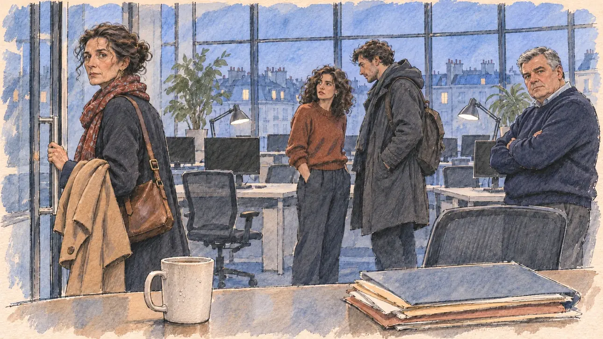

# `managerQuits` · Démission au QG

**Validée par le PO le 31/10/2026**, à l'essai 2. Elle sert telle quelle en clair et en sombre.



| Champ | Valeur |
| --- | --- |
| Carte | `managerQuits`, catégorie `team` (Crise d'équipe) |
| Style | Reportage dessiné |
| Ton | Tendu |
| Date | 2026-10-31 |
| Outil | ChatGPT avec le modèle GPT Sol 6.1 en effort « light », et ChatGPT Images 2.5 |
| Conversation | À remplir (le lien ne s'ouvre qu'avec le compte qui l'a créée) |
| Format rendu | 1672 × 941 (16:9) : export en 1290 × 726 px, WebP de qualité 75, 109 Ko, sans recadrage |
| Fichier d'origine | PNG de ChatGPT, chez le PO. L'export du dépôt a été fait depuis la copie partagée dans la conversation avec Claude |
| Première édition | `kit-france-2611-0001` |

## Texte de la carte

> **Démission au QG**
>
> Votre directrice de campagne claque la porte en pleine semaine, épuisée. Une partie de l'équipe parle de la suivre.

## Le moment choisi

Le QG un soir de semaine, le même grand plateau que pour [`oldTweet`](../polemic/oldTweet.md), vu depuis le bureau du candidat. La directrice, à la porte vitrée, se retourne une dernière fois. Derrière elle, deux membres de l'équipe se parlent, déjà prêts à la suivre, et un autre regarde le candidat, en attente d'une réaction. Le bureau s'est vidé.

## Prompt complet

Dans une nouvelle conversation, avec [`oldTweet.webp`](../../illustrations/polemic/oldTweet.webp) comme seule image de référence :

```
Use the attached image as the style reference: the same pencil and ink drawing with loose watercolour washes and warm paper grain. Faces, hands and objects are drawn with visible ink lines, never photographic. Not the same scene.

Editorial illustration, landscape 16:9 (1536 × 864 px), filling the whole frame edge to edge. The open-plan headquarters of the player's candidate, on a weekday evening in 2027, with tall windows on Paris rooftops at dusk. The scene is seen from the candidate's desk, the candidate staying off-camera: in the foreground, only the edge of the desk with a pile of files and a cold coffee. In the left third, at the glass door, the campaign director, a woman in her fifties, exhausted, her bag on her shoulder and her coat over one arm, turns back one last time and looks at the viewer, her face above mid-height: she is leaving. Behind her, the team has stopped working: two staffers look at her, one has already put on his coat and hesitates, another slowly closes her laptop, and two others turn to the viewer, waiting for a reaction. Nothing on the screens, the papers or the walls is readable.

Style: Reportage drawing made on the spot, like a press illustrator or courtroom sketch artist: pencil and ink with loose watercolour washes, lively unfinished lines, white paper showing through.

Palette: navy #13203F, vellum #F5EFE1, gold #A9802A, brick #B5523B, ochre #D9A441, sage #8FA58A, slate #5E7186, sand #DCC8A4, warm grey #8C8279; use 4 to 6 of them, subtle warm paper grain.

Tone: tense, cold office light against the blue dusk outside, hard shadows.

Constraints: realistic proportions, expressive but not caricatured faces, people of varied ages, genders and origins; anatomically correct hands with exactly five fingers, few hands visible, the others in pockets, behind objects or out of frame; no readable text anywhere (signs, banners, labels and screens stay blank); no captions or speech bubbles; no logos, flags or political party colours; no recognisable real person, no lookalike of a real politician; no explicit violence; no oil-paint texture, no white or ragged border.

Format: if 16:9 is not available, make 1536 × 1024 and keep the top 80 px and the bottom 80 px free of anything important (faces, hands, the main action): they will be cropped.
```

### Message de correction

Envoyé après l'essai 1 :

```
Keep this image exactly, the same people, places and style, but change where people look. The director at the door still looks at the viewer. Of the team, only the grey-haired man on the right and the young woman far right look at the viewer. All the others look at the director as she leaves: the man in the coat turns towards the door, hesitating, and the others watch her go. Keep every hand anatomically correct, with five fingers, and no readable text anywhere.
```

Le générateur a fait mieux que demandé : il a retiré plusieurs personnes, et le couple qui se parle dit « une partie de l'équipe parle de la suivre ».

## Essais écartés

- **Essai 1** (31/10/2026) : toute l'équipe fixait le candidat, comme pour une photo de groupe, et le départ de la directrice ne se lisait plus.

## Retouches

Aucune.

## Relecture

Faite et validée par le PO le 31/10/2026, sur l'essai 2.

- [x] Aucun texte lisible : ni sur les écrans, ni sur les papiers, ni aux murs.
- [x] Aucun sosie d'une personne réelle.
- [x] Le candidat du joueur est hors champ.
- [x] Mains, visages et foules sans défaut visible à 343 px de large.
- [x] Aucune couleur de parti, aucun symbole officiel. Des personnes variées.
- [x] En 3:2 : rien d'important dans les 80 px du haut et du bas. Sans objet ici : l'image est en 16:9.
- [x] Lisible sur la page de l'événement, en clair et en sombre.

## Régénération demandée (04/11/2026)

**Pourquoi.** La revue de la première série note le style à 2/3 et les détails à 2/3 : c'est une peinture numérique sous un filtre de hachures. La ville la nuit est rendue comme une photo (tour Eiffel, dôme doré, lumières), les visages sont peints (la directrice, l'homme au bureau), le bleu nuit est dense et le papier ne se voit nulle part. Le décor est chargé : un plateau entier d'écrans, de chaises, de bureaux, de plantes et de lampes, une baie vitrée sur tout Paris, et au premier plan une pile de dossiers, un mug, un pot à crayons et une lampe. Le PO a décidé de régénérer l'image.

**Ce qui reste.** Le QG un soir de semaine, vu depuis le bureau du candidat (hors champ) : la directrice de campagne à la porte vitrée, sac sur l'épaule et manteau sur le bras, qui se retourne une dernière fois et regarde le candidat ; derrière elle, deux membres de l'équipe qui se parlent, déjà prêts à la suivre, et un homme aux cheveux gris qui regarde le candidat en attendant sa réaction. Au premier plan, la pile de dossiers et le café froid.

**Ce qui change.** Le rendu, par les lignes du gabarit : traits d'encre, lavis clairs et papier nu, et un crépuscule en lavis pâle au lieu du bleu nuit dense. Le plateau est esquissé, comme dans `oldTweet` : quelques bureaux et écrans éteints suggérés d'un trait, une seule lampe, et par la baie quelques toits seulement, sans tour Eiffel ni dôme. Le pot à crayons et les plantes sortent du décor ; la pile de dossiers et le mug restent au premier plan. Quatre personnages au total, comme sur l'image actuelle.

### Prompt de régénération

Dans une nouvelle conversation, avec [`oldTweet.webp`](../../illustrations/polemic/oldTweet.webp) comme seule image de référence.

```
Use the attached image as the style reference and copy its drawing: quick, nervous pencil lines, often drawn twice, loose ink hatching in the shadows, transparent watercolour washes that spill a little over the lines, and the warm paper showing through everywhere. Not the same scene.
Like in the reference, the setting can be full when the story needs it, with the things that say where we are and what is happening, but each one is sketched with a few pencil lines and a light wash, never rendered or finished, and the drawing gets looser and paler towards the edges until it fades into the bare paper.
This must look like a drawing made by hand on paper, never like a photograph, a film poster or a digital painting: the people are drawn with pencil and ink lines and washes, not modelled; continuous lines, never dotted or dashed outlines; no uniform texture, speckles or hatching filter laid over the picture; no dense colour, no glossy highlights, no smooth gradients, in the sky and on the walls too. The fade into the paper at the edges stays narrow, without a wide white margin. No blur and no depth-of-field effect: everything, the foreground included, is drawn sharp, like a sketch made on the spot.
Faces are drawn exactly like the clothes and the background: ink outlines, a few hatching strokes and flat watercolour washes for the skin, with the same level of detail as the rest of the drawing. No photographic skin, no realistic wrinkles or pores, no airbrushed or digital-painting look on the faces.

Editorial illustration, landscape 16:9 (1536 × 864 px), the scene filling the frame, with only a light fade into the paper at the edges. The open-plan headquarters of the player's candidate, on a weekday evening in 2027, seen from the candidate's desk, the candidate staying off-camera: in the foreground, only the edge of the desk with a pile of files and a cold coffee mug. In the left third, at the glass door, the campaign director, a woman in her fifties with wavy brown hair pinned up loosely, a tired, drawn face, a patterned red scarf and a dark coat, a brown leather bag on her shoulder and a camel coat over one arm, turns back one last time and looks at the viewer, her face above mid-height: she is leaving. Behind her, the team has stopped working: a young woman with thick curly brown hair and a rust-coloured sweater and a tall man in a long dark hooded coat talk to each other low, he has already put his coat on and hesitates, both looking at the director, not at the viewer; at the far right, a man in his fifties with short grey hair and a navy sweater looks at the viewer, waiting for a reaction. The office is only suggested: a few dark desks and switched-off monitors in a few pencil lines, one desk lamp, and through the tall window a few Paris rooftops in a pale blue dusk wash. Most of the paper stays bare. Nothing on the monitors, the papers or the walls is readable.

Style: Reportage drawing made on the spot, like a press illustrator or courtroom sketch artist: pencil and ink with loose watercolour washes, lively unfinished lines, white paper showing through.

Palette: navy #13203F, vellum #F5EFE1, gold #A9802A, brick #B5523B, ochre #D9A441, sage #8FA58A, slate #5E7186, sand #DCC8A4, warm grey #8C8279; use 4 to 6 of them, subtle warm paper grain.

Tone: tense, cold office light against a pale blue dusk, soft but cold shadows.

Constraints: realistic proportions, expressive but not caricatured faces, drawn like the rest of the illustration and never photographic; people of varied ages, genders, origins and body types (heavy, stocky, round, tall, short, wiry, not only slim), each with a distinct face and haircut (no two people alike), drawn with respect and never as a joke; anatomically correct hands with exactly five fingers, few hands visible, the others in pockets, behind objects or out of frame; no readable text anywhere (monitors, papers and walls stay unreadable); no captions or speech bubbles; no logos or political party colours; no recognisable real person, no lookalike of a real politician; no explicit violence; no photographic rendering, no blur or bokeh, no dotted outlines, no texture or hatching filter over the picture, no oil-paint texture, no wide white margin or frame (a light fade into the paper at the edges is fine).

Format: if 16:9 is not available, make 1536 × 1024 and keep the top 80 px and the bottom 80 px free of anything important (faces, hands, the main action): they will be cropped.
```
