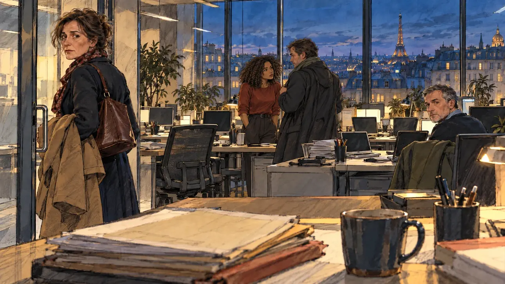

# `managerQuits` · Démission au QG

**Validée par le PO le 31/10/2026**, à l'essai 2. Elle sert telle quelle en clair et en sombre.



| Champ | Valeur |
| --- | --- |
| Carte | `managerQuits`, catégorie `team` (Crise d'équipe) |
| Style | Reportage dessiné |
| Ton | Tendu |
| Date | 2026-10-31 |
| Outil | ChatGPT avec le modèle GPT Sol 6.1 en effort « light », et ChatGPT Images 2.5 |
| Conversation | À remplir (le lien ne s'ouvre qu'avec le compte qui l'a créée) |
| Format rendu | 1672 × 941 (16:9) : export en 1290 × 726 px, WebP de qualité 75, 109 Ko, sans recadrage |
| Fichier d'origine | PNG de ChatGPT, chez le PO. L'export du dépôt a été fait depuis la copie partagée dans la conversation avec Claude |
| Première édition | À remplir |

## Texte de la carte

> **Démission au QG**
>
> Votre directrice de campagne claque la porte en pleine semaine, épuisée. Une partie de l'équipe parle de la suivre.

## Le moment choisi

Le QG un soir de semaine, le même grand plateau que pour [`oldTweet`](../polemic/oldTweet.md), vu depuis le bureau du candidat. La directrice, à la porte vitrée, se retourne une dernière fois. Derrière elle, deux membres de l'équipe se parlent, déjà prêts à la suivre, et un autre regarde le candidat, en attente d'une réaction. Le bureau s'est vidé.

## Prompt complet

Dans une nouvelle conversation, avec [`oldTweet.webp`](../../illustrations/polemic/oldTweet.webp) comme seule image de référence :

```
Use the attached image as the style reference: the same pencil and ink drawing with loose watercolour washes and warm paper grain. Faces, hands and objects are drawn with visible ink lines, never photographic. Not the same scene.

Editorial illustration, landscape 16:9 (1536 × 864 px), filling the whole frame edge to edge. The open-plan headquarters of the player's candidate, on a weekday evening in 2027, with tall windows on Paris rooftops at dusk. The scene is seen from the candidate's desk, the candidate staying off-camera: in the foreground, only the edge of the desk with a pile of files and a cold coffee. In the left third, at the glass door, the campaign director, a woman in her fifties, exhausted, her bag on her shoulder and her coat over one arm, turns back one last time and looks at the viewer, her face above mid-height: she is leaving. Behind her, the team has stopped working: two staffers look at her, one has already put on his coat and hesitates, another slowly closes her laptop, and two others turn to the viewer, waiting for a reaction. Nothing on the screens, the papers or the walls is readable.

Style: Reportage drawing made on the spot, like a press illustrator or courtroom sketch artist: pencil and ink with loose watercolour washes, lively unfinished lines, white paper showing through.

Palette: navy #13203F, vellum #F5EFE1, gold #A9802A, brick #B5523B, ochre #D9A441, sage #8FA58A, slate #5E7186, sand #DCC8A4, warm grey #8C8279; use 4 to 6 of them, subtle warm paper grain.

Tone: tense, cold office light against the blue dusk outside, hard shadows.

Constraints: realistic proportions, expressive but not caricatured faces, people of varied ages, genders and origins; anatomically correct hands with exactly five fingers, few hands visible, the others in pockets, behind objects or out of frame; no readable text anywhere (signs, banners, labels and screens stay blank); no captions or speech bubbles; no logos, flags or political party colours; no recognisable real person, no lookalike of a real politician; no explicit violence; no oil-paint texture, no white or ragged border.

Format: if 16:9 is not available, make 1536 × 1024 and keep the top 80 px and the bottom 80 px free of anything important (faces, hands, the main action): they will be cropped.
```

### Message de correction

Envoyé après l'essai 1 :

```
Keep this image exactly, the same people, places and style, but change where people look. The director at the door still looks at the viewer. Of the team, only the grey-haired man on the right and the young woman far right look at the viewer. All the others look at the director as she leaves: the man in the coat turns towards the door, hesitating, and the others watch her go. Keep every hand anatomically correct, with five fingers, and no readable text anywhere.
```

Le générateur a fait mieux que demandé : il a retiré plusieurs personnes, et le couple qui se parle dit « une partie de l'équipe parle de la suivre ».

## Essais écartés

- **Essai 1** (31/10/2026) : toute l'équipe fixait le candidat, comme pour une photo de groupe, et le départ de la directrice ne se lisait plus.

## Retouches

Aucune.

## Relecture

Faite et validée par le PO le 31/10/2026, sur l'essai 2.

- [x] Aucun texte lisible : ni sur les écrans, ni sur les papiers, ni aux murs.
- [x] Aucun sosie d'une personne réelle.
- [x] Le candidat du joueur est hors champ.
- [x] Mains, visages et foules sans défaut visible à 343 px de large.
- [x] Aucune couleur de parti, aucun symbole officiel. Des personnes variées.
- [x] En 3:2 : rien d'important dans les 80 px du haut et du bas. Sans objet ici : l'image est en 16:9.
- [x] Lisible sur la page de l'événement, en clair et en sombre.
